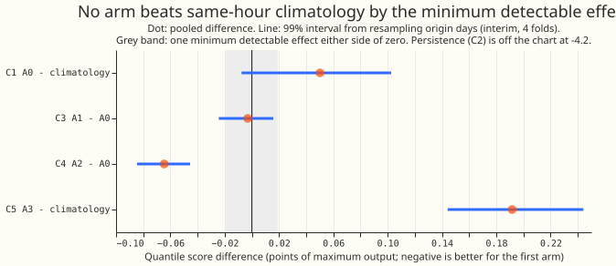
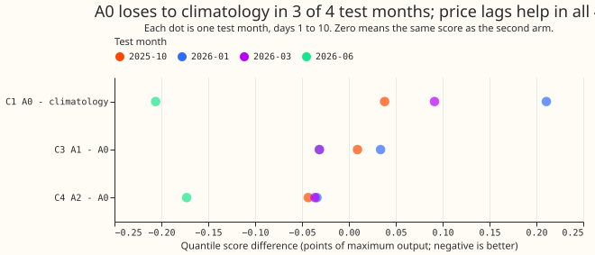
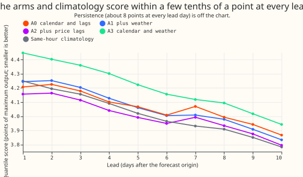

**Generator X's output is not forecastable from calendar, recent output, weather, or lagged price:
the best of four network versions beats the usual output at the same half-hour, weekday type, and
season (climatology) by 0.015 points, below the 0.019-point minimum detectable effect.** One point
is 1% of Generator X's maximum absolute output, measured on the quantile score (twice the mean
pinball loss over 11 quantile levels). The minimum detectable effect is the seed-to-seed spread of
the score. We asked whether a mixture density network, a neural network that outputs a probability
distribution, can forecast Generator X's output (positive for export, negative for import) better
than two plain references: climatology, and persistence (the last output seen before the forecast
was made). We fitted four versions of the network that differ in their inputs, for 4 test months and
3 random seeds each (4 versions x 4 test months x 3 seeds = 48 fits). Each version was scored on
55,533 forecast half-hours (pairs of forecast origin and lead time, up to 10 days ahead). Every
version beats persistence by about 4 points of quantile score. No version beats climatology by more
than the minimum detectable effect, so the stop rule we fixed before fitting fires: stop if no
version beats both references by more than that effect. The result narrows the search to inputs of a
different kind, such as the operator's dispatch schedule.

## Results

**Scores are in points, one point being 1% of Generator X's maximum absolute output; smaller is
better.** The metric is twice the mean pinball loss over 11 quantile levels, averaged over 3 seeds,
for leads up to 240 hours. The setup is four test months (2025-10, 2026-01, 2026-03, 2026-06),
24-month training
windows, monthly refits, and equal rows for every arm. The intervals are interim.

- **Arms.** A0: calendar and the three origin lags. A1: A0 plus ensemble weather mean and spread.
  A2: A0 plus market index price at the three lag times. A3: calendar and weather, no lags.
- **Absolute scores, days 1 to 10.** A0 4.068, A1 4.065, A2 4.004, A3 4.210, climatology 4.018,
  persistence 8.267. In the 12 to 36 hour band: A0 4.229, A2 4.173, climatology 4.232.
- **Noise floor.** The minimum detectable effect is 0.019 points (A0's seed spread). There are 5
  planned
  comparisons (the Bonferroni count), so each interval is widened to the 99% level.
- **C1, A0 minus climatology.** +0.050 (interval -0.008 to +0.103); A0 loses in 3 of the 4 test
  months
  (2026-01 +0.211, 2026-03 +0.091, 2025-10 +0.038, 2026-06 -0.206).
- **C2, A0 minus persistence.** -4.199 (-5.740 to -3.109).
- **C3, A1 minus A0.** -0.003 (-0.024 to +0.016). Weather adds nothing.
- **C4, A2 minus A0.** -0.065 (-0.085 to -0.046), negative in all four months. A2 minus climatology
  (post hoc, not a planned contrast) is -0.015, below the noise floor.
- **C5, A3 minus climatology.** +0.192 (+0.144 to +0.244). Weather and calendar alone lose.
- **Tails, days 1 to 10 (pinball q01 / q05 / q95 / q99).** A0 0.596 / 1.448 / 1.369 / 0.563; A2
  0.583 / 1.437 / 1.312 / 0.508; climatology 0.791 / 1.540 / 1.411 / 0.724. Coverage (share of
  actuals at or below the quantile; nominal 0.01 / 0.05 / 0.95 / 0.99): A0 0.019 / 0.058 / 0.924 /
  0.980; A2 0.018 / 0.063 / 0.942 / 0.983; climatology 0.029 / 0.067 / 0.933 / 0.971. The network
  sharpens both tails and loses in the middle levels.
- **Median error.** Mean absolute error of the median: A0 6.015, A2 5.977, climatology 5.881.
- **Idle and active half-hours** (idle means output under 5% of the maximum; 35,475 of 55,533 rows).
  Score on idle rows: A0 1.105, A2 1.125, climatology 1.218. On active rows: A0 9.310, A2 9.096,
  climatology 8.971.
- **Sign (import versus export).** Brier score of the probability of a negative output: A0 0.2404,
  A2 0.2344, climatology 0.2257. Accuracy: 58.4%, 61.1%, 63.3%. No arm beats the cell frequency.
- **Widening sweep (days 1 to 10).** Multiplying every spread by 1.15 gives A0 4.044, A2 3.984; by
  1.3 gives A0 4.041, A2 3.986. A2 at 1.15 beats climatology by 0.034, but that is a post hoc
  choice of factor.

**Prediction check.** The plan predicted A0 would beat climatology by 3% to 10% at 12 to 36 hours;
A0 scored 0.1% better (-0.004 points), so the prediction failed. The prediction that weather adds
nothing (C3) held at days 1 to 10 only: in the 12 to 36 hour band A1 scores 0.035 worse than A0
(interval +0.001 to +0.077). The prediction that A0 would beat climatology by under 2% beyond 3
days failed: from 3 to 10 days A0 scores 0.071 worse (interval +0.006 to +0.133). The prediction
that A0 beats persistence beyond 6 hours held (C2). The prediction that A3 stays within one minimum
detectable effect of climatology
failed (A3 is 0.19 worse). The prediction that price adds nothing failed (C4). The sign prediction
failed: no arm beat the overall share of negative half-hours in the same calendar group.

## Checks

- **Triggers.** Two audit triggers fired: the quantile-score and median-error contrasts of A0
  against climatology point opposite ways, and the price result (C4) contradicts its prediction. A
  fresh Sonnet audit re-derived the headline scores from the stored forecasts (all reproduced) and
  found: the tail gain explains the median reversal; the price lags leak nothing (newest price lag
  is exactly 3.5 hours before the origin, a completed settlement period); and the first climatology
  fell back to the whole training window for about 29% of rows, which understated it. We replaced
  that climatology with one pooled over three neighbouring months and report the old one only as
  a sensitivity (days 1 to 10: 4.129). The audit also found the weekend flag marked Friday; the flag
was
  fixed and all 48 fits were rerun, so no number from the first runs is quoted.
- **Median minus mean forecast.** The median-error figures are in Results. The mean forecast was
  not scored, because the quantile scores carry the contrast.
- **Cleaning.** The `substation_zero` rule flagged no half-hour of Generator X, so none was dropped;
  exact zeros are kept as readings. The 2026-06 test month loses leads past 2026-07-01 for late-June
  origins, so lead bands are not balanced in that fold.
- **Epoch cap.** A first run capped at 40 epochs stopped 42 of 48 fits early; the cap is 200 and
  no fit reached it.
- **Persistence.** The newest reading was missing for 1,578 rows; they use the climatology median.
  The 12 to 36 hour band and days 1 to 10 are scored; the predicted loss to persistence under 3
  hours was not tested.

## Caveats and next steps

- **No curtailment cost.** No avoidable-curtailment cost is computed, because no economic story is
  agreed. A forecast that uses price lags needs a live price feed that does not exist today.
- **Weather.** The weather is the stored ensemble summary of a Primary within 1 km of the site (a
  Primary substation), so
  the inputs are not the weather grid cell that contains the site.
- **Interim.** Four test months and one series give wide intervals; the score trend with lead in
  figure 3 reflects the mix of test months, and climatology falls with lead as well.
- **Anonymisation.** The example forecasts (a day-ahead and two 10-day forecasts, one winter and
  one summer) stay in the private store, because they plot Generator X's own half-hourly output.
- **Next step.** An input that carries the operator's dispatch, not a different network.

## Files

- **Scripts.** `ml-experiments/00476-generator-x-first-forecast-dispatch-lags-weather-price/` holds
  `e00476_fit.py`, `e00476_score.py`, and `e00476_charts.py`; it reuses code from experiments
  [87](../00087-bg2-best-guess-assembled-with-drop-one-ablations/result.md) and
  [397](../00397-plain-and-attention-mixture-density-network-for-primary-demand/result.md), and
  the lag recipe of experiment 428.
- **Stored forecasts, networks, and tables.** Private, under
  `data/ml-experiments/00476-generator-x-first-forecast-dispatch-lags-weather-price/` (`work/` holds
  the networks and one forecast table per arm, month, and seed).
- **Citations.** The network is the mixture density network of [Bishop
  (1994)](https://publications.aston.ac.uk/id/eprint/373/).
