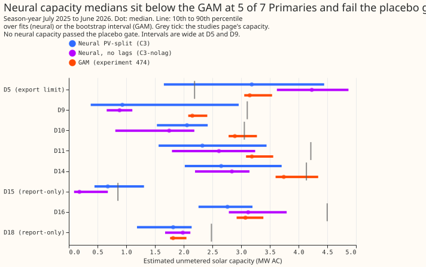
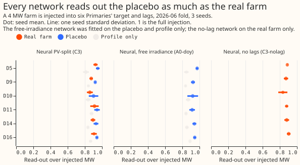
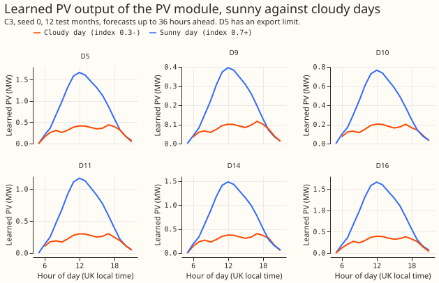

**Take-home: the neural PV module's capacities are unvalidated, and the explicit split changes the
forecast by less than the noise.** The placebo gate failed at all 6 signed-MW Primaries. A 4 MW
injection of a real solar farm was read out at 0.85 to 0.93 of its megawatts, and the placebo (the
same farm's daylight profile with a day-shuffled sky) at 0.91 to 0.97. The network with free
irradiance and no PV module read the placebo out at 0.91 to 0.97 as well. The read-out therefore
measures the profile the network learns from the hour and the day of year, not the sky.

**The forecast result repeats experiment 416.** On sunny middays `C3` minus `A0-doy` is +0.223 CRPS
points (interval -0.137 to +0.556) against a minimum detectable effect of 0.365, and q99 pinball
loss is -0.004. The 0.02 loss limit of the decision rule cannot be tested at an overall minimum
detectable effect of 0.105. Adoption therefore rests on the explanation clause, which needs
capacities that pass the gate. They do not, so the module is not recommended for production on this
evidence.

## Figures

## Results

- **Arms.** Stored from experiment 416, not refitted: `A0-doy` (free irradiance, no PV module),
  `A0-noirr-doy`, `C3` (PV-split), `H1` (explicit term plus free irradiance), `C3p-weak` (weak log
  prior). New: `C3-nolag` (`C3` with the power lags held constant), fitted on the 5 fold months of
  experiment 449, 3 seeds. Base recipe: experiment 397's plain loop with day-of-year inputs and no
  pretraining. Physics as experiment 405 (ensemble-mean and spread of shortwave, tilt 35, DC to AC
  1.15, 0.4% per kelvin). Monthly refits.
- **Rows.** One shared set of half-hours with the stack, BG2, the manual heuristic, and climatology
  (row set `fold_a_daily_gap_v1`); signed-MW six; D15 and D18 report-only and excluded from the
  six; D5 (export limit) and D12 (reverse flow, no PV module) marked. Flagged exact-zero half-hours
  dropped; D15 and D18 cut before 2025-03-01. Neural arms raw (no 1.15 widening); references as
  stored.
- **Gate.** The limit per Primary was written before any `C3` placebo score (D5 0.973, D9 0.924,
  D10 0.921, D11 0.914, D14 0.941, D16 0.944). The first clause passes everywhere because the limit
  is so high; the second clause (real farm above the placebo by 2 seed standard deviations) fails at
  6 of 6: real minus placebo is -0.026 to -0.046. The learned-capacity increment is 0.00 to 0.45 of
  the injected megawatts, and real minus placebo in capacity is +0.06 to +0.15, inside 2 standard
  deviations at 5 of 6.
- **Lags.** `C3-nolag` real-farm capacity increment is 0.17 to 0.43 against 0.17 to 0.43 for `C3`;
  higher at D11 and D14 only. Prediction (3) fails. Cost of removing the lags: +0.249 CRPS points at
  days 1 to 10 (interval +0.113 to +0.422), +0.139 on sunny middays (interval +0.006 to +0.210).
- **Capacity.** Neural medians (season-year 2025) against the GAM: D5 3.19 against 3.15 MW, D9 0.93
  against 2.15, D10 2.06 against 2.89, D11 2.33 against 3.19, D14 2.65 against 3.74, D16 2.76
  against 3.08, D18 1.82 against 1.82. D15 has no GAM estimate. See the
  [experiment 474 page](../00474-pv-capacity-placebo-gated-ladder-and-per-primary-
  intervals/result.md).

## Pros and cons of explicit PV for net demand

12 months, signed-MW six, CRPS in points of effective capacity (absolute scores), days 1 to 10
unless
stated. Bonferroni count: 6 tests (3 contrasts, 2 metrics), level 99.17%.

| Slice | `A0-doy` | `A0-noirr-doy` | `C3` | `H1` | Stack | BG2 | Manual heuristic | Climatology |
|---|---|---|---|---|---|---|---|---|
| Overall | 2.961 | 3.002 | 2.985 | 2.961 | 2.949 | 3.016 | 3.606 | 3.832 |
| Sunny middays | 4.263 | 4.366 | 4.486 | 4.490 | 4.888 | 4.497 | 5.600 | 5.693 |
| All daylight | 3.730 | 3.833 | 3.783 | 3.745 | 3.861 | 3.893 | 4.550 | 4.674 |
| Cloudy daylight | 4.705 | 4.916 | 4.668 | 4.569 | 4.194 | 4.863 | 5.617 | 5.769 |
| 12 to 36 hours | 2.652 | 2.719 | 2.687 | 2.659 | 2.416 | 2.594 | 3.603 | 3.852 |
| Cold winter nights | 4.688 | 4.616 | 4.631 | 4.714 | 4.180 | 4.553 | 6.280 | 6.570 |

- **Where explicit PV helps.** The PV module narrows the upper tail: q99 pinball loss on sunny
  middays is 0.310 for `C3` against 0.314 for `A0-doy` and 0.320 for `A0-noirr-doy`, and over days 1
  to 10 it is 0.285 against 0.306 and 0.309; q99 coverage is 0.966 against 0.960. It scores
  better than the network with no irradiance on cloudy daylight (-0.248, interval -0.479 to
  -0.029). It gives a PV profile that can be plotted by sky condition (third figure).
- **Where it costs.** On sunny middays `C3` is +0.223 CRPS points worse than `A0-doy` (not
  significant). The capacity is not identified (gate). The module needs a capacity table per Primary
  (refreshed at each monthly refit) and a physics chain on ensemble irradiance and temperature at
  forecast time. Removing the lags, the cheapest way to force the PV module to carry the sky, hurts
  the forecast.
- **Minimum detectable effect, first.** Sunny middays 0.365 (12 months), 0.275 (5 fold months);
  overall 0.105 and 0.126. None of the `C3` contrasts exceeds its minimum detectable effect.
- **Fold months (5 months, 3 seeds for `C3-nolag`).** `C3` minus `A0-doy` sunny middays +0.193
  (-0.295 to +0.645); overall -0.019. `C3-nolag` minus `C3` overall +0.249.
- **Tails and cost.** On the 12 months q99 coverage on sunny middays is 0.996 (`C3`), and cold
  winter
  nights q99 pinball loss is 0.96 for `C3` against 1.09 for `A0-doy` (stack 0.83). Christmas week
  (report-only, 20,736 rows): CRPS 4.32 `C3`, 4.50 `A0-doy`, 3.71 BG2. Avoidable-curtailment cost,
  energy-proxy, sum over the six Primaries and the scored months, GBP million at limit fractions
  0.9,
  0.75, 0.5: `C3` 9.55, 28.23, 80.81; `A0-doy` 9.49, 28.61, 82.06; stack 4.24, 16.62, 59.80; manual
  heuristic 10.41, 37.43, 104.84. D14 and D16 dominate the totals.

## Checks

- **Reviews.** A fresh Sonnet agent reviewed the injection and fit code before the first fit and
  found no bugs; three small fixes were applied (saved lead and validation flag, an assertion on the
  six lag columns, the read-out restricted to the signed six). Reviews of the results and of this
  page are recorded in the pull request.
- **Not computed.** Median minus mean forecast per site and the mean-forecast error beside each
  quantile-score contrast were not computed; this experiment re-scores stored forecasts.
- **Caveats.** The read-out uses rows inside the fold's own training window (in sample), so it
  measures attribution, not skill. Injected megawatts are in units of the farm's 99th-percentile
  output. NGED's event labels are incomplete: rows with no labelled event may still hold unlabelled
  events. The equivalent capacity is a least-squares read-out on the ensemble unit shape. The
  `C3-nolag` fits used 3 seeds; the stored arms use 5.

## What to try next

- **Inject the anomaly only.** An injection whose daylight profile is removed (experiment 409's
  anomaly variant) at 4 MW or more tests the sky read-out without the profile that any network
  absorbs.
- **Use the GAM capacity as the PV module's capacity** (pinned, as `C1` of experiment 405) and judge
  the neural module on the forecast only.

## Plan (written before any fit)

## What is asked

**The question is whether the PV module of the net demand neural network reads the sky well enough
to give a capacity per Primary worth plotting, and whether the explicit split helps or hurts the
net demand forecast.** The brief (`unmetered_pv_neural_module_brief.md`, with its edits of
2026-11-01) asked for 75 refits. The queue-order check found four of the five score arms already
stored by experiment 416, so this experiment reuses them and fits only what is new.

## Review of the plan against the latest evidence

- **Reused, not refitted:** `A0-doy` (A-free), `A0-noirr-doy` (No-irr), `C3` (PV-split),
  `C3p-weak` (weak prior), and `H1` (explicit term plus free irradiance), from experiment 416's
  `work/seed_preds/`, 12 months, 5 seeds, with the `*.capacity.json` files.
- **Base recipe:** experiment 397's plain loop (`e00397_prep`, `e00405_{prep,models,pv,fit}`,
  `e00409_*`, `e00416_*`), day-of-year inputs, no pretraining. Experiment 425's arm A (pretrained)
  is a reference row only.
- **Physics as in experiment 405:** irradiance is the ensemble mean and spread of shortwave in
  training and forecasting alike; CAMS defines the sunny flag at scoring only. Tilt 35 degrees, DC
  to
  AC ratio 1.15, 0.4% per kelvin. The brief's 1.25 ratio and its 1.1 and 1.5 sensitivity are
  dropped, because they break the reuse of every stored `C3` fit.
- **Scope:** the six signed-MW Primaries (D5, D9, D10, D11, D14, D16), with D15 and D18 report-only.
  D5 (export limit), D12 (reverse flow, no PV module), D15 and D18 are marked in every table. The
  MVA-only Primaries are covered by experiment 474's GAM-side table.
- **Standing rules followed:** cleaned data, the D15 and D18 cut at 2025-03-01, monthly refits,
  saved networks, the tails, the seven-step process, draft pull request.

## New work (about 50 fits, one GPU process under 8 GB, one feeder core)

1. **Placebo and injection (runs first, gates the capacity plots).** On the 2026-06 fold, 3 seeds,
   inject a metered solar farm's output (Solar A and Solar C of the six; named only by letter) into
   all six signed-MW Primaries, with the lags injected as in experiment 405. Conditions: control
   (no injection); held farm at 2 MW and 4 MW for both farms; placebo (the farm's monthly daylight
   profile plus its day-to-day anomaly shuffled within the calendar month, 4 MW); profile only (the
   farm's monthly daylight profile, 4 MW). `C3` takes all of them (7 conditions, 21 fits).
   `A0-doy` takes control, placebo, and profile only (9 fits) to calibrate the gate.
2. **One new arm: `C3-nolag`.** `C3` with the three power-lag values and their missing flags held
   constant in training and at inference. It is fitted on the five fold months of experiment 449
   (3 seeds, 15 fits) and on control and the 4 MW held farm in the 2026-06 fold (6 fits).
3. **Re-scoring on CPU:** the stored arms plus `C3-nolag` on the 12 months and on the five fold
   months of experiment 449, from stored forecasts.
4. **Plots:** capacity per Primary with the prior and the 10th to 90th percentile over seeds, beside
   experiment 474's GAM estimates; implied PV on a sunny and a cloudy day; PV share of net demand by
   hour; recovery against injected MW.

## Pre-registered rules

1. **Recovery** is the seed-mean learned capacity increment (injected minus control, last
   season-year cell) divided by the injected MW, per Primary. The least-squares read-out of
   experiment 409 (`dC_LS`) is reported beside it.
2. **The gate limit** is the equivalent capacity that `A0-doy` shows on the profile-only injection:
   the least-squares regression of the change in its median forecast between control and the
   injection on the ensemble unit shape, over daylight rows of the 2026-06 test month, divided by
   the injected MW. The limit is the larger of the profile-only equivalent and the placebo
   equivalent, seed-averaged, per Primary. **The number is committed to this page, in a separate
   commit, before any PV-split placebo score is read.**
3. **The gate passes at a Primary** when `C3`'s placebo recovery is at most that Primary's limit
   plus 0.20, and the held-farm recovery exceeds the placebo recovery by more than 2 seed standard
   deviations. A failed gate marks the Primary's capacity "unvalidated" in the plots. Scores are
   reported regardless.
4. **Score contrasts** (12 months and the five fold months, signed-MW six, CRPS days 1 to 10 and
   sunny middays): `C3` minus `A0-doy`, `C3` minus `A0-noirr-doy`, `C3-nolag` minus `C3` (fold
   months only). Month-block bootstrap at 95% with 20,000 resamples, Bonferroni across the 3, one
   equal-row intersection (row set `fold_a_daily_gap_v1`), minimum detectable effect first. Sunny
   middays are CAMS clear-sky index at least 0.7, 10:00 to 15:00.
5. **Other scores:** q01, q05, q95, and q99 coverage and pinball loss; the 12 to 36 hour band;
   cold winter nights; Christmas week (report-only); the 1.15 widening; avoidable-curtailment cost
   at f = 0.9, 0.75, and 0.5 for the signed-MW six (`metrics.avoidable_curtailment_cost`); absolute
   scores beside every contrast.
6. **Expected result:** close to experiment 416, which is not new evidence by itself. The 0.02 loss
   limit is untestable at the sunny-midday minimum detectable effect of 0.28 to 0.37 (overall
   0.057).

## Gate limit (written after the `A0-doy` fits and before any `C3` placebo score was read)

**The limit is non-binding: `A0-doy` recovers 0.91 to 0.97 of the injected megawatts from the
placebo, and 0.84 to 0.89 from the profile alone.** The free-irradiance network absorbs the farm's
monthly daylight profile through its hour and day-of-year inputs, and the profile is most of the
injected signal. Limits per Primary (placebo recovery, the larger of the two): D5 0.973, D9 0.924,
D10 0.921, D11 0.914, D14 0.941, D16 0.944. Rule 3 stands as written, so the first clause (`C3`
placebo recovery at most the limit plus 0.20) can only fail above about 1.1, and the discriminating
clause is the second one: the held farm must exceed the placebo by more than 2 seed standard
deviations. The read-out uses rows inside the fold's own training window, so it measures how much of
the injection the fitted network attributes to the sky and the profile, not out-of-sample skill.

## Production cost of the PV term

The PV term needs a capacity table per Primary, refreshed at each monthly refit, and a physics chain
(irradiance and temperature from the ensemble to plane-of-array power) at forecast time. The write-
up
reports this beside the score.
