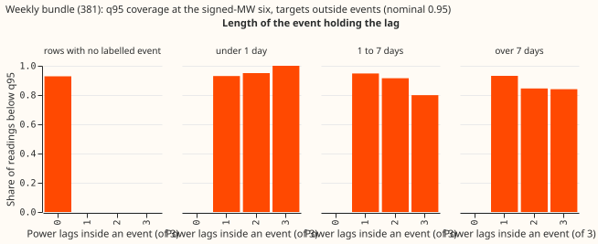
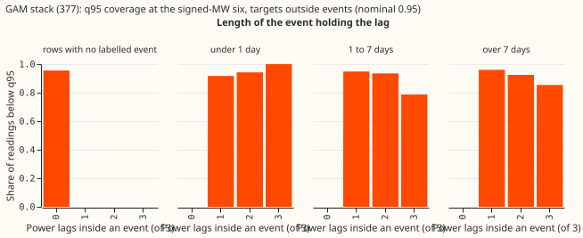
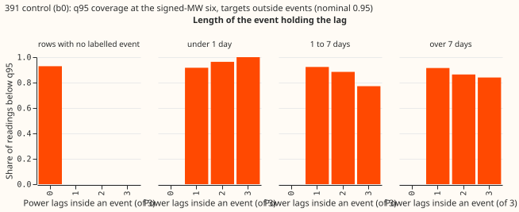
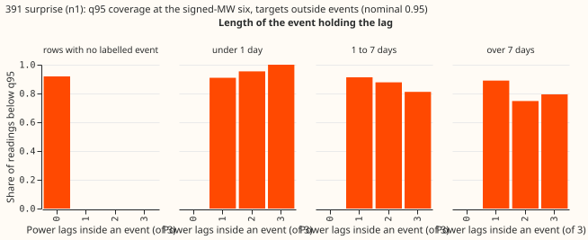

**A power lag inside a labelled load-shift event keeps raising the forecast error for a week after
the event ends.** A power lag is a past power reading that the forecast takes as an input. For the
weekly bundle of experiment 381 (weekly-refitted XGBoost forecasts) at the signed-MW six, targets
0 to 24 hours after the end of the lag's event score 1.66 points of continuous ranked probability
score (CRPS) worse than targets with no lag in an event (95% interval -0.06 to +3.69). Targets 3 to
7 days after score 1.05 worse (+0.04 to +2.36). The GAM stack of experiment 377 (a generalised
additive model with a Kalman filter) is worse by 2.90 and 1.61 at the same two positions. The
surprise arm (`n1`) of experiment 391 does not reduce the harm. Avoidable-curtailment cost, the
pounds of generation curtailed that a perfect forecast would have avoided, cannot separate the
forecasts during events, because it rests on 2 to 11 events per Primary substation.

Part F2 of [experiment 395](../00395-xgboost-level-state-winter-spread-anchor-stored-forecasts/result.md)
re-scores stored forecasts and fits nothing. "Unpadded" means each event runs from its labelled
onset to its labelled end, with no extra 24 hours on either side. "Signed-MW six" means the six
Primaries D5, D9, D10, D11, D14, and D16, whose meters report signed megawatts. NGED's event labels
are incomplete, so a comparison row is a row with no labelled event, which is not the same as a
clean row. Flagged exact-zero half-hours are dropped as in Part F, and
[experiment 398](../00398-load-shift-event-rescore-without-flagged-zero-actuals/result.md) showed
that dropping the flagged half-hours moves no contrast, so nothing needed repeating.

## Figures

Each chart shows q95 coverage (the share of readings below the forecast's 95% quantile; nominal
0.95) by the number of lags inside an event and the length of that event, at the signed-MW six,
for targets outside events.

The charts of the monthly control (`coverage_monthly_control.svg`), experiment 383's `d`, `c1`, and
`c2` (`coverage_w383_*.svg`), and experiment 391's `o` (`coverage_b391_o.svg`) sit in the same
folder.

## Results

All figures use leads of days 1 to 10 for harm and 12 to 36 hours for cost, drop flagged zeros, and
resample whole events (95% intervals). Harm is the CRPS in points of effective capacity minus each
Primary's mean on rows with no lag in an event and a target outside events.

**The harm falls with distance from the event but is still distinguishable from zero 3 to 7 days
after for the bundle and the GAM stack.** Event counts are 30 (0-24 h), 30 (1-3 days), 34 (3-7
days), and 34 (7-21 days).

| Forecast | 0-24 h | 1-3 days | 3-7 days | 7-21 days |
|---|---|---|---|---|
| Weekly bundle | +1.66 (-0.06 to +3.69) | +0.98 (-0.32 to +2.32) | +1.05 (+0.04 to +2.36) | +0.81 (-0.07 to +2.12) |
| Monthly control | +1.41 (-0.12 to +3.63) | +0.59 (-0.31 to +1.65) | +0.58 (-0.07 to +1.61) | +0.27 (-0.13 to +0.95) |
| GAM stack | +2.90 (+0.18 to +5.76) | +1.90 (-0.35 to +4.85) | +1.61 (+0.04 to +3.78) | +1.27 (+0.04 to +3.18) |
| Plain weekly member (383 d) | +1.77 (-0.02 to +3.96) | +0.98 (-0.28 to +2.23) | +0.94 (+0.06 to +2.03) | +0.78 (-0.04 to +1.97) |
| 391 control (b0) | +1.42 (-0.11 to +3.65) | +0.57 (-0.30 to +1.65) | +0.57 (-0.11 to +1.62) | +0.26 (-0.14 to +0.97) |
| 391 surprise (n1) | +1.44 (-0.03 to +3.37) | +0.75 (-0.25 to +1.60) | +0.69 (+0.02 to +1.57) | +0.39 (-0.11 to +1.05) |
| 391 oracle (o) | +1.25 (-0.12 to +3.01) | +0.72 (-0.26 to +1.90) | +0.61 (-0.13 to +1.62) | +0.28 (-0.14 to +0.99) |

**Three lags inside an event do far more harm than one or two (+2.71 against +0.34 and +0.35).**
For the bundle, one lag gives +0.34 (+0.01 to +0.76), two give +0.35 (-0.33 to +1.19), and three
give +2.71 (-0.19 to +5.99). `printed_report.txt` holds the other forecasts.

**The length and depth slices are too thin to rank.** The signed-MW six has 4 events longer than
7 days and 4 events in the third depth quartile, so the report prints no interval for those
slices. The bundle's harm is +0.16 for events of 1 to 7 days (11 events) and +0.46 for events under
1 day (19 events), and neither interval excludes zero. The MVA-only eight are in `printed_report.txt`.

**With Part H's corrected signs, the median follows the labelled depth about as Part H found.**
Part H of experiment 395 corrected the sign of each labelled depth. The share of the depth that the
forecast's median follows, for events with 0 lags, 1 or 2 lags, and 3 lags inside the event:

- Weekly bundle: 0.52, 0.83, and 0.94, as in Part H.
- Experiment 391 control (`b0`): 0.60, 0.85, and 0.90.
- Experiment 391 surprise arm (`n1`): 0.53, 0.86, and 0.92.
- Experiment 391 oracle (`o`): 0.55, 0.85, and 0.91.

**Avoidable-curtailment cost during events does not separate the forecasts.** Cost is the energy
proxy of `metrics.avoidable_curtailment_cost` at limit fraction f = 0.9 (the limit is 90% of the
Primary's largest earlier reading), in pounds. Costs below are per-event means of the difference
from the plain weekly member, with 99.17% pooled intervals (each of six contrasts at a 95%
family-wise level) over 33 events during and 34 events after.

- Bundle during events: -£3,752 (-£17,632 to +£149).
- Bundle in the 7 days after events: -£558 (-£1,330 to -£26), so the bundle costs less than the
  weekly member, not more.
- GAM stack during events: -£117,202 (-£543,668 to +£692).
- GAM stack in the 7 days after: +£4,425 (+£121 to +£12,476).
- Experiment 383's arms, including the plain weekly member, carry the 1.15 widening. The bundle and
  the monthly control do not, and the stack and experiment 391's arms are scored as stored. A
  difference from the member therefore mixes the widening with the forecast skill.

**Across all rows, the GAM stack costs far less than the weekly forecasts at D14 and D16.** At D14
the plain weekly member and the bundle cost £1.14 million and £1.15 million more than the stack,
and at D16 £3.84 million and £3.69 million more. In the 7 days after events the bundle costs £4,983
per event less than the stack (-£13,695 to -£376). D16 has 4 events with scored rows and carries
almost all of the pounds during events, D9 has none, and D11 has 2. Costs at f = 0.75 and 0.5 are in
`printed_report.txt`.

## Predictions

- **P1 (the bundle costs more than the member in the 7 days after events) failed**: -£558
  (-£1,330 to -£26).
- **P2 partly held**: the point estimate is largest at 0 to 24 hours, but at 3 to 7 days the
  interval still excludes zero for the bundle and the stack, and at 7 to 21 days for the stack.
- **P3 failed**: `n1` has the same or higher harm than `b0` at every position.
- **P4 cannot be tested**: the signed-MW six has 4 events longer than 7 days.

## Checks and caveats

- **Coverage of the row sets.** All nine forecasts cover all 2,824,844 half-hour rows of the
  Part F slice table.
- **Reviews.** A fresh Sonnet agent reviewed the code before the first run and found two problems:
  unchecked row coverage, and a target position measured from the wrong event. Both are fixed. Two
  further fresh Sonnet agents checked the numbers against the printed report and reviewed the prose.
- **Event counts.** Labelled events per Primary at the signed-MW six: D5 33, D9 1, D10 12, D11 3,
  D14 13, D16 16. The cost intervals use only events with scored rows: D5 11, D10 7, D11 2, D14 9,
  D16 4.
- **Incomplete labels.** The baseline rows can still hold unlabelled events, so the harm figures are
  lower bounds.
- **Median minus mean.** We did not compute it, because the stored forecasts hold quantiles only.
- **Audit triggers.** P1 and P3 contradicted the hypothesis and the prediction respectively.
- **Options for next steps.** Rescore the cost with the widening matched across forecasts, and add
  events from Primaries with few labels.
