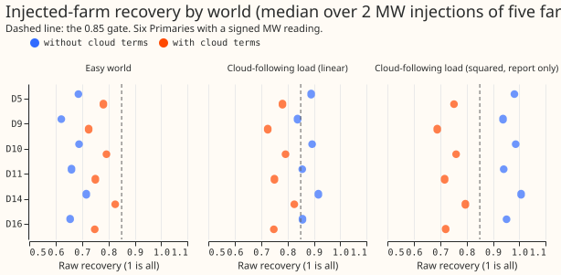
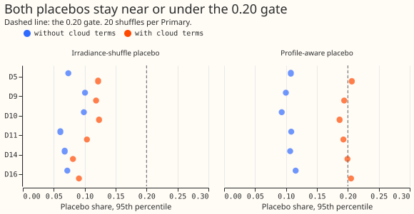
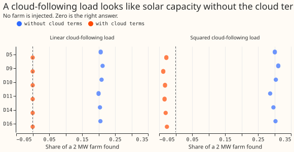
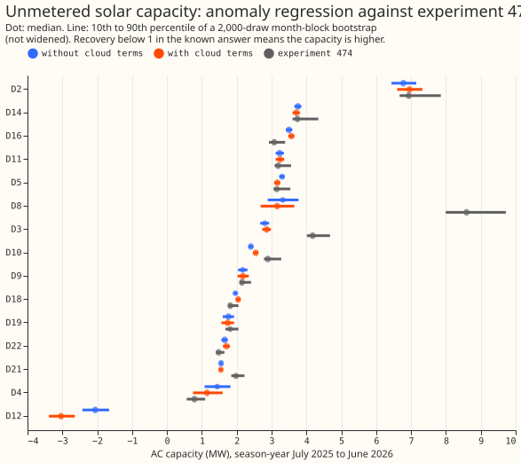

# PV capacity: an anomaly-regression rung on experiment 474's ladder

**Take-home message: a capacity estimate built only from day-to-day weather within a month passes
its placebos but is biased low, so it validates nothing.** The anomaly regression removes the mean
of each calendar year-month, hour of day, and weekday class from the reading and from the physics
solar shape, so the season and the time of day cannot fake a capacity. At the 6 signed-MW
Primaries it recovers 0.62 to 0.72 of a metered solar farm that we injected as a test (0.73 to
0.83 with the two cloud terms), against a gate of 0.85. No gated cell passes at any Primary. The
estimates still land close to experiment 474's at 4 of the 6 signed-MW Primaries, which is some
independent support for those numbers. The estimator fails badly at D12 (reverse flow gives a
negative capacity), and it disagrees with experiment 474 by 1.3 MW at D3 and 5.4 MW at D8.

The question was whether a placebo-robust construction could validate the capacities that
experiment 477's placebo gate rejected. The placebo passes by construction, so it cannot say
whether the means removed the signal as well. The known answer says they did: the injected farm is
recovered at about 0.67 without the cloud terms. The result narrows the search for a validated
capacity to methods that keep more of the signal than a group-mean anomaly does, or that correct
for the recovery measured here.

## Figures

## Results

- **Arms.** Two estimator variants: the anomaly regression without cloud terms and with the two
  cloud columns of experiment 474. Both fit temperature jointly (ERA5 temperature and its 24-hour
  mean, piecewise-linear at 5, 10, 15, and 20 degrees Celsius, three local-hour bands). Physics
  shape: tilt 35 degrees, DC to AC ratio 1.15, with the temperature derate. One capacity per
  season-year. 2,000-draw month-block bootstrap.
- **Row set.** Experiment 474's: default rows with a finite reading and CAMS shape before
  2026-07-01; D18 from 2025-03-01 only; D15 not run (generator case). The injection test used
  Solar A, B, C, D, and F at D5, D9, D10, D11, D14, and D16, with the rows each farm has.
- **Recovery (easy world, 2 MW and 4 MW alike).** Without cloud terms 0.62 to 0.72 (median 0.67).
  With cloud terms 0.73 to 0.83 (median 0.77). The gate is 0.85, so no Primary passes in the easy
  world. Experiment 474's rungs recovered 0.75 to 0.94 without cloud terms.
- **Cloud-following load, linear form.** Without cloud terms recovery rises to 0.84 to 0.92,
  because the load adds about 0.2 of spurious capacity (figure 3) on top of the shortfall. With
  cloud terms 0.73 to 0.83. The widened 80% interval covers the injected capacity in 0% to 60% of
  injections without cloud terms, and 0% with them. No cell passes the 70% coverage gate.
- **Cloud-following load, squared form (report only).** Without cloud terms recovery is 0.94 to
  1.01 and the interval covers in 60% to 100% of injections. This coverage comes from the
  spurious load (0.29 to 0.31 of a 2 MW farm, figure 3) cancelling the shortfall, not from a sound
  estimate. With cloud terms recovery is 0.69 to 0.80 and coverage 0%.
- **Cloud load alone, no farm.** Without cloud terms the linear load invents 0.20 to 0.21 of a
  2 MW farm and the squared load 0.29 to 0.31. With cloud terms the linear load invents 0.000006
  (the terms match its form exactly, so this figure is optimistic) and the squared load -0.03.
- **Profile-aware placebo (a), 95th percentile over 20 shuffles and 5 farms.** 0.09 to 0.12
  without cloud terms (passes at 6 of 6). With cloud terms 0.187 to 0.206 (passes at 4 of 6; D5
  and D16 exceed 0.20). Experiment 474's rungs reached 0.25 to 0.51.
- **Irradiance-shuffle placebo (b), share of the real capacity.** 95th percentile 0.06 to 0.10
  without cloud terms and 0.08 to 0.12 with them. This placebo passes by construction.
- **Interval coverage.** The bootstrap interval of an injected-minus-base increment is narrow
  because the reading's noise cancels between the two fits. A coverage failure therefore reflects
  bias (the recovery shortfall) and not an interval that is too narrow for the noise.
- **Capacity at the 6 signed-MW Primaries, July 2025 to June 2026, with cloud terms** (AC, MW,
  median; experiment 474 in brackets): D5 3.2 (3.1), D9 2.2 (2.2), D10 2.5 (2.9), D11 3.2 (3.2),
  D14 3.7 (3.7), D16 3.6 (3.1). The recovery of 0.73 to 0.83 suggests the true capacity is higher.
  No bias correction is applied. The full table, with DC capacity at 1.25 (1.1 and 1.5 are a
  rescaling of the AC capacity), is in [nged_table.md](nged_table.md).
- **8 MVA-only Primaries.** The estimates are fitted to apparent power with reactive power assumed
  zero, which experiment 366 found fails at a power factor of 0.97. D2 7.0 (6.9), D3 2.9 (4.2),
  D4 1.1 (0.8), D8 3.2 (8.6), D19 1.7 (1.8), D21 1.5 (2.0), D22 1.7 (1.5); D12 is -3.0 (reverse
  flow; the estimate is not a capacity). D18 (report-only, history from 2025-03-01) is 2.0 (1.8).
  None is validated.
- **Signal share and detectability (stage 0).** About 0.24 of the shape's variance survives the
  mean removal (0.21 at D18). The bootstrap standard deviation of the capacity at the 6 signed-MW
  Primaries is 0.05 to 0.10 MW, comparable to the stage 0 ordinary-least-squares standard errors
  (0.02 to 0.05 MW), so the indicative minimum detectable capacity of 0.05 to 0.35 MW was about
  right. The binding limit is the bias, not the noise.
- **Capacity-rises prior.** Clipping at zero and taking the running maximum changes the
  read-out season-year little: D10's median goes from 2.41 to 2.41 MW in the latest year and
  1.95 to 2.01 MW in 2024. Both versions are in `work/real_<site>.parquet`.
- **Tails.** The 5th and 95th percentiles of the bootstrap are in `work/capacity_table.parquet`.
  No forecast is scored, so tail calibration, the avoidable-curtailment cost, the equal-rows
  check, and the forecast-use step do not apply.
- **Rows with no labelled event.** NGED's event labels are incomplete, so the readings may hold
  unlabelled events.
- **Weather source.** CAMS irradiance and ERA5 temperature, both past-weather estimates. This
  rung estimates capacity from history, so no forecast-time availability is needed.
- **Anonymisation.** Solar A to F by letter; no pairing with a Primary is named.
- **Checks.** No forecast is scored, so the median-minus-mean and mean-forecast-error checks do
  not apply. Triggers fired: none that apply to a capacity estimate.

## Deviations and caveats

- Prediction 4 (recovery 0.75 to 0.95 without cloud terms in the easy world) failed: the range was
  0.62 to 0.72.
- The cloud terms match experiment 129's linear load exactly, so the linear cloud-load result with
  cloud terms is optimistic.
- The group mean uses calendar year-month in local time; a first draft used the UTC month and the
  code review caught the edge case before any scored run.
- The minimum number of rows for a season-year's capacity column is 4,000 half-hours in at least 3
  months (the code review of the first draft found 2,000 too lax; the smoke run used 2,000).
- Compute: CPU only, 4 processes, about 3 minutes in total.
- Problems caused by the move: the 474 modules import `torch`, so the worktree needs
  `uv sync --all-packages --group gpu`.

## Pre-registered plan

- **Estimator.** For each Primary, remove from the reading (megawatts) and from every regressor the
  mean of the same calendar year-month, local hour of day, and weekday class (Monday to Friday,
  Saturday, Sunday). Regress the reading's anomaly on the physics PV shape's anomaly: tilt 35
  degrees, DC to AC ratio 1.15 as in experiment 405, with the temperature derate, one capacity
  coefficient per season-year (July to June). The coefficient is the negative of the capacity in
  MW AC. Temperature enters the same regression, so heating and cooling load is fitted jointly
  with the PV capacity: ERA5 temperature and its 24-hour trailing mean, each with piecewise-linear
  hinges at 5, 10, 15, and 20 degrees Celsius, in three local-hour bands (0 to 8, 8 to 16, 16 to
  24), all as anomalies. The comparison arm adds the two cloud columns of experiment 474 (the
  day-mean and half-hour cloud response).
- **Capacity-rises prior.** A post-hoc step after each fit: clip each draw's capacity path at zero
  and take its running maximum over the season-years, so a fall is resisted. Both versions are
  reported.
- **Uncertainty.** A month-block bootstrap of 2,000 draws, resampling months within each
  season-year and calendar quarter (experiment 269's stratification). The 10th, 50th, and 90th
  percentiles of AC capacity. DC capacity is AC capacity times 1.25, with 1.1 and 1.5 as a
  post-hoc rescaling (experiment 73 found the ratio not identified, and the AC capacity does not
  change).
- **Known-answer worlds** (experiment 474's harness, same farms and injection sizes). The injected
  series is subtracted from the reading (so the reading's anomaly falls by the series' anomaly)
  before the group means are removed. The easy world, with no load that follows the clouds, injects
  2 MW and 4 MW of Solar A to F's output (five farms, E left out for its short history). The
  cloud-load world adds experiment 129's cloud-following load (a load whose mean equals 2 MW of
  capacity, linear in the day's mean cloud response). A third world adds a load that follows the
  squared day-mean cloud response, scaled to the same mean, to test a load the cloud terms do not
  match exactly. Each world runs with and without the cloud terms.
- **Placebos.** (a) The profile-aware placebo of experiment 474: the farm's day-of-year profile
  plus the anomaly of another day of the same month, injected at 2 MW. The group-mean removal
  deletes the profile, so this placebo can pass trivially. (b) The irradiance-shuffle placebo: the
  PV shape's days and the two cloud columns' days are permuted together, by one
  permutation within each calendar year-month, and the real reading is refitted, and
  the placebo capacity is reported as a share of the real capacity. This placebo is true by
  construction. Both use 20 shuffles. The page states plainly that a placebo that passes by
  construction can hide a real signal that was removed together with the means, so the known
  answer (recovery of the 2 MW and 4 MW injections) is the check that the means did not erase
  the signal.
- **Coverage.** The nominal 80% interval is the 10th to 90th percentile of the bootstrap's
  increment (injected-world capacity minus base capacity, same draw), reported alone and widened
  by 1.28 times the standard deviation of the point recoveries over the five farms (experiment
  474's definition).
- **Scope.** Six signed-MW Primaries run the known answer. The eight MVA-only Primaries (D2, D3, D4,
  D8, D12, D19, D21, D22) are fitted to the apparent-power reading with reactive power assumed zero,
  by experiment 366's rule and experiment 420's export gate: the rule fails at a power factor of
  0.97, so these capacities carry that caveat. D5 (export limit; the clip-free solar term does not
  represent it), D12 (reverse flow), D15 (generator case, not run), and D18 (history only from
  2025-03-01, report-only) are marked. The 6 signed-MW Primaries and the 8 MVA-only Primaries are
  reported separately, never pooled.
- **Not applicable.** No forecast is scored, so the avoidable-curtailment cost, tail calibration
  (including the rule that q99 coverage must stay within 5%), and the forecast-use step do not
  apply. The tails reported are the 5th and 95th percentiles of the bootstrap capacity. Experiment
  474's forecast-use step repeats experiments 405, 409, 416, and 477 and is dropped.
- **Anonymisation.** Solar A to F by letter; no nearest-farm names; distance bands only
  ("under 15 km", "15 to 30 km", "30 km or more"). Rows with no labelled event: NGED's event
  labels are incomplete, so the readings may hold unlabelled events.

## Stage 0: numbers fixed before any recovery or placebo is read

Ordinary-least-squares standard errors on the real reading (no injection, no placebo), at the
latest season-year (July 2025 to June 2026). The standard error assumes independent rows, so it is
a lower bound (rows within a day are strongly correlated); the bootstrap interval will be wider.

- **Post-removal signal share:** 0.23 to 0.25 of the PV shape's variance at each of the 14
  Primaries, and 0.21 at D18. Experiment 405 found 0.21 on its farm. About one quarter of the
  shape's variance survives the group-mean removal.
- **Variance inflation factor of the latest season-year's capacity column** against all other
  columns: 1.02 to
  1.05 without the cloud terms, 1.35 to 1.65 with them, 2.4 for D18.
- **Minimum detectable capacity** (80% power, two-sided level 0.05 divided by the
  Bonferroni count of 36 tests: 6 signed-MW Primaries, 2 estimators, 3 gates): 0.05 to 0.35 MW
  AC without the cloud terms and 0.06 to 0.40 MW with them (D8 is widest, D21 narrowest). The count
  suits the 6 signed-MW Primaries only, and the figure tests a capacity against zero, which none of
  the gates does, so it is indicative. A capacity under those figures cannot be told from zero by
  this estimator.
- **Bonferroni count:** 36.

The full table is in the private file `work/stage0_signal.json`.

## Checks and reviews

Plan review, code review before the first fit, results review, and write-up review: Sonnet
reviewers, as the `ml-experiment` skill requires. Their findings and triage are in the PR body.
