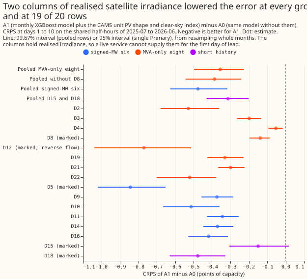
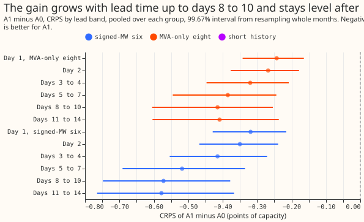
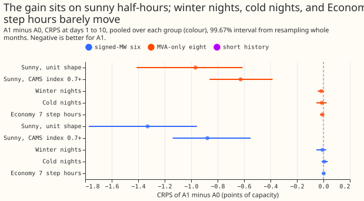
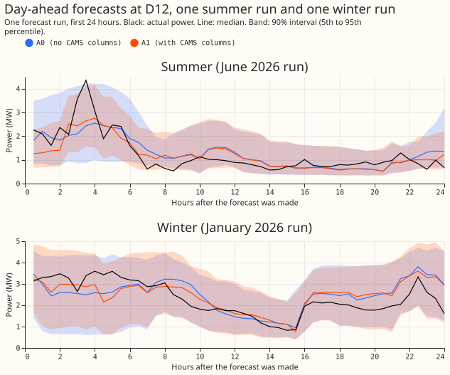
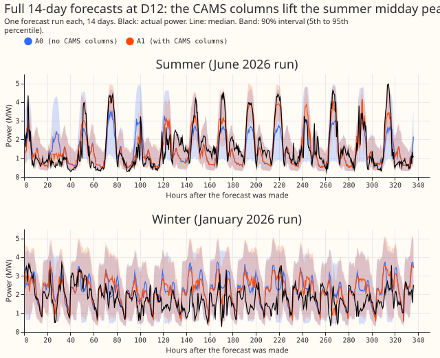

**Take-home.** Giving the monthly XGBoost demand model the satellite-measured sunshine of each
half-hour lowered its error at all 16 primary substations in the point estimates (the sites that
step 33 kV down to 11 kV, called Primaries below). Over the eight Primaries that report apparent
power only (MVA), the error fell by 0.36 points of capacity (1 point is 1% of a substation's
effective capacity). Over the six that report signed real power (MW), it fell by 0.48 points. The
gain is an upper bound on what a live service can have: these are lab conditions, in which the model
sees the realised sunshine at every lead, and the satellite data arrives about a day late. The next
experiment should build the same two columns from the ECMWF ensemble weather forecast and measure
how much of the gain remains.

## The columns lowered the error at every Primary

We asked whether two extra input columns, computed from the sunshine (irradiance, in watts per
square metre) that a satellite measured in each half-hour, lower the error of the monthly XGBoost
demand forecast. The two columns are the output of a generic south-facing solar fleet under that
irradiance, and the ratio of the measured irradiance to the irradiance under a cloudless sky. We
refitted the model monthly for 12 months with the columns (arm A1) and without them (arm A0), on the
same rows. We compared the continuous ranked probability score (CRPS) of forecasts 1 to 10 days
ahead, in points of capacity. A negative difference favours A1.

A1 was better in the point estimates at all 16 Primaries, and the gain was far larger than the 0.03
to 0.10 points predicted. The gain is largest on sunny half-hours and grows with lead time, which is
what realised weather in place of a forecast would give. The planned tests of a signed-power label
(the known-answer test and arms A2) were not started: A1 shows that the columns lower the error
without a sign label, and the brief runs them only if the maintainer asks.

## Figures

## Results

- **Arms.** A0 is experiment 381's monthly control refitted on CPU. Its recipe is experiment 87's
  `n1h` configuration (500 rounds, learning rate 0.05, depth 6, training rows weighted with a
  half-life of 0.5 years, the 51 ensemble members' quantiles mixed at prediction time). A1 is A0
  plus `cams_unit_pv_shape` and `cams_clear_sky_index`. Cadence: monthly refits, 12 refits from
  2025-07-01 to 2026-06-01, 384 fits in 8.6 hours wall time. Code:
  `ml-experiments/00480-xgboost-cams-columns-at-mva-only-primaries-lab-conditions/`, which imports
  the folders of experiments 87, 377, and 381.
- **Weather source at lag times.** The CAMS radiation service's satellite retrieval at each
  Primary's coordinates, hourly. CAMS publishes about a day late, so the columns would be
  unavailable at forecast time for the first day of lead. Here the columns hold the half-hour's own
  realised value at every lead, so every figure is a lab-condition upper bound, and use at lag times
  older than a day was not tested.
- **Row sets.** The contrasts use the half-hours shared by A0, A1, and experiment 381's stored
  control: 4,012,330 half-hours at the 16 Primaries under `fold_a_daily_gap_v1`. The absolute tables
  use the half-hours shared by all seven arms, 2,824,844, which leaves out part of D15 and D18. No
  scored half-hour has a missing actual. The noisy start of D15 and D18 (before 2025-03-01) is cut
  from training rows and lags. D5, D12, D15, and D18 are the marked Primaries.
- **Minimum detectable effect, computed before any score.** 0.032 points at the eight and 0.105
  points at D12, the half-widths of experiment 381's `solar` arm minus its `control` arm. The pooled
  contrast at the eight (C1) is about 11 times 0.032.
- **Code check.** A0 minus experiment 381's stored control, which was fitted on the GPU: +0.001
  (-0.003 to +0.005) at D5 and +0.006 (-0.010 to +0.036) at D12, inside the 0.05 limit.

| Contrast (A1 minus A0), CRPS days 1 to 10 | Estimate | Interval |
|---|---|---|
| C1, the eight MVA-only Primaries | -0.355 | 99.67%: -0.497 to -0.228 |
| MVA-only seven (without D8) | -0.386 | 99.67%: -0.543 to -0.241 |
| Signed-MW six | -0.476 | 99.67%: -0.627 to -0.316 |
| D15 and D18 | -0.313 | 99.67%: -0.429 to -0.201 |
| D12 | -0.769 | 99.67%: -1.180 to -0.406 |
| D8 | -0.138 | 99.67%: -0.220 to -0.058 |

- **Per Primary (95%).** All 16 point estimates are negative, from -0.053 at D4 to -0.843 at D5. Of
  the 16 intervals, 15 lie wholly below zero. D15 is the exception, -0.149 (-0.305 to +0.018). No
  Primary is worse than +0.05.
- **Absolute CRPS (days 1 to 10, all-arm row set).** Per-Primary values for every arm are in
  `scores/scores.parquet` in the data folder. At D12: A0 6.82, A1 6.05, stack 7.52, BG2 6.75,
  `manual_heuristic` 7.92, `climatology` 8.83. At D5: A0 3.89, A1 3.05, stack 4.08, BG2 3.94. A1 is
  below `manual_heuristic` and `climatology` at all 16 Primaries, and below BG2 at D12 and D5. At
  D15 the all-arm table shows A1 (15.53) above A0 (15.51), because that row set leaves out part of
  D15; on the 4,012,330 shared half-hours A1 is 0.149 lower.
- **Lead bands.** At the eight, the gain grows from -0.24 at day 1 to -0.42 at days 8 to 10 and is
  level at -0.41 for days 11 to 14. At the signed-MW six it grows from -0.32 to -0.57.
- **Slices.** On sunny half-hours (unit PV shape high) the gain is -0.97 (-1.41 to -0.61) at the
  eight and -1.33 (-1.77 to -0.96) at the six. With the CAMS index at least 0.7 it is -0.63 at the
  eight and -0.88 at the six. Winter nights, cold nights, and Economy 7 step hours move by under
  0.02 points. In the 7 days after a labelled event the gain is -0.37 (-0.73 to -0.17) at the eight,
  and during a labelled event it is -0.28 (-0.65 to +0.05). NGED's event labels are incomplete, so
  rows with no labelled event may hold unlabelled events, and these event counts are lower bounds.
- **D12 bias on sunny half-hours (median forecast minus actual, in points of capacity, over days 1
  to 10).** A0 -4.89, A1 +2.09. A0 runs from -2.10 at day 1 to -6.34 at days 8 to 10. A1 runs from
  +1.87 at day 2 to +2.37 at days 8 to 10 and +2.87 at days 11 to 14. The columns remove the
  under-forecast and overshoot it. At D8 the bias falls from +9.97 to +7.90.

| Tails, mean over each group (days 1 to 10) | A0 MVA-only | A1 MVA-only | A0 signed-MW | A1 signed-MW |
|---|---|---|---|---|
| Coverage q01 (nominal 0.01) | 0.0126 | 0.0124 | 0.0074 | 0.0070 |
| Coverage q05 (0.05) | 0.069 | 0.072 | 0.052 | 0.055 |
| Coverage q95 (0.95) | 0.933 | 0.936 | 0.909 | 0.913 |
| Coverage q99 (0.99) | 0.991 | 0.991 | 0.980 | 0.981 |
| Pinball q01 | 0.248 | 0.242 | 0.249 | 0.240 |
| Pinball q05 | 0.883 | 0.829 | 0.674 | 0.600 |
| Pinball q95 | 0.975 | 0.903 | 0.947 | 0.844 |
| Pinball q99 | 0.332 | 0.326 | 0.385 | 0.378 |
| twCRPS | 0.201 | 0.191 | 0.386 | 0.380 |

- **Tails.** The upper tail improves most: pinball q95 falls by 0.07 at the eight and 0.10 at the
  six. Coverage moves by under 0.005 and stays on the same side of nominal as A0.
- **Avoidable curtailment cost, signed-MW six, scored year, in pounds (as
  `metrics.avoidable_curtailment_cost` defines it).** At the 0.9 limit (the headline limit of the
  curtailment rule), A1 is lower than A0 at D10 (28,733 against 29,036), D11 (201,909 against
  213,752), and D5 (426,074 against 427,491). A1 is higher at D14 (2.217 million against 2.177
  million), D16 (7.465 million against 7.446 million), and D9 (169,524 against 166,786). The total
  over the six is slightly higher for A1, about 10.51 million against 10.46 million. The stack is
  lower than A1 at all six Primaries at both limits, and `manual_heuristic` is below A1 at D5
  (232,138). At the 0.5 limit A1 is lower than A0 at all six (for example D16, 24.3 million against
  25.2 million). The costs during a labelled event and in the 7 days after one could not be scored:
  the function needs a perfect-forecast arm that is empty on those rows. The better CRPS did not
  give a consistent saving at the 0.9 limit.
- **Pre-registered rules.** C1's interval lies wholly below zero and no Primary is worse than +0.05,
  so the rule for porting the two columns is met on lab-condition numbers. The no-harm contrasts at
  the signed-MW six and at D15 and D18 have upper bounds of -0.316 and -0.201, below +0.05. The stop
  rules for the A2 arms were not tested.
- **Predictions.** P1 (0.03 to 0.10 points at the eight) failed on size: -0.355. P2 (largest at D12
  and D8, and 0.10 to 0.40 points on sunny half-hours) failed on size: -0.97 at the eight and -2.36
  at D12 on sunny half-hours, and D8 is among the smaller gains. P3 (gain concentrated in days 1 to
  3) failed: the gain grows with lead. P4 (under 0.03 at the other eight) failed: the signed-MW six
  gain 0.476.

## Checks

- **Median minus mean forecast per Primary.** The mean of each forecast distribution is estimated
  from the 11 stored quantiles by the trapezoid rule, with the lowest and highest quantile held flat
  to levels 0 and 1. In A0 the gap runs from -0.093 MW to +0.0005 MW, and in A1 from -0.089 MW to
  +0.004 MW, so the spread does not shift the forecast. The gap is closer to zero in A1 at 14 of 16
  Primaries.
- **Error of the median beside the CRPS contrasts.** The median's mean absolute error is lower in A1
  at all 16 Primaries (for example D5 6.76 to 5.11 MW, D12 12.27 to 10.67 MW), so the CRPS and the
  error of the median point the same way.
- **Result against prediction.** The size contradicts the prediction. The tested explanation is that
  the columns hold realised irradiance in place of a forecast: the gain is 96% within 08:00 to 16:00
  UTC (peak -1.43 points at 12:00), under 0.015 points between 19:00 and 05:00, negative in all 12
  scored months, and largest in March to May. A fresh Sonnet audit (private
  `briefs/e480_audit_report.md`) rebuilt the CRPS from the stored quantiles with its own code,
  matched all 16 per-Primary contrasts to within 0.0005, and found no leakage in the CAMS join. The
  audit did not retrain, so a refit with the CAMS columns shuffled across days at one Primary
  remains the stronger test.
- **Leaving one Primary out.** Dropping any one Primary leaves the pooled eight between -0.295
  (without D12) and -0.398 (without D4), and the pooled six between -0.404 (without D5) and -0.503
  (without D11). Every interval is wholly below zero, so no single Primary carries the result.
- **Control against the stored control.** At D5 and D12, A0 moved by under 0.01 against experiment
  381's stored control. On the all-arm row set A0 differs from the stored control by 0.089 at D15,
  which has the 2025-03-01 cut that the stored control lacks, and by 0.037 at D16, which is
  unexplained and below the 0.05 limit.

## Caveats and what to try next

- **Lab conditions.** The gain is an upper bound. A live service has the realised satellite value
  only for data at least a day old, and that use was not tested.
- **Mixed result at the tail cost.** The better CRPS at the signed-MW six did not lower the
  avoidable curtailment cost consistently at the 0.9 limit.
- **D12 overshoot.** A1 over-forecasts sunny D12 half-hours by 1.9 to 2.9 points, from day 2 to days
  11 to 14, so the correction overshoots.
- **Not tested here.** The reverse-flow rule of experiment 366 holds only for reactive power zero
  and fails at a power factor of 0.97. The known-answer test and the A2 arms repeat work in
  experiments 366, 372, 374, 387, 393, 420, and 424, so they were not started.
- **Next.** Build the same two columns from the ensemble's forecast irradiance and from CAMS only
  for lag times older than a day, and measure how much of the 0.355-point gain remains. A refit with
  the CAMS columns shuffled across days at one Primary would test the mechanism directly.
