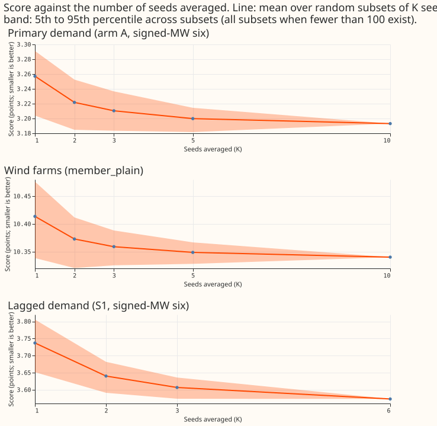
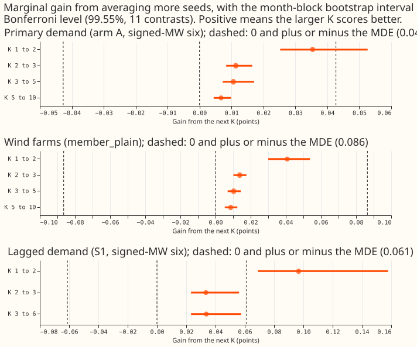
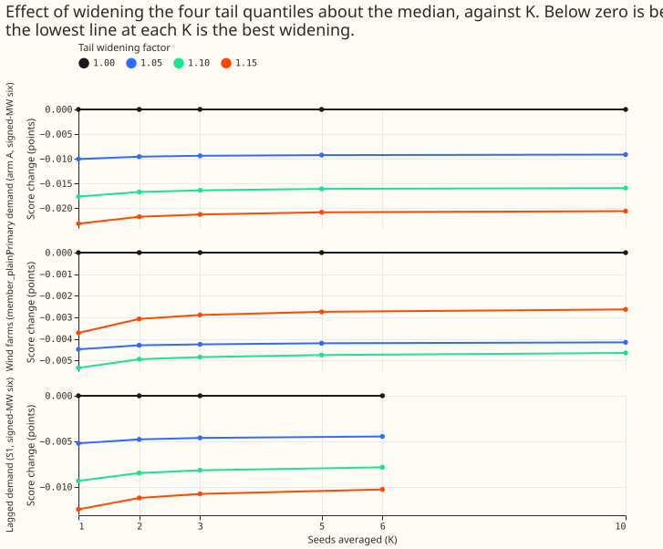
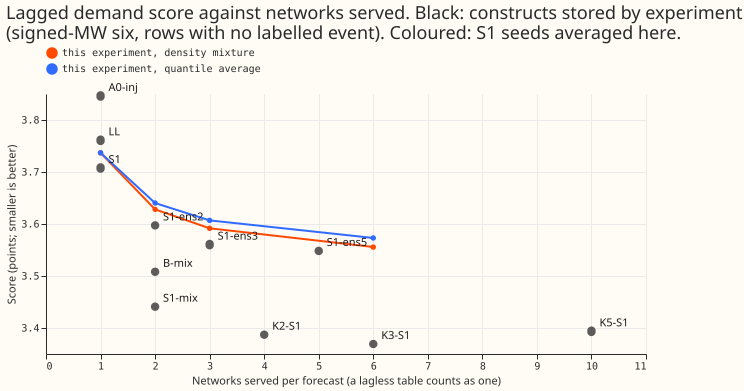
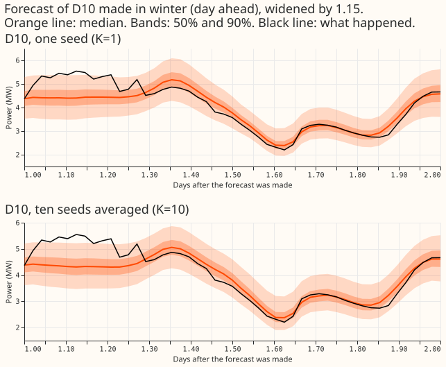
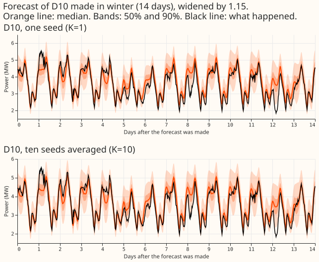
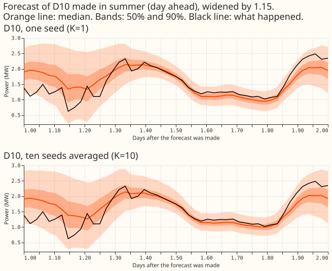
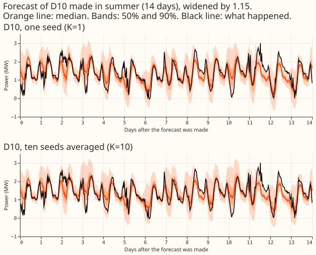

The solar half of the original brief is dropped because experiment 430 already stores six seeds
for `a2_member` and `g0_onepass`.

## Plan

- **Reuse.** Arm A seeds 0 to 4 for the five months (experiment 425 `work/seed_preds/A`); wind
  `member_plain` seeds 0 to 4 (experiment 429 `parts/`); S1 seeds 0 to 4 (experiment 454).
- **New fits (60).** Arm A seeds 5 to 9 on five months: 25 pretrains and 25 fine-tunes (pretraining
  is per seed and month). Wind `member_plain` seeds 5 to 9: 5 fits. S1 seed 5 on five months:
  5 fits, so the S1 pool reaches K = 6 (experiment 404 stores the lagless tables for seeds 0 to 5
  only). Seeds 3 to 5 of S1 share training worlds with
  seed `seed % 3` (experiment 454's caveat), so S1 curves past K = 3 are lower-bound on diversity
  and the page says so.
- **Cadence.** Monthly refits; five of the twelve months. No weekly refits.
- **Standing practices followed.** Cleaned data (flagged exact-zero half-hours dropped, counts
  reported per fold), the D15 and D18 cut before 2025-03-01, saved networks in the experiment's
  data folder, stored predictions reused, tails and curtailment cost reported, example forecasts
  plotted, draft pull request. Load-shift event plots are not needed because the experiment does
  not score events. Nearest-farm pairings are named by letter only.
- **Compute.** One timed arm A fit (month 2025-10, seed 5): 43 s pretrain plus 61 s fine-tune and
  forecast. Estimated total about 1.2 GPU-hours, one process under 8 GB, one feeder core.
- **Where new seeds are written.** This experiment's own data folder. The timing fit above wrote
  `pretrained/A/2025-10_s5.pt`, `seed_preds/A/2025-10_s5.parquet` and the matching `models/A/`
  files into experiment 425's folder. They were moved here afterwards, and the wrapper refuses to
  overwrite any existing file.

## Take-home

**A second seed gives the largest gain, and later seeds add little.** For Primary demand, two seeds
score 0.035 points better than one (99.55% interval +0.025 to +0.053, better in 5 of 5 months). The
point estimate is above the 0.03 bar for porting, and the interval spans it. Each later step gains at
most 0.011 points. Wind follows the same curve with more noise. Averaging seeds of the lagged neural
network S1 does not replace the lagless head. Five demand months make these results interim, so they
support a choice for the first release and no more.

## Figures

## Results

Scores are points of effective capacity (demand) or capacity (wind). Before any contrast the scorer
prints the Bonferroni count, 11 (experiment 425's arm A 4, S1 3, wind 4; interval level 99.55%), and
the minimum detectable effect: 0.0427 for arm A at the signed-MW six, 0.0864 for wind (12 monthly
blocks), and 0.0612 for S1.

- **A second demand seed gains 0.035 points; later seeds gain at most 0.011.** Arm A, signed-MW six,
  days 1 to 10, widened 1.15, 100 random draws of K seeds from 10: K = 1 scores 3.2572, K = 2 3.2218,
  K = 3 3.2104, K = 5 3.1998, and K = 10 3.1931. The gains per step are +0.0354 (+0.0252 to
  +0.0526), +0.0113, +0.0106, and +0.0067. Every interval excludes zero, and every gain is below the
  minimum detectable effect by point estimate.
- **Other demand slices fall the same way.** MVA-only eight: 3.760 (K = 1) to 3.680 (K = 10). Rows
  with no labelled event, six: 2.772 to 2.710. Cold nights, six: 4.212 to 4.132. 12 to 36 hours, six:
  2.932 to 2.866.
- **Demand tails stay under-covered at every K.** With the widening at 1.15, q99 coverage runs 0.960
  to 0.964, q95 coverage 0.889 to 0.896, and q99 pinball loss 0.344 to 0.325. The best widening is
  1.15 at every K, the top of the grid, so the optimum is censored.
- **The pre-registered rule recommends K = 2 for demand.** K = 2 is the smallest K within 0.0427 of
  K = 10 with a q99 pinball loss within 5% of K = 10's (K = 1 fails at a ratio of 1.059). The
  scorer's "marked K" (the K beyond which every gain is inside the minimum detectable effect) is 1,
  because all four gains are below 0.0427. The 0.03 porting bar also gives K = 2.
- **For wind, one seed meets the pre-registered rule, and a second seed gains 0.041 points.**
  `member_plain`, kept rows, true days 1 to 10, equal-weight months: K = 1 scores 10.414, K = 2
  10.373, K = 3 10.359, K = 5 10.349, and K = 10 10.340. The gains per step are +0.041, +0.014,
  +0.010, and +0.009. K = 1 is within the minimum detectable effect of K = 10 (0.0735 against
  0.0864), so the rule recommends K = 1. Reading K = 2 as the better choice is post hoc: it rests on
  the 0.03 porting bar, and the lower bound of the K = 2 gain (+0.030) sits exactly on it. The best
  widening is 1.10, and q99 coverage at 1.0 is 0.976. Farms are named A, B, and C.
- **For S1, three averaged seeds meet the rules under quantile averaging, and six under the density
  mixture.** The quantile average of seeds 0 to 5 scores 3.737 (K = 1), 3.640 (K = 2), 3.607
  (K = 3), and 3.573 (K = 6), raw. The gains per step are +0.097, +0.033, and +0.034, against a
  minimum detectable effect of 0.0612. The density mixture (experiment 454's construction) fails the
  5% q99 rule at K = 3, so its recommended K is 6. Seeds 3 to 5 share training worlds with seeds 0
  to 2, so a random pair of seeds can share a world, and the S1 curves understate the diversity that
  independent worlds would give.
- **Averaging S1 seeds does not match a mixture with the lagless head at the same number of
  networks.** All values are raw scores. At 2 networks, S1-mix scores 3.441 and B-mix 3.508, against
  3.640 for two averaged S1 seeds (3.628 as a density mixture). At 4 networks, K2-S1 scores 3.387,
  against 3.607 for three seeds and 3.573 for six (neither count is four; the S1 pool has no
  four-seed entry). At 6 networks, K3-S1 scores 3.369, against 3.573 for six averaged seeds. The
  lagless table counts as a network in these counts. Prediction P4 fails.
- **Avoidable-curtailment cost shows no monotone trend in K.** Signed-MW six, 12 to 36 hours,
  f = 0.9, five months, 10 random subsets per K: K = 1 costs 7.19M pounds, K = 2 6.98M, K = 3 7.43M,
  K = 5 7.02M, and K = 10 7.28M, against 9.31M for the manual heuristic. K = 1 is the highest cost at
  all three limit fractions, but the differences are smaller than the 5th-to-95th-percentile range
  across subsets (0.9M to 2.4M). A second seed therefore does not improve the metric NGED cares about
  by a measurable amount.
- **A second demand seed doubles the refit cost.** Arm A takes about 80 GPU seconds per seed per
  monthly refit (46 s pretrain plus 34 s fine-tune), so K = 2 takes 158 s. Wind takes 56 s per seed,
  and S1 29 s per seed plus cross-fitted lagless tables (not timed). The timings are medians from a
  loaded workstation. Serving latency was not measured.

## Predictions

- **P1 (arm A): partly supported.** The K = 1 to K = 2 gain is 0.035, below the predicted 0.05 to
  0.12. The K = 3 to K = 5 gain (0.011) and the K = 5 to K = 10 gain (0.007) are inside the
  predicted bounds.
- **P2 (best widening falls with K): not testable.** The best widening is 1.15, the top of the
  grid, at every K.
- **P3 (wind): supported.** The K = 5 to K = 10 gain is 0.009, inside the predicted bound.
- **P4 (averaging S1 seeds beats B-mix at equal networks): not supported.**
- **The verdict "partly supported" refers to the predictions.** The hypothesis itself holds for arm A
  (K = 5 to K = 10 gains 0.0067), wind (0.0086), and S1 (K = 3 to K = 6 gains 0.0337, below the
  minimum detectable effect of 0.0612).

## Checks

- **Equal rows.** One row set serves every K and seed (1,273,228 scored demand rows). The scorer
  asserts identical keys for all 10 seeds in every month.
- **Gates.** Demand scoring agrees with `metrics.scored_rows` to 4e-6 points. Wind seeds 0 to 4
  pooled over rows give 10.533, the value experiment 429 stored. S1 seed 0 gives 3.7518 and the
  seed 0 to 2 mixture 3.5604, both equal to experiment 454's stored values.
- **Median against mean.** A reviewer's re-derivation (not in the score report) found the
  median-forecast absolute error falls with K in the same direction as CRPS (5.614 at K = 1 to 5.575
  at K = 10), and the K = 1 to K = 10 gain is positive at all six signed-MW sites (+0.044 to +0.082).
- **Audit triggers.** Trigger 2 fires: P1 and P4 are contradicted, and the grid censors P2. Trigger 7
  fires if the first release sets its seed count from this result before another replication. A
  results review found one bug, now fixed: the curtailment subsets were the first 10 in sorted order,
  so seed 0 sat in every K = 2 subset.
- **The minimum detectable effect is a weak bar.** The demand value rests on 5 monthly differences,
  and 2026-01 (a difference of 0.143) sets it. On the other four months it is 0.0077, and against
  that value the gains from K = 1 to K = 2 and from K = 2 to K = 3 would lie outside it. Read the
  bootstrap intervals beside it.

## Caveats and files

- **Interim.** Five of the twelve demand months and one wind year are scored, so the choice needs a
  repeat on the other seven months before the first release fixes it.
- **Loop and files.** Arm A uses experiment 425's 12-fold loop, read at 2025-10, 2025-12, 2026-01,
  2026-03, and 2026-06. Demand seeds 5 to 9 are in this experiment's data folder (`work/seed_preds/A`,
  `work/models/A`, `work/pretrained/A`) and wind seeds 5 to 9 in `wind/parts`. The five S1 seed 5
  networks are experiment 404's `work/models/S1/<month>_s5.pt`. Nothing is left in experiment 425's
  or 429's folders.
- **Equal-weight months.** The scores differ slightly from the row-pooled values of experiments 425
  and 429.
- **Solar.** Dropped, because experiment 430 stores six seeds.
- **Data rules.** The D15 and D18 cut and the flagged exact-zero drop follow experiment 425; its fit
  logs hold the counts per fold. Load-shift event plots are not needed, because this experiment does
  not score events.

## What to try next

- Repeat the K = 2 choice on the other seven demand months.
- Test a widening grid above 1.15 for demand.
