**A forecast that mixes lagged and lagless heads (K2-S1) was in none of the eight scenarios
meaningfully worse than the lagless forecast when we injected load shifts into its lags.** The
pooled neural network that was never trained on shifted lags (A-pool) is the one that suffers. At
the wind farms, `member_plain` is level with research default 2 (the interval includes zero).

**The page shows wind reference contrasts, a 14-day wind chart, real-event charts, and eight
injected scenarios on stored demand neural networks.** The real-event charts add the actual with the
normal running arrangement (NRA) restored, and the surprise inputs. Experiment 468 holds the
earlier charts. Nothing was fitted: every neural network forecasts from stored weights.

A scenario shifts one donor Primary's lags by 1, 2, or 3 times its lag spread. The lag spread is the
standard deviation of the Primary's 24-hour change in power before 2025-10-01. The shift lasts 1,
3, or 14 days. A load shift leaves the target alone, and a genuine level change moves the target
too. Mirrored scenarios subtract the same energy from up to two neighbours. Each scenario runs on 16
donors and 5 test months (80 clusters). The scored rows are the donor's rows whose lags fall inside
the event. The clean actual is the actual without the injected shift.

**The page compares five forecasts.** They are the lagless neural network (LL, which reads no lag),
S1 (a lagged neural network trained on injected shifts), B-mix (a 50/50 mixture of a lagged and a
lagless head), K2-S1 (a mixture of two S1 and two lagless heads), and A-pool (experiment 425's arm
A, a pooled plain neural network trained on real lags only). Experiment 470's assembly winner is not
shown. The scenarios are numbered 1 to 8, and "S1" always means the S1 neural network. The
signed-MW six are the six Primaries whose power is signed in MW, and the MVA-only eight are the
eight Primaries recorded only in MVA. D15 and D18 are two Primaries that are reported separately.

## Scenarios

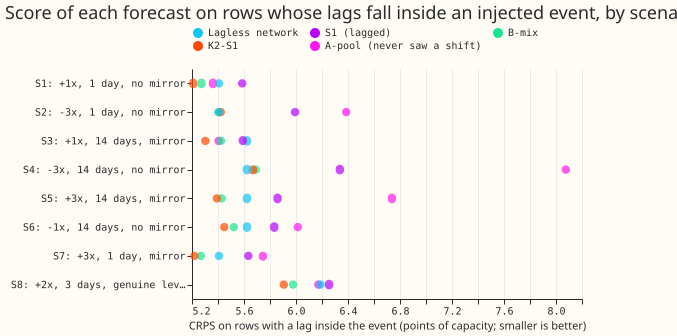

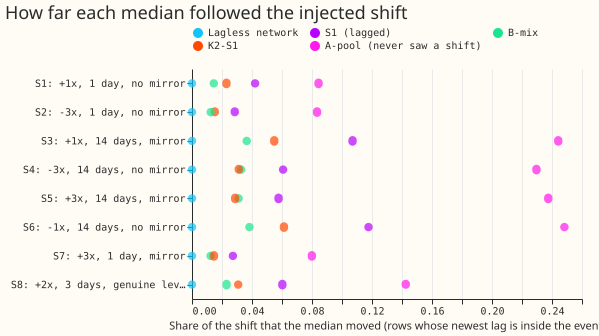

- **Scenario 1 to 8 are defined by shift size, duration, and mirror.** Scenario 1: +1x, 1 day, no
  mirror. Scenario 2: -3x, 1 day, no mirror. Scenario 3: +1x, 14 days, mirror. Scenario 4: -3x, 14
  days, no mirror. Scenario 5: +3x, 14 days, mirror. Scenario 6: -1x, 14 days, no mirror. Scenario
  7: +3x, 1 day, mirror. Scenario 8: +2x, 3 days, genuine level change.
- **The neural networks barely followed the shift.** On rows whose newest lag is inside the event,
  the median moved by 1% to 6% of the shift for K2-S1, 1% to 4% for B-mix, 3% to 12% for S1, and 8%
  to 25% for A-pool. The lagless neural network moved by 0.
- **A-pool is harmed by a large negative unmirrored shift.** In scenario 4 its CRPS is 8.08 points
  of capacity against 5.62 for the lagless neural network and 5.67 for K2-S1. Its q95 covers 72% of
  actuals (nominal 95%), and its q05 covers 1.0% (nominal 5%). K2-S1 minus A-pool is -2.41 points
  (interval -3.10 to -1.73 at the Bonferroni level for 40 contrasts, 99.875%).
- **In scenario 5 (+3x, mirror), the mirror left A-pool over-confident on the lower side.** Its q05
  covers 16.6% of actuals and its q95 covers 97%.
- **S1 is worse than the lagless neural network in scenarios 2 and 4.** The contrast is +0.58
  points in scenario 2 and +0.71 in scenario 4. K2-S1 minus lagless is -0.20 in scenario 1, -0.32
  in scenario 3, and -0.28 in scenario 8, and each excludes zero at the Bonferroni level. K2-S1
  cannot be told apart from lagless in the other five scenarios.
- **Absolute scores are close for the lagless network and K2-S1.** In rows with a lag inside the
  event, CRPS in points of capacity is 5.4 (1-day scenarios) to 6.2 (scenario 8) for lagless, and
  5.2 to 5.9 for K2-S1. The row counts are 146,975 (1-day), 994,340 (14-day), and 332,691
  (scenario 8).
- **The ranking differs between the signed-MW six and the MVA-only eight.** In scenario 4, K2-S1 and
  the lagless neural network score 3.92 and 3.99 at the signed-MW six and 4.95 and 4.96 at the
  MVA-only eight. A-pool scores 6.46 and 6.95. B-mix is lowest at the MVA-only eight (4.94 against
  4.95 for K2-S1). The lagless neural network leads at D15 and D18 (13.31 against 13.90 for K2-S1).
- **K2-S1's band widens by under 2% inside unmirrored shifts.** Its 90% band is 27.9 points wide
  inside scenario 4 and 27.6 before the event. The widths are 28.1, 28.1, 27.9, and 27.7 points in
  scenarios 1, 2, 4, and 6. The band covers 85% of actuals inside scenario 4 rows (nominal 90%). The
  lagless neural network's q95 covers 87% to 88% of actuals in scenarios 1 to 7 and 84% in scenario
  8.
- **Widening by 1.15 does not change the ranking, except in scenario 2.** Experiment 454's widening
  is stored beside every raw score (`crps_by_scenario_widened.csv`). In scenario 2, the lagless
  neural network and B-mix swap places.

## Example forecasts

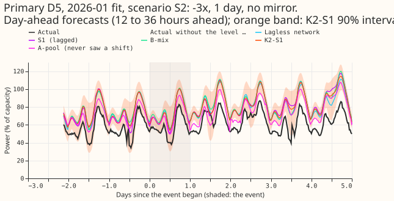

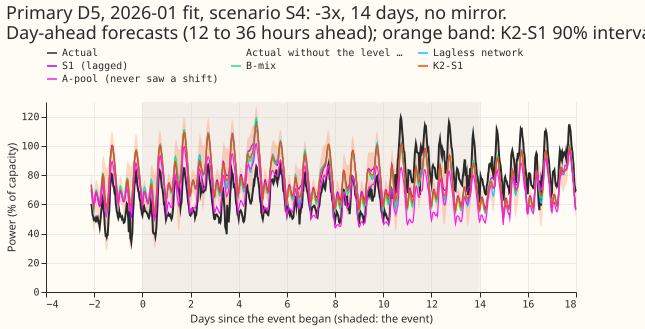

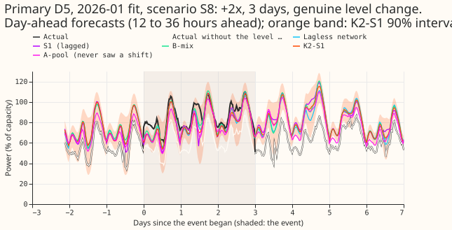

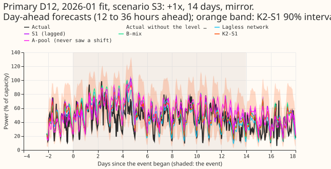

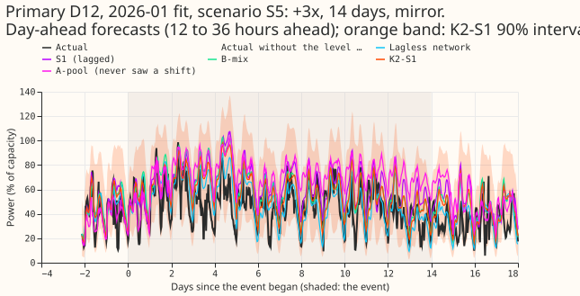

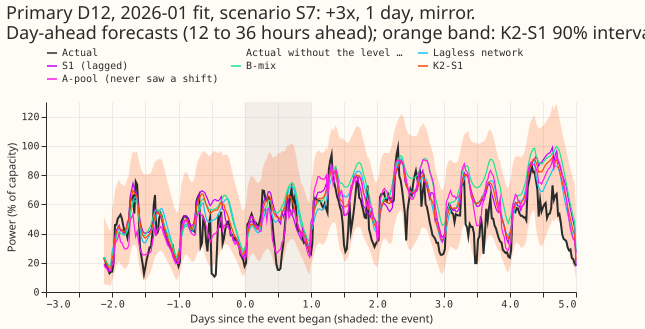

- **D5 is one of the signed-MW six and D12 is one of the MVA-only eight.** All six charts show
  day-ahead forecasts (12 to 36 hours ahead).
- **A-pool follows the shift.** In scenario 4 its median sits below the others throughout the
  event, while the other four medians stay near the clean actual.

## Real events with NRA, lags, and surprise

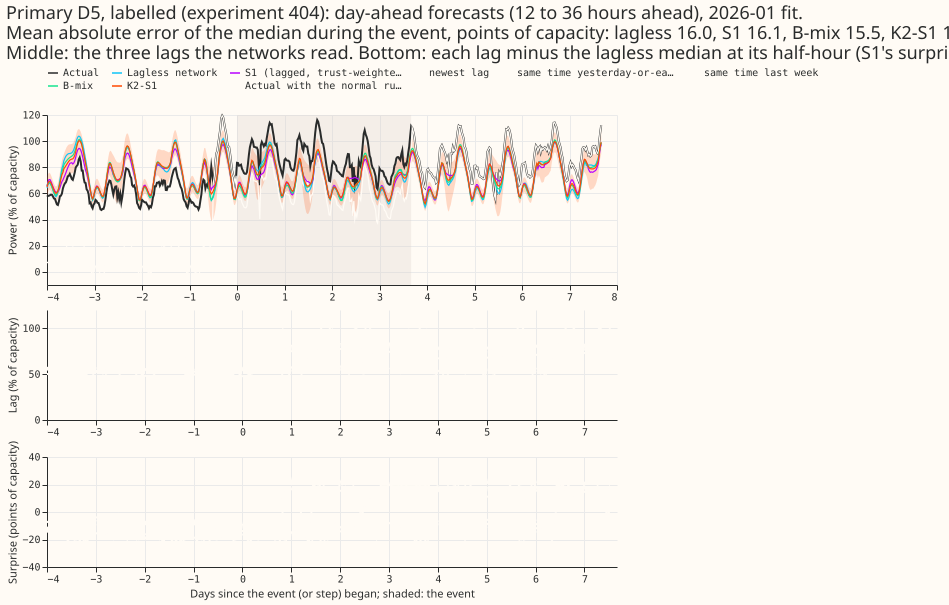

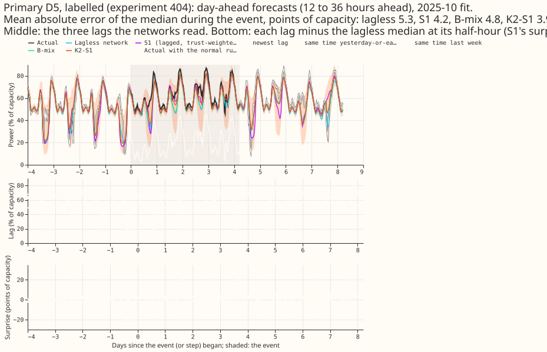

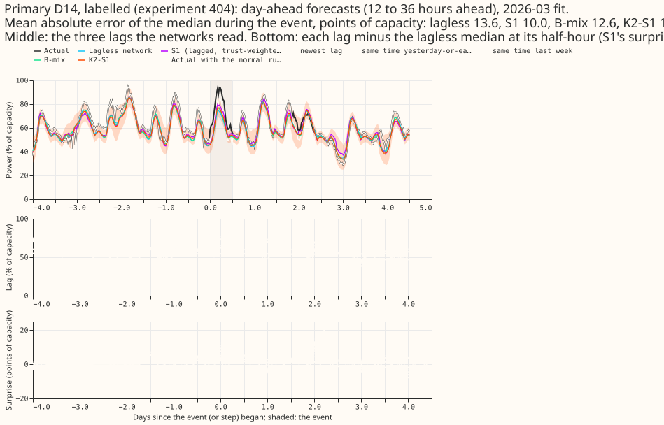

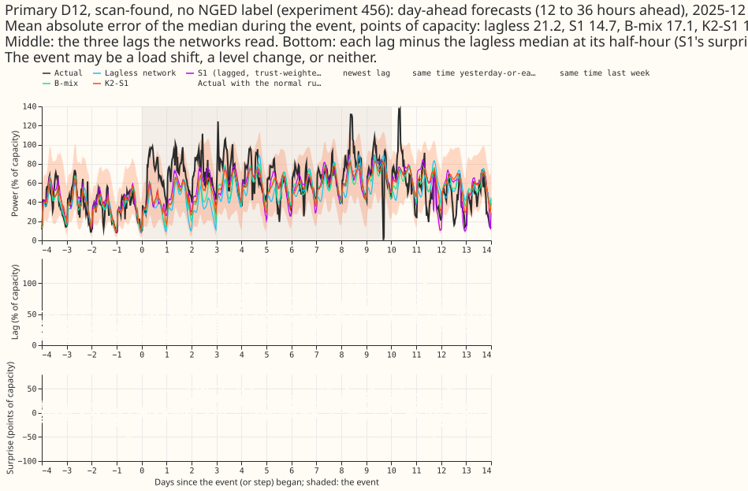

- **Each chart adds the NRA actual, the lags, and the surprise.** The NRA actual is drawn for
  labelled events only. The chart shows the three lags each neural network reads, and each lag minus
  the lagless median at its own half-hour (the surprise that S1 reads).
- **Surprise is large during real events.** The largest absolute surprise on a lag inside an event
  is 22, 35, 31, 36, 11, and 21 points of capacity at the six labelled events and 88 at the
  scan-found D12 step.
- **Caveat.** NGED's labels are incomplete, so the scan-found D12 step may be a load shift, a level
  change, or neither. Rows with no labelled event may hold events no label covers, so the injected
  scenarios sit on a series that is not event-free.

## Wind reference contrasts

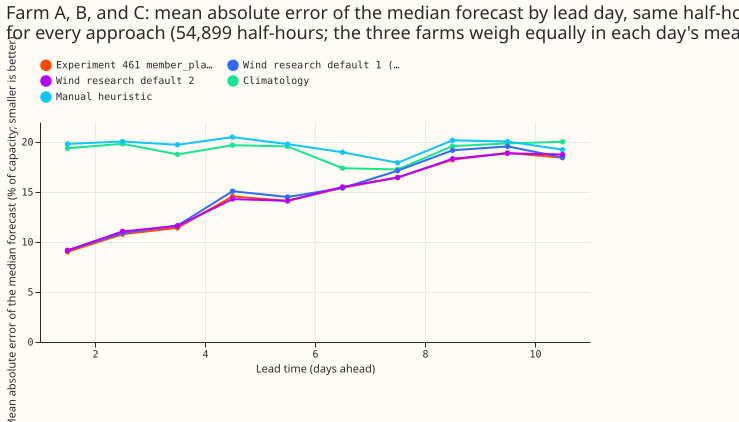

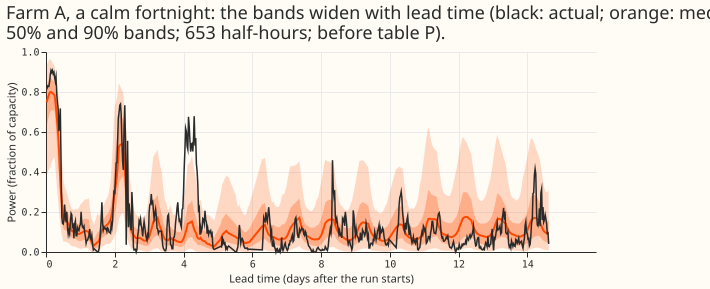

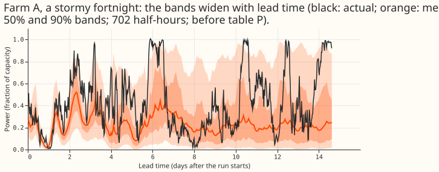

- **`member_plain` beats research default 1 and is level with research default 2.** Each contrast is
  experiment 461's `member_plain` (p99.9 capacity, after table P, the correction fitted to 24 to 240
  hours) minus a reference, in points of the p99.9 capacity, over 54,899 half-hours and 11 months,
  month-block bootstrap at 98.75% (Bonferroni count 4), minimum detectable effect in brackets.
  Research default 1: -0.41 (-0.79 to -0.04; 0.52). Research default 2: -0.05 (-0.18 to +0.09;
  0.18). Climatology: -4.72 (-6.25 to -3.24; 2.04). Manual heuristic: -5.35 (-7.06 to -3.71; 2.23).
  In the 24 to 36 hour band (3,270 half-hours) the contrasts are -0.24, -0.05, -12.71, and -12.80.
- **Absolute errors are 14.3 to 19.7 points.** The mean absolute error of the median, in points of
  capacity, is `member_plain` 14.33, research default 1 14.74, research default 2 14.38, climatology
  19.06, manual heuristic 19.68. The gain over research default 1 is smaller than the contrast's
  minimum detectable effect.
- **Research default 2 has the lowest error at two of three farms.** It has the lowest error among
  the references at Farm A (14.31 against 14.78 for default 1) and Farm B (15.31 against 16.03), and
  not at Farm C (13.50 against 13.37).
- **The 14-day chart uses `member_plain` before table P.** Table P is fitted to 24 to 240 hours. The
  90% band covers 92% (calm fortnight) and 83% (stormy fortnight) of Farm A's half-hours.

## Predictions

- **P1 did not hold.** The first-day cut was not made, so rows pool the whole event. A-pool moved by
  8% to 25% of the shift, not at least 50%. The predictions for K2-S1 (under 50%) and the lagless
  neural network (under 5%) held.
- **P2 did not hold.** On the genuine level change (S8) the medians of K2-S1, S1, and A-pool moved
  by 3%, 6%, and 14% of the shift, so none followed the new level.
- **P3 held in part.** The K2-S1 band was wider inside unmirrored shifts by under 2%, and its
  coverage stayed above 80% (83% to 87%).
- **P4 held at two of three farms.** The figures are in the wind bullet above.

## Not done, and caveats

- Curtailment cost at f = 0.9, 0.75, and 0.5 is not computed, because the node-plus-generators
  machinery takes a whole month of computing per series and the injected worlds replace one
  Primary's forecast only.
- The 12 to 36 hour band, a minimum detectable effect for the demand scenarios, and a run with and
  without the largest scenario are not computed. Demand intervals are cluster bootstraps over 80
  (month, donor) clusters.
- Recipients of mirrors are forecast but not scored here. Row classes by newest lag are in
  `crps_by_scenario_and_class.csv`; in scenario 8 the rows classed `before` and `after` mix shifted
  and unshifted targets, because the class follows the lags only.
- A shift on an MVA-only Primary is clipped at zero, so its recorded size can overstate a negative
  shift.
- The 14-day chart is wind only, because demand and solar forecasts end at 240 hours.

## Checks

- **Self-test passed.** The no-shift forecasts match experiment 454's stored cells to 7.6e-05 and
  experiment 425's stored arm A to 6e-06 (capacity fraction), in every month.
- **The stored neural networks were refitted monthly.** Cleaned data and the D15 and D18 split
  come with the stored forecasts.
- **Median minus mean forecast:** not computed, because no mean forecast is scored.
- **Triggers fired:** none.
- **Production training load.** K2-S1 needs three S1 networks and three lagless tables per refit,
  A-pool five pooled networks.
- **Reviews:** a fresh Sonnet agent reviewed the code before the first scored run; three findings
  were fixed (non-finite actuals in the 14-day pick, row-alignment asserts, an origin check). The
  reference heuristic keeps experiment 303's definition.
