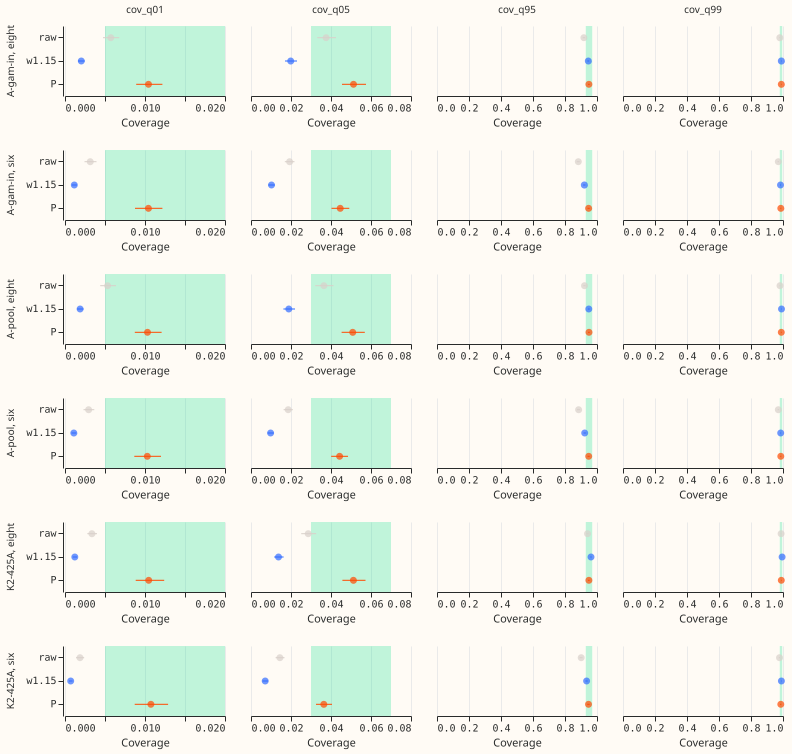
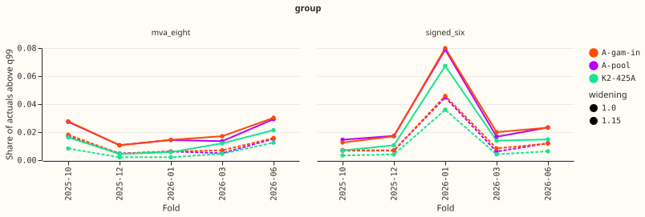
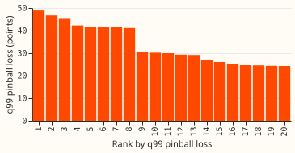
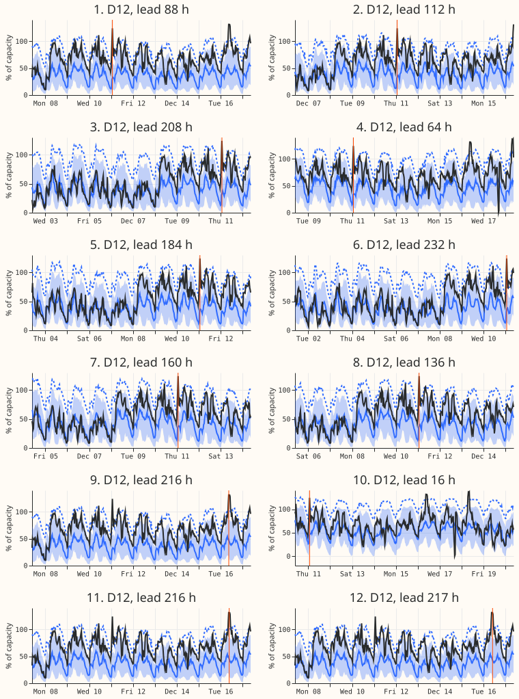

**The candidates' bands are too wide on the lower tail and too narrow on the upper tail, and one
factor per tail fixes both at the eight.** The bands of A-pool and A-gam-in (the first-release
demand candidates of [experiment
470](../00470-first-release-demand-forecaster-assembly-and-comparison/result.md)) are too wide on
the lower tail and too narrow on the upper tail. A symmetric 1.15 widening (every tail quantile's
distance from the median times 1.15) therefore repairs the upper tail while it damages the lower
one. Table P, which multiplies each tail quantile's distance from the median by its own factor,
brings all four tails into range at the eight MVA-only Primaries, for both candidates. It does not
at the signed-MW six, where it misses by a narrow margin, and cold winter nights stay under-covered
at the six. Experiment 435 found that table P failed on clean rows. Table P passes at the eight
here. Its factors are fitted on the other four folds, including folds later in time than the one
scored, so its coverage is optimistic. The strict fit, which uses earlier folds only, is the figure
to plan on.

**Terms.**

- **The eight and the six:** the eight Primary substations whose telemetry is in MVA, and the six
  whose telemetry is in signed MW. They are scored separately. D15 and D18 are two further Primaries
  with a short history, reported but never judged.
- **A-pool, A-gam-in, K2-425A:** the demand forecasters of experiment 470. A-pool averages five
  seeds of experiment 425's arm A. A-gam-in adds a generalised additive model input and exists for
  the eight only. K2-425A is a variant of A-pool that experiment 470 found worse at q99.
- **Table P:** a factor, per metering group, lead band, and tail, on each tail quantile's distance
  from the median. A lead band is a range of hours ahead, such as 12 to 36 hours.
- **NRA-corrected actuals:** actuals with the effect of a load shift removed, giving the power on
  the normal running arrangement (NRA). **BG2** is the best-guess demand forecaster of experiment
  425's series, and `manual_heuristic` is NGED's rule. In the curtailment rows, f is the fraction of
  the node's past maximum export used as the limit.

**Question and answer.** The question was whether a widening, rather than table P, makes the tails
honest. The prior from [experiment
435](../00435-stage-0-recalibration-table-for-untrusted-inputs-and-tails/result.md) was that a
widening would. The answer is no at the eight: the widening misses the q05 and q01 floors. The
experiment narrows the first release's recalibration choice to table P at the eight and leaves the
six open.

Figure 1 shows coverage with 95% intervals against the target ranges (green).

Figure 2 shows how often actuals exceed q99, raw and widened, by fold.

Figure 3 ranks the 20 worst half-hours of A-pool (widened) by q99 pinball loss.

Figure 4 shows the 12 worst of those half-hours, each as the forecast from its origin with the
target half-hour marked in orange.

## Arms, rows, and method

- **Arms:** A-pool (experiment 425's arm A, five seeds averaged), A-gam-in (the eight only), and
  K2-425A (the eight and D15/D18; three cells averaged in quantile space). Variants: `raw`, `w1.15`
  (distance of the four tail quantiles from the median times 1.15), and `P` (table P, fitted on the
  clean rows of the other four folds, one factor per group, lead band, and tail). The sweep 1.05 and
  1.10 is in `free_tails.parquet`.
- **Rows:** the `gam14` set of experiment 470 plus D15 and D18 (report-only). Folds: 2025-10,
  2025-12, 2026-01, 2026-03, 2026-06; July 2026 is unused. Flagged exact-zero half-hours are dropped
  (inherited from experiment 470's scoring context). The experiment 399 start cut for D15 and D18
  is inherited from experiment 470's rows.
- **Actuals:** rejoined from experiment 470's scoring context. "Rows with no labelled event" are
  `cls == "clean"`. NGED's event labels are incomplete, so these rows may hold unlabelled events.
- **Intervals:** month-by-origin-day block bootstrap, 20,000 resamples. The Bonferroni count is 10
  (8 contrasts of table P minus the widening, on CRPS and q99 pinball loss, each for 4
  combinations of group and candidate; plus 2 contrasts of K2-425A minus A-pool at q99 pinball loss,
  raw and widened).
- **Minimum detectable effect** (A-pool five single seeds, 1.15 widening): at the eight, CRPS
  0.044 points, q95 coverage 0.010, q99 coverage 0.003, and q99 pinball loss 0.0095 points; at the
  six, CRPS 0.087 points, q95 coverage 0.014, q99 coverage 0.008, and q99 pinball loss 0.018 points.
- **Limits on the claims:** (1) The raw lower tail at the eight (q05 0.036, q01 0.005) is already
  inside its target range, so only the symmetric widening breaks it. An upper-tail-only widening
  was not run, so "one symmetric widening cannot fix both" is untested against that cheaper option.
  (2) The K2-425A contrast after table P (+0.002) has no interval, because only the raw and widened
  contrasts were counted. (3) Table P's pooled coverage hides fold-level misses: for A-pool at the
  eight, 2025-10 has q05 0.072 and q99 0.979, and 2025-12 has q05 0.027 and q95 0.966. (4) Table P's
  CRPS gain over the widening (0.004 points) is a tenth of the minimum detectable effect (0.044),
  and the six's q99 pinball difference (0.011) is below its minimum detectable effect (0.018). At
  the six, the Bonferroni interval for that difference spans about 4.8% to 7.4%. (5) The 20 worst
  half-hours are 20 rows in one fold, probably one event; the 2025-12 fold's raw exceedance share
  is the lowest of the five. (6) Curtailment intervals are wide: no candidate variant is
  distinguishable from BG2, and table P at f = 0.9 (1.79) is above BG2 (1.37).
- **Selection bias:** every score is selection-biased, because the same five folds choose the
  candidates and score them.
- **Cadence:** the stored forecasts come from monthly refits. This experiment fits only table P's
  factors.
- **Reused code:** experiment 435 (`e00435_table_p_provisional`, `e00435_tailcore`), experiment 470
  (`e00470_score`, `e00470_build`, `e00470_curtailment`), and experiments 449 and 454 through them.

## Results (clean rows, points of effective capacity; coverage is a fraction)

| Group | Candidate | Variant | q01 | q05 | q95 | q99 | q99 pinball | CRPS |
|---|---|---|---|---|---|---|---|---|
| eight | A-pool | raw | 0.0053 | 0.0364 | 0.9216 | 0.9812 | 0.238 | 4.244 |
| eight | A-pool | w1.15 | 0.0019 | 0.0189 | 0.9487 | 0.9906 | 0.235 | 4.246 |
| eight | A-pool | P | 0.0103 | 0.0509 | 0.9498 | 0.9894 | 0.236 | 4.242 |
| eight | A-gam-in | raw | 0.0057 | 0.0376 | 0.9179 | 0.9802 | 0.236 | 4.200 |
| eight | A-gam-in | w1.15 | 0.0020 | 0.0199 | 0.9459 | 0.9899 | 0.231 | 4.202 |
| eight | A-gam-in | P | 0.0104 | 0.0512 | 0.9494 | 0.9895 | 0.233 | 4.198 |
| eight | K2-425A | raw | 0.0034 | 0.0286 | 0.9404 | 0.9881 | 0.236 | 4.132 |
| eight | K2-425A | w1.15 | 0.0012 | 0.0138 | 0.9625 | 0.9941 | 0.246 | 4.140 |
| eight | K2-425A | P | 0.0105 | 0.0512 | 0.9493 | 0.9893 | 0.238 | 4.131 |
| six | A-pool | raw | 0.0030 | 0.0186 | 0.8851 | 0.9708 | 0.195 | 3.451 |
| six | A-pool | w1.15 | 0.0011 | 0.0098 | 0.9232 | 0.9853 | 0.181 | 3.451 |
| six | A-pool | P | 0.0103 | 0.0443 | 0.9479 | 0.9863 | 0.192 | 3.443 |

Targets: q01 0.005 to 0.02, q05 0.03 to 0.07, q95 0.93 to 0.97, q99 0.98 to 0.995. The eight has
482,895 rows and the six 323,235 rows per candidate.

- **Decision rule at the eight:** A-pool and A-gam-in pass with table P. CRPS is 0.004 and 0.003
  points better than with the widening (A-pool: -0.0038, Bonferroni interval -0.0054 to -0.0021),
  and q99 pinball loss is +0.0009 (-0.0012 to 0.0035) and +0.0014 (-0.0003 to 0.0036), which is
  under 1% and well under the 5% limit.
- **Decision rule at the six (A-pool):** the four coverages pass, but q99 pinball loss is +0.0110
  (0.0087 to 0.0135) against the widening, which is +6.1% and above the 5% limit. The six fails the
  pinball-loss clause.
- **K2-425A's q99 failure:** the widening raises K2-425A's q99 pinball loss. Against A-pool, K2-425A
  is -0.0022 (-0.0145 to 0.0074) raw, +0.0110 (0.0021 to 0.0177) widened, and about +0.002 after
  table P (0.238 against 0.236). Table P repairs K2-425A's q99 loss. K2-425A's raw q95 coverage
  (0.940) is already inside the target range, so a 1.15 widening moves it to the top of that range
  (0.963) and pushes q05 to 0.014 and q01 to 0.001, below their floors.
- **Strict earlier-only fit** (each scored fold is fitted on the folds before it, so 2025-10 is
  never scored): A-pool at the eight gives q05 0.045, q95 0.949, q99 0.992, and q99 pinball loss
  +0.9% against the widening, which still passes. At the six it gives q95 0.927 and q99 pinball loss
  +6.2%, which fails, as experiment 435 found. The leave-one-fold-out figures above are therefore
  optimistic.
- **Cold winter nights (rows with no labelled event):** at the eight, A-pool q95 rises from 0.874
  raw to 0.929 with table P and 0.940 with the cold-night class (q05 0.049, q01 0.033, so the lower
  tail overshoots its 0.02 ceiling). At the six, q95 rises from 0.835 to 0.904 and 0.919, and q99
  stays at 0.972, below the 0.98 floor. The gap at the six is reported and no fix is added.
- **D15 and D18 (report-only, A-pool):** raw q95 is 0.908; the widening gives 0.949 but q05
  0.005; table P gives q95 0.918 and q05 0.023.
- **Christmas week:** raw q95 coverage (A-pool) is 0.963 at the eight and 0.931 at the six.
  Table P raises the eight's coverage to 0.986, above the 0.97 ceiling, and the cold-night class
  changes nothing, so the table over-widens that week.
- **Real-event rows (NRA-corrected actuals):** A-pool coverage is poor whatever the recalibration
  (eight: q95 0.856, q99 0.887; six: q01 0.513), so no recalibration here repairs event rows.
- **Tails by fold:** the share of actuals above q99 for A-pool raw at the eight runs 0.011 to 0.029
  per fold and at the six 0.015 to 0.079 (2026-01), against a target of 0.01. All of the 20 worst
  q99 half-hours at the eight (A-pool, widened) fall in 2025-12, so that fold alone drives the worst
  cases.
- **Curtailment cost at the signed-MW six** (£ million over the scored rows; lower is better; 95%
  interval): at f = 0.9, raw 2.18 (0.19 to 5.79), widened 1.89, table P 1.79, against BG2 1.37 and
  `manual_heuristic` 2.02. At f = 0.75: 8.63, 7.05, 6.81, BG2 8.24, `manual_heuristic` 12.88. At
  f = 0.5: 24.10, 21.63, 21.75, BG2 25.92, `manual_heuristic` 37.79. Table P minus raw is -0.39
  (-1.04 to -0.01) at f = 0.9 and -2.35 (-6.58 to +0.85) at f = 0.5.

## Checks

- **Audit triggers:** the result contradicts experiment 435 (table P failed there) and parts of the
  prediction, and the explanation tested is the fit (leave-one-fold-out against earlier-only,
  above). The maintainer's choice of first-release candidate also depends on this result. A
  comparison with the mean forecast was not made, because the stored forecasts hold quantiles only.
- **Prediction outcome:** P1 held. P2 held on its wording (table P matches the best widening on q95:
  0.950 against 0.949), but the widening breaks the lower tail, which P2 did not anticipate. P3 held
  for the six and failed for the eight (the cold class lifts cold-night q95 to 0.940). P4 failed
  (table P repairs K2-425A, not a widening). P5 held for q95 (D15/D18 stay under 0.93 after table
  P).

## Caveats and next steps

- **Caveats:** the leave-one-fold-out fit uses later folds; the strict fit is the planning figure.
  Five non-contiguous folds are few, and the 2025-12 fold dominates the worst half-hours. NGED's
  event labels are incomplete. K2-425A averages three cells in quantile space, so its numbers differ
  slightly from experiment 470's mean of per-cell scores.
- **Open options:** fitting table P on all five folds for the eight, and scoring July 2026 once the
  maintainer chooses the candidate. For the six, a smaller upper-tail factor or a per-Primary
  variant is untested.
