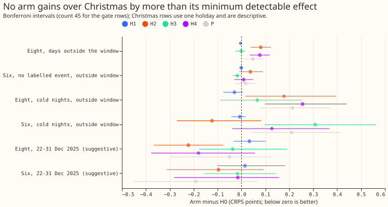
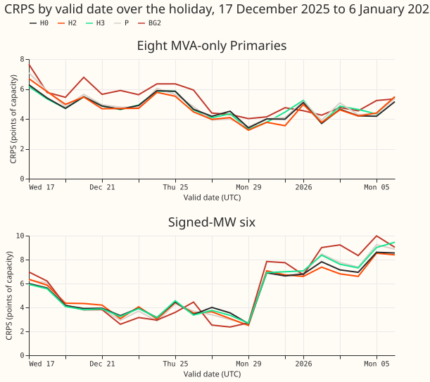
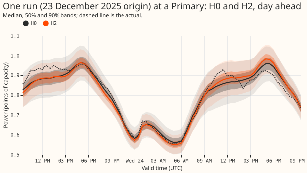
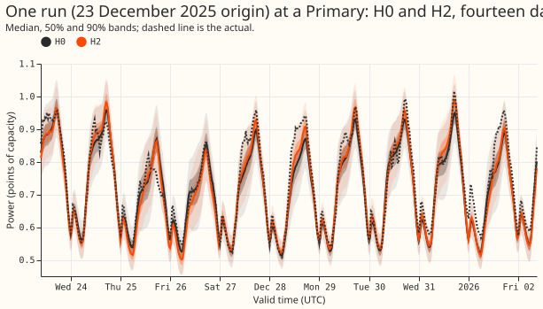

**No arm gained more over Christmas than one holiday can detect, and three cost skill on other
days.** The experiment tested five treatments of 22 December to 2 January (H1 a day-type input, H2
a Christmas weight with ERA5 replay, H3 a lag substitute, H4 all three, P a Christmas-weighted
pretraining) against H0, experiment 425's arm A. The eight are the eight MVA-only Primaries, and the
six are the six signed-MW Primaries. The Christmas minimum detectable effect is 0.27 CRPS points at
the eight and 0.26 at the six, from the three-seed spread of the stored fits on 22 to 31 December
2025. The largest Christmas differences (H2 -0.222 at the eight, P -0.190 at the six) lie below
those values, so the pre-registered stop rule applies and no gain was detected. The minimum
detectable effect reflects seed spread only, so it does not prove equivalence.

## Results (CRPS in points of effective capacity, 1.15 widening, difference from H0)

- **Row sets:** differences and intervals use rows that H0 and all five arms hold. Levels such as
  H0's 4.777 use the smaller set that BG2, `manual_heuristic`, and climatology also hold, so a level
  can differ from a difference by up to 0.005.
- **Gate, days outside the window, eight:** H1 -0.004, H3 -0.002, P +0.047, H4 +0.077, H2 +0.081.
  H0's own score is 4.777. The gate allows +0.02, so H2, H4, and P fail. The minimum detectable
  effect at the eight is 0.054.
- **Gate, six on rows with no labelled event:** H3 -0.018, H1 -0.001, H4 +0.009, P +0.018, H2
  +0.037. H0 scores 3.563. H2's point estimate exceeds the 0.02 gate, but its Bonferroni interval
  (-0.009 to 0.089) spans zero. The minimum detectable effect is 0.122, so every arm is inside it.
- **q99 pinball loss on the gate rows:** H2 +0.009 and H4 +0.008 at the eight (Bonferroni intervals
  exclude zero), everything else within 0.003. The +0.02 absolute rule is met by all arms.
- **Cold winter nights, outside the window:** at the six H3 is +0.309 (outside the minimum
  detectable effect of 0.26), P +0.210 and H4 +0.127 (inside it), and H2 -0.124; at the eight P is
  +0.213, H4 +0.255, and H2 +0.178, all outside the minimum detectable effect of 0.15.
- **Real-event rows at the six (normal-running-arrangement actuals):** H3 +0.301, H4 +0.226, P
  +0.222. H3's lag substitute therefore hurts when an event is present.
- **Christmas, 22 to 31 December 2025 (suggestive, one holiday, day-block bootstrap, no count):** at
  the eight H2 -0.222 (uncorrected 95% interval -0.312 to -0.131; Bonferroni with 45 tests -0.367 to
  -0.077), H4 -0.180, P -0.050, H3 -0.037, H1 +0.033; at the six P -0.190, H2 -0.097, H3 -0.017, H4
  -0.015, H1 +0.014. H0 scores 4.604 (eight) and 4.199 (six); BG2 scores 5.173 and 3.990;
  `manual_heuristic` 5.783 and 6.801; climatology 6.929 and 7.133.
- **Days either side (17 to 21 December, 3 to 6 January):** H2, H3, H4, and P are worse than H0 at
  both groups (+0.07 to +0.31); H1 is slightly better (-0.04, -0.06).
- **1 and 2 January of fold 2026-01 (report-only, lag leakage):** H3, H4, and P are worse (+0.2 to
  +0.9) at the six.
- **Tails on Christmas:** q95 coverage at the eight is 0.968 for H0 and 0.949 to 0.971 for the
  others; at the six it is 0.873 for H0 and 0.832 to 0.875 for the others (below 0.95 for all).
- **Pre-registered predictions:** P1 (H3 gains by more than the minimum detectable effect) failed.
  P2 (H1 helps least) held. P3 (H4 gains and passes the gate) failed on both counts. P4 (H2 and P
  stay inside the minimum detectable effect elsewhere) failed for H2 and H4 (+0.081 and +0.077
  against 0.054) and for P (+0.047, inside 0.054 only narrowly).
- **Compute:** 1 reproduction fit (H0r, 2026-06 seed 0: 15 epochs, val NLL 0.3641, the stored
  value), 75 fine-tunes of 36 to 70 seconds, and 15 P pretrainings; about 1.3 GPU-hours.

## Caveats

- The experiment did not score avoidable-curtailment cost at f = 0.9, 0.75, and 0.5, the "Checks"
  bullets (median minus mean forecast, mean-forecast error beside each score), the load-shift event
  time-series plots, or a second scored Christmas (December 2024 held out). Figures 3 and 4 show one
  Primary and one run.
- The Christmas and either-side slices come from one holiday, so every number there is suggestive.
- H2 and H4 take 1.33 times the optimiser steps per epoch, so their loss differs from H0's in the
  batch mix and the step count as well as in the weight. Their gate losses cannot be separated from
  that.
- The voted day type uses only earlier Christmases, so fold 2025-12 has years 2019 to 2024 for the
  Primaries with that history and none for D15 and D18; for such dates the day type is the
  weekday's.
- Every score is selection-biased: the five folds that choose the arm also score it. July 2026 is
  unused. NGED's event labels are incomplete: "rows with no labelled event" may hold events.
- Reference H0 is experiment 425's stored fits; the reproduction fit matched the stored fit.

## Audit (fresh Sonnet agent, from the raw stored forecasts)

- **Trigger:** three pre-registered predictions failed (P1, P3, P4) with no tested explanation.
- **Numbers reproduce:** the audit re-derived H2 +0.081, H4 +0.077, P +0.047, H1 -0.004, and H3 -0.002
  at the eight outside the window, and H3 +0.301 on real-event rows at the six. Every H2 and H4 seed
  loses to the matching H0 seed, and all arms are scored on the same 1,145,256 rows. It found no
  leakage in the day-type vote, the replay rows, or the lag substitution.
- **Accepted: the H2, H4, and P loss sits in two winter folds and is not specific to Christmas.**
  The loss at the eight is +0.139 (H2) and +0.172 (P) in fold 2025-12, and +0.195 (H2) and +0.132 (P)
  in fold 2026-01, against at most +0.05 elsewhere. In fold 2025-12 H2 loses +0.112 on 1 to 16
  December, more than five days before the window. P has neither the weight nor the replay and
  shares the loss, so a factor common to the winter folds may explain part of it. H2 bundles the
  weight with the replay (each replay row is seen about 70 times in a 10-epoch fit), so the
  experiment cannot say which component hurts. The advice below therefore rejects the bundles as
  tested, not the ideas separately.
- **Accepted: the H3 real-event harm rests on one episode.** The six's real-event rows are mostly
  two Primaries and one long episode. In fold 2026-01 the harm is +0.725 on targets from 3 to 16
  January that have a substituted lag, and -0.005 elsewhere, which fits the substituted lag
  removing event state. In fold 2025-12 the harm is +0.405 on rows with no substituted lag, so the
  +0.30 mixes substitution and a changed fit. Excluding 3 to 13 January the figure is +0.113.
- **Accepted: the gate slice includes targets up to about 16 January,** which H3 and H4 affect,
  because long leads carry a lag back into the window. The gate numbers keep that definition.
- **Not run:** a weight-only arm, a replay-only arm, and H0r in folds 2025-12 and 2026-01. The
  H0r run in 2026-06 matches the stored fit to 1e-8.

## What to try next

- Score Christmas 2026 with H0 and H1, the arm that passes the gate.
- Run a weight-only arm and a replay-only arm, and H0r in folds 2025-12 and 2026-01, before ruling
  out either idea.
- Hold out December 2024 as a second scored Christmas before spending more on the question.

## Question and what the data can say

- **Scored Christmases: one.** Fold 2025-12 holds 22 to 31 December 2025 (10 days); fold 2026-01
  holds 1 and 2 January and trains on Christmas 2025 beside them, so those two days are report-only
  (lag leakage). The window is 22 December to 2 January by UTC date everywhere.
- **Training Christmases:** pretraining (ERA5 and CAMS rows with real lags, from 2019-09) holds
  Christmas 2019 to 2024; the ENS fine-tuning window (from 2024-04, 730 days) holds Christmas 2024
  and, for folds after the new year, Christmas 2025. Fold 2025-12 never trains on its own Christmas.
- **Consequence:** the Christmas minimum detectable effect on 10 days is large. It is printed before
  any contrast, every Christmas contrast is suggestive, and Christmas stays report-only for the
  usual gates. A second scored Christmas (December 2024 held out) needs a new fold cut and is not
  run.

## Design (all fine-tune experiment 425's stored arm A pretraining, three seeds, five folds)

- **Folds:** 2025-10, 2025-12, 2026-01, 2026-03, 2026-06 (experiment 449's), one refit per fold,
  monthly cadence as in 425. The experiment 399 start cut for D15 and D18 and the flagged exact-zero
  drop are applied exactly as in 425; the per-fold counts are logged.
- **H0 (reference, not refitted):** 425's own stored fits; `H0r` refits seed 0 of 2026-06 to show
  the widened network reproduces them within noise.
- **H1:** adds two input columns, `sat_like` and `sun_like`, with zero-initialised first-layer
  weights. On a window day the Primary's own history gives the day type: weekday-like (both zero),
  Saturday-like, or Sunday-like. A year votes by taking the nearest of three reference levels (mean
  daily power of weekdays, Saturdays, and Sundays from 15 November to 14 December and from 10
  January to 10 February); the calendar dates are voted by mode over earlier years whose window
  ended at least 4 days before the refit. Bank holidays outside the window are not remapped (425 has
  a bank-holiday flag; experiment 396's holiday columns raised January error, the prior for the
  gate). The network already has `christmas_inside`, `christmas_days`, `christmas_tent`, and the
  day-of-week inputs, so only the day type is new.
- **H2:** Christmas-period rows (valid time in the window) get weight 5 in fine-tuning, multiplying
  425's recency weight `0.5 ** (age_days / SHORT_HALF_LIFE_DAYS)`. ERA5 and CAMS rows whose valid
  time is in the window (about 0.27 million rows, held-out weeks excluded) are replayed: each batch
  of 16,384 holds 12,288 fine-tuning rows and 4,096 replay rows drawn with replacement, the fold's
  mean recency weight (so replay carries about a quarter of the loss), so an epoch (one pass over
  the fine-tuning rows) takes 1.33 times the steps. Early stopping sees the unweighted held-out-week
  negative log-likelihood of the fine-tuning rows only.
- **H3:** if a row's day or weekly lag half-hour lies in the window, the lag becomes the cleaned
  power at the same half-hour of the latest earlier day outside the window with the target date's
  day type (voted type in the window, weekday type outside; the day-type vote for a date uses only
  earlier years, and a substituted lag's age input grows by the days stepped back); a third input
  column `lag_substituted` flags it. The newest-usable-observation rule is kept because the search
  only moves back. The origin lag is not touched. The rule is the same in training and at forecast
  time.
- **H4:** H1 plus H2 plus H3.
- **P (requested 2026-11-01 by the manager for the maintainer):** a new pretraining of arm A's
  network with the window rows weighted 5 over Christmas 2019 to 2024 (pretraining cap and patience
  as 425), then the plain 425 fine-tune. It separates "Christmas skill from pretraining on all six
  Christmases" from "fine-tune emphasis" (H2).
