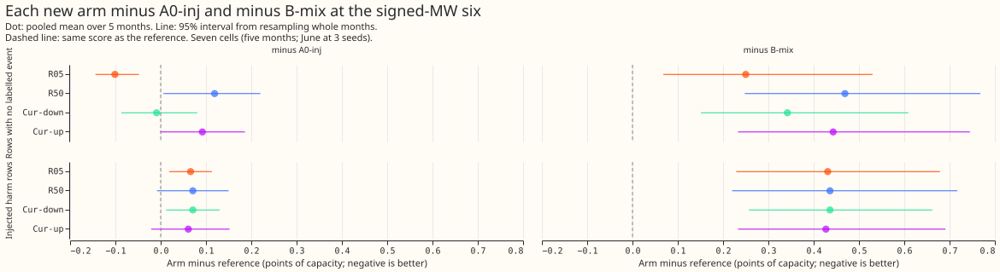
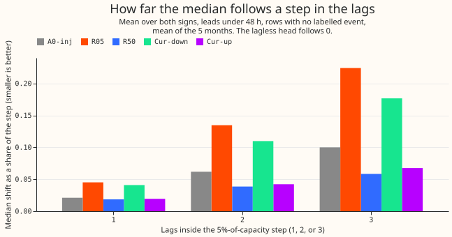
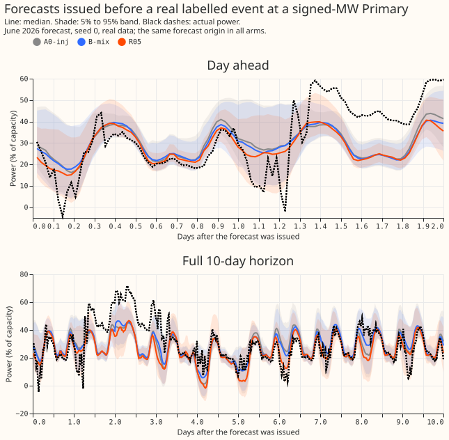
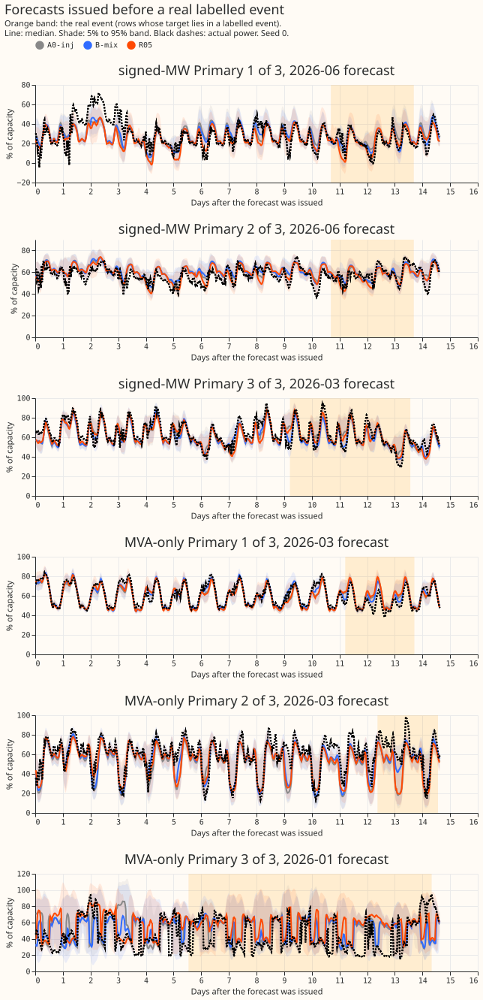

**Training with more artificial load-shift events in the lags makes the forecast follow a step in
its recent readings less, and raises its error on ordinary rows; none of the shares or schedules
tried removes the following for free.** We asked whether the share of training rows that hold an
artificial event, and how that share changes during training, alters how far a neural network's
median forecast follows a sudden step in its recent power readings (its 3 lags: the newest usable
reading, the reading at the same time of day on an earlier day, and the reading at the same time of
day and weekday on an earlier week). We trained the same neural network on copies of the training
data (called worlds) in which artificial load-shift events had been inserted into the readings, so
that 5% (arm R05), 28% (arm A0-inj, the reference), or 50% (arm R50) of the training rows had at
least one lag inside an inserted event. Two further arms started at 50% and ended at 5% (Cur-down),
or the reverse (Cur-up). We then added a step of 5% of the Primary substation's capacity to all 3
lags and measured the share of the step that appeared in the median forecast. That share was 0.224
for R05, 0.100 for A0-inj, and 0.058 for R50. R50 scored 0.119 points of capacity worse than A0-inj,
and R05 0.101 better, on rows outside every event that NGED (the electricity distribution network
operator) has labelled. No neural network alone beat the fixed 50/50 average of A0-inj and a
forecast built without lags (B-mix).

**Verdict: not supported.** The hypothesis was that Cur-down would reach the low following of a high
share without its loss of score. Cur-down follows 0.177 of the step, more than the 0.100 of A0-inj,
and no arm improves on A0-inj on injected harm rows. The hypothesis text described a lower following
for a schedule that ends at a low share, which the sweep shows is the wrong way round. All numbers
are interim: they come from five months and one to three seeds, and no interval is adjusted for the
16 contrasts. The sweep and the bad-data injections cover leads under 48 hours. NGED's logs may miss
events, so rows with no labelled event may hold events.

**Terms.** A lag is one of those 3 readings of the substation's power from an earlier time. A harm
row is a forecast target outside every event whose lags lie inside one, so a forecast that trusts
its lags is misled. Injected harm rows are harm rows in the injected scoring worlds (w200 to w202),
where events are many. Points of capacity are the continuous ranked probability score (CRPS,
computed from 11 quantiles) as a percentage of the Primary's capacity. The signed-MW six are the 6
Primary substations that report signed power. B-mix is the 50/50 mixture of the stored A0-inj
forecast and the lagless forecast, which is built without any lag. The lagless table holds that
forecast for every half-hour.

## Results

- **Arms and rates.** Every arm is experiment 404's A0-inj neural network, trained for 6 epochs on
  one injected world per epoch. The share of training rows with at least one of the 3 lags inside an
  injected event, at 2026-06 seed 0, is 4.9% for R05, 27.8% for A0-inj (experiment 404 called it
  20%), and 49.3% for R50. Cur-down uses 49.3%, then 27.8%, then 4.9%, for 2 epochs each; Cur-up
  uses the reverse. In the other cells the shares are 4.4% to 5.7%, 25.9% to 28.8%, and 45.4% to
  49.6%.
- **Reproduction.** The re-fitted A0-inj at 2026-06 seed 0 matches the stored forecasts to at most
  1.4e-4 of capacity at every quantile.
- **Minimum detectable effect.** From the seed spread of the stored A0-inj at 2026-06 (seeds 0 to
  2), 2.8 standard deviations: 0.144 on rows with no labelled event and 0.155 on injected harm rows.
  Experiment 404's month-to-month spread (0.3 to 1.0 points) is larger. The clean-row equivalence
  limit of experiment 439 is 0.061.
- **Contrasts at the signed-MW six** (points of capacity, negative is better; unadjusted 95%
  intervals from resampling months; the number after the interval is the cells better than the
  reference, of 7). The pre-registered Bonferroni level for k = 16 is stricter, and only the
  interval for R05 on rows with no labelled event (-0.144 to -0.048) would plausibly survive it.

| Arm | Absolute, no labelled event | Minus A0-inj | Minus B-mix | Absolute, injected harm | Minus A0-inj | Minus B-mix |
|---|---|---|---|---|---|---|
| A0-inj (stored) | 3.698 | | +0.350 (0.171 to 0.598) | 4.019 | | +0.365 (0.177 to 0.566) |
| R05 | 3.590 | -0.101 (-0.144 to -0.048), 7 | +0.250 (0.068 to 0.530) | 4.077 | +0.066 (0.019 to 0.113), 1 | +0.431 (0.229 to 0.679) |
| R50 | 3.793 | +0.119 (0.006 to 0.220), 2 | +0.469 (0.248 to 0.768) | 4.065 | +0.071 (-0.008 to 0.150), 3 | +0.436 (0.220 to 0.717) |
| Cur-down | 3.676 | -0.009 (-0.087 to 0.081), 5 | +0.342 (0.151 to 0.609) | 4.065 | +0.071 (0.012 to 0.130), 2 | +0.436 (0.257 to 0.662) |
| Cur-up | 3.768 | +0.092 (-0.001 to 0.186), 3 | +0.443 (0.233 to 0.745) | 4.056 | +0.061 (-0.021 to 0.152), 3 | +0.427 (0.233 to 0.691) |

- **P1 partly holds.** At 3 lags and leads under 48 hours, R05 follows 0.124 more of the step than
  A0-inj (0.224 against 0.100). R50 follows 0.042 less (0.058), which is 0.008 short of the 0.05
  that P1 asked for. At leads of 48 to 120 hours, R50 follows 0.037 less (0.054 against 0.091),
  which is 0.013 short.
- **P2 fails.** R50 scores 0.119 worse than A0-inj on rows with no labelled event (0.006 to 0.220),
  against the 0.05 predicted. The gap is inside the 0.144 seed spread and above the 0.061 clean-row
  limit of experiment 439.
- **P3 holds as an equivalence check.** Cur-down is 0.092 behind R05 on rows with no labelled event,
  inside the 0.144 seed spread. It is 0.009 better than A0-inj there, and 0.005 behind R05 on
  injected harm rows.
- **P4 holds.** Every neural network alone is 0.25 to 0.47 behind B-mix on rows with no labelled
  event, and R05 narrows the gap from 0.35 to 0.25.
- **Stop rule.** The stop rule does not fire, because R05 differs from A0-inj on the sweep share by
  0.124, more than 0.05. R50 differs by 0.042, so the rate is shown to matter below 28% and not
  shown to matter above it.
- **Mixtures (descriptive, not in k).** Mixed with the lagless table, R05 is 0.073 better than B-mix
  on rows with no labelled event (-0.094 to -0.048, better in 7 of 7 cells) and 0.030 better on
  injected harm rows (-0.060 to 0.000). The mixed R50, Cur-down, and Cur-up are within 0.06 of
  B-mix.
- **Sweep.** Median shift as a share of a step of 5% of capacity at 3 lags, leads under 48 hours
  (mean of 5 months; lowest to highest month): A0-inj 0.100 (0.084 to 0.128); R05 0.224 (0.161 to
  0.268); R50 0.058 (0.052 to 0.070); Cur-down 0.177 (0.152 to 0.213); Cur-up 0.067 (0.050 to
  0.085). The ratio of band width to its width without the step stays within 1.006 for every arm.
  The control that hides all three lags was not run, because experiment 404's sweep builds it only
  for arms whose names start with "B". The lagless forecast follows 0 by construction, so the
  mixture follows about half of the neural network's share.
- **Bad-data injections.** Median shift as a share of the corruption, mean of 5 months, in the order
  A0-inj, R05, R50, Cur-down, Cur-up. A stuck reading for 24 hours: 0.056, 0.102, 0.028, 0.086,
  0.030. A dropout to zero for 6 hours: 0.024, 0.032, 0.019, 0.051, 0.017. A spike of 4 times the
  week-on-week change: 0.024, 0.032, 0.023, 0.036, 0.022. A spike of 20 times: 0.004, 0.014, 0.010,
  0.013, 0.011. The corruption definitions are experiment 465's, with the size measured over the
  corrupted readings only.
- **Tails** (signed-MW six, rows with no labelled event, raw quantiles; coverage of q01, q05, q95,
  and q99, then q99 pinball loss in points of capacity). A0-inj: 0.011, 0.043, 0.813, 0.915; 0.349.
  B-mix: 0.005, 0.025, 0.856, 0.950; 0.259. R05: 0.011, 0.043, 0.822, 0.928; 0.305. R50: 0.011,
  0.041, 0.796, 0.901; 0.415. Every neural network alone is under-covered at q95 and q99. Its q99
  pinball loss is 0.046 (R05) to 0.156 (R50) above B-mix's, beyond the +0.02 limit. The four
  mixtures with the lagless table are within 0.018 of B-mix on rows with no labelled event, and
  within 0.022 on injected harm rows. The full table, including the 12 to 36 hour band, is in
  `work/scores/tails.csv`.
- **Avoidable curtailment** (signed-MW six; million pounds summed over the cells of the five months;
  95% interval resampling cells). At f = 0.9, R05 minus A0-inj is -0.09 (-0.44 to 0.17) and R50 is
  -0.06 (-0.35 to 0.14). At f = 0.75, R50 is +1.58 (0.25 to 3.32) and Cur-up +1.21 (0.23 to 2.42).
  At f = 0.5, R05 is -3.12 (-7.94 to 0.37), R50 +4.78 (1.46 to 8.82), and Cur-up +3.31 (0.49 to
  6.57). A0-inj minus B-mix is +0.19, +0.90, and +2.69 at f = 0.9, 0.75, and 0.5, with every
  interval including zero.
- **Serving cost.** Each arm serves one neural network per pass, with no table to refresh and no
  detector or gate, and the share and schedule of injected rows add nothing at serving. B-mix serves
  two neural networks (the lagged network and the lagless one), the cross-fitted lagless table, and
  a mixture step. Removing that complexity leaves a gap to B-mix of +0.25 (R05) to +0.47 (R50) on
  rows with no labelled event and +0.43 to +0.44 on injected harm rows.
- **What the share would change for an operator.** A forecast trained with a higher share of
  artificial events follows a sudden step in the last few days of power readings less, and is a
  little less accurate on ordinary days. The share needs no event labels.
- **Row counts** (signed-MW six, summed over the 7 cells): 626,771 rows with no labelled event and
  1,138,838 injected harm rows. Rows inside real events, rows after events, and cold-night rows were
  not scored separately.

## Checks

- **Median minus mean forecast per site, and the error of the mean forecast.** Neither was computed:
  the stored forecasts hold 11 quantiles and not the mean of the mixture.
- **Audit triggers.** No control failed, no nested arm beat the arm that contains it, and the
  headline intervals are of the same order as experiment 404's. The prediction for R50 in P1 missed
  by 0.008 at leads under 48 hours; the miss is small, and no audit was run.
- **Reviews.** One Sonnet review of the plan and code before the first fit, one Sonnet review of the
  scoring scripts before the numbers were quoted, one Sonnet check of the numbers against the stored
  tables, and one Sonnet prose review. Each finding was triaged in the pull request.

## What to try next

- **Do not tune the share further.** The 3 rates between 5% and 50% show one trade-off between the
  following and the error on ordinary rows; other rates were not tested, and the best-scoring arm
  (R05) follows the most.
- **Stage the difficulty of events** (the follow-up named for this experiment) only if the leak must
  fall at constant score; this experiment gives no evidence for it.
- **Stored artefacts.** Fitted neural networks are in
  `data/ml-experiments/00486-lagged-network-injection-rate-and-schedule/work/models/`, forecasts
  under `work/predictions/`, and tables under `work/scores/`.

## Plan (written before any score was read)

**The lagged neural network (A0-inj of experiment 404) learns from training worlds in which power
readings have been corrupted by injected load-shift events, and the share of training rows with a
corrupted lag has never been varied.** Experiment 404 chose it once. This experiment trains the same
network, on the same rows and with the same loss, on worlds with a different share, and on two
schedules that change the share during training. It then asks whether the network's median still
follows a step in its lags, and what that costs on rows with no labelled event.

## Arms

All arms are experiment 404's A0-inj network (mixture density network, three origin lags, six
epochs, experiment 397's recency weights, monthly refit, lagless table frozen), trained on injected
worlds saved to disk, one per rate and seed. Only the world in each epoch changes.

| Arm | Share of training rows with a lag inside an injected event | Schedule |
|---|---|---|
| A0-inj (reference, stored) | 27.8% measured at 2026-06 (experiment 404 called it 20%) | constant |
| R05 | 4.9% | constant |
| R50 | 49.3% | constant |
| Cur-down | 49.3%, then 27.8%, then 4.9% | epochs 1 to 2, 3 to 4, 5 to 6 |
| Cur-up | 4.9%, then 27.8%, then 49.3% | epochs 1 to 2, 3 to 4, 5 to 6 |

- **Rate definition.** Spikes count as events, and the shares are for 2026-06 seed 0 (the write-up
  reports the share in every cell). The share counts training rows with at least one of the three
  origin lags inside an injected event, measured on the 2026-06 training pool at seed 0
  (`e00486_fit.py share`). The brief's 5%, 20%, and 50% are the labels; the stored world measures
  27.8% by this definition. The new worlds use experiment 428's injection with the event coverage
  changed to 0.016 (R05) and 0.18 (R50), set by measuring candidate worlds (0.02, 0.04, 0.20, 0.30
  gave 6.4%, 11.4%, 54.1%, and 73.4%).
- **Worlds are per seed and new for each rate.** Training seeds 100 to 102; the scoring worlds w200
  to w202 and the clean world w-1 are experiment 404's, unchanged, so every arm is comparable with
  the stored A0-inj and B-mix.
- **Reproduction.** `A0-repro` re-fitted A0-inj for 2026-06 seed 0: on world w200 its quantiles
  differ from the stored A0-inj by at most 1.4e-4 of capacity. The check passes if every arm-level
  score matches the stored one within the minimum detectable effect; it is also the noise floor. No
  other cell is refitted.
- **Mixtures.** Each new arm is also scored as the fixed 50/50 mixture with the cross-fitted lagless
  table (`X+lagless`), read alone and in the mixture; the mixture contrasts are descriptive.

## Minimum detectable effect, row sets, and the stop rule

- **Minimum detectable effect (MDE).** Computed from the stored A0-inj and B-mix before any new arm
  is read, and printed first. Source 1: the seed spread at 2026-06 (seeds 0 to 2). Source 2:
  experiment 404's month-to-month spread (0.4 to 1.0 points on harm rows, 0.3 to 0.9 inside events,
  0.3 to 0.8 on clean rows). Clean-row equivalence uses experiment 439's bar of 0.061. For the sweep
  share, equivalence means within 0.05 of A0-inj.
- **Row sets of the 16 contrasts.** Signed-MW six only (the MVA-only eight apart, never pooled).
  Rows with no labelled event: the clean real world w-1. Injected harm rows: pooled over w200 to
  w202. Contrasts use the five months at seed 0; seeds 1 and 2 at 2026-06 give the MDE and
  descriptive rows. Intervals are month-block bootstraps with the sign count over the five months
  beside each; event slices use whole-event intervals.
- **Stop rule.** Evaluated after the seed-0 cells of R05 and R50. If it fires, Cur-down and Cur-up
  still run on those cells, but 2026-06 seeds 1 and 2 are not fitted for any arm.
- **References.** The gain is read against A0-inj; q99 pinball loss within +0.02 is against B-mix;
  no loss on rows with no labelled event is judged against the 0.061 bar.

## What the write-up will state

- One sentence an operator could read on what the regime changes in the forecast; that the regime
  needs no event labels.
- Serving cost per arm and per reference: networks per pass (one for an arm, two for B-mix), tables
  stored and refreshed (none, against the lagless table), detector or gate (none), and the score gap
  to B-mix on rows with no labelled event, harm rows, and injected harm rows.
- q01, q05, q95, and q99 coverage and pinball loss, the 12 to 36 h lead band, raw and after table P
  with the 1.15 widening; row counts per row class (including rows inside real events, after events,
  and cold nights); avoidable curtailment at f = 0.9, 0.75, and 0.5.
- The readings-level sweep and the bad-data injections of experiment 465 (copied from its branch
  with credit, since it is unmerged), the time series plots, and the `dataviz` skill's rules.

## Compute

- **Fits:** 4 arms × 7 cells (five scored months at seed 0; 2026-06 at seeds 0 to 2) = 28 fits at
  about 26 s each on the GPU, about 0.2 GPU-hours, one GPU process under 8 GB and one feeder core.
- **Reused:** the stored A0-inj and B-mix forecasts on all 7 cells; one reproduction fit.
- **Scoring:** forecasts on w200 to w202 and w-1 for 8 arms (four networks alone and mixed), the
  sweep, the corruption injections, curtailment, and the bootstrap dominate the wall time.

## Standing practices followed

Monthly refits; cleaned data with flagged `substation_zero` half-hours dropped (the count per cell
is printed with the scoring); the D15 and D18 start cut before 2025-03-01; fitted networks saved
under this experiment's data folder; stored forecasts reused; tails and curtailment reported; the
unlogged-event caveat stated: NGED's logs may miss events, so rows with no labelled event may hold
events, the harm table is optimistic, and real-event slices undercount. Weather inputs are the ECMWF
ENS mean and spread of experiment 404 (no past-weather lags enter the network, so the past-weather
caveat does not apply).

## Reading earlier advice

The plan follows experiment 404's advice to use the fixed 50/50 mixture B-mix as the reference and
to report the absolute score and event counts beside every contrast. It departs from nothing.
