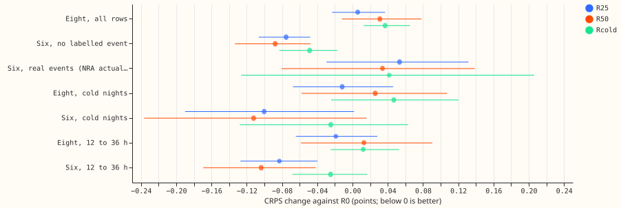
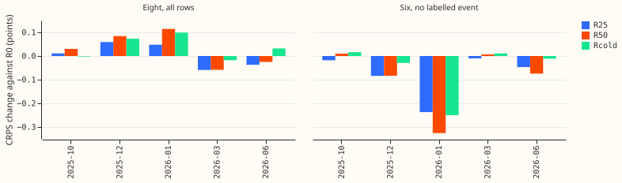

---

**Replaying ERA5-and-CAMS rows does not fix cold winter nights at the eight, and its gain at the six
is below the seed-noise minimum detectable effect.** Fine-tuning experiment 425's arm A with 25% or
50% of each step's loss on ERA5-and-CAMS pretraining rows left CRPS at the eight MVA-only Primaries
unchanged on all rows (R25 +0.006, R50 +0.031), and replaying only cold-night rows (Rcold) made the
eight slightly worse (+0.037). On rows with no labelled event, R25 lowers the eight's CRPS by 0.028
(Bonferroni interval excludes zero), so the all-rows result hides a gain on clean rows and a loss on
event rows. At the signed-MW six, plain replay lowered CRPS on rows with no labelled event by 0.075
to 0.088 points (about 2 to 2.5%). The block bootstrap excludes zero for that gain, with or without
the 2026-01 fold (R25 −0.039 and R50 −0.034 without it), but the gain is below the 0.112-point
three-seed minimum detectable effect, which measures the seed noise the bootstrap leaves out. The
match with a five-seed pool and the six's cold-night gain both come from 2026-01 alone. The
experiment is inconclusive and no arm is a candidate. All scores are selection-biased, because the
five folds that choose the candidate also score it. July 2026 is unused.

**The neural network shows no sign of forgetting cold nights at the eight.** The question was
whether the neural network forgets rare cold nights during fine-tuning on the ensemble (ENS) rows,
which start in 2024-04. The answer at the eight is no sign of forgetting. The experiment narrows
replay to a possible regulariser at the six and rules out cold-night-only replay.

Figure 1 shows each replay arm minus R0 on the seven CRPS row sets, with 27-test Bonferroni
intervals. Below zero is better.

Figure 2 shows the same differences by fold for the eight and the six on rows with no labelled
event. The six's gain comes mainly from the 2026-01 fold.

**Arms and design.**

- **Arms:** all fine-tune the stored arm A pretrained weights of experiment 425 (learning rate 2e-4,
  seeds 0 to 2, folds 2025-10, 2025-12, 2026-01, 2026-03, 2026-06). R0 is experiment 425's stored
  fit. R25 and R50 put 25% and 50% of each step's loss weight on ERA5-and-CAMS rows. Rcold does as
  R25 but draws replay rows only from cold nights (sun more than 5 degrees below the horizon, 2 m
  temperature of 3 degrees Celsius or below; about 4.7% of the replay rows). Drawing from cold
  nights as the scored slice defines them replaces the decile definition of lowest temperature,
  December to February, sun below -6 degrees. The slice is called "cold nights" because it covers
  every month.
- **Step and loss:** an epoch is one pass over the ENS training rows in batches of 16,384 ENS rows
  (R0's steps). Each step adds 5,461 (R25, Rcold) or 16,384 (R50) replay rows, drawn with
  replacement. Step loss is `(1 - r)` times the recency-weighted ENS loss plus `r` times the
  unweighted replay loss. Early stopping reads the unweighted ENS held-out weeks only. The replay
  share is a loss share, not a row share per batch.
- **Replay rows:** the fold's pretraining rows with the held-out weeks and purge excluded and both
  standing cuts applied; the same 46 inputs, with the `std_*` columns set to the fold's median ENS
  spread by lead band. ERA5-and-CAMS weather is not available at forecast time; it enters training
  only.
- **Fits and cost:** 45 fits plus one reproduction fit, about 65 minutes with one GPU process (peak
  3.2 GB, one feeder core). Predictions, weights, and logs are in the experiment's private folder
  `work/`. Code reused from experiments 397, 418, 425, 454, and 470.
- **Reproduction check:** the R0 refit (2026-01, seed 0) matches the stored fit: largest quantile
  difference 1e-5, 10 epochs each, CRPS 4.5462 at the eight and 4.8854 at the six for both. Passed.
- **Production cost:** serving is unchanged. The monthly refit needs the ERA5-and-CAMS table and
  1.33 times (R25) or 2 times (R50) the rows per epoch.

**Cold-night CRPS cannot be resolved below 0.169 at the eight and 0.236 at the six.** The minimum
detectable effect was printed before any contrast (points of capacity). Five single seeds of arm A
give a seed standard deviation of 0.052 (eight), 0.070 (six, no labelled event), 0.105 (cold nights,
eight), and 0.147 (cold nights, six). For two arms of three seeds each the minimum detectable effect
is 0.083, 0.112, 0.169, and 0.236.

**No arm lowered cold-night CRPS with an interval that excludes zero.** The table gives CRPS in
points of effective capacity, 1.15 widening; difference against R0 with the 27-test Bonferroni
interval; Bonferroni count 27).

| Row set | R0 | R25 − R0 | R50 − R0 | Rcold − R0 |
|---|---|---|---|---|
| Eight, all rows | 4.764 | +0.006 (−0.023, 0.037) | +0.031 (−0.012, 0.078) | +0.037 (0.013, 0.065) |
| Six, no labelled event | 3.517 | −0.075 (−0.106, −0.048) | −0.088 (−0.133, −0.048) | −0.049 (−0.083, −0.017) |
| Six, real events (NRA) | n/a | +0.053 (−0.030, 0.132) | +0.034 (−0.081, 0.139) | +0.042 (−0.126, 0.206) |
| Eight, cold nights | 4.286 | −0.012 (−0.068, 0.046) | +0.026 (−0.058, 0.107) | +0.047 (−0.024, 0.120) |
| Six, cold nights | 5.955 | −0.100 (−0.190, 0.002) | −0.112 (−0.237, 0.016) | −0.025 (−0.128, 0.063) |
| Eight, 12 to 36 h | n/a | −0.019 (−0.064, 0.028) | +0.013 (−0.058, 0.091) | +0.012 (−0.025, 0.053) |
| Six, 12 to 36 h | n/a | −0.083 (−0.127, −0.040) | −0.104 (−0.169, −0.042) | −0.025 (−0.068, 0.017) |

- **Context:** A-pool (five-seed average) scores 4.680 (eight), 3.451 (six), 4.161 and 5.931 (cold
  nights, eight and six). R25 and R50 at the six (3.441, 3.429) match A-pool in the pooled mean, but
  only through 2026-01: in the other four folds R25 is 0 to 0.05 worse than A-pool. At the eight, R0
  is 0.084 worse than A-pool and the replay arms 0.09 to 0.12 worse.
- **Predictions:** P1 (Rcold lowers cold-night CRPS by 0.05 at both) is inconclusive at the eight
  (+0.047, interval −0.024 to 0.120, against a minimum detectable effect of 0.169, so the wrong-sign
  estimate is within seed noise) and inconclusive at the six. P2 holds at the eight (R25 and R50
  intervals lie inside ±0.083) and fails at the six (an improvement, so not equivalence). P3 holds:
  q99 pinball loss changes by at most +0.003 points (eight) and −0.012 (six).
- **Stop rule:** not met, because the cold-night minimum detectable effect (0.169 and 0.236) is
  above 0.05. The idea is not closed; the cold-night result is inconclusive.
- **Candidates:** none. All three arms fail the +0.02 non-inferiority gate at the eight (upper
  bounds 0.037 for R25, 0.078 for R50, and 0.065 for Rcold), and R25 and R50 do not lower cold-night
  CRPS with an interval excluding zero at both groups.
- **Eight on rows with no labelled event (not one of the 27 tests):** −0.028 (R25, Bonferroni
  interval −0.052 to −0.005), −0.024 (R50, −0.055 to +0.006), and +0.014 (Rcold, −0.006 to +0.033).
  Rcold's loss at the eight rests on all rows.
- **Epoch cap:** R50 reached the 40-epoch cap in 4 of its 15 fits and R25 reached 37 epochs, so
  early stopping did not fire in those fits and the replay arms may be under-trained (R0 stops near
  10 epochs). A higher cap could change R50 and the eight's null in either direction.
- **Cold nights exist in only 3 of the 5 folds** (2025-12, 2026-01, 2026-03; none in 2025-10 and
  2026-06). Without 2026-01 the six's cold-night difference is +0.024 (R25), +0.067 (R50), and
  +0.072 (Rcold), so the sign flips; at the eight it stays small and negative to near zero (−0.023,
  −0.007, −0.006).
- **Validation loss:** replay lowers the ENS held-out negative log-likelihood (2026-01: R25 0.355,
  R0 0.364 to 0.369) but not CRPS at the eight.

**Replay changes tail coverage by 0.007 or less at the eight, and cold nights at the six stay far
under target.** Coverage is of the 1.15-widened bands, with targets q95 0.95, q99 0.99, q05 0.05,
and q01 0.01. At the eight, R0 has q95 0.945 and q99 0.989; the replay arms move by at most 0.007.
At the six, q95 rises from 0.918 (R0) to 0.925 to 0.928 (R25, R50). On cold nights at the six every
arm stays far below target (q95 0.787 to 0.804, q99 0.871 to 0.877; Rcold's cold-night q99 pinball
loss rises by 0.061), and Rcold raises cold-night q01 coverage at the eight to 0.009 and at the six
to 0.068 (target 0.01), so its lower tail worsens. Full tables are in `work/scores/absolute.csv`.

**Every replay arm lowers avoidable-curtailment cost at the six at f = 0.9, by an amount whose 95%
interval only just excludes zero.** The cost is in GBP million summed over the five scored folds,
rows with no labelled event, scaled limit f. R0: 1.87 (f = 0.9), 7.07 (0.75), 21.70 (0.5); manual
heuristic at f = 0.75 is 12.88. Paired difference against R0 with a 95% interval (not corrected for
the nine comparisons): at f = 0.9, R25 −0.29, R50 −0.41, Rcold −0.39, each statistically significant
at the 5% level; at f = 0.75 and 0.5 the intervals mostly include zero (f = 0.5: R25 −1.38,
significant). The totals carry wide intervals (R0 at f = 0.9: 0.18 to 4.90), as in experiment 470.

**Checks.**

- **Audit:** two triggers fired (gain concentrated in one fold, and a prediction answered the other
  way). A fresh Sonnet auditor re-derived every contrast, the 27 Bonferroni intervals, the fold
  shares, and the minimum detectable effects, and confirmed the verdict "inconclusive, no
  candidate". It found that leaving out 2026-01 does not remove the six's no-event gain for R25 and
  R50 (−0.039 and −0.034, Bonferroni intervals −0.060 to −0.019 and −0.065 to −0.008) and removes
  only Rcold's (−0.003). The wording above follows its findings. The 2026-01 fold supplies 58% (R25)
  and 68% (R50) of the pooled gain (−0.237 and −0.325 in that fold).
- **Not run:** the median-minus-mean check and the mean-forecast error contrast, the load-shift
  event plots (no event contrast is claimed), and the example probabilistic forecast plots (the
  forecasts are fine-tunes of experiment 425's arm A, whose examples are on its page).
- **Caveats:** NGED's event labels are incomplete, so rows with no labelled event may hold
  unlabelled events. Three seeds and five folds give wide seed noise. The block bootstrap does not
  include seed variance. Rcold draws about 4 rows per cold-night row per epoch, so memorisation of
  the pool is possible and is not visible to the ENS-only early stopping.

**What to try next.** Repeat plain 25% replay with five seeds on a second set of folds before using
it at the six. Do not pursue cold-night-only replay. Leave the cold-night under-coverage at the six
to recalibration.
