**Real labelled load-shift events (periods when NGED moved a substation's load to a neighbouring
substation), added to the training of the lagged-power neural network, change nothing detectable.**
The question was whether the real events from months before the scored month improve the
lagged-power neural network (A0-inj of experiment 404, a mixture density network that reads the
three most recent power lags and was trained on synthetic events injected into the data) when mixed
into training or used to fine-tune it. The answer at the signed-MW six is no: `RealMix` (real events
mixed into training) is within the minimum detectable effect (MDE) of A0-inj on every row class, and
`PT-FT` (pretrained on injected events, then fine-tuned on real ones) is worse on four of the five
row classes. The result narrows the search: the label-free recipes that could replace real labels
(injected or scanned events) have nothing to match beyond the target correction.

## Figures

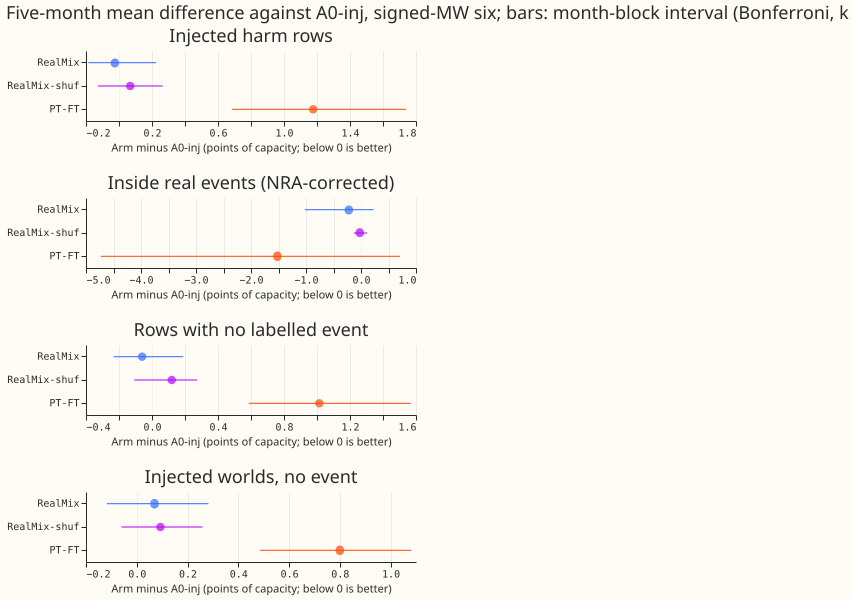

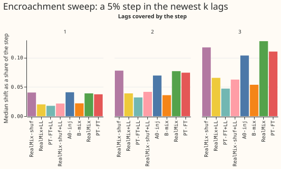

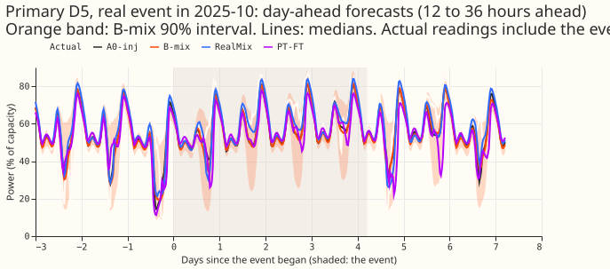

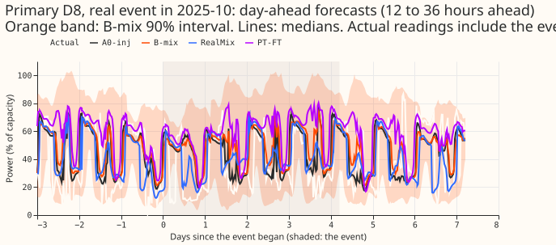

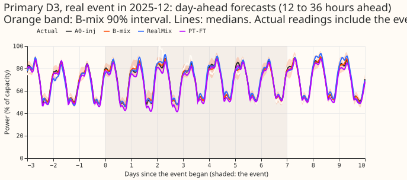

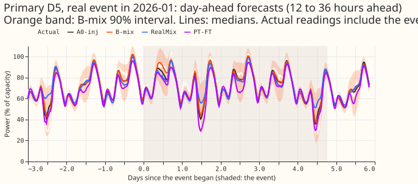

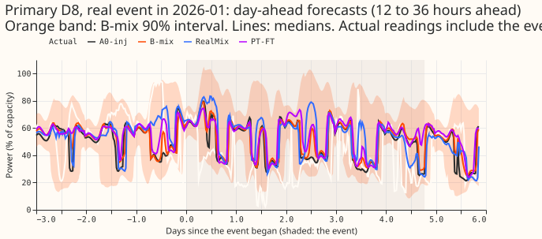

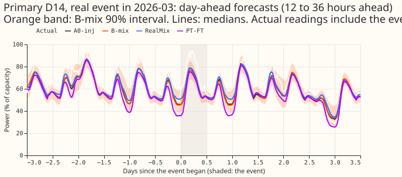

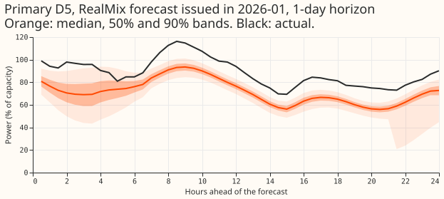

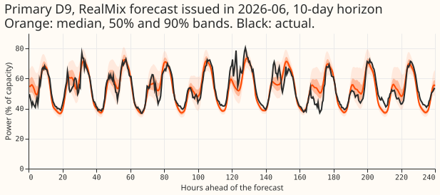

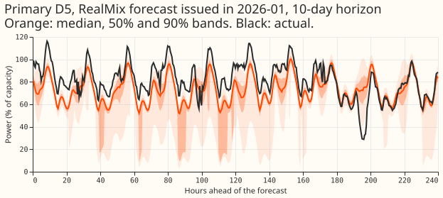

## Arms, rows, and method

- **Terms.** The signed-MW six are the six Primary substations that report signed power (D5, D9,
  D10, D11, D14, D16). A harm row is one whose target lies outside every event but whose lags lie
  inside one. The 1.15 widening scales each quantile's distance from the median by 1.15. The lagless
  table holds forecasts made without power lags.

- **Network and recipe.** Experiment 404's A0-inj (`PlainLagMdn`, injected world of seed 100, 6
  epochs, experiment 397's recency weights), monthly refit, seed 0, five scored months (2025-10,
  2025-12, 2026-01, 2026-03, 2026-06). One fit takes about 78 s on the GPU; the 18 fits took about
  0.4 GPU-hours. Code in `ml-experiments/00488-*`, importing experiments 404, 428, 435, 400, and 397
  without edits.
- **Arms.** `RealMix`: rows whose target lies inside an event that ended at least 14 days before the
  scored month get the corrected target (actual minus experiment 435's NRA share, depth 1.0) and the
  observed lags; the uncorrected copies are removed. `PT-FT`: stored A0-inj, 2 epochs at one tenth
  of the learning rate, on the corrected event rows plus an equal number of rows with no labelled
  event from the same months. `RealMix-shuf`: each event's lag pattern and depth injected into a
  random clean period of the same Primary, with the clean target. `repro`: the A0-inj recipe through
  this experiment's loop. `RealMix-d075` and `RealMix-d125`: RealMix with the correction scaled,
  2026-06 only. `+LL` marks the 50/50 mixture with the cross-fitted lagless table, as B-mix does for
  A0-inj.
- **Training events.** At the signed-MW six, 20, 28, 29, 38, and 43 events were available to the
  five months (64 to 113 at all 16 Primaries); no month was dropped. Rows whose target lies inside
  an available event are 3.45% of 2026-06 training rows, above the 2% target, so RealMix does not
  oversample and differs from A0-inj only by the corrected target and the observed lags on those
  rows.
- **Scored rows** (signed-MW six, seed 0, five months pooled): 604,246 injected harm rows, 533,170
  injected rows with no event, 323,235 rows with no labelled event, 44,145 real harm rows, 50,168
  rows inside a padded real event (24 events), and 12,654 rows in the 96 half-hours after one. The
  three scoring worlds are 200 to 202; the real world is -1. Flagged zeros are dropped as in
  experiment 404; they were not tallied again here.
- **MDE.** Seed spread of A0-inj at 2026-06 (seeds 0 to 2), for a five-month pool: 0.09 on injected
  harm rows, 0.13 inside events, 0.08 on rows with no labelled event, and 0.31 on real harm rows.
  The month-to-month spread of each contrast's own monthly differences gives larger values (0.26 on
  injected harm rows, 0.74 on corrected event rows, 0.25 on rows with no labelled event). The
  seed-based values (0.08 to 0.13) overlap P1's predicted 0.05 to 0.2, and the month-to-month values
  (0.25 to 0.74) exceed it, so P1 could mostly be reported as "within the MDE".

## Results (signed-MW six, raw forecasts, points of effective capacity)

Five-month mean of the monthly differences; the absolute scores of A0-inj and B-mix are in the
second and third columns.

| Row class | A0-inj | B-mix | RealMix − A0-inj | RealMix-shuf − A0-inj | PT-FT − A0-inj | RealMix − B-mix | PT-FT − B-mix |
|---|---|---|---|---|---|---|---|
| Injected harm rows | 4.213 | 3.895 | −0.025 | +0.068 | +1.177 | +0.293 | +1.494 |
| Rows with no labelled event | 3.824 | 3.513 | −0.060 | +0.120 | +1.014 | +0.251 | +1.325 |
| Inside real events, NRA-corrected (depth 1.0) | 14.840 | 14.503 | −0.22 | −0.023 | −1.52 | +0.116 | −1.18 |
| Inside real events, metered | 6.339 | 6.222 | +0.086 | −0.019 | +0.852 | +0.203 | +0.968 |
| Real harm rows | 3.811 | 3.680 | +0.247 | −0.023 | +0.979 | +0.378 | +1.110 |

- **Intervals.** The Bonferroni (k = 12) month-block intervals: RealMix on injected harm rows
  [−0.19, +0.23], on rows with no labelled event [−0.23, +0.19]; PT-FT on injected harm rows [+0.69,
  +1.74], on rows with no labelled event [+0.59, +1.57]; RealMix inside real events, NRA-corrected
  [−1.02, +0.23]; PT-FT inside real events, NRA-corrected [−4.72, +0.71] (3 of 5 months negative).
  Largest event dropped: RealMix −0.02, PT-FT −0.20 on corrected event rows.
- **PT-FT trades four row classes for an uncertain gain on corrected event rows.** Fine-tuning
  scores better on corrected event rows in three of the five months but worse on rows with no
  labelled event in all five, so fine-tuning on event rows costs accuracy on ordinary rows.
- **The mixtures with the lagless table are the same as B-mix.** RealMix+LL minus B-mix: −0.03 on
  injected harm rows, −0.05 on rows with no labelled event, +0.003 on metered event rows (all inside
  the MDE); PT-FT+LL is worse (+0.40, +0.34, +0.31).
- **Reproduction check.** `repro` was fitted for 2026-06 only. Its difference from A0-inj is 0.000
  on every row class there, so this experiment's training loop reproduces the stored recipe exactly.
- **Depth sensitivity (2026-06 only, depth-1.0 corrected event rows, minus A0-inj).** RealMix-d075
  −0.02 and RealMix-d125 −0.14, against RealMix −0.22 over five months; a single month cannot rank
  them.
- **The eight MVA-only Primaries (descriptive).** RealMix +0.19 [0.04, 0.34] on injected harm rows
  and +0.10 on rows with no labelled event; PT-FT +0.73 and +0.59. Corrected event rows: RealMix
  −0.49 [−0.82, −0.16], RealMix-shuf −0.39 [−0.81, +0.03], PT-FT −0.69 [−1.38, +0.07] (26 events).
  Both RealMix and RealMix-shuf improve the corrected event rows at the eight by a similar amount,
  so the gain there does not come from the real events' content.
- **Tails, signed-MW six, rows with no labelled event** (coverage at q01, q05, q95, q99; pinball
  loss at q95 and q99): RealMix 0.015, 0.046, 0.814, 0.913; 0.0096, 0.0036. A0-inj 0.012, 0.044,
  0.806, 0.912; 0.0098, 0.0035. B-mix: q95 0.855, q99 0.949; 0.0085, 0.0026. PT-FT 0.002, 0.013,
  0.837, 0.943; 0.0105, 0.0032. After the 1.15 widening RealMix reaches q95 0.854 and q99 0.940,
  PT-FT 0.881 and 0.966. The q99 pinball loss is within 0.001 of B-mix for every arm.
- **Encroachment sweep (2026-06, all 16 Primaries, a 5% step in the lags).** The median shifts by a
  share of the step, for the newest 1, 2, and 3 lags: A0-inj 0.041, 0.069, 0.104; RealMix 0.039,
  0.077, 0.128; RealMix-shuf 0.040, 0.078, 0.118; PT-FT 0.037, 0.074, 0.110; B-mix 0.022, 0.036,
  0.054; RealMix+LL 0.020, 0.039, 0.066. The band width ratio is 1.00 for every arm. No arm differs
  from A0-inj by more than 0.024.
- **Bad-data injections (2026-06, median shift as a share of the corruption).** A 6-hour dropout to
  zero: A0-inj 0.021, RealMix 0.023, PT-FT 0.016, RealMix-shuf 0.021. A spike of 20 times the weekly
  spread: 0.011, 0.018, 0.003, 0.009. A stuck reading for 24 hours: 0.028, 0.032, 0.032, 0.028. The
  injection definitions are copied from experiment 465 (experiment 465); the spread is the median
  absolute change from the same half-hour a week earlier, as there.

## Serving requirements and the accuracy lost by simplifying

- **RealMix and PT-FT** serve one network per pass, with no lagless table, no mixture step, and no
  detector. Their accuracy loss against B-mix, which serves two networks and a refreshed table, is
  +0.29 and +1.49 on injected harm rows and +0.25 and +1.33 on rows with no labelled event.
- **RealMix+LL** serves the same two networks and table as B-mix and matches it within the MDE.

## Checks

- **Median minus mean forecast, and the error of the mean forecast:** not computed. The stored
  forecasts hold the 11 quantiles only, so the mean forecast is unavailable.
- **Audit triggers:** none fired. The control that should change nothing (`repro`) moves the score
  by 0.000, no nested arm beats the arm that contains it, and the intervals are similar in width to
  those of experiment 404 and 455. A fresh Sonnet agent re-derived the injected-harm and
  no-labelled-event contrasts of RealMix and PT-FT from the stored forecasts with its own code, and
  matched them to three decimals.
- **Prediction outcome:** P1 reported as within the MDE for RealMix; PT-FT is worse than A0-inj, not
  better. P2 held (RealMix-shuf does not improve on A0-inj). P3 held (no arm beats B-mix on rows
  with no labelled event). P4 held (3.45% natural share).

## Caveats and next steps

- **NGED's event labels are incomplete.** Rows with no labelled event may hold unlabelled events, so
  a real-event slice undercounts and the clean-row figures are optimistic.
- **This is a diagnostic.** At about 1,300 substations NGED will supply no event labels, so a gain
  here could not ship without a label-free way to find events; none was found.
- **Not run: avoidable curtailment cost.** The experiment 449 pipeline depends on experiment 448's
  stored rows and reference forecasts, which this experiment's rows do not match. Every contrast
  above is within the MDE or worse than A0-inj, so a curtailment difference would be small; the
  scoring can be added if wanted.
- **Not run: seeds 1 and 2 of the new arms.** The MDE uses A0-inj's and B-mix's stored seeds; each
  new arm has seed 0 only. The sweep ran for 2026-06 only.
- **Depth error.** The corrected target uses the labelled depth; the 0.75 and 1.25 arms ran for one
  month.
- **Next.** A label-free recipe has only the target correction to replace; whether a scanned or
  injected stand-in matches RealMix is not worth testing, because RealMix itself gains nothing.
