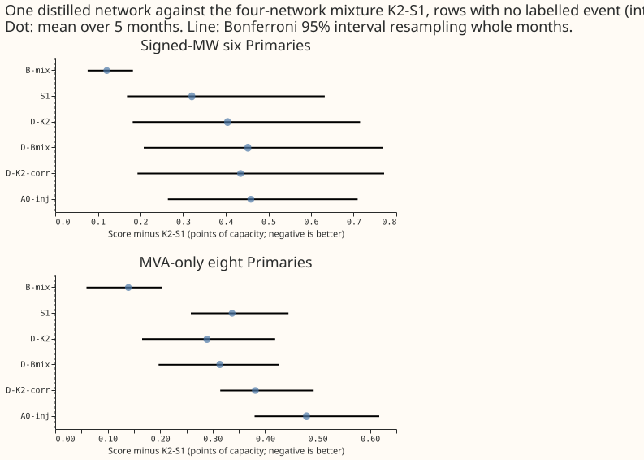

## What this experiment found

**Imitating the four-network mixture did not teach one neural network what the lagless forecast
adds.** We asked whether one neural network, whose demand inputs are the Primary substation's
measured power at 3 earlier times, can be trained to forecast as well as K2-S1. K2-S1 is the
equal-weight mixture of 2 such networks (given extra inputs) and 2 forecasts made without any recent
power readings (the lagless forecast, read from a stored table). If so, the live service could run
1 network and store no table. We trained the network on injected worlds (experiment 404's copies of
the real power series with artificial level shifts added), with the K2-S1 forecast, or the simpler
B-mix forecast (a 50/50 mixture of 1 such network and the lagless forecast), as an extra training
target at weight 0.5 on every row. We scored it on the same 5 test months as experiment 454.

On rows with no labelled event, the imitation network (D-K2) scores 3.79 points of capacity at the
6 Primaries metered in signed megawatts, against 3.85 for A0-inj (the same network trained without
a teacher), 3.51 for B-mix, and 3.39 for K2-S1. A point of capacity is 1% of a Primary's effective
capacity. The gap to B-mix, 0.28, is larger than the minimum detectable effect from this
experiment's seed spread (0.24) and from experiment 470 (0.10). The plan's stop rule is: if the
student is worse than B-mix on rows with no labelled event by more than the minimum detectable
effect, one network cannot absorb the lagless forecast and the idea closes. The point estimates
meet that rule by a small margin: the interval for the gap to B-mix at the 8 Primaries metered in
megavolt-amperes just reaches zero. The verdict is not supported, because D-K2 is also 0.40 behind
K2-S1, so the plan's recommendation rule fails on its first clause.

**Glossary.** "The six" and "the eight" are the 6 Primaries metered in signed megawatts and the 8
metered in megavolt-amperes. "Better in n of 5 months" counts the test months in which the arm
scores lower (better) than the reference. "Bonferroni 95% interval" is a month-block bootstrap
interval at the family level the plan fixes (18 contrasts).

## Figure

**Figure 1.** Every arm's score minus K2-S1's on rows with no labelled event, in points of capacity
(negative is better).

## Results (rows with no labelled event, points of capacity, mean over 5 months)

- **Arms.** D-K2 (teacher K2-S1, all rows), D-Bmix (teacher B-mix, all rows), D-K2-corr (teacher
  K2-S1 on rows where a lag lies in an event, descriptive), D-0 (no teacher term). References are
  experiment 454's stored forecasts of A0-inj, S1, B-mix, and K2-S1. Student seeds 0 to 2, each on
  its own injected world (100 to 102).
- **Signed-MW six, absolute score.** K2-S1 3.387, B-mix 3.508, S1 3.708, D-K2 3.791, D-K2-corr
  3.822, D-Bmix 3.839, A0-inj 3.846.
- **MVA-only eight, absolute score.** K2-S1 4.215, B-mix 4.355, D-K2 4.504, D-Bmix 4.529, S1 4.552,
  D-K2-corr 4.596, A0-inj 4.694.
- **D-K2 minus K2-S1.** +0.404 at the six (Bonferroni 95% interval 0.182 to 0.715, better in 0 of 5
  months); +0.289 at the eight (0.166 to 0.419, 0 of 5).
- **D-K2 minus B-mix.** +0.283 at the six (0.033 to 0.622, 0 of 5); +0.150 at the eight.
- **Gap closed (descriptive only).** D-K2 recovers 12% of the gap between A0-inj and K2-S1 at the
  six and 40% at the eight.
- **Minimum detectable effect.** 0.237 at the six and 0.125 at
  the eight from the seed spread of B-mix in this harness; 0.100 and 0.065 from experiment 470's
  single seeds.
- **Tails (clean rows, raw).** The q99 pinball loss is 0.0024 for D-K2 against 0.0022 for K2-S1 at
  the six (+0.02 points of capacity if the stored fraction is scaled by 100, so at the +0.02 limit;
  with the 1.15 widening 0.0022 against 0.0020) and 0.0026 against 0.0025 at the eight.
  The q95 coverage is 0.880 (D-K2) and 0.875 (K2-S1) at the six, below the nominal 0.95 for both;
  the 1.15 widening lifts both to about 0.91. The student is no more overconfident than its teacher
  on the five held-out months.
- **Real harm rows.** At the six D-K2 scores 3.889 against 3.546 for B-mix (+0.343, interval 0.104
  to 0.661).
- **Rows inside real events (metered actuals).** At the six D-K2 scores 5.752 against 5.872 for
  B-mix (-0.120, interval -0.902 to +0.245, better in 2 of 5 months) and 5.757 for K2-S1. At the
  eight the event rows are 4 months and D-K2 is +0.073 against B-mix (interval -0.283 to +0.636).
- **Injected harm rows (worlds 200 to 202, cells that experiment 404 stored).** Signed six: A0-inj
  4.311, D-K2 4.185, D-Bmix 4.195, S1 4.273, B-mix 3.948. MVA-only eight: A0-inj 6.036, D-K2 5.727,
  D-Bmix 5.772, S1 5.968, B-mix 5.507. K2-S1 has no forecast on the injected worlds.
- **Reproduction check.** D-0 (no teacher term) for 2026-06 seed 0 scores 5.66609 on all rows, the
  stored A0-inj scores 5.66608, and the largest median difference is 1e-4 of capacity.

## Serving table

| Arm | Networks per pass | Stored at serving | Fits per monthly refit | Clean-row score at the six |
|---|---|---|---|---|
| K2-S1 | 4 (2 S1, 2 lagless) | lagless table, past lagless forecasts, mixture step | 4 | 3.39 |
| B-mix | 2 (1 lagged, 1 lagless) | lagless table, mixture step | 2 | 3.51 |
| A0-inj | 1 | nothing | 1 | 3.85 |
| D-K2 | 1 (raw lags only) | nothing | 5 (the 4 teacher fits, then the student) | 3.79 |

Removing the lagless module costs 0.28 points of capacity against B-mix and 0.40 against K2-S1 at
the six. The student reads raw lags only: no lagless table and no input derived from the lagless forecast.

## Caveats

- **Not run, because the stop rule had already applied:** cold winter nights (so no cold-night
  minimum detectable effect was printed), the 12 to 36 hour band, avoidable-curtailment cost, the
  encroachment sweep, the bad-data injections, the example forecast and real-event plots, and the
  K2-S1 forecast on the injected worlds. None of them can reverse the clean-row gap, but the
  write-up makes no claim about them.
- **Scored but not discussed:** the NRA-actual event rows and the table P variant are in
  `contrasts.csv`. On NRA actuals at the six, D-K2 minus B-mix is -0.028 (interval -0.327 to
  +0.186, better in 2 of 5 months) and D-K2 minus K2-S1 is +0.006 (-0.251 to +0.273). Prediction
  P2 (no worse than K2-S1 by more than the minimum detectable effect on event rows and injected
  harm rows) holds on the event rows at the six; it cannot be checked on injected harm rows
  because K2-S1 has no forecast there.
- The teacher networks are in sample on the student's training rows; only the lagless table is
  cross-fitted. The lagless forecast's standard deviation is limited to a fixed range twice (as in
  experiment 404's B-mix scoring). D-Bmix distils from A0-inj of the same fit seed, so it partly
  imitates a network with the same initialisation and batch order. The teacher's in-sample
  sharpness did not show up as overconfidence on the 5 test months (q95 coverage above).
- 5 scored months, 3 seeds, and NGED's event labels are incomplete, so rows with no labelled
  event may hold unlogged events. Every score is selection-biased, and July 2026 stays unused.
- Every interval quoted is a month-block bootstrap interval at the Bonferroni level of the 18
  contrasts the plan fixes. The stop rule rests on point estimates, and the interval for D-K2
  minus B-mix at the 8 runs from -0.0002 to +0.339.
- Reviews: one fresh Sonnet language-model code review before the first fit (it found no blocking
  bug; three crash guards applied). One Sonnet write-up review checked the numbers and prose; its
  10 findings were applied.

## Checks

- Median minus mean forecast per site and the error of the mean forecast beside each score were not
  computed.
- Audit triggers: none fired (the repro control passed; no nested arm beat the arm containing it).

## Problems caused by the move

None.
