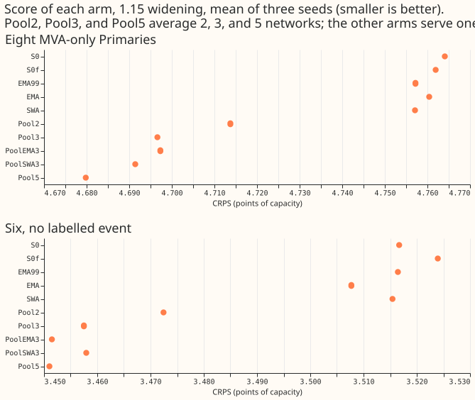
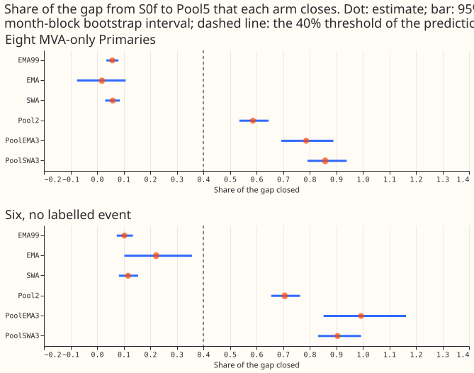
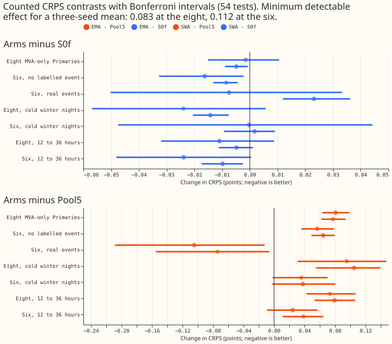
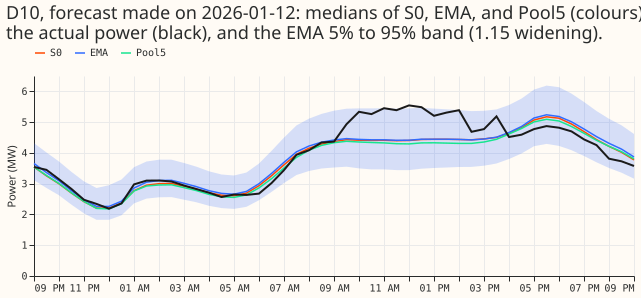
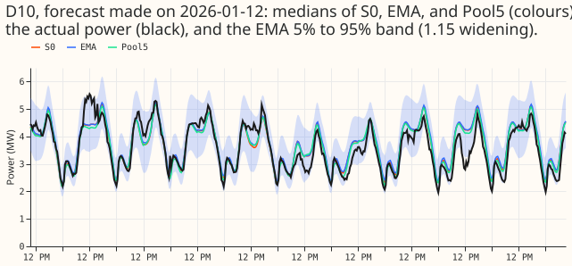

## Take-home

**One averaged neural network gains almost nothing over one ordinary neural network, while a pool of
seeds closes most of the gap to the five-network pool.** The demand networks here forecast power at
16 substations, and CRPS (continuous ranked probability score, in points of effective capacity;
lower is better) scores each forecast. At the eight MVA-only Primaries, the fixed-budget single
network scores 4.762 points, the five-network pool 4.680, the exponential moving average (EMA)
network 4.760, and the stochastic weight average (SWA) network 4.757. The pool of three EMA networks
scores 4.697. At the six signed-MW Primaries, on rows with no labelled event, the same five arms
score 3.524, 3.451, 3.508, 3.515, and 3.451. The gap to the five-network pool is 0.082 points at the
eight and 0.073 at the six. The seed-noise minimum detectable effect is 0.083 at the eight and 0.112
at the six. Each gap is therefore about the size of the noise, so the experiment can show only that
weight averaging gains little. It cannot rank the arms closely. These results are interim, because
they rest on 5 months of data and one fine-tune trajectory per seed.

## Figures

Figure 1. CRPS of each arm.

Figure 2. Share of the gap from S0f to Pool5 that each arm closes.

Figure 3. Counted contrasts with Bonferroni intervals.

Figure 4. Example forecasts of one Primary.

## Results

**Every score is in CRPS points of effective capacity at the 1.15 tail widening, the mean of three
seeds on experiment 470's rows.** Experiment 470 (the first-release demand forecaster comparison)
supplies the rows, which hold the eight MVA-only Primaries (substations metered in MVA only) and
the six signed-MW Primaries (substations metered in signed MW). Each arm is scored over 15
fine-tunes: 5 held-out months times 3 seeds. A negative contrast means the first arm scores lower,
which is better. The scorer printed the Bonferroni count (54) and the minimum detectable effect
for the mean of three seeds before any contrast: 0.083 at the eight, 0.112 at the six on rows with
no labelled event, 0.169 at the eight on cold nights, and 0.236 at the six on cold nights. Every
score is selection-biased, because the five folds that choose also score.

Arms:

- **S0f:** one network fine-tuned for a fixed 4 epochs, final weights.
- **S0:** one network fine-tuned with early stopping (experiment 425's stored fit; the production
  recipe).
- **EMA, EMA99, SWA:** the same fine-tune read out as an exponential moving average of the weights
  (decay 0.999, or 0.99 for EMA99) or a stochastic weight average over the last epoch.
- **Pool2, Pool3, Pool5:** the quantile mean of 2, 3, or 5 seeds of S0 (experiment 425's stored
  seeds). **PoolEMA3, PoolSWA3:** the quantile mean of 3 EMA or SWA networks from different seeds.
- **P0f, Pswa, Pswa+EMA, Pswa+SWA:** the one-fold pretraining arms (final or SWA pretrained
  weights, then the fine-tune read out as in the lines above).

- **The gap from one network to five is small.** From S0f to Pool5, the gap is 0.082 points at
  the eight and 0.073 at the six (0.119 and 0.036 on cold nights). The plan required a gap above
  0.15 points before a closure share could be tested. Every gap here is below that, so the closure
  shares are reported without a test.
- **Weight averaging gains 0.002 to 0.016 points at the eight and the six.** EMA minus S0f: -0.002
  at the eight (Bonferroni interval -0.015 to +0.011) and -0.016 at the six (-0.033 to -0.002). SWA
  minus S0f: -0.005 (-0.009 to -0.001) and -0.008 (-0.013 to -0.004). The closure shares of the
  gap to Pool5 are 2% (EMA) and 6% (SWA) at the eight, and 22% and 12% at the six. The 95% intervals
  of the EMA share run from -8% to 11% at the eight and 10% to 36% at the six.
- **Averaged networks stay far from the pool.** EMA minus Pool5 is +0.080 at the eight (+0.063 to
  +0.099) and +0.057 at the six (+0.036 to +0.078). SWA minus Pool5 is +0.077 and +0.064. The
  differences from Pool5 are within the minimum detectable effect at the eight (0.083). The plan's
  condition that the gap exceed 0.15 points fails. The plan's recommendation rule is therefore not
  met.
- **Two seeds do what weight averaging cannot.** Pool2 (three pairs of seeds) closes 59% of the gap
  at the eight and 71% at the six. A pool of three EMA networks closes 79% and 99%, and a pool of
  three SWA networks 86% and 91%. A pool of three plain networks (Pool3) scores 4.697 at the eight
  and 3.457 at the six.
- **Weight averaging helps slightly on cold nights.** EMA minus S0f on cold nights at the eight is
  -0.024 (-0.057 to +0.006), and SWA minus S0f is -0.014 (-0.021 to -0.008). Both are within the
  cold-night minimum detectable effect (0.169).
- **SWA worsens the six's real-event rows.** SWA minus S0f is +0.023 on those rows (+0.012 to
  +0.036). EMA minus S0f is -0.008 (-0.050 to +0.033). The scorer printed no minimum detectable
  effect for the real-event rows.
- **The q99 rule holds.** EMA, SWA, and S0f differ by at most 0.005 points of q99 pinball loss at
  the eight and the six (EMA is 0.004 better than S0f at the six). The averaged networks are 0.006
  to 0.010 above Pool5 (rule: at most 0.02). Coverage at q99 is 0.991 (EMA) and 0.990 (SWA) at the
  eight, against 0.992 for Pool5, and 0.985 and 0.983 at the six against 0.985.
- **The best widening is 1.05 at the eight and 1.05 to 1.10 at the six for every arm,** including
  S0 and Pool5, with differences of at most 0.004 points from the 1.15 headline, so averaging seeds
  or weights does not change the widening.
- **The fixed budget scores about the same as early stopping.** S0f minus S0 is -0.002 at the eight,
  +0.007 at the six (+0.004 to +0.010), and -0.11 on real-event rows at the six (-0.14 to -0.08).
- **SWA in pretraining (2026-01 only, three seeds, descriptive) does not help at the eight and
  helps at the six.** At the eight: S0f 4.552, P0f 4.557, Pswa 4.560, Pswa+EMA 4.586, Pswa+SWA
  4.564, Pool5 4.492. At the six: S0f 3.932, P0f 3.891, Pswa 3.866, Pswa+EMA 3.818, Pswa+SWA
  3.857, Pool5 3.889. At the six, Pswa scores 0.025 below P0f and Pswa+EMA 0.073 below P0f, and
  Pswa+EMA scores below Pool5. This is one fold and the differences are below the six's minimum
  detectable effect.
- **Avoidable-curtailment cost is the one metric where EMA looks as good as the pool, within wide
intervals.** At f = 0.75 at the signed-MW six on rows with no labelled event, over the 5 months, the
cost in millions of pounds is 7.36 for S0f, 6.80 for EMA, 7.18 for SWA, 7.16 for Pool2, 7.05 for
Pool5, 6.52 for the pool of three EMA networks, and 12.88 for the manual heuristic. EMA minus S0f is
-0.56 (95% interval -1.52 to -0.01), EMA minus Pool5 is -0.25 (-1.00 to +0.19), and SWA minus Pool5
is +0.14 (-0.01 to +0.28). At f = 0.9 the EMA minus S0f difference is -0.12 (-0.33 to +0.00), and at
f = 0.5 it is -0.95 (-2.47 to -0.05). SWA is not as good as the pool at f = 0.5: SWA minus Pool5 is
+0.66 (+0.32 to +1.00).
- **The curtailment ranking of EMA above Pool5 is within noise.** The intervals of EMA minus Pool5
  include zero, and the cell bootstrap treats each month and Primary as independent. The
  curtailment-cost contrasts are descriptive and uncounted.
- **A fine-tune takes a median of 104 s on a loaded workstation, and all four networks of a run come
  from that one fit.** A pretraining takes about 40 s. S0f, EMA, and SWA each serve one network per
  pass and need one fit per monthly refit. Pool5 serves five networks and five fits. Serving latency
  was not measured.

## Predictions

- **P1 (EMA or SWA closes at least 40% of the gap at the eight): not supported.** The shares are
  2% and 6%. The P1 test is inconclusive because the gap is below 0.15 points.
- **P2 (EMA lowers the held-out-week loss in at least 12 of 15 fits): refuted.** EMA is lower in 7
  of 15. The range of EMA minus raw weights is -0.009 to +0.004.
- **P3 (the closure share is under 20%): supported at the eight (2% and 6%), not supported at the
  six for EMA,** because the point estimate of 22% exceeds 20%, although its interval (10% to 36%)
  reaches below.
- **P4 (SWA in pretraining closes more of the gap than fine-tune averaging alone): not supported at
  the eight, and descriptively supported at the six** (Pswa+EMA 3.818 against 3.865 for EMA alone).

## Checks

- **Both fine-tune loops reproduce experiment 425's stored validation loss.** The loop that stops at
  the best epoch and the loop that averages weights each give 0.36901423 for 2026-01, seed 0 (epoch
  4 of 10).
- **The fine-tune budget is 4 epochs, not the 10 planned.** The stored fine-tune lengths (median
  10 epochs) include 6 patience epochs, so the median best epoch is 4.
- **None of the seven audit triggers fired.** No control failed, and the results agree with
  experiment 481 (a second seed gives the largest gain among the seed counts it scored).
- **The median forecast against the mean forecast was not computed.** The contrasts here are
  quantile-score contrasts only.
- **Five months, shared pretrained networks, and descriptive curtailment arms limit these
  results.** One pretrained network per seed is shared by S0f, EMA, and SWA, so their scores are
  correlated. Pool2 is the quantile mean of seeds (0,1), (0,2), and (1,2).

## Plan

**The plan was followed, with two deviations.** The fine-tune budget is 4 epochs, and the EMA99 arm
and the P0f pretraining control were added.
