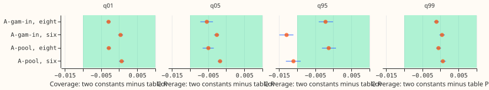
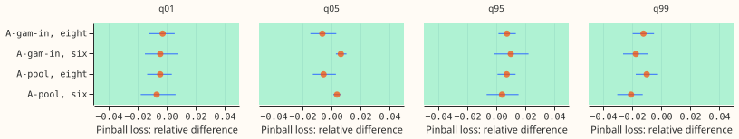

**Two numbers recalibrate the demand forecast at the eight MVA-only Primaries as well as table P
does, and they do not at the signed-MW six.** The first-release demand forecasts are too wide on the
lower tail and too narrow on the upper tail. [Experiment
483](../00483-uncertainty-rerun-on-the-first-release-demand-candidates/result.md) fixed that with
table P, a table of 40 factors per metering group (one per lead band and tail quantile). This
experiment asked whether one lower constant (applied to q01 and q05) and one upper constant
(applied to q95 and q99) can replace the table. Each constant was fitted on earlier months only and
compared with table P on the same held-out rows. At the eight the constants match table P; at the
six the upper tail stays about 0.012 less covered than with table P. Wind and solar were not tested,
because their stored forecasts sit in other experiments' folders and the manager asked for demand
first.

Figure 1 shows the coverage of the two-constant rule minus table P's, with 99.8% Bonferroni
intervals (24 tests), against the 0.01 limit (green band). Earlier-folds-only fit.

Figure 2 shows the same difference in pinball loss as a share of table P's, against the 5% limit.

## Results (clean rows; four scored folds 2025-12 to 2026-06; earlier-folds-only fit)

| Group | Candidate | Variant | q01 | q05 | q95 | q99 | CRPS |
|---|---|---|---|---|---|---|---|
| eight | A-pool | raw | 0.005 | 0.033 | 0.920 | 0.983 | 4.372 |
| eight | A-pool | table P | 0.010 | 0.045 | 0.949 | 0.992 | 4.372 |
| eight | A-pool | two constants | 0.007 | 0.040 | 0.947 | 0.991 | 4.372 |
| eight | A-gam-in | table P | 0.010 | 0.044 | 0.946 | 0.992 | 4.330 |
| eight | A-gam-in | two constants | 0.007 | 0.038 | 0.944 | 0.991 | 4.330 |
| six | A-pool | raw | 0.002 | 0.018 | 0.874 | 0.968 | 3.597 |
| six | A-pool | table P | 0.010 | 0.042 | 0.927 | 0.982 | 3.585 |
| six | A-pool | two constants | 0.011 | 0.040 | 0.916 | 0.983 | 3.588 |

Coverage targets: q01 0.005 to 0.02, q05 0.03 to 0.07, q95 0.93 to 0.97, q99 0.98 to 0.995. The
eight has 393,820 rows and the six 268,145 rows per candidate.

- **Decision rule at the eight (A-pool and A-gam-in, earlier-folds-only):** passes. Coverage
  differences from table P are -0.003 (q01), -0.005 (q05), -0.001 to -0.002 (q95), and -0.001
  (q99), every Bonferroni interval inside +/-0.01. Pinball loss differs by at most 1.3% at any
  tail (A-pool q95 +0.7%, interval 0.1% to 1.3%; q99 -1.0%), inside the 5% limit. CRPS differs by
  -0.0001 (interval -0.0008 to +0.0007) points, the minimum detectable effect being 0.044.
- **Decision rule at the six (A-pool and A-gam-in):** fails on q95 coverage. The difference from
  table P is -0.011 (interval -0.013 to -0.009) for A-pool and -0.013 (-0.015 to -0.011) for
  A-gam-in, against a limit of 0.01. Pinball loss is within 5% (q99 is 2.1% better than table P),
  and CRPS is 0.003 points worse (0.002 to 0.004). Two-constant q95 coverage is 0.916 against the
  0.93 floor; table P also misses it, at 0.927.
- **Fitted constants:** the lower factor is 0.95 to 0.98 at the eight (so the lower tail is left
  almost untouched), 0.77 to 0.88 at the six. The upper factor is 1.10 to 1.24 at the eight and
  1.03 to 1.26 at the six, and it varies by fold.
- **Leave-one-fold-out fit** (comparable to experiment 483's headline table, optimistic because it
  uses later folds): at the eight q95 coverage is 0.009 to 0.010 below table P's, and the interval
  crosses the 0.01 limit (A-pool -0.0088, interval -0.0106 to -0.0070), so equivalence is
  inconclusive there. The other coverage and pinball limits at the eight hold; the six fails q95
  coverage as above (-0.013).
- **12 to 36 hours:** the pattern is the same. At the eight A-pool's q95 coverage is 0.958 with
  the constants and 0.946 with table P. At the six it is 0.922 against 0.938.
- **Cold winter nights (rows with no labelled event):** at the eight q95 coverage is 0.927
  (constants) and 0.929 (table P), both under the 0.93 floor, against 0.874 raw. At the six it is
  0.867 and 0.879, against 0.835 raw. Cold nights stay under-covered under both rules.
- **Serving table.** Table P: 40 factors per metering group, a lead-band lookup, and a clip rule.
  Two constants: 2 numbers per metering group, refitted on the earlier months at training time.
  No other serving cost changes. The eight can use the constants; the six keeps table P.
- **Not tested:** wind and solar. [Experiment
  481](../00481-seed-averaging-diminishing-returns-for-demand-and-wind/result.md) found a constant
  widening of 1.10 best for wind at every number of seeds, which suggests the rule may fit wind, but
  the stored forecasts of experiments 429, 430, 450, and 461 have not been re-scored. This is a
  named gap.

## Method

- **Arms and rule.** A-pool, A-gam-in (the eight only), and K2-425A (report-only) from experiment
  483's cache. The lower factor scales the distance of q01 and q05 from the median and the upper
  factor scales q95 and q99. Each is the 0.50 to 1.80 grid value (step 0.01) that minimises the
  summed pinball loss of its two quantiles on the fitting rows, per metering group.
- **Fits.** Earlier-folds-only (each scored fold is fitted on the folds before it; 2025-10 is never
  scored) is the planning figure. Leave-one-fold-out is the comparison with experiment 483. Table P
  is fitted on the same rows as the constants, with its own rule (it skips cells with fewer than 200
  rows or a spread under 1e-6, which fall back to a factor of 1).
- **Rows and cleaning.** The `gam14` row set of experiment 470, clean rows (those with no labelled
  event), flagged exact-zero half-hours dropped and the experiment 399 start cut for D15 and D18,
  both inherited from experiment 483's cache. July 2026 is unused. Stored forecasts come from
  monthly refits; nothing is refitted.
- **Intervals.** Paired row-level differences, resampled in blocks of one origin day within a month
  (20,000 resamples). The Bonferroni count is 24 (four tail quantiles, coverage and pinball loss,
  for A-pool at the eight, A-pool at the six, and A-gam-in at the eight; the A-gam-in six, K2-425A,
  cold-night, and 12 to 36 hour intervals use the same level but are not counted). The equivalence
  limits (0.01 of coverage, 5% of pinball loss) sit at or below experiment 483's minimum
  detectable effects at the six (q95 coverage 0.014), so a result inside the limits whose interval
  crosses one is inconclusive, and a claim of equivalence cannot show a smaller difference than the
  minimum detectable effect.
- **Code.** `ml-experiments/00492-*/e00492_two_constant.py` and `e00492_report.py`; the scoring
  reuses `e00470_score.row_metrics` and experiment 483's `e00483_tails` and experiment 435's
  `e00435_table_p_provisional`. Tables are under `data/ml-experiments/00492-*/work/`.

## Checks

- **Median minus mean forecast per site:** not available, because the stored forecasts hold
  quantiles only.
- **Mean or median error beside the contrast:** not computed; the contrast is a calibration
  difference between two recalibrations of the same median, so the median is unchanged.
- **Audit triggers:** none fired. The prediction missed in one respect (the six fails on q95
  coverage, not on the q05 and q99 pinball clauses the plan named), which is recorded below.
- **Reviews:** one fresh Sonnet code review before the first run (found that the first draft scored
  pinball loss in fractions rather than points and did not sort the quantiles; both fixed by
  calling `row_metrics`; the other findings were confirmed correct). The results review and the two
  write-up reviews are recorded in the PR body.
- **Prediction outcome:** P1 held (earlier-folds-only). P2 held in direction (the six fails) but
  for q95 coverage. P3 held for the upper factor (above 1 at the eight); the lower factor is 0.95
  to 0.98, close to 1 rather than clearly below. P4 held at the six and is marginal at the eight
  (0.927 against a floor of 0.93).

## Caveats and next steps

- **Caveats:** five non-contiguous folds are few, and the earlier-folds-only comparison scores
  four. Every score is selection-biased, because the same folds choose the candidates and score
  them. NGED's event labels are incomplete, so rows with no labelled event may hold unlabelled
  events. No time series plots of forecasts are drawn, because the forecasts are experiment 483's
  and this experiment changes only the tail widths; those plots are on the experiment 483 page.
- **Next steps:** re-score wind and solar with the same rule from the stored forecasts of
  experiments 429, 430, 450, and 461. For the six, a lead-band-specific upper factor is untested.
