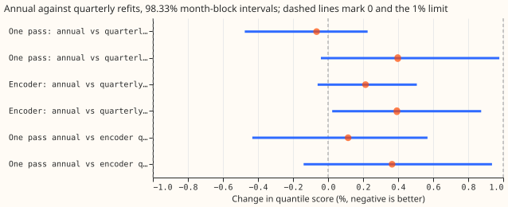
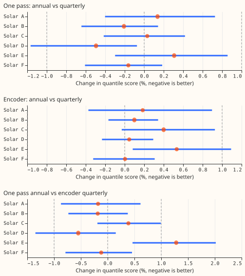
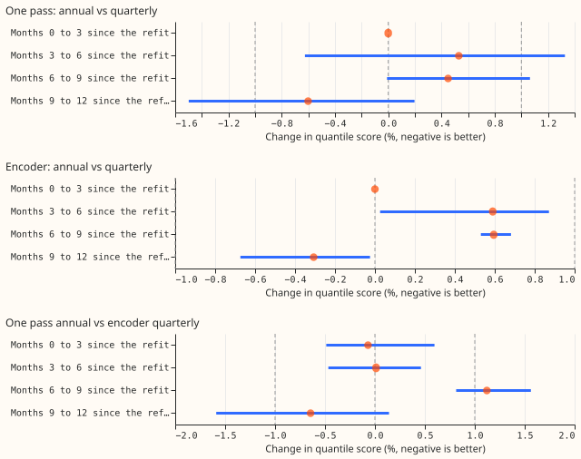
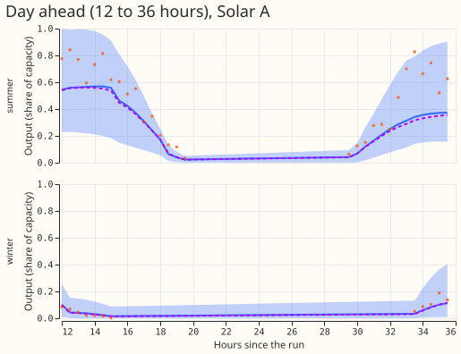
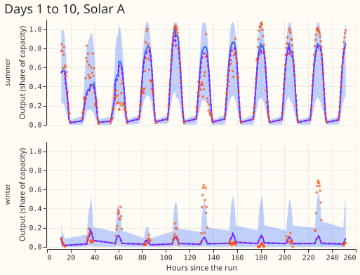

**Refitting the neural network once a year scores within 1% of refitting it every quarter for both
solar networks we tested, so the first production solar forecast needs one refit a year instead of
four.** The one exception is Solar E, where the one-pass network with annual refits scores 1.3%
worse than the 51-member encoder with quarterly refits. That gap comes mostly from the one-pass
network and not from the refit schedule, because the one-pass network with quarterly refits is
already 1.0% worse on Solar E.

We asked whether the pooled solar network for the six metered farms (Solar A to F, metered by
National Grid Electricity Distribution) can be refitted once, on data to 31 August 2025, and then
forecast all 12 scored months. A 51-member ensemble weather forecast drives each network. We
refitted two networks from experiment 430 this way, six random seeds each, and compared them with
experiment 430's stored forecasts from four quarterly refits. Experiment 430 already found that a
one-pass network on the ensemble mean and spread scores 6.842 against 6.810 for the encoder over all
bands (three seeds), so we quote that result and did not rerun it.

**Both annual-refit schedules passed the pre-registered 1% limit, with little margin for the
encoder.** The audit estimates that adding seed noise to the interval lifts the upper end to about
0.88% for the encoder (C2). Scores are quantile scores in points of capacity (lower is better),
farm-equal means over experiment 310's scored year. The interval is a two-sided 98.33% month-block
interval, which sets the Bonferroni count at 3. The minimum detectable effect from the seed spread
is 0.58% for the annual one-pass network, 0.28% for the quarterly one-pass network, 0.38% for the
annual encoder, and 0.58% for the quarterly encoder, so the 1% limit lies above all four. An
equivalence claim at the minimum detectable effect cannot show a loss smaller than the minimum
detectable effect, and a result inside the limit with a wider interval would be inconclusive and not
equivalent.

| Contrast | All bands | 12 to 36 hour band | Worst farm (all bands) | Verdict |
|---|---|---|---|---|
| C1: one pass, annual against quarterly | −0.07% (−0.48% to +0.23%) | +0.40% (−0.04% to +0.98%) | Solar E +0.31% | equivalent |
| C2: encoder, annual against quarterly | +0.21% (−0.06% to +0.51%) | +0.39% (+0.02% to +0.87%) | Solar E +0.53% | equivalent |
| C3: one pass annual against encoder quarterly (baseline) | +0.11% (−0.43% to +0.57%) | +0.37% (−0.14% to +0.94%) | Solar E +1.28% (+0.46% to +2.02%) | not equivalent: Solar E exceeds +1% |

*Figure 1. Percentage change in quantile score of the annual-refit network against its reference,
with 98.33% month-block intervals, over all bands and in the 12 to 36 hour band. Negative is better.
The dashed lines mark 0 and the 1% limit.*

*Figure 2. The same contrasts for each farm, all bands.*

*Figure 3. The same contrasts by months since the 2025-09 refit, grouped by the init month of the
run. The first group is zero by construction, because the annual and quarterly fits are the same
fits. Each interval rests on 3 to 4 valid-time months, so it is descriptive.*

## Results

- **Absolute scores (all bands, six seeds).** Annual one pass 6.825, quarterly one pass 6.830,
  annual
  encoder 6.832, quarterly encoder (the baseline) 6.818.
- **The loss does not grow with the age of the network.** The annual schedule scores +0.53% and
  +0.45% against the quarterly schedule in months 3 to 6 and 6 to 9 for the one-pass network, +0.59%
  and +0.60% for the encoder, and −0.60% and −0.31% in months 9 to 12 (annual better). The predicted
  growth through the year did not appear, and the pattern follows the season more than the age of
  the network. The one group above 1% is C3 in months 6 to 9 (+1.12%), which mixes the schedule and
  the network design. The per-quarter intervals are too narrow (Audit), so we do not read them.
- **The 12 to 36 hour band loses a little more.** The loss is +0.4% for both networks, inside the
  limit, with the C2 interval just above zero (+0.02% to +0.87%).
- **Control passed.** On the first three init months the annual and quarterly forecasts agree to
  below 1e-5% for both networks (largest row difference 1.2e-5 points), as the same fit and seed
  give.
- **Prediction against result.** C1 was predicted at +0.3% and came out −0.07%, inside the interval
  of both. C2 was predicted at +0.3% and came out +0.21%. C3 was predicted at +0.5% with the upper
  end
  below +1.5%, and came out +0.11% with an upper end of +0.57%. The prediction that the last quarter
  alone may exceed 1% did not hold.

### Tails

| Arm | 0.01 pinball | 0.99 pinball | Coverage of 0.01 | Coverage of 0.99 | Median minus mean (points) |
|---|---|---|---|---|---|
| annual one pass | 0.345 | 0.333 | 0.0534 | 0.9861 | −0.035 |
| quarterly one pass | 0.344 | 0.335 | 0.0530 | 0.9850 | −0.072 |
| annual encoder | 0.340 | 0.335 | 0.0527 | 0.9839 | +0.022 |
| quarterly encoder | 0.338 | 0.334 | 0.0525 | 0.9849 | −0.116 |

Farm-equal means over all bands, six seeds, points of capacity. The 0.01 quantile covers about 5% of
observations in every arm, as in experiment 430. Annual refits move no pinball loss by more than
0.002 points.

### Example forecasts

*Figure 4. One-pass forecasts of Solar A for the 12 to 36 hours after a summer run and a winter run.
The band is the 5% to 95% range of the annual network, the solid line its median, the dashed line
the median of the quarterly network, and the dots the observed output.*

*Figure 5. The same two runs over days 1 to 10.*

### Serving table

| Stack | Networks per serving pass | Inputs | Refits per year | Score against baseline (all bands) |
|---|---|---|---|---|
| Encoder, quarterly (baseline) | 1 network with the 51-member encoder | member-level and summary columns | 4 | 0 |
| One pass, quarterly | 1 network | ensemble mean and spread | 4 | +0.18% (experiment 430, six seeds) |
| Encoder, annual | 1 network with the 51-member encoder | member-level and summary columns | 1 | +0.21% (C2) |
| One pass, annual | 1 network | ensemble mean and spread | 1 | +0.11% (C3), Solar E +1.28% |

The cost of a refit is about 8 seconds of GPU time for the one-pass network and 24 seconds for the
encoder, per seed. The lead range scored is 1 to 10 days, with the 12 to 36 hour band beside it.

### Checks

- **Median minus mean forecast, per farm.** Averaged over all rows, the median forecast minus the
  mean forecast is −0.035 points of capacity for the annual one pass, −0.072 for the quarterly one
  pass, +0.022 for the annual encoder, and −0.116 for the quarterly encoder (Tails table), so no arm
  has a spread that shifts the forecast by more than 0.12 points.
- **Mean-forecast error beside the contrasts.** The mean absolute error of the mean forecast favours
  the annual schedule in all three contrasts: −0.41% for C1 (−0.91% to −0.05%), −0.08% for C2
  (−0.40% to +0.26%), and −0.22% for C3 (−0.88% to +0.41%). The quantile score favours it for C1
  only. The gaps are 0.4 to 1.2 times the seed-resampling standard deviation of the contrast (0.18
  to 0.35 percentage points), so we read them as noise.
- **Triggers fired.** Of the seven audit triggers in the `ml-experiment` skill, trigger 3 fired for
  C1 and C2 (the mean-forecast error and the quantile score point in different directions, by an
  amount inside seed noise), and trigger 4 fired for C1 (omitting Solar D flips the sign, from
  −0.07% to +0.03%) and C3 (omitting Solar E flips the sign, from +0.11% to −0.15%). A fresh Sonnet
  agent audited the result (below). Triggers 1, 2, 5, and 6 did not fire, and trigger 7 does not
  apply.

### Audit

A fresh Sonnet agent re-derived the contrasts with its own code and tried to break them.

- **Re-derivation:** the three all-band point estimates and the per-farm estimates match the printed
  values to three decimals, and the intervals agree to 0.01 percentage points. Accepted, no change.
- **Control:** for each of the six seeds and both networks, annual and quarterly forecasts agree to
  3.3e-6 in every quantile on the first three init months. They first differ in the init month
  2025-12, as expected. Accepted.
- **Rows:** all four arms hold 410,899 rows per seed, with identical keys and actuals. No leakage,
  misalignment, or dropped rows. Accepted.
- **Leave-one-farm-out:** the sign flips for C1 (omit Solar D) and C3 (omit Solar E), and both
  contrasts sit within ±0.3% of zero, so the flips are immaterial. The interval part of the verdict
  never changes (largest upper ends: +0.33%, +0.57%, +0.69%). C3 becomes equivalent without Solar E,
  so its verdict rests on that one farm. Accepted, stated in the opening.
- **Seed noise in the interval:** the month-block interval treats the six-seed averages as fixed.
  The
  audit adds seed noise in quadrature and estimates the upper ends at about 0.57% for C1, 0.88% for
  C2, and 0.95% for C3. Accepted: the equivalence of C2 and C3 has little margin below the 1% limit,
  and the page says so.
- **Per-quarter intervals:** a cut of 3 or 4 valid-time months allows only 20 to 35 distinct
  resamples, so the intervals are too narrow and uncorrected. Accepted: Figure 3 is descriptive.
- **Staleness prediction:** the last group is better for the annual schedule, so the predicted
  growth of the loss through the year did not appear. Accepted.

### Caveats

- **One scored year, one refit date.** Both schedules share the training end of 2025-08-31, so the
  result is for the staleness of one year starting in September. A refit date in another month could
  differ.
- **The quarterly references come from experiment 430's run, on a different day.** The control shows
  the two runs agree on the first quarter, so the GPU run is reproducible.
- **Solar E.** The comparison of the one-pass network with the encoder at Solar E (C3) is dominated
  by the network design, as experiment 430's leave-one-farm-out check found.
- **Own history only, quarterly cadence of the stored references, no table P.** The widening factor
  of the serving path is not applied.
- **Seed noise.** The month-block intervals leave out seed noise, and the minimum detectable effects
  cover seed noise only.

### Problems caused by the move

None.

## Design

See the plan in the opening commit of this pull request: two arms (`annual_g0_onepass`,
`annual_a2_member`) from experiment 430's `g0_onepass` and `a2_member` configurations with one refit
at
2025-09 that predicts the runs of all 12 months, six seeds, scored against experiment 430's
quarterly
forecasts. Code reuse: this folder imports the modules of experiments 310 and 430
(`ml-experiments/00310-metered-farm-long-lead-scoring/` and
`ml-experiments/00430-unified-forecaster-solar-and-pretraining-ablations/`). Fitted networks are in
the private data folder.
