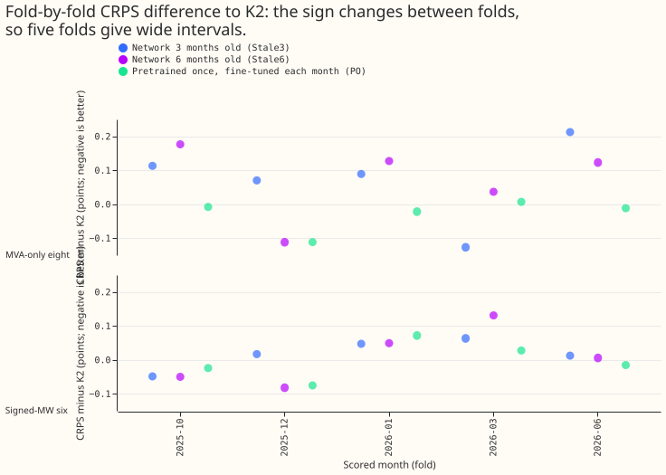
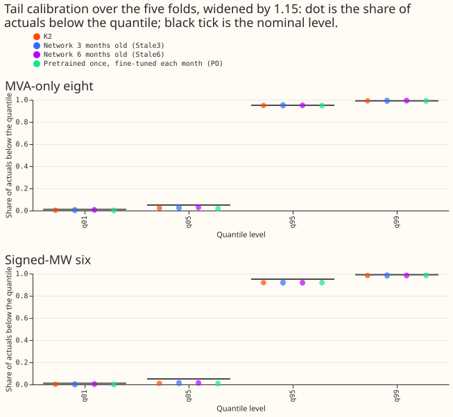
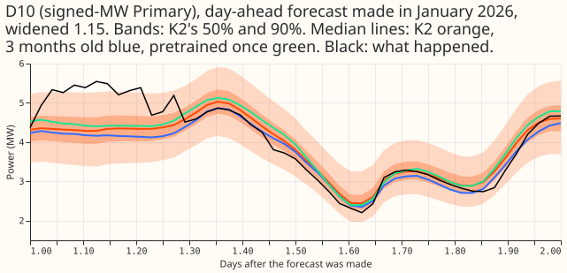
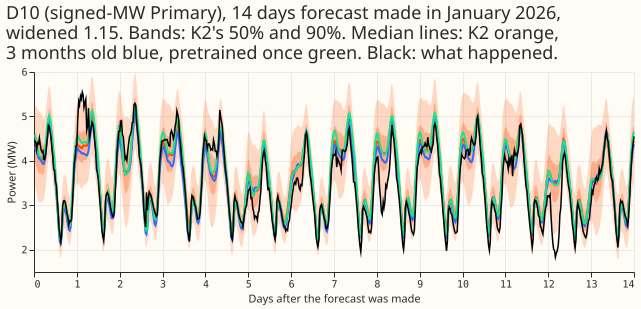
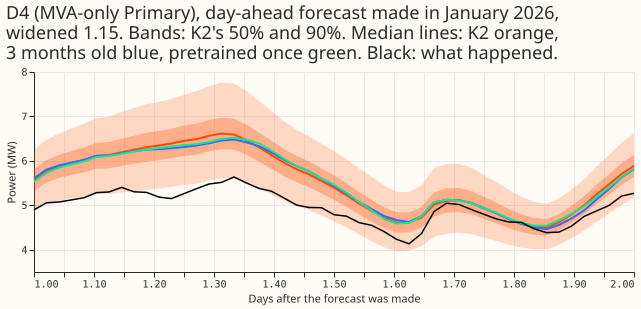
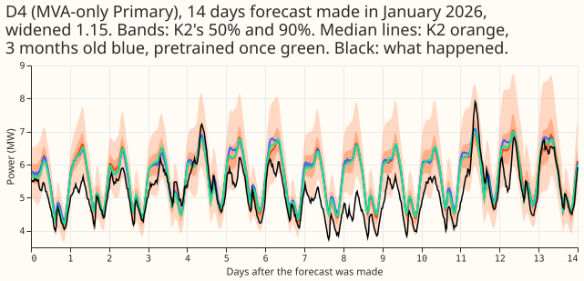

**In five scored months, pretraining the demand neural network once and fine-tuning it each
month scored within 0.03 points of pretraining it at every refit (a lower score is better), and
would save about 42 of the 80 GPU seconds that refitting one network takes (46 per refit, less the
one yearly pretraining). A network refitted 3 months earlier scored about 0.07 points worse than a
freshly refitted one at the eight Primary substations that report only apparent power, and five
months are too few to say how much worse.** Whether to refit less often than monthly is therefore
open until a larger test.

We asked whether the neural network that forecasts demand at 16 Primary substations could be
simplified. A refit has two stages: pretraining on estimates of past weather (ERA5 and CAMS), then
fine-tuning on archived ECMWF ensemble (ENS) forecasts. One change was to refit every 3 or 6
months instead of every month. The other was to pretrain once and fine-tune each month. We scored
three arms against the average of two neural networks (trained from different random seeds, each
refitted in the scored month; experiment 425's arm A). All four were scored on the same
half-hours of the same five months. The score is the continuous ranked probability score (CRPS),
in points of effective capacity, a percentage of each Primary's capacity. The 16 Primaries are 8
that report only apparent power in megavolt-amperes (MVA), called "the eight"; 6 that report
signed megawatts, called "the six"; and D15 and D18, which are reported separately.

| Arm | What it is |
|---|---|
| K2 | The fresh pool: two neural networks, each pretrained and fine-tuned in the scored month. |
| Stale3, Stale6 | Two networks refitted 3 or 6 months before the scored month. |
| PretrainOnce | Two networks fine-tuned each month from pretraining done once, with data to 2025-07. |

Verdict: partly supported. In these five months, PretrainOnce is equivalent to K2 at both groups,
meaning its upper Bonferroni bound lies inside the limit of 0.086 points at the eight and 0.170 at
the six. Stale3 and Stale6 are equivalent at the six but not shown equivalent at the eight.

## Figures

## Results

- **Arms.** (PO in the tables below is PretrainOnce.) K2 is the quantile average of seeds 0 and 1 of
  experiment 425's arm A (fresh pretraining and fine-tuning in the scored month). Stale3 and Stale6
  are experiment 425's arm A networks fitted 3 and 6 months before the scored month. PO fine-tunes
  each scored month from the pretraining of the 2025-07 cut. Stale11 is the single fold 2026-06 from
  the 2025-07 networks. Seeds 0 and 1; widening 1.15; rows of experiment 470
  (`experiment_470_intersection_v1`); folds 2025-10, 2025-12, 2026-01, 2026-03, 2026-06; monthly
  refits; cleaned data with 1,179 scoring actuals dropped for a flagged exact zero; the D15 and D18
  start cut applied.
- **Minimum detectable effect (two seeds, five folds).** 0.086 points at the eight and 0.170 at the
  six (the six on rows with no labelled event). Experiment 489's 5-seed values (0.065 and 0.100) do
  not apply to a 2-seed pool. Limits: 0.086 for Stale3 and PO at the eight, 0.100 for Stale6, 0.170
  at the six; q99 pinball loss 0.02. Bonferroni count 12.
- **CRPS, difference to K2 (points).** The first interval is the Bonferroni interval over origin
  days; the second is the 95% interval over folds.

| Arm | Eight | Six | Verdict |
|---|---|---|---|
| Stale3 | +0.067 [+0.023, +0.109]; folds [-0.081, +0.225] | +0.022 [-0.010, +0.052]; folds [-0.035, +0.072] | not shown equivalent at the eight; equivalent at the six |
| Stale6 | +0.069 [+0.028, +0.110]; folds [-0.070, +0.212] | +0.018 [-0.021, +0.054]; folds [-0.093, +0.115] | not shown equivalent at the eight; equivalent at the six |
| PO | -0.030 [-0.059, -0.003]; folds [-0.088, +0.030] | -0.002 [-0.028, +0.020]; folds [-0.072, +0.066] | equivalent at both |

- **Absolute CRPS (points).** K2 4.720 at the eight and 3.486 at the six; Stale3 4.787 and 3.508;
  Stale6 4.789 and 3.504; PO 4.690 and 3.484.
- **Fold by fold.** Stale3 at the eight changes sign between folds (-0.126 in 2026-03, +0.213 in
  2026-06). The 2026-06 loss comes mostly from one Primary (its q95 coverage falls to 0.76
  against 0.87), and a network 11 months old loses 0.205 in the same fold, so the five folds show no
  clear growth of the loss with age (on the 3 folds with stored networks, Stale6 loses 0.094 at the
  eight against 0.059 for Stale3, so an age effect is not excluded). PO's gain at the eight comes
  from 2025-12 (-0.112); without the 2025-12 fold, PO's gain at the eight is -0.008, so the page
  claims equivalence and no gain.
- **Tails (widened 1.15, all folds).** q99 pinball loss differences at the eight are +0.009
  (Stale3), +0.010 (Stale6), and +0.003 (PO), and at the six +0.001, -0.001, and -0.009, all
  inside the 0.02 limit. q99 coverage is 0.990 to 0.991 at the eight for every arm and 0.982 to
  0.986 at the six. q95 coverage is 0.947 to 0.950 at the eight and 0.916 to 0.921 at the six.
- **Cold winter nights.** At the eight Stale3 scores 4.369 and K2 4.237; Stale6 4.372; PO 4.224. At
  the six Stale3 scores 6.244, Stale6 6.279, K2 5.996, and PO 5.937. Older networks lose more on
  cold nights, in the direction predicted.
- **12 to 36 hours.** At the eight Stale3 scores 4.286, Stale6 4.270, K2 4.163, and PO 4.202. At the
  six Stale3 scores 3.648, Stale6 3.635, K2 3.565, and PO 3.564.
- **Avoidable-curtailment cost at the six, difference to K2 (experiment 470's cost measure).** At
  f = 0.9 Stale3 +0.224 [-0.081, +0.774], Stale6 +0.277 [-0.087, +0.918], PO +0.041 [-0.130,
  +0.223]. At f = 0.75: +0.662, +0.695, +0.093. At f = 0.5: +0.496, +0.944, -0.259. Every interval
  includes zero.
- **D15 and D18 (report only).** The stale networks are much worse (CRPS 18.6 for Stale3 and 21.2
  for Stale6 against 11.0 for K2) probably because a network fitted before the D15 and D18 cleaned
  histories grew long has seen little of those histories. PO scores 11.6.
- **Serving table.** K2: 2 networks per pass, 12 refits and 12 pretrainings per year, about 80 GPU
  seconds per seed-refit (46 pretraining, 34 fine-tuning; experiment 481). PO: 2 networks, 12
  fine-tunes, 1 pretraining per year, about 38 GPU seconds per seed-refit including the yearly
  pretraining, change in CRPS against K2 -0.030 and -0.002 points (negative is better). Stale3: 3
  refits per year if the 4-month cadence's worst month held, +0.067 and +0.022 points.

## Checks

- **Median minus mean forecast per Primary.** K2 has a median below the mean at 15 of 16 Primaries
(the two largest gaps are -2.4 and -1.7 points of capacity) and PO at all 16 (-2.6 and -2.1); PO's
values differ from K2's by under 0.5 points.
- **Error of the median beside the CRPS contrast.** Mean absolute error of the median forecast at
  the eight: K2 6.777, Stale3 6.885, Stale6 6.892, PO 6.724 points; at the six: 5.652, 5.710, 5.678,
  and 5.662. The directions agree with the CRPS contrasts except for PO at the six (CRPS -0.002,
  median error +0.009), a gap too small to fire trigger 3.
- **Triggers.** Trigger 2 (the 3-month network missed the prediction of 0.05 at the eight) was
  tested: the loss does not follow the length of the ENS fine-tuning window (15 to 23 months), and
  the stale-network loader reproduces experiment 425's stored forecasts exactly (a maximum
  difference of 0.0 in all 10 files). Trigger 4: dropping 2025-12 turns PO's -0.030 into -0.008,
  which leaves the equivalence verdict unchanged, so trigger 4 did not fire. No audit was run. A
  Sonnet results review re-derived every contrast from the stored row tables and agreed with them.

## Caveats

- Five folds, each from one pair of networks, give wide intervals across folds; the origin-day
  interval treats each fitted network as fixed, so that interval is optimistic. Read the interval
  across folds for cadence.
- Stale3 and Stale6 differ from K2 in age and in the length of the ENS history they trained on (12
  to 23 months, against 24 for K2), and the two Stale6 refits at 2025-04 and 2025-06 were fitted
  here with 12 and 14 months. Stale12 could not be run because refits before 2025-04 have under 12
  months of ENS history.
- PO also reuses the 2025-07 pretraining's target statistics and ENS-spread table, which the
  fine-tuning replaces with each month's.
- Stale3 measures the worst month of a 4-month cadence, not its average.
- NGED's event labels are incomplete: "rows with no labelled event" may hold unlabelled events.
  Every score is selection-biased, and July 2026 is unused.
- Reviews: one Sonnet plan review, one Sonnet code review before the first fit, one Sonnet results
review, and two Sonnet write-up reviews.

## What to try next

- Test the cadence on more folds, with the arms that vary by cut: a rolling set of 12 monthly folds
  from experiment 425 and refits every 2 or 3 months.
- Port pretrain-once into the demand recipe, then re-check weekly before any release claim.

## Plan

### Question

Production refits the demand network every month, pretraining on ERA5-and-CAMS rows and then
fine-tuning on ENS rows. Fewer fits per year and no pretraining at each refit would simplify
serving and training. This experiment ages the network on purpose, and also fine-tunes from one
pretraining run reused at every refit. The baseline is experiment 425's arm A with 2 seeds.

### Design

- **Rows and folds.** The 5 folds of experiment 449 (2025-10, 2025-12, 2026-01, 2026-03,
  2026-06) on the rows of experiment 470 (`experiment_470_intersection_v1`). The D15 and D18 start
  cut and the flagged exact-zero drop apply. Cleaned data everywhere; monthly refits.
- **K2 (baseline).** Quantile average of seeds 0 and 1 of arm A, stored in experiment 425
  (`work/seed_preds/A`). The 1.15 widening is applied to every arm as in experiments 470 and 489.
- **Stale3, Stale6 (cadence).** For scored month M, forecast with the arm A networks (seeds 0 and 1)
  that were pretrained and fine-tuned at refit R = M minus 3 (or 6) months. The network's own
  standardiser and target statistics are used. No retraining: the networks are experiment 425's
  stored `work/models/A/<R>/s<seed>`. The arm is named by the network's age at the start of the
  scored month. A network that old is also about one month older by the month's end, so Stale3 is
  the worst month of a 4-month cadence and Stale6 of a 7-month cadence: a conservative reading, and
  the page says it that way. The test covers the worst month of a cadence, not its average.
    - Stale3 needs R in 2025-07, 2025-09, 2025-10, 2025-12, 2026-03: all stored, so no fits.
    - Stale6 needs R in 2025-04, 2025-06, 2025-07, 2025-09, 2025-12. Experiment 425 stores only the
      last three, so the first two are fitted here: arm A, seeds 0 and 1, pretrain and fine-tune,
      with `e00425_fit.run_arms` unchanged. Their ENS fine-tuning windows hold 12 and 14 months, not
      24, because the ENS history starts in 2024-04 (so every stale network also has a shorter ENS
      window than K2: 15 to 23 months at the stored cuts; the page prints the window per fold and
      reads age and window length as confounded); the plan reads Stale6 on all 5 folds and on
      the 3 folds with stored networks.
    - Stale12 cannot be run: refits before 2025-04 would have under 12 months of ENS history. The
      single fold 2026-06 from the stored 2025-07 networks (Stale11) is reported as descriptive.
- **PretrainOnce.** Each of the 5 scored months is fine-tuned from the pretrained arm A network of
  the first stored cut (2025-07) of the same seed, instead of the network pretrained at that
  month's cut. Fine-tuning is experiment 425's (learning rate 2e-4, same rows, same loop, seeds 0
  and 1). The fold's standardiser is the scored month's own, so the fine-tuning sees an input scale
  that differs slightly from the pretraining's. The pretraining also used the 2025-07 fold's target
  mean and standard deviation per Primary and its median ENS spread by lead band, which the
  fine-tuning replaces with the scored month's. All three mismatches are part of what the arm tests,
  because a production refit would also fine-tune with its own statistics. Ten
  fine-tunes; no pretraining.
- **Caveats named in advance.** D15 and D18 are uninterpretable for the stale arms (Stale6 at the
  2025-04 cut has about 1 month of their rows after the start cut), and are report-only. Each
  network's recency weight is relative to its own refit, which is part of staleness. The origin-day
  block bootstrap ignores dependence across days of one fold, so intervals are optimistic for every
  arm alike.
- **Not run.** A cadence on the fine-tune alone with fresh pretraining (a pure fine-tune staleness
  arm): the question the brief asked, but it needs a pretraining cut at each scored month paired
  with a fine-tune R months earlier, and production would pretrain once, which PretrainOnce covers.

### Scoring and stop rules

- Experiment 489's scorer pattern: the experiment 470 scorer, tail script, and curtailment script
  pointed at this folder. Because Stale6 and Stale11 cover fewer folds, each arm is scored in its
  own call against K2 on the folds the arm has.
- The scorer prints the MDE before any contrast (experiment 428's definition from the seed spread of
  arm A, as in experiment 489). Experiment 481 uses another definition; the page reports both.
- Report per arm: CRPS at the eight, the signed-MW six, cold winter nights, the 12 to 36 hour band;
  q01, q05, q95, q99 coverage and pinball loss; avoidable-curtailment cost at f = 0.9, 0.75, 0.5 at
  the six. Christmas week and D15 and D18 are report-only.
- **Stop.** Do not run Stale6's two new fits if Stale3 already fails its limit at either group.
- **Serving table (required).** Networks per serving pass, refits per year, pretrainings per year,
  GPU seconds per refit (experiment 481: about 80 per seed, 46 pretraining and 34 fine-tuning), and
  the change in CRPS against K2.

### Compute

- Stale3: 0 fits, 10 month-forecast passes. Stale6: 4 networks (2 cuts x 2 seeds), about 5 GPU
  minutes, plus passes. PretrainOnce: 10 fine-tunes, about 6 GPU minutes. One GPU process under 8
  GB; one feeder core.

### Standing practices followed

Monthly refits; cleaned data; D15 and D18 cut; saved networks; stored forecasts reused; tails and
cost; example forecasts and the 14-day plot; the process order of the ml-experiment skill.
Not applicable: load-shift event plots (no event slice is headline).

### Series

Step 3 of the neural simplification series (brief of 2026-11-01); step 6 shares this pull request.
Steps 1 and 4 run in other pull requests.
