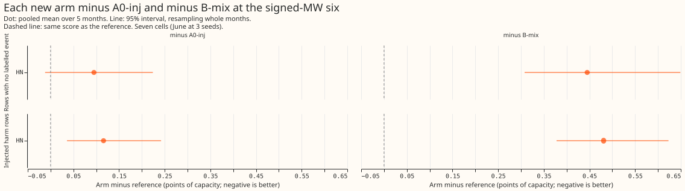
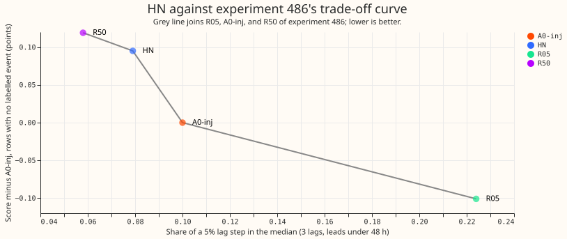
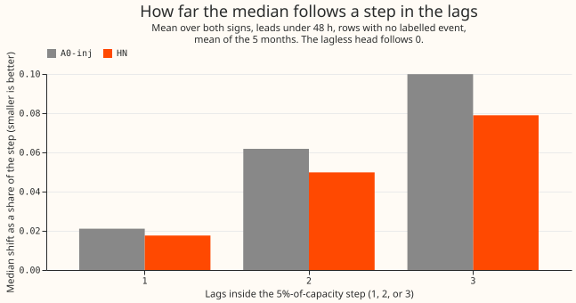
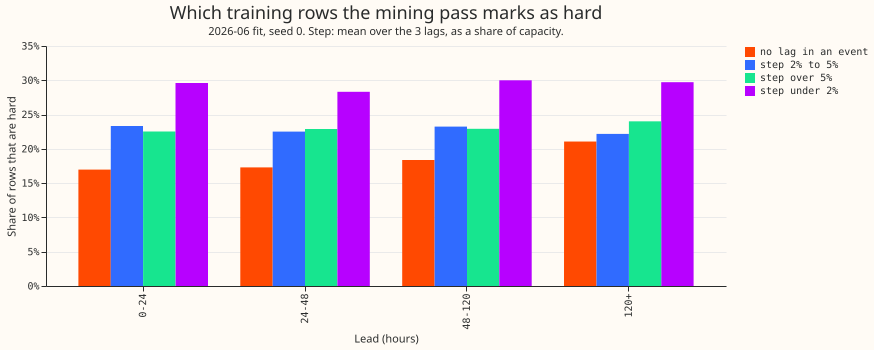
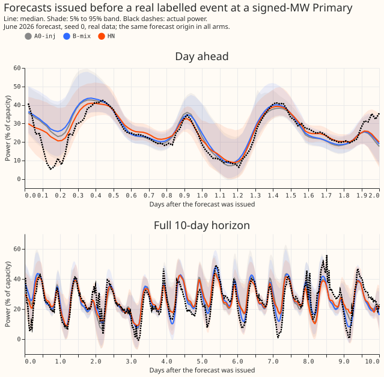
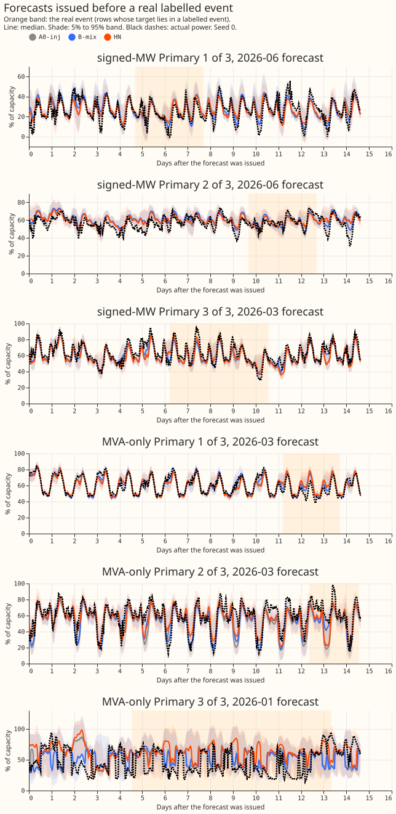

**Retraining the lagged neural network on its own worst rows lowered the share of a step in its
readings that reaches its median forecast by only 0.021, and made its score on rows with no labelled
event worse, which puts it on the trade-off that experiment 486 found between following a step and
scoring those rows.** We asked whether a neural network that forecasts a Primary substation's power
from its recent readings (its 3 lags: the newest usable reading, the reading at the same time on an
earlier day, and the reading at the same time and weekday on an earlier week) can be taught to trust
a sudden step in those readings less. We trained it on a copy of the training data into which
artificial load-shift events had been inserted, for 3 epochs. We then scored every training row,
marked as hard the 20% of rows with the highest pinball loss (a quantile-forecast error score) in
their class, plus the rows where its median followed the inserted step, and trained 3 more epochs
with each hard row shown 3 times (arm HN, for hard-negative mining). We then added a step of 5% of
the Primary's capacity to all 3 lags (the scoring step) and measured the share of that step that
appeared in the median forecast (the follow share): 0.079 for HN, meaning 7.9% of the step, and
0.100 for the same network trained on the injected events without mining (arm A0-inj). HN scored
0.095 percentage points of the Primary's capacity worse than A0-inj on the mean continuous ranked
probability score (CRPS), on rows outside every event that National Grid Electricity Distribution
(NGED), the distribution network operator, has labelled. We call those the rows with no labelled
event.

**Verdict: not supported.** The prediction was a drop of at least 0.05 in the follow share, and the
drop is 0.021 (lower in 4 of the 5 months: 0.007, -0.002, 0.033, 0.043, and 0.024 for 2025-10,
2025-12, 2026-01, 2026-03, and 2026-06). The pass bar set in the experiment brief was a follow share
of at most 0.10 together with a loss of under 0.05 points on rows with no labelled event; the first
part holds and the second does not. The stop rule fires: the point (0.079, +0.095) sits 0.035 above
the piecewise-linear curve of experiment 486 through R05, A0-inj, and R50 (the curve gives +0.060 at
0.079), inside the 0.061 clean-row bar (experiment 439's). This stop rule is weak, because its 0.061
tolerance is wider than HN's whole move in follow share, so even a network identical to A0-inj would
sit on the curve. The result therefore says that HN cannot be told apart from the curve, and closes
only the two regimes tested: the share of injected rows and this one mining rule. HN is 0.445 points
of capacity behind B-mix on rows with no labelled event, as the plan expected.

**All numbers are interim and have four limits.** They come from five months and one to three seeds
(seven cells, so 2026-06 counts three times in the absolute scores and the curtailment sums), and
the intervals are unadjusted for the four contrasts. The mining pass mostly retrained on ordinary
high-loss rows, and no control oversamples a random 20% of rows, so selection and extra exposure are
confounded. NGED's logs may miss events, so rows with no labelled event may hold events.

**Terms.** A hard row is a training row marked by the mining pass. Harm rows, injected harm rows
(the three injected scoring datasets, worlds w200 to w202), the signed-MW six (the six Primaries
that report signed power), the MVA-only eight (the eight that report apparent power only), B-mix,
and the minimum detectable effect are as in [experiment
486](../00486-lagged-network-injection-rate-and-schedule/result.md). Points of capacity are CRPS
from 11 quantiles as a percentage of the Primary's capacity, and B-mix is the 50/50 mixture of the
stored A0-inj forecast and the forecast built without any lag. A cell is one scored month with one
seed; there are 7. The event step used by the mining pass is the mean over the 3 lags of the
injected minus the clean reading, and differs from the scoring step.

## Results

- **Mining.** Of the 3,860,882 training rows at 2026-06 seed 0, 21.1% are hard (813,673). The loss
  rule marks 20.0% by construction in each class and the follow rule marks 90,839 rows (2.4%, or
  about 7% of the rows with a corrupted lag); across the 7 cells the hard share is 20.5% to 21.3%
  and the follow rule marks 1.5% to 2.5%. Among rows with a lag inside an injected event 23.2% are
  hard, against 20.0% of the other rows, so about 70% of the hard rows have no corrupted lag and the
  pass mostly marks ordinary high-loss rows. Each fit took 59 to 82 seconds on the GPU, about 0.14
  GPU-hours for the 7 cells.
- **Minimum detectable effect** (2.8 standard deviations of the seed spread at 2026-06, seeds 0 to
  2, signed-MW six): A0-inj 0.144 on rows with no labelled event and 0.155 on injected harm rows;
  B-mix 0.050 and 0.070; HN 0.088 and 0.106. Experiment 404's month-to-month spread (0.3 to 1.0
  points) is larger, and experiment 439's clean-row bar is 0.061.
- **Contrasts at the signed-MW six** (points of capacity, lower is better; unadjusted 95% intervals
  from resampling months; the number after each interval counts the cells, out of 7, where HN beats
  the reference). The pre-registered Bonferroni level for k = 4 is 98.75%, which gives intervals
  wider than the 95% ones shown. The absolute scores are means over the 7 cells; the contrasts are
  means of month means (seeds within a month averaged first), so a contrast need not equal the
  difference of two absolutes.

| Rows | HN absolute | Minus A0-inj | Minus B-mix |
|---|---|---|---|
| No labelled event (A0-inj 3.698, B-mix 3.371) | 3.794 | +0.095 (-0.012 to 0.224), 1 | +0.445 (0.308 to 0.649), 0 |
| Injected harm rows (A0-inj 4.019, B-mix 3.664) | 4.119 | +0.116 (0.036 to 0.242), 0 | +0.481 (0.378 to 0.623), 0 |

- **P1 fails.** At 3 lags and leads under 48 hours HN follows 0.079 of the step against 0.100 (a
  drop of 0.021, not the 0.05 predicted; lowest to highest month 0.055 to 0.104 against 0.084 to
  0.128). At leads of 48 to 120 hours HN follows 0.073 against 0.091.
- **P2 holds as an equivalence check only.** HN is 0.116 worse than A0-inj on injected harm rows,
  inside the 0.155 minimum detectable effect of A0-inj (HN's own is 0.106). The unadjusted interval
  excludes zero, which is not the registered test, so the cost is reported but not claimed.
- **P3 holds.** HN does not beat B-mix on either row class.
- **Mixture (descriptive, not in k).** Mixed with the lagless table, HN scores 3.385 on rows with no
  labelled event (+0.005 against B-mix, -0.034 to 0.045) and 3.684 on injected harm rows (+0.017,
  -0.030 to 0.065). Mining therefore changes the mixture by less than the minimum detectable effect.
- **MVA-only eight (descriptive).** HN minus A0-inj is +0.224 on rows with no labelled event (0.114
  to 0.322) and +0.271 on injected harm rows (0.165 to 0.362); HN minus B-mix is +0.649 and +0.790.
- **Sweep.** Median shift as a share of a 5% step, leads under 48 hours (mean of the months), A0-inj
  then HN: 1 lag 0.021 and 0.018; 2 lags 0.062 and 0.050; 3 lags 0.100 and 0.079. The band-width
  ratio is in `work/sweep/`.
- **Bad-data injections** (median shift as a share of the corruption, mean of 5 months), A0-inj then
  HN. A stuck reading for 24 hours: 0.056 and 0.045. A dropout to zero for 6 hours: 0.024 and 0.018.
  A spike of 4 times the week-on-week change: 0.024 and 0.020. A spike of 20 times: 0.004 and 0.001.
- **Tails** (signed-MW six, rows with no labelled event, raw quantiles; coverage of q01, q05, q95,
  and q99, then q99 pinball loss in points of capacity). A0-inj: 0.011, 0.043, 0.813, 0.915; 0.349.
  B-mix: 0.005, 0.025, 0.856, 0.950; 0.259. HN: 0.006, 0.029, 0.846, 0.932; 0.317. HN+lagless:
  0.003, 0.019, 0.877, 0.958; 0.246. HN is 0.058 above B-mix on q99 pinball loss, beyond the +0.02
  limit, and 0.032 below A0-inj. HN+lagless is 0.013 below B-mix. On injected harm rows the q99
  pinball loss is 0.636 (A0-inj), 0.538 (B-mix), 0.607 (HN), and 0.526 (HN+lagless). The 12 to 36
  hour band is in `work/scores/tails.csv`.
- **Avoidable curtailment** (signed-MW six; million pounds summed over the cells of the five months;
  95% interval resampling cells). HN minus A0-inj: +0.09 (-0.10 to 0.28) at f = 0.9, -0.11 (-1.66 to
  1.25) at f = 0.75, and -0.30 (-2.58 to 1.72) at f = 0.5. HN+lagless minus B-mix: +0.09 (-0.02 to
  0.25), +0.15 (-0.68 to 1.04), and +0.21 (-1.07 to 1.56). Every interval includes zero.
- **Serving cost.** HN serves one neural network per forecast with no table, mixture, or detector,
  and mining adds training cost only. B-mix serves two networks, the cross-fitted lagless table, and
  a mixture step. Removing that complexity leaves HN 0.445 points behind B-mix on rows with no
  labelled event and 0.481 behind on injected harm rows.
- **What the regime would change for an operator.** The network was shown its own worst mistakes
  about events and trained on them more. The network was retrained mostly on ordinary high-loss
  rows, followed a step in its last days of readings about a fifth less (0.079 against 0.100), and
  was a little less accurate on ordinary days. The regime needs no event labels.
- **Row counts** (signed-MW six, summed over the 7 cells): 626,771 rows with no labelled event and
  1,138,838 injected harm rows, as in experiment 486. Rows inside real events, after events, and
  cold nights were not scored separately.

## Checks

- **Median minus mean forecast per site, and the error of the mean forecast.** Neither was computed:
  the stored forecasts hold 11 quantiles and not the mean of the mixture.
- **Audit triggers.** No control failed, no nested arm beat the arm that contains it, and the
  headline intervals are of the same order as experiment 486's (0.236 wide for HN minus A0-inj on
  rows with no labelled event, against 0.214 for R50). No audit was run.
- **Caveats.** The follow share uses the mean step over the 3 lags, so a row with only the oldest
  lag inside an event has a diluted step. HN has no control that oversamples a random 20% of rows,
  so a part of its effect may be the extra rows seen (about 40% more per mined epoch) and not their
  selection. Both caveats came out of the code review and are not tested here.
- **Reviews.** One Sonnet code review before the first fit (findings: the step definition, the
  missing random-oversampling control, `nanquantile` for the class limits, and a stale example
  command; the last two were applied, the first two are the caveats above). The results, write-up,
  and prose reviews are listed in the pull request.

## What to try next

- **Do not mine on loss again.** The loss rule picks 20% of rows in every class. A follow-share-only
  rule marks 1.5% to 2.5% of rows and targets events, but a rule marking so few rows is unlikely to
  move the trade-off. Any new mining run needs a control that oversamples a random 20% of rows.
- **Stored artefacts** (not a next step). Fitted networks and epoch-3 checkpoints are in
  `data/ml-experiments/00495-lagged-network-hard-negative-mining-on-injected-events/work/models/HN/`,
  hard-row tables under `work/hard/`, forecasts under `work/predictions/`, and score tables under
  `work/scores/`.

## Plan (written before any score was read)

**The plan, written before any score was read.** Experiment 486 showed that the share of training rows
with a corrupted lag trades how far the lagged network's median follows a step in its lags against
its score on ordinary rows. Hard-negative mining is the one regime of the injection family that
experiment does not duplicate: it keeps the 28% share and changes which rows the last epochs see.

## Arm and mining rule

- **HN.** Experiment 404's A0-inj network (mixture density network, three origin lags, experiment
  397's recency weights, monthly refit, the lagless table frozen) trained on the stored injected
  world of experiment 428 for 3 epochs. The epoch-3 checkpoint is saved. A mining pass scores every
  training row once. The last 3 epochs shuffle the training rows together with two extra copies of
  each hard row, so each hard row appears 3 times per epoch.
- **Hard row.** (a) The row has a lag inside an injected event, its three lags differ from the clean
  readings by at least 0.5% of capacity on average (the step), and the median on the injected lags
  minus the median on the clean lags exceeds 0.25 of the step; or (b) its pinball loss against the
  clean target (mean of the 11 quantiles) exceeds the 80th percentile of its class (a lag inside an
  injected event, or none). The hard set is computed once.
- **Why 3 plus 3 epochs.** The brief says 60% of 6 epochs (3.6) and an epoch-3 checkpoint; the
  checkpoint falls on a whole epoch, so the split is 3 plain epochs and 3 mined epochs. The first 3
  epochs reproduce the stored A0-inj recipe, whose re-fit matched the stored scores to 1.4e-4 of
  capacity in experiment 486.
- **Dropped from the brief.** Arms W3 and W3+HN (weight 3 on event rows), dropped by the load-shift
  Discuss session after experiment 486 (PR 148) showed that weight 3 on 20% event rows is about the
  effective share of R50. The earlier brief's conditional dependence on brief 1 is therefore gone.
- **Reproduction.** Not refitted: experiment 486's `A0-repro` already matched the stored A0-inj to
  1.4e-4 of capacity; HN's first 3 epochs use that recipe.

## Cells, row sets, and scoring

- **Cells.** Seven: five scored months at seed 0 (2025-10, 2025-12, 2026-01, 2026-03, 2026-06) and
  2026-06 at seeds 1 and 2, as for experiments 404 and 486. Seven full refits. The scoring worlds
  w200 to w202 and the clean world w-1 are experiment 404's, unchanged.
- **Minimum detectable effect.** Both sources, printed first: the seed spread of the stored A0-inj
  and B-mix at 2026-06 (seeds 0 to 2), and experiment 404's month-to-month spread (0.4 to 1.0 points
  on harm rows, 0.3 to 0.9 inside events, 0.3 to 0.8 on rows with no labelled event). Experiment
  439's clean-row bar of 0.061 judges clean-row equivalence. Harm-row claims are judged on the
  injected harm rows; real harm rows and rows inside real events are descriptive.
- **Contrasts.** The four of the decision rule, as month-block bootstraps with the sign count over
  the five months. The 50/50 mixture of HN with the lagless table, and the MVA-only eight, are
  descriptive and outside k.
- **Reported beside CRPS.** q01, q05, q95, and q99 coverage and pinball loss (raw and after table P
  with the 1.15 widening, with the 12 to 36 hour band); the encroachment sweep of experiment 404
  and the bad-data injections of experiment 465 (stuck 24 hours, dropout to zero 6 hours, spikes of
  4 and 20 times) on HN, A0-inj, and B-mix; avoidable curtailment at f = 0.9, 0.75, and 0.5;
  row counts per row class; a figure of the hard set by lead band and by event depth; the plots of
  the standing rules (a day-ahead and a 14-day forecast, and at least 6 real labelled events across
  both metering groups, with generators anonymised).
- **Serving cost.** One network per pass, no table, mixture, or detector, and no change at serving
  from the mining pass (training only). B-mix serves two networks, a stored lagless table, and a
  mixture step. The write-up states the score gap to B-mix on rows with no labelled event and on
  injected harm rows as the price of removing that complexity.
- **Operator sentence.** "The network was shown its own worst mistakes about events and trained on
  them more." The regime needs no event labels.

## Compute

- **Fits.** 7 fits at about 20 to 36 s plus one mining pass each (a forward pass over the training
  rows, minutes at most), about 0.1 GPU-hours. One GPU process under 8 GB and one feeder core. A fit
  starts only when `free -g` shows more than 20 GB available. The first fit is timed and the total
  reported to the manager before the rest.
- **Reused.** The stored A0-inj and B-mix forecasts on all 7 cells, and experiment 486's results.
- **Scoring.** Forecasts on w200 to w202 and w-1, the sweep, the corruption injections,
  curtailment, and the bootstrap dominate the wall time.

## Standing practices followed

Monthly refits; cleaned data with flagged `substation_zero` half-hours dropped (the count per cell
is printed with the scoring); the D15 and D18 start cut before 2025-03-01; fitted networks saved
under this experiment's data folder; stored forecasts reused; tails and curtailment reported; the
unlogged-event caveat stated: NGED's logs may miss events, so rows with no labelled event may hold
events, the harm table is optimistic, and real-event slices undercount. Weather inputs are the ECMWF
ENS mean and spread of experiment 404 (no past-weather lags enter the network, so the past-weather
caveat does not apply).

## Reading earlier advice

The plan follows experiment 486's advice to keep B-mix as the reference and not to tune the share
of injected rows, and experiment 488's finding that real labelled events add nothing detectable
beyond injected events. It departs from nothing. Experiment 484 weights hard rows in demand network
fine-tuning, a different network and loss; it is cited as related work only.
