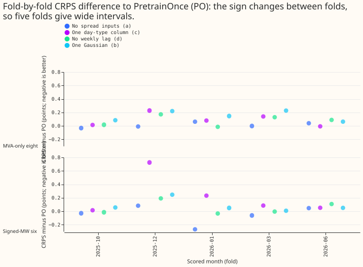
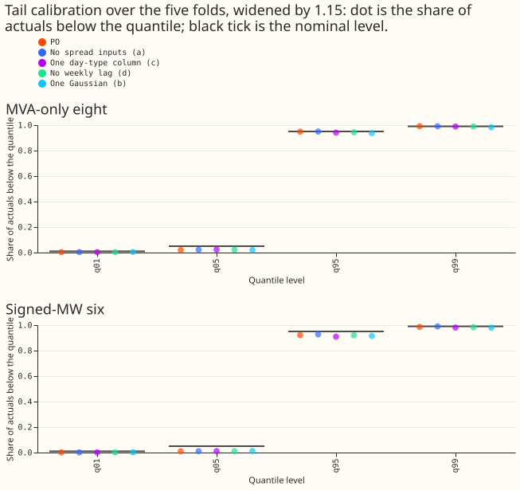
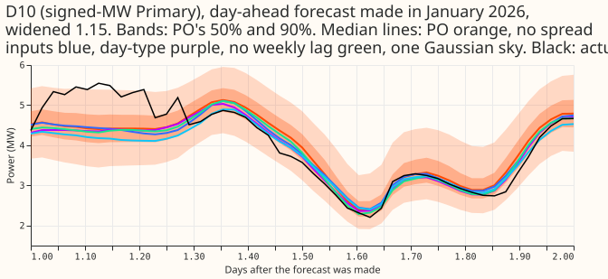
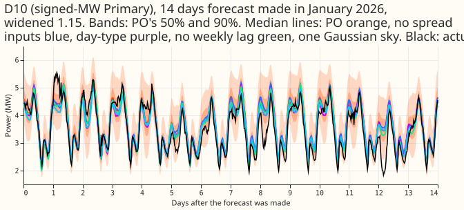
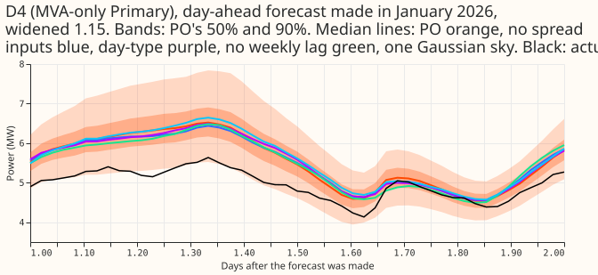
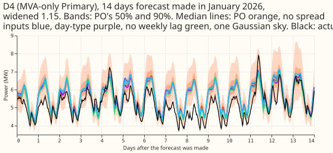

**The demand neural network can drop its 7 ensemble-spread inputs (46 inputs down to 39) with no loss on the whole scored sample. The change in forecast error (CRPS, continuous ranked
probability score, in percentage points of each Primary substation's capacity; a lower score is
better) was +0.012 at the 8 Primaries that report only apparent power (MVA) and -0.043 at the 6 that
report signed megawatts. Both changes are inside the equivalence limit. On cold winter nights at the
6 signed-MW Primaries the network without spread inputs scored 0.187 points worse, and on the 6 Primaries' rows with a labelled event it scored 0.408 worse. The whole-sample equivalence claim does not show those losses.**

**Each of four removals is tested alone against PretrainOnce (PO), with the printed minimum
detectable effect as the limit.** PO is experiment 494's network: pretrained once at the 2025-07
cut and fine-tuned each month, two seeds. Experiment 494 found PO equivalent to a fresh refit. "The
eight" are the 8 MVA-only Primaries and "the six" are the 6 signed-MW Primaries, scored on rows with
no labelled event. The limits are the smallest differences that two seeds per fold could reliably
detect: 0.086 points at the eight and 0.170 at the six. "Bonferroni" bounds are 95% interval bounds
adjusted for 20 comparisons.

| Arm | What is removed | Inputs | Output values (3 per Gaussian) | CRPS change to PO, eight / six |
|---|---|---|---|---|
| PO | nothing (PretrainOnce) | 46 | 9 | 0 |
| a | the 7 ensemble-spread (`std_*`) inputs; the ensemble mean stays | 39 | 9 | +0.012 / -0.043 |
| c | the 4 Christmas and bank-holiday columns, replaced by one day-type column | 43 | 9 | +0.095 / +0.229 |
| d | the 3 weekly-lag inputs (value, missing flag, age) | 43 | 9 | +0.079 / +0.050 |
| b | two of the three Gaussians of the output | 46 | 3 | +0.152 / +0.082 |
| dF | arm d, with fresh pretraining at every fold (a check, not a candidate) | 43 | 9 | +0.080 / +0.064 |

**Only arm a is equivalent to PO at both the eight and the six.** An arm is equivalent when the
upper Bonferroni bound of its CRPS difference to PO is at most the limit. Arm a's upper bounds are
+0.042 at the eight and -0.004 at the six. Arm c is not shown equivalent at either group: its CRPS
difference could be as large as +0.143 at the eight and +0.332 at the six. Arm d could be as large
as
+0.124 at the eight (not shown equivalent) and +0.089 at the six (equivalent). Arm b could be as
large as +0.201 at the eight, and its q99 pinball-loss difference could be as large as +0.029
against a limit of 0.02. No combined network was run, because arm a is the only arm equivalent at
both groups. Verdict: partly supported.

## Figures

## Results

- **Setup.** Each arm is experiment 425's arm A (pooled plain network, Primary embedding, `g09`)
  behind a fixed input transform, pretrained once at the 2025-07 cut and fine-tuned at each of the 5
  folds (2025-10, 2025-12, 2026-01, 2026-03, 2026-06), seeds 0 and 1, widening 1.15, rows of
  experiment 470 (`experiment_470_intersection_v1`), cleaned data with 1,179 scoring actuals dropped
  for a flagged exact zero, the D15 and D18 start cut applied. Experiment 425's arm A is the pooled
  plain network with a Primary embedding (setting `g09`). The removed inputs are multiplied by zero
  inside the network, after the standardiser and after the pretraining spread table, so
  training, forecasting, and reloading share one code path. A gate before any arm: an identity
  transform started from experiment 425's stored 2025-07 weights reproduced PretrainOnce's stored
  forecasts to within 5e-6.
- **Minimum detectable effect (two seeds, five folds).** 0.086 points at the eight and 0.170 at the
  six. The caps in the series brief (0.03 for a, 0.02 for c, 0.05 for d and b) lie below those
  limits, so an
  equivalence claim at the limit cannot show a loss smaller than the minimum detectable effect, and
  an interval that reaches past the limit is inconclusive. Bonferroni count 20 (5 arms x 2 groups x
  CRPS and q99 pinball loss), with 100,000 origin-day block resamples. The scorer's Bonferroni
  interval is two-sided, and the decision rule reads its upper end.
- **CRPS, difference to PO (points).** The first interval is the Bonferroni interval over origin
  days; the second is the 95% interval over folds.

| Arm | Eight | Six | Verdict |
|---|---|---|---|
| a | +0.012 [-0.020, +0.042]; folds [-0.034, +0.059] | -0.043 [-0.084, -0.004]; folds [-0.215, +0.125] | equivalent at both |
| c | +0.095 [+0.052, +0.143]; folds [-0.029, +0.211] | +0.229 [+0.140, +0.332]; folds [-0.143, +0.588] | not shown equivalent at both |
| d | +0.079 [+0.038, +0.124]; folds [-0.016, +0.174] | +0.050 [+0.013, +0.089]; folds [-0.070, +0.169] | not shown equivalent at the eight; equivalent at the six |
| b | +0.152 [+0.103, +0.201]; folds [+0.055, +0.242] | +0.082 [+0.043, +0.129]; folds [-0.034, +0.199] | not shown equivalent at the eight; equivalent at the six |

- **q99 pinball loss, difference to PO (points).** The upper Bonferroni bounds are all inside the
  0.02 limit except arm b at the eight: a -0.003 (bound +0.001) and -0.008 (-0.003); c +0.003
  (+0.007) and +0.013 (+0.018); d +0.005 (+0.008) and +0.005 (+0.009); b +0.016 (+0.029) and -0.003
  (+0.003), the first number at the eight and the second at the six.
- **Absolute CRPS (points).** At the eight: K2 4.720, PO 4.690, a 4.702, c 4.785, d 4.769, b 4.842.
  At the six: K2 3.486, PO 3.484, a 3.441, c 3.712, d 3.534, b 3.566.
- **Against K2 (descriptive).** Arm a is also equivalent to K2: -0.018 [-0.049, +0.011] at the eight
  and -0.045 [-0.077, -0.014] at the six. Arms c, d, and b are not shown equivalent to K2 at the
  eight (+0.065, +0.049, +0.122).
- **Fold by fold.** Arm a's gain at the six comes mostly from 2026-01 (-0.268; the other four folds
  range from -0.059 to +0.083), so the improvement at the six is not established. Leaving one fold
  out moves arm a's point estimate at the eight between 0.000 and +0.023, which stays inside the
  limit.
- **Fresh-pretraining check on arm d (dF).** dF against K2 (both pretrained fresh): +0.051
  [+0.007, +0.096] at the eight (not shown equivalent) and +0.062 [+0.031, +0.092] at the six
  (equivalent). dF against PO gives +0.080 and +0.064. The verdicts equal arm d's, so the
  pretrain-once shortcut did not change a verdict.
- **Cold winter nights (CRPS difference to PO, Bonferroni interval; descriptive; 3 folds: 2025-12,
  2026-01, 2026-03).** At the eight: a +0.051 [-0.041, +0.172], c +0.053 [-0.037, +0.203], d +0.225
  [+0.042, +0.445], b +0.273 [+0.155, +0.405]. At the six: a +0.187 [+0.014, +0.312], c +0.745
  [+0.353, +1.109], d +0.167 [+0.051, +0.261], b +0.288 [+0.042, +0.475]. Every arm is worse on cold
  nights at the six. Among the arms called equivalent at the six (a and d), both lose there although
  neither loses on the whole sample. Arm a's cold-night loss is +0.376 in 2025-12, +0.073 in
  2026-01, and -0.003 in 2026-03, so it comes almost entirely from the December fold. Against K2 the
  loss is +0.128 [-0.007, +0.240], which includes zero.
- **12 to 36 hours (CRPS difference to PO).** At the eight: a -0.027, c +0.024, d +0.025, b +0.116.
  At the six: a +0.033, c +0.265, d +0.083, b +0.114.
- **Christmas week (descriptive, one Christmas).** At the eight a is -0.320 [-0.411, -0.206] better
  than PO; c -0.017, d +0.010, b -0.162. At the six: a +0.046, c +0.204 [+0.064, +0.476], d +0.228,
  b +0.200. Arm c does not lose at the eight in Christmas week.
- **Rows with a labelled event at the six (`six_nra`, descriptive).** Arm a is +0.408 [+0.244,
  +0.577] against PO and +0.420 [+0.279, +0.562] against K2; arm c is +0.223 [-0.059, +0.518]. The
  loss of arm a is largest in 2026-01 (+0.590) and 2025-12 (+0.424), so removing the spread inputs
  hurts on rows where a labelled event occurred, which "rows with no labelled event" leaves out.
- **Against the briefs' original caps.** The upper Bonferroni bounds against the caps in the series
  brief (0.03 for a, 0.02 for c, 0.05 for d and b): a +0.042 at the eight (past 0.03) and -0.004 at
  the six (inside), c +0.143 and +0.332 (past), d +0.124 and +0.089 (past), b +0.201 and +0.129
  (past). Only arm a at the six meets the original cap. The q99 pinball-loss minimum detectable
  effect and the month-by-half-hour climatology row named in the plan were not computed.
- **The pre-registered predictions.** P1 held (a equivalent at both groups). P2 failed (c not shown
  equivalent at either group). P3 held at the six (+0.050, inside 0.00 to 0.08) and failed at the
  eight (not shown equivalent). P4 failed on the CRPS range (+0.152 at the eight, outside 0.00 to
  0.10; +0.082 at the six, inside) and q99 coverage fell by 0.008, inside the predicted 0.02. P5 did
  not apply, because no combined network ran.
- **Tails (widened 1.15, all folds, rows with no labelled event).** q99 coverage at the eight: PO
  0.991, a 0.991, c 0.989, d 0.989, b 0.983. At the six: PO 0.986, a 0.989, c 0.980, d 0.983, b
  0.980. Arm b's q99 coverage falls by 0.008 at the eight and 0.006 at the six, inside the 0.01
  limit. q95 coverage is 0.949 (PO) and 0.937 (b) at the eight, and 0.921 (PO) and 0.909 (c) at the
  six.
- **Avoidable-curtailment cost at the six, difference to PO (experiment 470's cost measure;
  unadjusted 95% bootstrap intervals).** At curtailment fraction f = 0.9: a -0.461 [-1.370, +0.039],
  c +0.193 [-0.009, +0.541], d -0.119 [-0.265, -0.004], b -0.307 [-0.917, +0.027]. At f = 0.75: c
  +1.267 [+0.116, +2.899]; a, d, and b include zero. At f = 0.5: a -1.234 [-4.226, +0.888], c +2.539
  [+0.773, +4.654], d +0.917 [-0.219, +2.230], b +0.195 [-1.315, +1.698]. Arm c's cost is higher at
  f = 0.75 and 0.5; arm d's is lower at f = 0.9.
- **D15 and D18 (report only).** CRPS: PO 11.588, a 10.566, c 10.868, d 11.523, b 11.068, K2 10.956.
  Arms a, c, and b score 0.5 to 1.0 points better than PO here, and PO scores 0.63 worse than K2, so
  on these two series pretraining once did not match a fresh refit.
- **Serving table.** Every arm keeps 2 networks per pass, 12 monthly fine-tunes, and 1 pretraining
  per year (about 38 GPU seconds per seed-refit, experiment 494). Arm a needs 39 inputs instead of
  46 and no ensemble-spread values at serving; change in CRPS against PO +0.012 at the eight and
  -0.043 at the six. Arm c: 43 inputs, +0.095 and +0.229. Arm d: 43 inputs and no read of the
  load one week earlier, +0.079 and +0.050. Arm b: a 3-value output instead of 9, +0.152 and +0.082.

## Checks

- **Median minus mean forecast per Primary.** PO has a median below the mean at 16 of 16 Primaries
  (largest gap -2.6 points of capacity), K2 at 15 of 16 (-2.4), and arm a at 15 of 16 (-1.7). Arm
  b's
  gap is zero by construction, because one Gaussian is symmetric.
- **Error of the median beside the CRPS contrast.** Mean absolute error of the median forecast at
  the eight: PO 6.724, a 6.734, c 6.854, d 6.840, b 6.970 points; at the six: PO 5.662, a 5.600, c
  5.979, d 5.700, b 5.749. The directions agree with the CRPS contrasts for every arm (a at the six
  improves in both), so trigger 3 did not fire.
- **Triggers.** No audit trigger of the `ml-experiment` skill fired and no audit was run. A
  leave-one-fold-out check on arm a at the eight stays inside the limit (0.000 to +0.023).

## Caveats

- Five folds, each from one pair of networks, give wide intervals across folds; the origin-day
  interval treats each fitted network as fixed, so that interval is optimistic. The interval across
  folds for arm a at the six reaches +0.125 and for arm c reaches +0.588.
- Each removal is tested alone; the removals might interact, and no combined network was run.
- Arm c is a design choice: a single ordinal (0 to 3) in place of four columns. A different merge
  (for example a one-hot day type) might lose less; this experiment does not test that.
- Zeroing an input gives the same function as removing it, but the unused first-layer weights start
  at random values, so initialisation differs slightly from a network built without them.
- Arm b keeps the 1.15 widening used for the three-Gaussian arms; a different widening might change
  its q99 result.
- NGED's event labels are incomplete: "rows with no labelled event" may hold unlabelled events.
  Every score is selection-biased, and July 2026 is unused.

## What to try next

- Re-test the removal of the spread inputs on more folds, scoring cold winter nights at the six
  separately before any change to serving.
- Test other merges of the holiday columns (a one-hot day type, or keeping the Christmas position
  inside the merged column) before dropping the idea.

## Plan

### Question

The demand neural network has 46 input columns, a weekly lag, and a three-Gaussian output. Each
removable input is a column production must compute and store, and each removable output shrinks the
network. This experiment removes them one at a time from experiment 494's PretrainOnce recipe, which
is equivalent to the fresh refit (experiment 494) and saves the pretraining stage.

### Design

- **Rows and folds.** The 5 folds of experiment 449 (2025-10, 2025-12, 2026-01, 2026-03, 2026-06) on
  the rows of experiment 470. Every arm trains on exactly the rows of experiment 425's arm A: the
  D15 and D18 start cut and the flagged exact-zero drop apply, and the row set does not depend on
  the inputs. Cleaned data, monthly refits, seeds 0 and 1, widening 1.15.
- **Removing an input.** Each arm trains the experiment 425 network (pooled plain network, Primary
  embedding, `g09`, learning rate 2e-4 in fine-tuning) with a fixed input transform in front of the
  first layer: the removed columns are set to zero, and the merged column is computed from the
  columns it replaces. For (a) and (d), a zeroed input carries no information and receives no
  gradient, so the network computes the same function as one built without those columns (the unused
  first-layer weights start at random values, so initialisation differs slightly). Arm (c) is not of
  that kind: the merged ordinal is a design choice, and `bank_holiday` is also recoverable from
  `nearest_days`. The serving table counts the inputs actually needed.
    - **(a) No ensemble spread.** The 7 `std_*` columns are zeroed. The ensemble mean stays.
    - **(c) One day-type column.** `christmas_inside`, `christmas_days`, `christmas_tent`, and
      `bank_holiday` are replaced by one column `bank_holiday + 2 * christmas_inside` (0 for an
      ordinary day, 1 for a bank holiday, 2 inside the Christmas period, 3 for both). This removes
      the graded position within the Christmas period. `nearest_days` and `nearest_inside` stay.
    - **(d) Two origin lags.** `lag_week`, `lag_week_missing`, and `lag_week_age` are zeroed. The
      newest-reading lag and the same-time-yesterday lag stay. Training rows do not change.
    - **(b) One Gaussian.** `components = 1`, so the output layer is 3 values, not 9.
    - **Combined.** The arms that pass, together.
- **Where the transform sits.** The input mask or merge is a wrapper module created inside
  `fit397.make_model`, driven by an arm field recorded in `meta.json`. Training, pretraining,
  forecasting, and reloading a saved network all pass through it. It acts after the standardiser's
  clipping and NaN fill, and after `prep425.fold_pretrain` overwrites the `std_*` columns with the
  lead-band median table, so pretraining rows carry no residual spread values. Pretraining uses the
  2025-07 fold's standardiser and spread table, as the stored PretrainOnce does, and fine-tuning
  uses each month's own. **Gate before any arm is read:** an identity-transform arm must reproduce
  the stored PretrainOnce forecasts, up to GPU nondeterminism.
- **Pretrain once, with a fresh check.** Each arm pretrains once, at the 2025-07 cut (seeds 0 and 1,
  ERA5 and CAMS rows, the arm's own transform), and fine-tunes at each of the 5 folds from those
  weights. This is experiment 494's PretrainOnce recipe, so the baseline is PretrainOnce. To check
  that the pretrain-once shortcut does not change a verdict, arm (d) is also run with fresh
  pretraining at every fold (80 GPU seconds per seed-fold) and compared with K2, with the same
  limits and group split. Arm (d) is chosen because the lags are the inputs most tied to
  pretraining. The check passes if its equivalence verdict agrees with (d) against PretrainOnce. If
  the verdicts disagree, the page reports both and (d) stays out of the combined arm.
- **Not run.** Experiment 494 measured pretrain-once, so no arm tests it again. Arms that change
  hidden width, depth, or the training rows are other experiments.

### Scoring and stop rules

- The experiment 470 scorer as in experiment 494: each arm against PretrainOnce, all on the same
  rows, with the printed two-seed MDE before any contrast. The scorer reports the eight, the six,
  cold winter nights, the 12 to 36 hour band, q01, q05, q95, q99 coverage and pinball loss, and
  avoidable-curtailment cost at f = 0.9, 0.75, and 0.5 at the six. D15 and D18 and Christmas week
  are report-only.
- **Stop.** An arm that is not equivalent is not combined.
- **Serving table.** Inputs, output values, networks per pass, refits per year, and the change in
  CRPS against PretrainOnce, per arm.

### Compute

- Pretraining: 4 arms x 2 seeds x about 46 s. Fine-tuning: 4 arms x 5 folds x 2 seeds x about 34 s.
  The fresh-pretraining check: 5 folds x 2 seeds x 80 s. The combined arm: about 7 minutes. Roughly
  50 GPU minutes in all (GPU only; per-fold data preparation and forecasting bring the wall clock to
  about 1.5 hours), one GPU process under 8 GB, one feeder core. The briefs ask for arms a, c, and d
  first and b only if budget allows; at this cost all four run.

### Standing practices followed

Monthly refits; cleaned data; D15 and D18 cut; saved networks; stored forecasts reused
(PretrainOnce and K2); tails and cost; example forecasts and the 14-day plot; the process order of
the ml-experiment skill. Not applicable: load-shift event plots.

### Baseline choice

The brief names experiment 425's arm A and K2 as the baseline. This plan uses PretrainOnce as the
primary baseline, because every arm shares its pretraining cut and fine-tuning recipe, and
experiment 494 found it equivalent to K2. K2 stays in the serving table. Step 1 of the series (the
calibration rule) does not change the demand networks, so it leaves this baseline unchanged.

### Series

Step 6 of the neural simplification series (brief of 2026-11-01), after experiments 494 (refit
cadence and pretrain once) and steps 1 and 4 in other pull requests.
