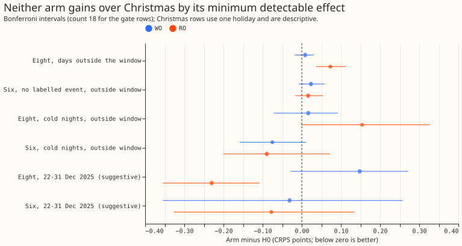
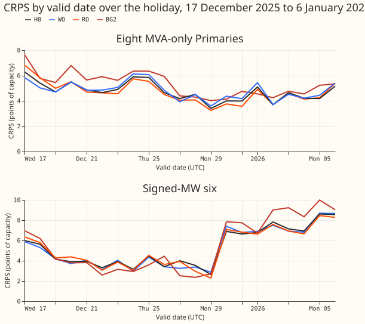
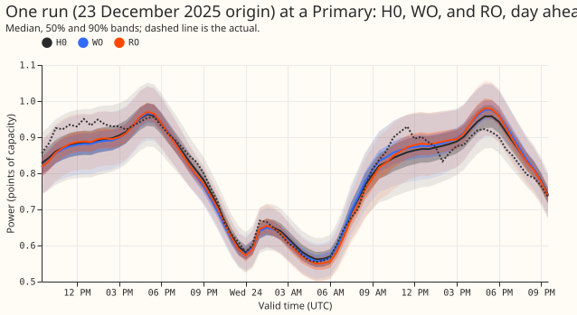
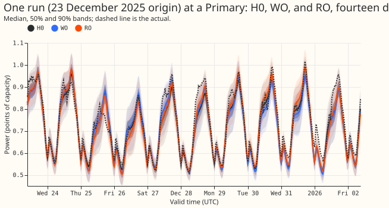

**In this experiment the ERA5 replay carried both the Christmas gain and the loss on other days,
and the weight carried neither; the replay's extra optimiser steps are not ruled out as the cause.**
We asked which half of experiment 485's combined arm (labelled H2 there: a weight of 5 on Christmas
rows plus a replay of earlier Christmases drawn from ERA5 weather estimates, 25% of each batch)
did the work. We fitted each half alone (WO the weight, RO the replay) from the same stored
pretrained neural network, on five folds (test months) and three seeds, and scored both on the
same rows as H0 (experiment 425's unmodified fine-tune). Scores are the continuous ranked
probability score (CRPS) in points of effective capacity. The eight are the eight Primary
substations whose meters report MVA only, and the six are the six whose meters report signed MW.
RO lowers CRPS over 22 to 31 December 2025 at the eight by 0.230 points and raises it by 0.073
points on days outside 22 December to 2 January. WO moves the days outside that window by 0.009.
The Christmas minimum detectable effect (from the three-seed spread of the stored fits) is 0.27 at
the eight and 0.26 at the six. Neither arm clears that effect, so the stop rule applies: we report
no demonstrated Christmas gain. The next test is the Christmas of 2026.

## Results (CRPS in points of effective capacity, 1.15 widening, difference from H0)

- **Minimum detectable effect, printed first (three-seed spread of the stored fits):** 0.054
  (eight, outside the window), 0.122 (six, no labelled event), 0.148 and 0.260 (cold nights, eight
  and six), 0.082 (12 to 36 hour band, eight), 0.27 and 0.26 (22 to 31 December, eight and six).
  The 0.02 gate is below the first two, so a pass there is inconclusive.
- **Absolute scores outside the window:** H0 4.780 (eight) and 3.569 (six, no labelled event). WO
  4.788 and 3.592; RO 4.853 and 3.585.
- **Gate, eight:** WO +0.009 (Bonferroni -0.018 to 0.031), RO +0.073 (0.037 to 0.112). RO fails.
- **Gate, six, no labelled event:** WO +0.023 (-0.007 to 0.058), RO +0.016 (-0.017 to 0.054).
  Both are inside the minimum detectable effect, so the gate is inconclusive for both.
- **q99 pinball loss on the gate rows:** RO +0.0087 at the eight (Bonferroni 0.002 to 0.019),
  which stays inside the +0.02 limit; WO +0.0023 at the eight and +0.0016 at the six.
- **Christmas, 22 to 31 December 2025 (suggestive, one holiday, day-block bootstrap, uncorrected
  95% intervals):** at the eight RO -0.230 (-0.315 to -0.145) and WO +0.148 (0.038 to 0.238); at
  the six RO -0.078 (-0.238 to 0.067) and WO -0.031 (-0.234 to 0.157). H0 scores 4.613 (eight) and
  4.171 (six). Experiment 485 reported H2 at -0.222 (eight) and -0.097 (six).
- **12 to 36 hour band, outside the window:** eight WO +0.006, RO +0.054 (Bonferroni 0.010 to
  0.099); six WO +0.015, RO -0.036 (-0.077 to 0.004).
- **Cold winter nights, outside the window:** eight WO +0.017, RO +0.154 (-0.002 to 0.327); six WO
  -0.075, RO -0.089. Minimum detectable effects are 0.148 and 0.260.
- **Tails on Christmas, eight:** q95 coverage H0 0.968, WO 0.923, RO 0.976; q99 coverage 0.996,
  0.987, 0.998. At the six q95 coverage is 0.874 (H0), 0.816 (WO), 0.859 (RO), below 0.95 for all.
  WO's six q99 pinball loss on Christmas is 0.477 against H0's 0.341 (day-block interval 0.012 to
  0.309, uncorrected).
- **Avoidable-curtailment cost at the signed-MW six, rows with no labelled event, all five folds
  (units of experiment 470's table; difference from H0, 95% cell-bootstrap interval):** at f = 0.9
  H0 1.852, WO -0.139 (-0.503 to 0.072), RO -0.167 (-0.557 to 0.049); at f = 0.75 H0 7.408, WO
  -0.178 (-1.046 to 0.411), RO -0.515 (-1.705 to 0.187); at f = 0.5 H0 22.711, WO +0.168 (-1.248 to
  1.439), RO -0.970 (-2.908 to 0.315). `manual_heuristic` costs 2.017, 12.883, and 37.789. On the
  Christmas half-hours alone the costs are 0.000 to 0.002 at f = 0.9, 0.19 at f = 0.75, and 1.2 to
  1.3 at f = 0.5 for all three arms, with no contrast distinguishable from zero.
- **Where RO's loss outside the window sits:** mostly the two winter folds, +0.150 (2025-12) and
  +0.174 (2026-01) at the eight, as in experiment 485's H2.
- **Pre-registered prediction:** failed. Neither arm lowered Christmas CRPS by the minimum
  detectable effect at both groups.
- **Fits and compute:** 30 fine-tunes of 30 to 41 seconds each (0.29 GPU-hours), no reproduction
  fit needed because experiment 485 matched H0 to 1e-8. Rows dropped per fold: 68,680 for the
  D15 and D18 start cut and 2,155 to 2,925 flagged exact-zero half-hours. Replay sets hold 218,689
  (folds 2025-10 and 2025-12), 274,171, 286,075, and 286,075 rows. Fitted networks are in the
  experiment's data folder under `work/models/{WO,RO}`.

## Checks

- **Median minus mean of the 11 quantiles, per group (points; gate rows / Christmas rows):** H0
  -0.847 / -0.189 at the eight and -0.471 / -0.672 at the six; WO and RO differ from H0 by at most
  0.12 on gate rows, and by up to 0.12 at the eight and 0.24 at the six on Christmas rows. No arm
  shifts the forecast in a way the CRPS contrast does not show.
- **Mean absolute error of the median forecast beside each CRPS contrast:** outside the window RO
  is +0.100 at the eight and +0.020 at the six against H0 (WO +0.007, +0.016); on Christmas RO is
  -0.399 at the eight and -0.125 at the six (WO +0.180, -0.144). Every sign agrees with the
  matching CRPS contrast.
- **Audit triggers:** none fired. The prediction failed, but it was written with a stated prior
  against it and the cause (the replay) is what the split tests. RO and WO add up to H2's pattern
  (RO +0.073 plus WO +0.009 against H2's +0.081 outside the window at the eight), so no nested arm
  beats its container.

## Caveats

- One Christmas is scored, so every Christmas number is suggestive. December 2024 is not scored:
  no pretrained weights exist for that cut, and the ensemble history starts 2024-04-01.
- RO takes 1.33 times the optimiser steps per epoch, so an RO effect is a replay effect plus a
  step-count effect. No step-matched control was run.
- Fold 2026-01 trains on Christmas 2025, so its rows for 1 and 2 January are reported but not
  counted in any test.
- Every score is selection-biased: the five folds that choose the arm also score it. July 2026 is
  unused. NGED's event labels are incomplete: "rows with no labelled event" may hold events.
- The serving cost is nil for both arms: each changes the training loop only, and the refit count
  stays at 12 monthly refits a year.
- Code reuse: the scripts import experiment 485's fit loop, regime helpers, scorer, and figure
  code, which in turn import experiments 87, 397, 407, 418, 422, 425, and 470.

## Review of the work

- **Code review (fresh Sonnet agent, before the first fit):** no blocking problems; two wording
  fixes (the curtailment table has no BG2 column; H2 is quoted from experiment 485, not rescored),
  both applied.
- **Results review (fresh Sonnet agent, from the raw stored forecasts):** re-derived the seven
  headline numbers to four decimals, found identical rows and correct seed pairing across arms,
  and found no leakage in the replay set.
- **Prose review (fresh Sonnet agent):** 25 findings. Accepted: the lead's missing definitions and
  its overclaim about the replay (step count not ruled out), the wording of the weight's
  Christmas contrast, and the "network", "costs", "meets", and "which" ambiguities. Rejected: the
  request to explain every statistical term (Bonferroni, day-block bootstrap) inline, because
  experiment 485's page, which this one follows, defines them once.

## What to try next

- Christmas 2026 would give a second scored holiday for H0 and RO.
- A step-matched control and a smaller replay share would show whether the loss outside the window
  comes from the extra optimiser steps.
