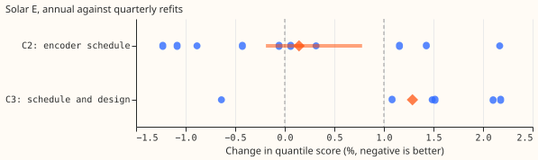
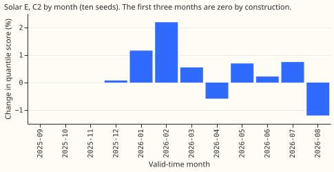
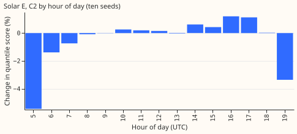
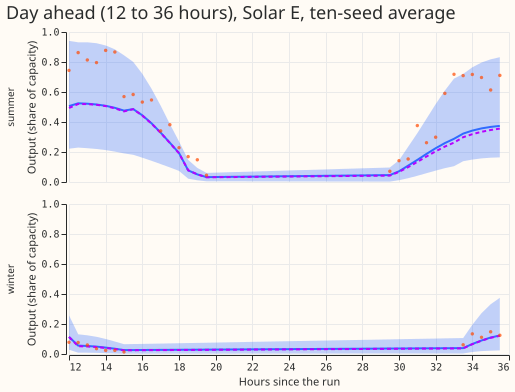
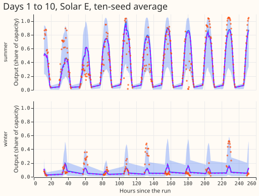

**Refitting the Solar E network once a year instead of every quarter loses about 0.3% of the quantile
score, inside the 1% limit, so annual refits can stand for all six farms.** The quantile score is a
pinball loss averaged over 11 quantile levels (lower is better). Experiment 493 reported that, at
Solar E, the one-pass network with annual refits scored 1.28% worse than the 51-member encoder with
quarterly refits. That figure changes two things at once, the network design and the refit schedule.
Holding the design fixed at the encoder, the schedule alone costs +0.26% at ten random
initialisations (seeds), with a 97.5% month-block interval of −0.19% to +0.78%.

We first re-read the six seeds that experiment 493 stored, with no new fits. At six seeds the
schedule-only contrast was +0.53% (+0.10% to +1.06%). The upper end exceeded 1%, and the seed spread
of the contrast was too large to rule out a loss of 1% (a minimum detectable effect of 1.01%). We
then fitted seeds 6 to 9 (16 fits, as the brief required in that case). The ten-seed contrast is +0.26%
with a minimum detectable effect of 0.71%, so the 1% limit lies above it and the result is
conclusive.

*Figure 1. Change in quantile score at Solar E, annual against quarterly refits. Each dot is one
seed, the diamonds are the mean of the per-seed contrasts, and the bar is the 97.5% month-block
interval of the ten-seed average forecast for C2. The dashed lines mark 0 and the 1% limit. C3 has
six seeds only.*

## Results

- **C2, the schedule alone (encoder, annual against quarterly), Solar E.** Ten-seed average forecast:
  +0.265% over all bands (−0.190% to +0.780%) and +0.409% in the day-ahead band (+0.160% to
  +0.720%), month-block intervals at 97.5% (Bonferroni count 2, family level 5%, 12 valid-time
  months, 10,000 draws). Quarter-block intervals (4 blocks, at most 35 distinct resamples) are
  −0.18% to +0.99% and +0.09% to +0.71%.
- **Seed spread.** The ten per-seed contrasts run from −1.23% to +2.17% (mean +0.14%, standard
  deviation 1.14). The mean of the per-seed contrasts differs from the contrast of the average
  forecast (+0.26%) because averaging ten forecasts lowers each arm's score by a different amount.
- **Minimum detectable effect.** Printed before any score: 1.96 × standard deviation ÷ √seeds, the
  half-width of a normal-approximation 95% interval for the mean per-seed contrast. It is 1.01% at
  six seeds and 0.71% at ten. At six seeds the 1% limit was below the minimum detectable effect, so
  the six-seed read was inconclusive; at ten seeds the limit is above it. A t quantile instead of
  1.96 would give about 1.32% at six seeds and 0.82% at ten.
- **Absolute scores (points of capacity, ten seeds, all bands, rows pooled).** Annual 7.273,
  quarterly 7.257. The month-block contrasts above weight the 12 valid-time months equally; the
  per-seed contrasts and these scores pool rows (see the audit below).
- **C3, the one-pass network with annual refits against the encoder with quarterly refits (six
  seeds).** +1.28% (+0.52% to +1.96%), per-seed mean +1.29% with a range of −0.64% to +2.18%.
  The schedule contributes about 0.3% of it at ten seeds, so the rest, about 1%, belongs to the
  network design. C3 has no ten-seed version because the one-pass network was not refitted.
- **The loss is not one quarter.** By refit quarter (ten seeds), annual against quarterly is 0.00%
  (same fit by construction), +1.28%, +0.35%, and −0.37% for the later three. The per-seed standard
  deviation in each of those quarters is 1.9, 2.3, and 0.8 points, larger than the contrast in all
  three, so the prediction that the contrast exceeds the seed spread in at least 2 of 4 quarters
  failed. Quarters are groups of forecast run dates, so each interval is descriptive.
- **By valid-time month.** The contrast is positive in January (+1.2%) and February (+2.2%), near
  zero in March and May to July, and negative in April (−0.6%) and August (−1.2%). The first three
  months are zero by construction. See Figure 2.
- **By hour of day.** The loss sits in the daytime hours: 14:00 to 18:00 UTC hold 93% of the score
  difference, and the 05:00 to 08:00 UTC hours favour annual refits. See Figure 3.
- **Not a clip effect.** The 460 rows whose output is at least 98% of the year's 99.9th percentile
  carry −2.9% of the total score difference (annual is slightly better there). Output as a share of
  effective capacity rises from 0.43 (December) to 1.07 (April and May), a seasonal pattern; the
  scored year shows no capacity step. The 2021 to 2023 production level that experiment 453 found at
  other farms is outside the scored year, so this read could not test it.
- **Control.** In the first quarter the annual and quarterly forecasts are the same fit, and agree to
  below 1e-6 percent for all ten seeds.

*Figure 2. Change in quantile score by valid-time month (ten-seed average forecast).*

*Figure 3. Change in quantile score by hour of day (ten-seed average forecast).*

### Tails

| Arm | 0.01 pinball | 0.05 pinball | 0.95 pinball | 0.99 pinball | Coverage of 0.95 | Coverage of 0.99 |
|---|---|---|---|---|---|---|
| annual encoder | 0.460 | 1.800 | 1.395 | 0.323 | 0.9325 | 0.9821 |
| quarterly encoder | 0.457 | 1.785 | 1.384 | 0.321 | 0.9336 | 0.9836 |

Solar E, ten-seed average, points of capacity. The annual schedule is worse at every tail by 0.002 to
0.016 points. Both arms undercover the 0.95 and 0.99 quantiles by 1 to 2 points.

### Example forecasts

*Figure 4. Solar E forecasts for the 12 to 36 hours after a run (15 June 2026 and 15 January 2026).
The band is the 5% to 95% range of the annual encoder, the solid line its median, the dashed line
the median of the quarterly encoder, and the dots the observed output.*

*Figure 5. The same two runs over days 1 to 10.*

### Serving table

| Stack | Networks per serving pass | Inputs | Refits per year | Score against quarterly encoder, Solar E |
|---|---|---|---|---|
| Encoder, quarterly | 1 network with the 51-member encoder | member-level and summary columns | 4 | 0 |
| Encoder, annual | 1 network with the 51-member encoder | member-level and summary columns | 1 | +0.26% |

Annual refits remove 3 of the 4 refits per year for the encoder (24 seconds of GPU time each, per
seed). The serving pass is the same in both rows.

### Checks

- **Median minus mean forecast.** +0.65 points of capacity for annual and +0.54 for quarterly
  refits (ten seeds, all rows).
- **Mean-forecast error beside the contrast.** The mean absolute error of the mean forecast is 14.050
  for annual and 14.058 for quarterly refits, a difference of −0.06%. The quantile score favours
  quarterly refits by +0.26%, so audit trigger 3 fires, with a mean-forecast gap well inside seed
  noise.
- **Other triggers.** The control passed. The result did not contradict its prediction: the
  prediction stated a ten-seed spread of about 1 point, and the contrast moved from +0.5% to +0.26%
  inside it. The interval is as wide as experiment 493's for the same contrast (1.0 against 0.97
  points). Leave-one-farm-out does not apply to one farm.
- **Audit.** A fresh Sonnet agent re-derived the contrasts (triage below).

### Reviews

- **Code review (fresh Sonnet).** Redirects, row assembly, leakage cut-off, and bootstrap level were
  correct. Accepted: fixed the "six-seed" headings printed in ten-seed mode, grouped the quarter table
  by run date (the refit quarter) instead of valid time, and corrected the capacity heading. Accepted
  and stated above: the minimum detectable effect is a normal-approximation half-width, not a
  power-based figure.
- **Audit (fresh Sonnet).** It re-derived every headline number from the raw forecasts with its own
  code (ten seeds +0.265% and day-ahead +0.409%, six seeds +0.534%, per-seed contrasts, absolute
  scores), and found complete rows, no duplicate keys, a first quarter identical to the stored
  quarterly fit (largest quantile difference 2.6e-6), and no leakage in the cut-off. Accepted: the
  headline contrasts weight the 12 valid-time months equally, while the absolute scores and the
  per-seed contrasts pool rows (September 2025 holds 890 rows and May 2026 holds 8,310). Pooling rows
  gives +0.22% (−0.37% to +0.79%) over all bands and +0.54% (+0.27% to +0.78%) in the day-ahead
  band at ten seeds, so the verdict stands; the day-ahead upper end stays below 1%. Accepted: the gap
  between +0.26% and the per-seed mean +0.14% is seed noise (standard error 0.36) plus an ensembling
  effect, not a fault. Accepted: the annual-minus-quarterly gap shrinks with horizon (row-pooled:
  day 1 +0.53%, days 6 to 7 +0.19%, days 8 to 10 −0.06%).

### Caveats

- **Seeds 6 to 9 were added after the six-seed read**, as the brief specified for an ambiguous
  six-seed result. The six-seed and ten-seed numbers are both shown.
- **One farm, one refit date, one scored year.** Annual refits train to the end of August 2025. The
  scored year runs to August 2026, so it includes forecasts for July and August 2026, which the
  standing rule keeps unused; the rule was written after experiment 310 fixed these rows, and this
  experiment inherits its row set.
- **Tails.** The 0.95 and 0.99 quantiles undercover by 1 to 2 points under both schedules.
- **Not run:** avoidable-curtailment cost and cold winter nights, which apply to demand. The
  stored lead band that starts at 12 hours is the day-ahead band; for solar the stored minimum
  lead is 12 hours in these forecast files.
- **Seed noise.** Month-block intervals treat the ten-seed average as fixed.

### Problems caused by moving the code to this repository

None. A fresh worktree needed `uv sync --all-packages --group gpu` for PyTorch, as `CLAUDE.md` says.

## Design

Code: `ml-experiments/00498-solar-e-annual-refit-schedule-only-read/`. It imports the modules of
experiments 310, 430, and 493 (`ml-experiments/00310-metered-farm-long-lead-scoring/`,
`ml-experiments/00430-unified-forecaster-solar-and-pretraining-ablations/`, and
`ml-experiments/00493-solar-annual-against-quarterly-refits/`). Fitted networks and predictions of
seeds 6 to 9 are in the private data folder `data/ml-experiments/00498-solar-e-annual-refit-schedule-only-read/`.
