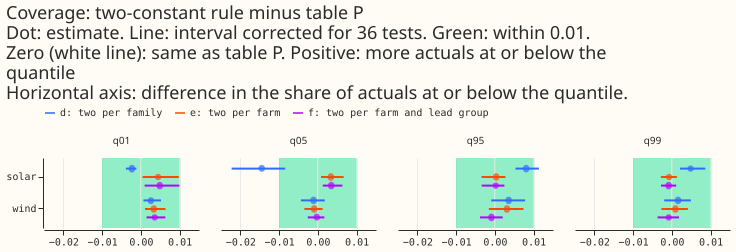
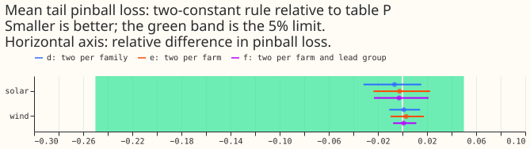
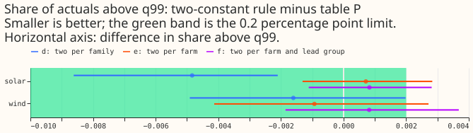
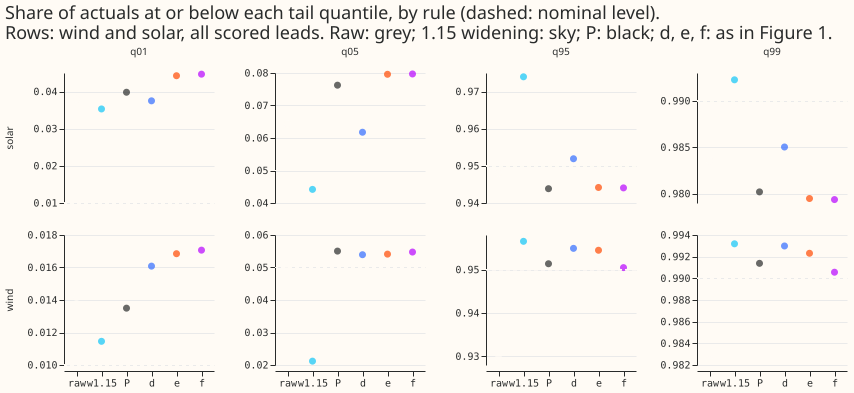
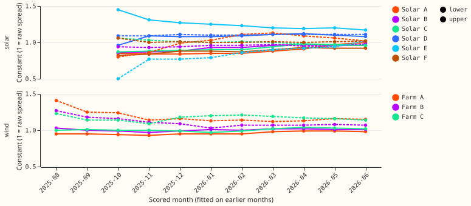
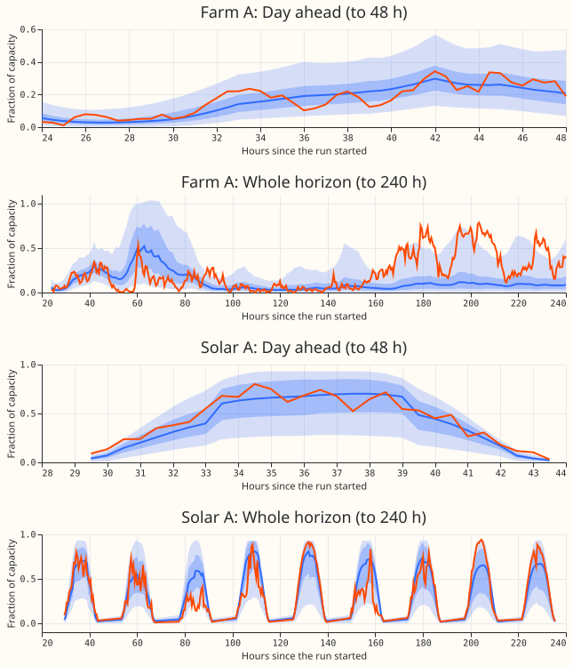

**Two constants per farm tune the wind and solar tails about as well as table P on the stored
forecasts, but the stored year is too short to prove it.** Table P is the recalibration of
[experiment 450](../00450-wind-upper-tail-check-with-table-p-and-sweep/result.md) and [experiment
461](../00461-wind-and-solar-retrain-with-p99-9-effective-capacity/result.md): one widening factor
for each farm, lead band, and tail quantile (16 per farm), plus a clip. A tail quantile here is q01,
q05, q95, or q99, the 1%, 5%, 95%, and 99% points of the forecast distribution. This experiment
re-scored experiment 461's stored forecasts (wind `member_plain`, solar `a2_member`, the
neural-network arms named on that page, both scaled by the 99.9th percentile of the series' output
as its capacity) with one number scaling the lower tail (q01 and q05) and one scaling the upper tail
(q95 and q99), fitted on earlier months only. Rule d fits one pair for each family, rule e one pair
for each farm, and rule f one pair for each farm and lead group (the first stored band, 36 to 72
hours, and 72 to 240 hours). It follows [experiment
492](../00492-two-constant-tail-widening-in-place-of-table-p-for-demand/result.md), which tested the
same rule for demand. No forecasting model was fitted.

On wind, every two-constant rule sat within 0.004 of table P's coverage at every tail, and the
rules' mean tail pinball loss differed from table P's by under 0.3%. The pre-registered rule needs
the minimum detectable effect (printed before any contrast) to be at or below each limit, and it is
not, except for wind q99 coverage. Only that criterion is called equivalent, so no rule matches
table P on all six. On solar, per-farm constants match table P's coverage within 0.005, but one pair
for all six solar sites misses it at q05 and q95.

Figure 1 shows each rule's coverage minus table P's, pooled over farms, with the limit (green).

Figure 2 shows the mean tail pinball loss of each rule relative to table P's.

Figure 3 shows the share of actuals above q99, minus table P's.

Figure 4 shows each rule's absolute tail coverage, including the raw forecast and the 1.15
widening, against the nominal level.

Figure 5 shows the constants of rule e per farm and scored month.

Figure 6 shows one wind run (Farm A, January 2026) and one solar run (Solar A, June 2026) in
fractions of capacity, with the median, the 50% band (q25 to q75), the 90% band (rule d's tails),
and the actual. The horizontal axis is hours since the run started; the stored leads start at 24
hours for wind and 29.5 hours for solar. The first panel of each pair is the day-ahead window.

## Results

All rows are true days 1 to 10. The scored months are wind 2025-08 to 2026-06 (54,899 rows, 3 farms)
and solar 2025-10 to 2026-06 (264,951 rows, 6 series). Every row is scored by every rule.

| Family | Rule | q01 | q05 | q95 | q99 | Share above q99 | Mean tail pinball (MW) |
|---|---|---|---|---|---|---|---|
| wind | raw | 0.0142 | 0.0501 | 0.9297 | 0.9825 | 1.75% | 0.1274 |
| wind | 1.15 widening | 0.0115 | 0.0212 | 0.9565 | 0.9932 | 0.68% | 0.1264 |
| wind | table P | 0.0135 | 0.0550 | 0.9514 | 0.9914 | 0.86% | 0.1257 |
| wind | d | 0.0161 | 0.0539 | 0.9549 | 0.9930 | 0.70% | 0.1258 |
| wind | e | 0.0168 | 0.0541 | 0.9545 | 0.9923 | 0.77% | 0.1260 |
| wind | f | 0.0171 | 0.0548 | 0.9505 | 0.9906 | 0.94% | 0.1258 |
| solar | raw | 0.0379 | 0.0643 | 0.9481 | 0.9835 | 1.65% | 0.0675 |
| solar | 1.15 widening | 0.0353 | 0.0442 | 0.9740 | 0.9923 | 0.77% | 0.0692 |
| solar | table P | 0.0398 | 0.0763 | 0.9439 | 0.9802 | 1.98% | 0.0681 |
| solar | d | 0.0375 | 0.0618 | 0.9519 | 0.9850 | 1.50% | 0.0676 |
| solar | e | 0.0443 | 0.0796 | 0.9442 | 0.9795 | 2.05% | 0.0679 |
| solar | f | 0.0447 | 0.0797 | 0.9441 | 0.9794 | 2.06% | 0.0679 |

The cells are the share of actuals at or below the quantile, except the last two columns.

- **No rule matches table P on all six criteria, for either family.** The minimum detectable effect
  exceeds every limit except wind q99 coverage (below), so a result inside the limits is reported as
  inconclusive. Only wind q99 coverage, for rules d, e, and f, is called equivalent. Table P stays
  for both families.
- **On wind, the intervals alone put rule d inside the limits on all six criteria.** Differences
  from table P (interval at the Bonferroni level, a correction for 36 tests): q01 +0.0026 (+0.0006
  to +0.0052), q05 -0.0011, q95 +0.0036, q99 +0.0016, share above q99 -0.16 percentage points
  (-0.49 to +0.20), and tail pinball +0.11% (-1.07% to +1.44%). Rules e and f are inside the limits
  on five criteria. The share above q99 is inconclusive for both (e: -0.09 points, interval -0.41
  to +0.27; f: +0.08 points, -0.19 to +0.37).
- **On solar, one pair for all six sites fails at q05 and q95, but per-farm pairs do not.** Rule d
  differs from table P at q05 by -0.0145 (interval -0.0223 to -0.0084) and at q95 by +0.0081
  (+0.0053 to +0.0114), both crossing the limit of 0.01. Rules e and f are inside the limits on
  coverage (every difference under 0.005) and tail pinball loss (-0.23% and -0.28%, intervals about
  -2.3% to +2.3%). Their share above q99 is inconclusive (+0.07 and +0.08 points, intervals reaching
  +0.28).
- **Table P misses the 1.5% limit on actuals above q99 for solar.** That limit, at most 1.5%, is
  experiment 461's operating limit for wind and solar. Table P passes for wind (0.86%) and fails for
  solar (1.98%). Rule d passes for wind (0.70%) and for solar (1.497%, just inside the limit). The
  raw forecast fails for both (1.75% and 1.65%), as do rules e and f for solar (2.05% and 2.06%).
- **The minimum detectable effect is a conservative bound, and mostly larger than the limits.** It
  comes from the run-block spread of table P's own rows, at 80% power and the Bonferroni level.
  Wind, pooled, all rows: coverage 0.010 (q01) to 0.035 (q05), share above q99 0.84 points, tail
  pinball 20%. Solar: coverage 0.016 to 0.041, share above q99 1.6 points, pinball 16%. Every value
  except wind q99 coverage exceeds its limit.
- **The bound ignores that both rules are scored on the same rows.** The paired intervals above are
  1.2 to 12 times narrower than the bound, and only 1.2 to 1.5 times narrower for wind q99 coverage
  and share above q99. `verdict` in `contrasts.csv` is the interval's verdict, and
  `verdict_after_mde` applies the rule. Wind rule d's share above q99 sits about 0.002 percentage
  points inside its limit, so a different resampling seed could flip that cell.
- **Shorter solar blocks would change four verdicts.** With one block per day instead of one per
  week, solar intervals are about 2.2 times narrower (`contrasts_init_blocks.csv`). Rule d's q05
  difference is then not equivalent. Rule d's q95 and the share above q99 of rules e and f are then
  equivalent. Weekly blocks stay as the pre-registered choice, because consecutive daily runs share
  their weather.
- **In the first lead band, the intervals are wide.** The stored first band is 24 to 36 hours for
  wind (3,133 rows) and 29.5 to 36 hours for solar (12,565 rows). Wind q95 coverage differs from
  table P's by +0.0045 (d), +0.0041 (e), and +0.0080 (f, interval +0.0018 to +0.0160). Only about
  30 wind actuals are expected above q99 here. Solar d differs at q05 by -0.0153 (-0.0276 to
  -0.0062).
- **Per farm, most cells are inside the limits, and Solar E is the exception.** For rule e on all
  rows, wind has 12 of 18 criteria inside the limits and 6 inconclusive. Solar has 25 of 36 inside,
  10 inconclusive, and 1 not equivalent: Solar E's share above q99 is +1.25 points (interval +0.29
  to +2.84). Solar E has the fewest scored rows of the six solar series (41,076, against 41,994 to
  45,936), and its fitted constants (lower 1.25, upper 0.83, means over the months) are the most
  extreme of the six. Four of its constants sit on the edge of the 0.50 to 1.80 grid in 2025-10.
- **Constants vary by farm and month.** Rule d: wind lower 0.99 and upper 1.15; solar lower 1.01 and
  upper 1.02. Rule e, upper constant: wind 1.18 (Farm A), 1.11 (Farm B), and 1.17 (Farm C); solar
  0.83 (Solar E) to 1.10 (Solar D). Figure 5 shows the month-by-month values.
- **The gate holds.** Table P with experiment 461's plain fitting window reproduces that
  experiment's pooled wind share above q99 at 0.88% (solar: 1.75%; `gate.csv`). The main run uses
  the stricter window described in Method, where wind table P is 0.86%.
- **Fallbacks were rare.** A cell is one farm, one lead group, and one scored month (99 wind cells
  and 162 solar cells). Rule f used its farm's pair from rule e in 5 wind cells and 8 solar cells.
  Separately, table P left a farm and lead band at factor 1 where fewer than 200 fitting rows
  existed; `constants.csv` counts those (`fit_rows`).

## Method

- **Forecasts.** Experiment 461's `rows_member_plain_p999.parquet` and `rows_a2_member_p999.parquet`
  (folder `00461-*/work`), in MW; wind is 52 Tuesday runs with 5 seeds averaged; solar is daily runs
  with 3 seeds averaged. July 2026 and later are dropped. Wind has 47 run blocks in the scored
  months. Weather at forecast time only.
- **Fit window.** A fitting row's valid time (initialisation plus lead) must precede the scored
  month's first initialisation. Experiment 461's plain "earlier months" window would fit actuals
  unknown at the first run (up to 10 days for wind, whose month key is the initialisation month).
- **Rules.** raw; 1.15 widening; table P (experiment 450's `fit_factors`, copied); d, e, f fitted
  as the 0.50 to 1.80 grid value (step 0.01) minimising pinball loss in fractions of capacity.
  Rule f has three lead groups: the first stored band, 36 to 72 hours, and 72 to 240 hours.
  All but raw use experiment 451's clip.
- **Intervals.** Paired run-block bootstrap, 100,000 resamples, blocks of one run (wind) or one
  initialisation week (solar), at the Bonferroni level for 36 tests. A sensitivity run with daily
  solar blocks is in `contrasts_init_blocks.csv`.
- **Code.** `ml-experiments/00499-*/e00499_two_constant.py` and `e00499_report.py`; the table P copy
  follows experiments 450 and 461; the folder of experiment 461 is read only as data.
- **Serving table.** Table P: 16 factors per farm plus the clip. Rule d: 2 numbers per family. Rule
  e: 2 per farm (6 wind, 12 solar). Rule f: 6 per farm. Each is refitted when the forecasts are.
- **Not applicable.** Cold winter nights and the avoidable-curtailment cost are demand measures.
  The cut of the noisy start of two short-history Primaries (D15 and D18) and the flagged
  exact-zero half-hours concern demand only. No ERA5 reanalysis or other past weather enters. No
  forecasting model was fitted or saved.

## Checks

- **Median minus mean forecast per site:** unchanged by every rule, because each rule scales
  distances from q50 (the median) and leaves the median alone; stored forecasts hold quantiles only.
- **Audit triggers:** none fired.
- **Prediction outcome.** P1 held for rule d, and held on five of six criteria for rules e and f
  (the intervals alone; the minimum detectable effect rule withholds equivalence on all but wind
  q99 coverage). P2 held for the family pair (d fails q05 and q95), and failed in part for the
  per-farm rules, which are inside the coverage limits but inconclusive on the share above q99; the
  stated low-sun mechanism was not tested. P3 held (f is no better than e). P4 held for per-farm
  cells once the minimum detectable effect rule is applied (18 of 18 wind and 33 of 36 solar cells
  are then inconclusive; on the intervals alone 12 and 25 are inside the limits). P4 missed for
  the first-band wind q99 criteria of rules d and f, whose intervals sit inside the limits.
- **Reviews:** recorded in the PR body.

## Caveats and next steps

- **Caveats.** Wind has 3 farms, 47 scored runs (52 stored), and 11 scored months; solar has 6
  series and 9. Every score is selection-biased, because the same year chose the candidates and
  scores them. The data partner NGED's event labels are incomplete, and these rows are generator
  output with no event labels at all. The minimum detectable effect used here is an unpaired
  bound, so "inconclusive" overstates the doubt for most cells. Constants are fixed in each
  resample, so fitting uncertainty is not in the intervals. The constants are fitted by pinball
  loss and table P by matching coverage, so the comparison is partly of fitting methods.
- **Next steps.** Re-score when 6 or more further months are stored. Try rule e with the family
  pair as the fallback for a series with under 3 months of history. Test whether solar's q05 and q95
  gap of rule d comes from low-sun hours by adding an hour-of-day slice.
