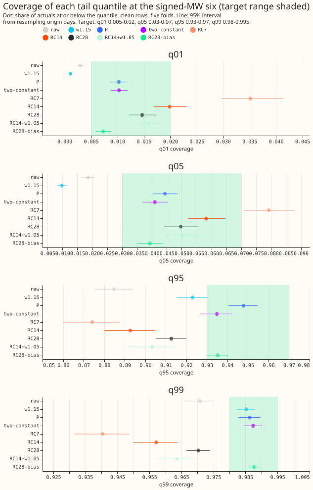
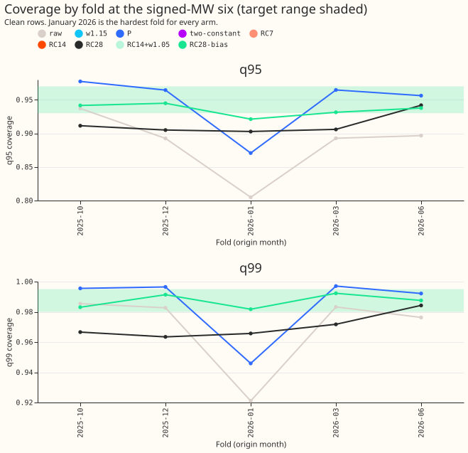
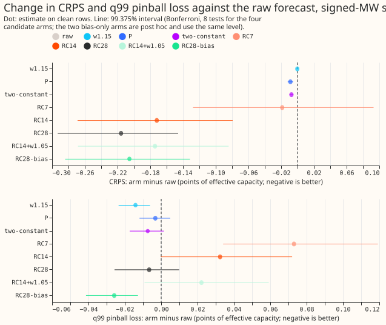
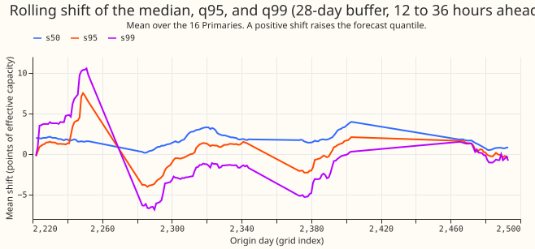
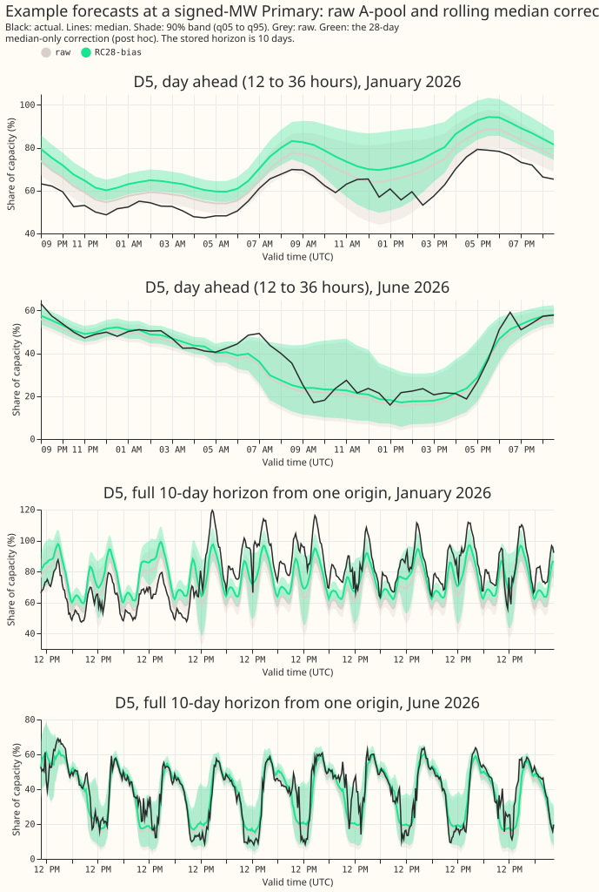
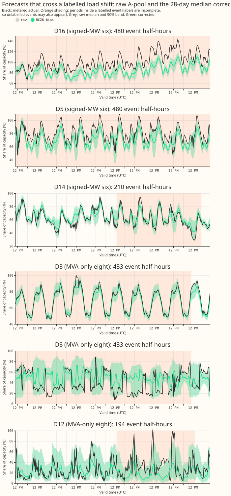

**A correction built from each quantile's own recent errors does not fix the upper tail at the
signed-MW six, but shifting the whole forecast by the recent median error comes close.** We asked
whether the forecast's tails could be repaired with no fitted table, by shifting every quantile of
the demand forecast by the matching quantile of the errors it made over the last 7, 14, or 28 days
(rolling conformal correction). The answer is no: q95 coverage at the six Primary substations whose
telemetry is in signed MW stays below its 0.93 floor for every buffer length (0.874 to 0.913,
against 0.885 for the raw forecast), so the pre-registered stop rule fires and the hypothesis is not
supported. An arm added after the scores were seen, which shifts all 11 quantiles by only the median
of the last 28 days' errors, brings all four tails into range (q95 0.935, q99 0.988) and lowers q99
pinball loss by 13%, but most of its CRPS gain comes from one Primary.

The correction follows conformalized quantile regression ([Romano et al.
(2019)](https://doi.org/10.48550/arXiv.1905.03222)) and its online form ([Gibbs and Candès
(2021)](https://doi.org/10.48550/arXiv.2106.00170)). The experiment re-scores forecasts stored by
earlier experiments and fits no model.

**Terms.**

- **The six, the eight, A-pool, table P:** as in [experiment
  483](../00483-uncertainty-rerun-on-the-first-release-demand-candidates/result.md). The six are the
  Primaries with signed-MW telemetry, the eight those with MVA-only telemetry, A-pool is the
  five-seed average of experiment 425's arm A, and table P multiplies each tail quantile's distance
  from the median by a factor per metering group, lead band, and tail.
- **RC7, RC14, RC28:** rolling conformal with a buffer of 7, 14, or 28 days of delivered errors.
  **RC14+w1.05** adds a final symmetric widening of the four tail quantiles by 1.05.
- **RC28-bias (post hoc):** the 28-day buffer's median error added to all 11 quantiles, with no tail
  shift of its own.
- **Clean rows:** rows with no labelled event. NGED's event labels are incomplete, so clean rows may
  hold unlabelled events.

Figure 1 shows each arm's coverage at the six with 95% intervals against the target range (green).
Only table P, the two-constant rule, and RC28-bias reach the q95 range, and the four rolling arms
fall short of the q95 and q99 floors.

Figure 2 shows q95 and q99 coverage by fold for four arms.

Figure 3 shows the change in CRPS and q99 pinball loss against the raw forecast, with the Bonferroni
intervals.

Figure 4 shows the mean 28-day shifts of the median, q95, and q99 for the 12 to 36 hour band.

Figure 5 shows a day-ahead forecast and a full 10-day forecast  at
one signed-MW Primary, in January and June 2026.

Figure 6 shows six forecasts that cross labelled load shifts, three at the six and three at the
eight, with the labelled half-hours marked in orange. NGED's logs may miss events, so unlabelled
events may also appear in these panels.

## Arms, rows, and method

- **Forecasts:** A-pool, from experiment 425's `seed_preds/A` (12 months, 2025-07 to 2026-06, each
  month out of fold) for the buffers, and experiment 483's cache for the scored rows (`gam14` plus
  D15 and D18, five folds: 2025-10, 2025-12, 2026-01, 2026-03, 2026-06). A-gam-in is dropped,
  because it exists for the eight only and has no history before its folds. K2-425A is not used.
- **Dropped half-hours of July 2026:** experiment 483's 2026-06 fold holds 2,736 half-hours with
  valid times on 2026-07-01 (leads of 39 hours or more), which the rule that keeps July 2026 for a
  finalist excludes. Every arm drops them, so the numbers here differ slightly from experiment 483's
  (the six's raw q95 is 0.8848 here).
- **Buffer:** at each daily 09:00 UTC origin, for each Primary and lead band, every stored forecast
  row whose target is at least 6 hours before the origin (12 half-hour steps) and within the last 7,
  14, or 28 days of target times. The buffers hold every delivered reading with a flagged exact zero
  removed, including readings inside labelled events, because a serving system holds no labels. The
  smallest buffer cell holds 113 residuals (7 days), 274 (14 days), and 547 (28 days), so the rule
  that leaves a cell with fewer than 100 residuals unchanged never fired. The 28-day buffer of a
  fold's first origin reaches back to forecasts initiated on 2025-08-24 (fold 2025-10), 2025-10-24
  (fold 2025-12), 2025-11-24 (fold 2026-01), 2026-01-22 (fold 2026-03), and 2026-04-24 (fold
  2026-06), so the months of out-of-fold forecasts that supply each fold's buffer are 2025-08 and
  2025-09, 2025-10 and 2025-11, 2025-11 and 2025-12, 2026-01 and 2026-02, and 2026-04 and 2026-05.
  Those forecasts come from the XGBoost model fitted for their own month, not the fold's model. No
  in-sample forecast enters.
- **Shift and sorting:** each of the 11 quantiles is shifted by the empirical (linear interpolation)
  quantile of the buffer's residuals at its own level. The shift leaves 7.2% (RC7), 4.3% (RC14), and
  1.8% (RC28) of rows with crossed quantiles, which the scorer sorts as experiment 483 does.
- **Row sets:** the five folds hold 322,323 clean rows at the six and 481,527 at the eight. The four
  folds from 2025-12 hold 267,233 clean rows at the six and add the arms fitted on earlier folds
  only (`P-earlier`, `two-constant-earlier`). Every arm in a set holds identical rows.
- **Cleaned data:** the 483 rows inherit the drop of flagged exact-zero half-hours. About 151, 11,
  0, 3, and 0 flagged half-hours fall among the five folds' scored valid times (2025-10 to 2026-06,
  16 Primaries). The start cut for D15 and D18 is inherited and those two Primaries are reported,
  never judged. July 2026 stays unused.
- **Cadence:** the stored forecasts come from monthly refits; this experiment fits only table P's
  factors and the two constants of experiment 492, as in those experiments.
- **Intervals:** month-by-origin-day block bootstrap, 20,000 resamples. The Bonferroni count is 8
  (RC7, RC14, RC28, and RC14+w1.05, each minus raw, on CRPS and q99 pinball loss, clean rows at the
  six), so the level is 99.375%. The 8 counted tests are the only tests with a stated family level;
  every other interval is 95% and descriptive. A sensitivity run with blocks of 14 origin days
  widens the counted intervals of the relative q99 pinball loss, and all four then include zero.
- **Minimum detectable effect** (A-pool made from five single seeds, 1.15 widening, clean rows;
  printed before any arm was scored): at the six, CRPS 0.087 points, q01 coverage 0.0009, q05
  0.0032, q95 0.0145, q99 0.0076, and q99 pinball loss 0.018 points; at the eight, CRPS 0.044, q01
  0.0008, q05 0.0040, q95 0.0096, q99 0.0028, and q99 pinball loss 0.0095.
- **Selection bias:** every score is selection-biased, because the same five folds choose and score
  the arms, and RC28-bias was chosen after the scores of the pre-registered arms were seen.
- **Reused code:** experiments 435, 470, 483, and 492 (their folders are on the script's
  `PYTHONPATH`); experiment 425's stored predictions and experiment 483's cache.

## Results at the signed-MW six (clean rows, five folds; points of effective capacity)

| Arm | q01 | q05 | q95 | q99 | q99 pinball loss | CRPS |
|---|---|---|---|---|---|---|
| raw | 0.0030 | 0.0186 | 0.8848 | 0.9707 | 0.195 | 3.457 |
| w1.15 | 0.0011 | 0.0098 | 0.9230 | 0.9853 | 0.181 | 3.457 |
| P (leave-one-fold-out) | 0.0103 | 0.0444 | 0.9479 | 0.9863 | 0.192 | 3.448 |
| two-constant (leave-one-fold-out) | 0.0103 | 0.0410 | 0.9349 | 0.9874 | 0.188 | 3.450 |
| RC7 | 0.0351 | 0.0792 | 0.8741 | 0.9404 | 0.268 | 3.438 |
| RC14 | 0.0199 | 0.0582 | 0.8926 | 0.9571 | 0.228 | 3.285 |
| RC28 | 0.0147 | 0.0497 | 0.9127 | 0.9703 | 0.189 | 3.241 |
| RC14+w1.05 | 0.0159 | 0.0501 | 0.9033 | 0.9636 | 0.218 | 3.283 |
| RC28-bias (post hoc) | 0.0073 | 0.0393 | 0.9353 | 0.9877 | 0.170 | 3.252 |

Targets: q01 0.005 to 0.02, q05 0.03 to 0.07, q95 0.93 to 0.97, q99 0.98 to 0.995.

- **Pre-registered rule:** no arm passes. RC7 fails q01, q05, q95, and q99. RC14 and RC28 keep q01
  and q05 in range but miss q95 (0.893, 0.913) and q99 (0.957, 0.970). RC14+w1.05 misses q95 (0.903)
  and q99 (0.964). The stop rule applies, and the decision rule then says the tails need a different
  forecaster, not a different correction. The post hoc result suggests a different correction, not a
  rolling shift of every quantile.
- **Prediction outcome:** P1 failed (no arm passes the q95 and q99 floors). P2 held for RC28 only
  (q99 pinball loss -3.4% against raw, Bonferroni interval -12.4% to +5.5%), and failed for RC7
  (+37%), RC14 (+17%), and RC14+w1.05 (+11%). P3 held: the fold range of q95 coverage is 0.039 for
  RC28 against 0.107 for table P and 0.132 for the raw forecast. P4 held in part: RC7 is noisiest,
  and RC28 is the best of the three on q95, q99, and q99 pinball loss, so the 28-day buffer, not the
  14-day buffer, is the best compromise. P5 held: cold-night q95 stays at 0.811 (RC14) and 0.864
  (RC28).
- **Counted contrasts against raw** (Bonferroni intervals): CRPS is lower by 0.172 for RC14 (-0.269
  to -0.079) and 0.216 for RC28 (-0.293 to -0.146), against a minimum detectable effect of 0.087;
  RC7 gives -0.019 (-0.128 to +0.093). The q99 pinball loss rises by 0.073 for RC7 (+37%, +18% to
  +61%) and falls by 0.007 for RC28 (-3%, -12% to +6%). The CRPS gain of RC14 and RC28 comes from a
  shift of the median, as the post hoc arm shows below, and with blocks of 14 origin days the RC14
  and RC28 relative CRPS intervals stay below zero (-11% to -0.2%, and -12% to -1.7%).
- **Why the tails fail (post hoc test of an explanation):** RC28 beats table P on CRPS by 0.207 (95%
  interval -0.260 to -0.157) but misses q95 by 0.017. An arm that adds only the median shift to
  every quantile (RC28-bias) has the same CRPS gain (-0.205 against raw, 95% interval -0.261 to
  -0.151) and passes every clause. The difference between the two arms is the tail shifts. The audit
  found that the 28-day shift of q99 is noisier than the shift of the median: in the 12 to 36 hour
  band its standard deviation across origins is 1.25 to 6.12 points of capacity across Primaries,
  against 0.65 to 3.05 for the median. RC28-bias beats RC28 on q99 pinball loss in all five lead
  bands. The raw forecast under-forecasts persistently (the median residual is positive in most
  Primary-by-fold cells, up to +6.9 points) and the raw forecast's lower tail is too wide, so a
  shift of the whole forecast fixes both tails at once.
- **Post hoc arm (RC28-bias):** q01 0.0073, q05 0.0393, q95 0.9353, q99 0.9877, and q99 pinball loss
  -13.2% against raw (95% interval -0.037 to -0.016 points). Its q95 coverage lies in range in 4 of
  5 folds and q99 in 5 of 5 (range across folds 0.024 and 0.011), against 3 and 1 for table P. The
  pass holds on the point estimate: the Bonferroni interval for RC28-bias q95 is 0.928 to 0.943, so
  its lower bound sits below the 0.93 floor.
- **RC28-bias beside table P and the two constants (point differences, no interval):** CRPS is 0.196
  points lower than table P's (3.252 against 3.448) and 0.198 lower than the two constants' (3.450).
  The q99 pinball loss is 0.023 lower than table P's (0.170 against 0.192) and 0.018 lower than the
  two constants' (0.188). The two constants and table P were fitted on other folds, which includes
  later folds.
- **Four folds with the earlier-only fits:** `P-earlier` gives q95 0.927 and q99 0.982 with q99
  pinball loss 0.199, and `two-constant-earlier` gives 0.916 and 0.982 with 0.195. RC28-bias gives
  q95 0.934, q99 0.989, and q99 pinball loss 0.171 on the same 267,233 rows. Among the earlier-only
  arms of the four-fold set, only the post hoc bias arms clear the q95 floor: RC14-bias (not
  otherwise reported here) also does, with q95 0.934, q99 0.989, and q99 pinball loss 0.171, so the
  choice of 28 days over 14 days is not a clear one.
- **By lead band (RC28-bias):** q95 coverage is 0.954 (0 to 12 hours), 0.949 (12 to 36 hours), 0.945
  (36 to 72 hours), 0.942 (days 4 to 5), and 0.925 (days 6 to 10); q99 is 0.994, 0.991, 0.990,
  0.989, and 0.985. In the 12 to 36 hour band q01 is 0.0041 and q05 0.0311, so q01 sits just under
  its 0.005 floor there.
- **Cold winter nights (clean rows):** RC28-bias q95 is 0.917 and q99 0.985 (raw 0.835 and 0.944;
  table P 0.904 and 0.970). The four pre-registered arms stay under target (q95 0.772 to 0.864).
- **Real events against NRA-corrected actuals:** every rolling arm scores worse than raw (CRPS 22.4
  raw; 24.5 RC28; 25.5 RC28-bias; 26.3 RC7), because the buffers hold event residuals. Table P gives
  22.6 and the widening 22.3. A rolling correction does not repair event rows, and RC28-bias makes
  them worse.
- **Christmas week (22 to 31 December, clean rows):** RC28-bias q95 is 0.972 and q99 0.997, above
  the 0.97 and 0.995 ceilings; RC28 gives 0.942 and 0.979.
- **The eight (report only):** RC28-bias gives q01 0.0095, q05 0.0469, q95 0.9312, q99 0.9851, q99
  pinball loss 0.231, and CRPS 4.248, against raw 0.0053, 0.0364, 0.9216, 0.9813, 0.238, and 4.245,
  so it passes the four coverage targets at the eight too and changes CRPS by +0.003 (95% interval
  -0.039 to +0.045). The pre-registered arms are worse than raw at the eight: RC28 CRPS 4.271 and
  q99 pinball loss 0.298, RC14 CRPS 4.428.
- **Curtailment cost at the six** (£ million over the scored rows, 95% interval, lower is better;
  avoidable-curtailment cost on rows with no labelled event that BG2 also holds): at f = 0.9, raw
  2.18 (0.19 to 5.78), table P 1.79, RC28 1.08, RC28-bias 1.01, BG2 1.37, `manual_heuristic` 2.02.
  At f = 0.75: raw 8.63 (2.88 to 17.71), table P 6.81, RC28-bias 4.93, BG2 8.24, `manual_heuristic`
  12.88. At f = 0.5: raw 24.10 (15.43 to 36.18), table P 21.75, RC28-bias 18.47, BG2 25.92,
  `manual_heuristic` 37.79. RC28-bias minus raw is -5.63 (-14.58 to -0.12) at f = 0.5. The intervals
  are wide and overlap at f = 0.9.

## Checks

- **Median forecast beside the quantile contrasts:** the mean absolute error of the median at the
  six falls from 4.95 points (raw) to 4.67 (RC14), 4.69 (RC28), and 4.69 (RC28-bias), the same
  direction as CRPS. At the eight the median error rises to 6.31 for RC14 and stays at 6.09 for RC28
  and RC28-bias (raw 6.10). The mean forecast is not stored (only quantiles), so the median minus
  mean forecast was not computed.
- **Audit triggers:** (2) the result contradicts the pre-registered prediction P1, and the
  explanation tested is the median-only arm above; (5) the bias-only arm, which holds less of the
  correction, beats RC28 that contains it on q95, q99, and q99 pinball loss; (4) one Primary (index
  9) carries most of the CRPS gain: the CRPS change of RC28-bias against raw is -0.96 at that
  Primary and -0.32, -0.21, -0.07, -0.02, and +0.27 at the other five. That Primary supplies 79% of
  the row-weighted summed gain with 17% of the rows, the other five average -0.07 per Primary
  (-0.052 weighted by rows), and the January 2026 fold dominates (-0.64, against -0.16 over the five
  folds). Without that Primary, RC28-bias still clears all four coverage clauses (q01 0.0074, q05
  0.0398, q95 0.9358, q99 0.9878). A fresh Sonnet audit re-derived the headline numbers from the
  stored seed predictions with its own code and confirmed them (CRPS, the four coverages, q99
  pinball loss). It found three further points, all accepted: a static median offset per Primary and
  lead band, fitted leave-one-fold-out, already gives CRPS 3.289 and q95 0.9365, so most of the gain
  of RC28-bias is a persistent under-forecast and not adaptivity (on the four folds with
  earlier-only fits the static offset gives CRPS 3.451 and q95 0.924, against 3.358 and 0.934 for
  RC28-bias, so rolling does add value there); table P and the two constants rescale spread only, so
  a fairer benchmark is a static offset, possibly followed by the two constants; and a live buffer
  would see raw delivered readings, including stuck meters, while these buffers use cleaned actuals.
- **Code review:** a fresh Sonnet review ran before the first scored run and found no blocking
  problem. Triaged: the shifts command now asserts that no buffer row is later than the delivery
  cutoff or initiated at or after the origin; the check command now also compares q01 and q99; the
  sensitivity run with blocks of 14 origin days was added. The delivery delay counts 12 half-hour
  steps from the target's label; if the label is the start of the half-hour the true lag is 12.5
  steps, a one-step effect that this experiment does not test. The curtailment cost was added as a
  separate script, as experiment 483 does.

## Serving cost

| | Table P | Two constants | Rolling conformal (RC28) | Median-only (RC28-bias) |
|---|---|---|---|---|
| Stored at training | 20 factors per metering group | 2 factors per metering group | nothing | nothing |
| Computed at each origin | nothing | nothing | 11 quantiles per Primary and lead band from the last 28 days' errors | the median of those errors |
| State kept by serving | none | none | the last 28 days of forecasts and delivered actuals per Primary and lead band | the same state |
| Updates per year | 12, with each monthly refit | 12, with each monthly refit | 365 (every daily origin) | 365 |
| Missing actuals | table unaffected | unaffected | buffer shrinks; fall back to the 1.15 widening below 100 residuals | the same |

A rolling correction adds a data dependency on the delivered power readings, which the forecast
already reads for its lags, and it needs the previous forecasts to be stored. Serving keeps the
buffer across a monthly model refit, but the buffer's residuals then come from the previous XGBoost
model; the stored data cannot show how a buffer behaves for the week after a refit.

## Caveats and next steps

- **Caveats:** five non-contiguous folds are few, and January 2026 dominates the worst cases for
  every arm. The buffers hold forecasts from the previous month's model at each month's start. The
  post hoc arm was chosen after the scores of the pre-registered arms were seen, and 79% of its
  row-weighted CRPS gain across the six Primaries comes through one Primary. RC28-bias makes
  real-event rows worse. NGED's event labels are incomplete. The stored lead range is 0 to 240
  hours.
- **Next steps (for the maintainer to decide):** repeat the median-only arm on fresh months (July
  2026 stays unused) and at the eight; test a static per-Primary offset as the benchmark, and
  whether a per-Primary offset, which the median shift approximates, belongs in the forecaster's
  training instead of in a serving buffer.
