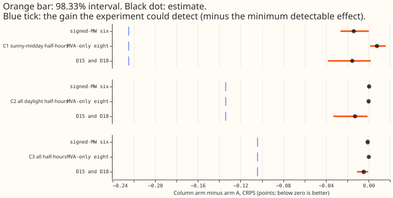
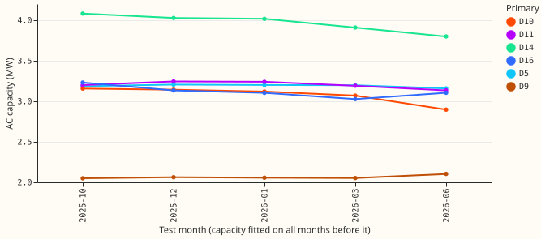
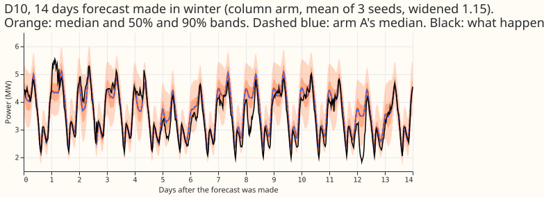
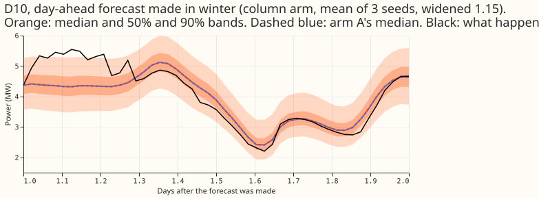
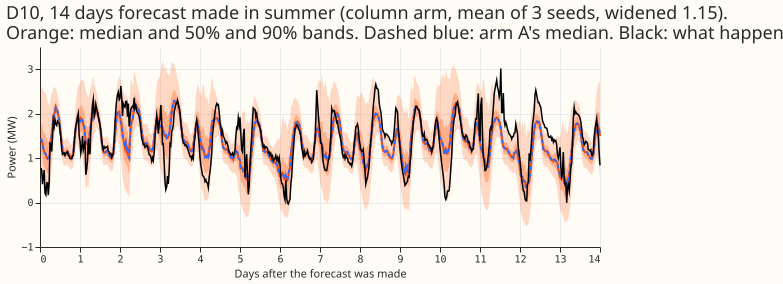
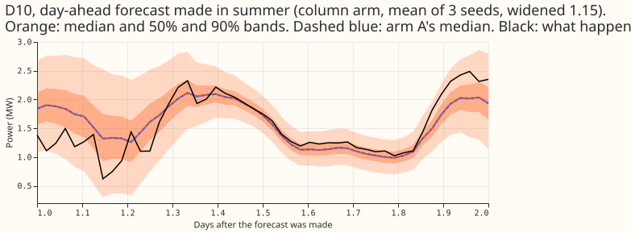

**Giving the demand network a column of "solar output if the capacity were X" did not improve the
forecast at the six Primaries metered in signed megawatts.** We asked whether one extra input, the
output that a solar capacity fitted by experiment 474's method on earlier months would give under the
forecast weather, lowers the error of experiment 425's best network (arm A). We fine-tuned arm A with
the column on 5 test months and 3 seeds, and compared it with arm A's stored forecasts. On sunny
middays the continuous ranked probability score (CRPS, a score for a whole forecast distribution, in
the same units as megawatts) moved by -0.014 points. The 98.33% interval is -0.027 to +0.000, and
the experiment could detect 0.225 points. The verdict is `refuted`: the largest gain the data allow
is about a tenth of the predicted one.

## Figures

## Results

- **Arms.** Arm A (experiment 425, seeds 0 to 2, stored) and the column arm (arm A fine-tuned from
  the same pretrained weights, 3 seeds, 5 folds: 2025-10, 2025-12, 2026-01, 2026-03, 2026-06).
  Monthly refits, learning rate 2e-4, forecasts widened by 1.15. 15 fine-tunes of 28 to 60 seconds
  each on the GPU.
- **Column.** Capacity per Primary and fold (3.0 to 4.1 MW AC at the six, from
  `e00501_capacity.py`; the full-history fit reproduces experiment 474's stored values exactly)
  times experiment 405's unit shape, divided by 3 MW; zero at the other 10 Primaries.
- **Tested contrasts** (column minus arm A, CRPS, days 1 to 10, signed-MW six, Bonferroni count 3,
  level 98.33%, rows equal across arms):

| Slice | Difference | Interval | Detectable |
|---|---|---|---|
| C1 sunny-midday half-hours (34,432) | -0.014 | -0.027 to +0.000 | 0.225 |
| C2 all daylight half-hours (158,999) | +0.000 | -0.001 to +0.001 | 0.134 |
| C3 all half-hours (429,350) | -0.001 | -0.003 to +0.000 | 0.104 |

- **Report-only groups.** MVA-only eight: C1 +0.008 (+0.001 to +0.016), C2 -0.000, C3 +0.000. D15 and
  D18: C1 -0.015 (-0.038 to +0.002), C2 -0.013 (-0.033 to -0.001), C3 -0.005 (-0.011 to -0.000).
  The column is zero at the eight, so their small shifts come from the shared network weights.
- **By fold (C1, points).** 2025-10 -0.030, 2025-12 -0.008, 2026-01 +0.012, 2026-03 -0.025, 2026-06
  -0.011. Leaving out each Primary in turn leaves C1 between -0.008 and -0.018.
- **Absolute scores** (signed-MW six, days 1 to 10, rows shared with the references): arm A 3.220,
  column arm 3.219, BG2 3.428, monthly XGBoost 3.569, manual heuristic 4.134, climatology 4.392.
  Sunny-midday CRPS by fold: 4.41, 3.73, 5.59, 4.08, and 3.07 for arm A.
- **Lead bands** (signed-MW six): 12 to 36 hours 2.822 (A) and 2.820 (column); 36 hours to 10 days
  3.268 and 3.268.
- **Tails** (signed-MW six, days 1 to 10): coverage at q01, q05, q95, q99 is 0.007, 0.022, 0.895,
  0.962 for the column arm and 0.007, 0.022, 0.895, 0.963 for arm A; pinball loss at q99 is 0.326
  and 0.325. Cold winter nights: 5.049 for both.
- **Curtailment** (avoidable cost over the six, pounds, as the scoring machinery reports it; the
  manual-heuristic baseline is the maintainer's unconfirmed understanding): at f = 0.9, 6.857 million
  (column) and 6.865 million (arm A); at 0.75, 16.94 and 16.97 million; at 0.5, 38.16 and 38.21
  million; the manual heuristic at 0.5 is 61.66 million.

## Checks

- **Median minus mean forecast per Primary** (mean of the 11 quantiles, MW) differs between the arms
  by under 0.001 at every Primary, and the mean-forecast absolute error moves together with the
  median's.
- **Triggers.** None fired: no control failed (the capacity fit reproduces experiment 474), the
  result does not contradict an earlier experiment (349, 352, and 416 found a flat response), the
  quantile score and the mean-forecast error agree, leaving one Primary out does not flip the sign,
  the column arm contains arm A and does not beat it by more than its interval, and no sister
  experiment on the same rows exists to compare interval widths.
- **Unattributable.** Experiment 474's capacities fail the placebo gate at every rung, so a gain
  would not have shown that the capacities are right, and the absence of a gain does not show that
  they are wrong. Experiment 474's D5 (export limit), D9 and D16 (pinned capacity too high) caveats
  apply.
- **Rows.** Fine-tuning rows dropped per fold: 68,680 for the D15 and D18 start cut and 2,155 to
  2,925 flagged exact-zero half-hours. 1,179 scoring actuals were dropped for a flagged exact zero
  across the 12 stored months. Clean rows may hold events that NGED's logs do not label.
- **Leaks left.** The recovery divisor, the farm-output normalisation, and `u99` use data after the
  fold (each is a constant scale factor), and the 2025-10 fold identifies its capacity increment from
  three months. Weather at lag times is arm A's; its past-weather caveat applies unchanged.

## Serving table

- **Stored:** one capacity per Primary at the six (6 numbers), refitted with each monthly network
  refit (30 fits of about 13 seconds each in this experiment) or once a year if the capacity is
  held.
- **Computed at serving:** experiment 405's physics shape of the ensemble-mean shortwave radiation
  and temperature per half-hour, times the capacity.
- **Cost against gain:** a per-Primary capacity table and an annual or monthly capacity refit, for
  no measurable gain.

## What to try next

Nothing in this direction: a capacity cannot be validated by the demand forecast score, so the
10th and 90th percentile arms were not run. Experiment 479's anomaly estimator remains the
candidate for a capacity that passes a known-answer test.
