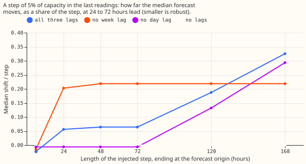
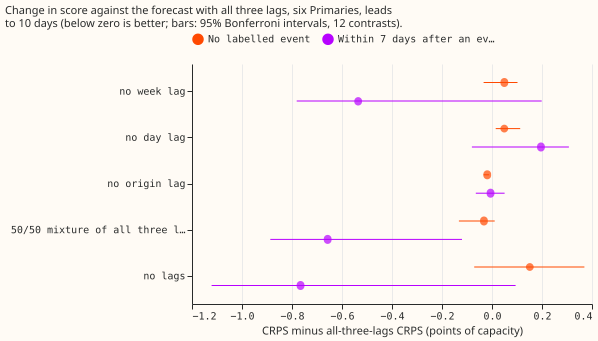

**Dropping one power lag does not remove the leak at every event length, and every single-lag
drop costs about 0.05 points of capacity (CRPS) on rows with no labelled event.** The day lag
carries the leak of events up to 3 days and the sensitivity to a stuck meter or a dropout. The
week lag carries part of the leak of events of 5 to 7 days. Dropping the week lag makes short
events and bad data worse. The three lags are power readings 1 day, 2 days, and 7 days (the origin,
day, and week lags) before the forecast time. NGED's event labels are incomplete, so "rows with no
labelled event" may hold unlogged events, the harm rows are optimistic, and the real-event slices
undercount. Every number is interim and unaudited.

## Setup

- **Arms.** All fitted like experiment 402's arm (a): monthly refits (2025-10-01, 2026-01-01,
  2026-03-01, 2026-06-01), 500 rounds, `eta` 0.05, 11 quantiles, CUDA, six Primaries metered in
  signed megawatts (D5, D9, D10, D11, D14, D16). "No week lag" and "no day lag" are 24 fits each.
  "a-rep" is a second CUDA fit of the three original lags (24 fits). "No origin lag" is experiment
  388's arm E, re-scored on the same rows with no fits; experiment 388 fitted it separately, so its
  device and code path may differ from arm (a)'s.
- **Cadence.** Monthly refits, as the standing rule says for research. The contrasts could depend
  on the schedule; no weekly check was run.
- **Reused.** Arm (a) from experiment 402 (`r0_lagged`), arm (b) (no lags) from experiment 392
  (`r0_lagless`), the 50/50 mixture of (a) and (b) (f), and experiment 465's `sweep.parquet` for
  arms (a) and (b). Code reused: experiments 87, 383, 392, 402, and 465.
- **Rows.** The intersection of finite actuals and every arm's forecast, valid time before
  2026-07-01, leads to 240 hours, no flagged zeros dropped at these six Primaries (0 in every fold).
  Rows with no labelled event: 326,964; harm rows (a lag lies in an event and the target does not):
  5,449; rows inside events: 8,740; rows within 7 days after an event: 14,441. The 12 to 36 hour
  band has 34,214 rows with no labelled event.
- **Noise floor.** Arm (a) minus a-rep is -0.0002 CRPS [-0.0012, +0.0006], so the device and seed
  noise is below 0.02 and the equivalence limit stays 0.11 (experiment 465's range).

## Results

CRPS in points of effective capacity, six Primaries, leads to 240 hours, no widening, intervals are
month-block bootstraps at the 95% Bonferroni level (k = 12). With 4 months (harm rows 3), each
interval is the range of the monthly differences, so the equivalence statements are screen-level.
Smaller is better.

- **Absolute scores, rows with no labelled event:** all three lags 3.096; no lags 3.247; 50/50
  mixture 3.064; no week lag 3.145; no day lag 3.145; no origin lag 3.077.
- **Contrast against all three lags, rows with no labelled event:** no week lag +0.049
  [-0.034, +0.102] (inside the 0.11 limit, so equivalent); no day lag +0.049 [+0.015, +0.113]
  (the upper end is just outside the limit); no origin lag -0.019 [-0.034, -0.011]. The sign count
  over the four months: no week lag is worse in 3 of 4 months and no day lag in 4 of 4.
- **Contrast against no lags, rows with no labelled event:** no week lag -0.102 [-0.268, +0.038];
  no day lag -0.102 [-0.257, +0.115]; no origin lag -0.170 [-0.404, +0.060].
- **12 to 36 hour band, rows with no labelled event:** no week lag +0.038 [-0.034, +0.110]; no day
  lag +0.110 [+0.069, +0.175]; no origin lag -0.016 [-0.061, +0.001].
- **Within 7 days after an event (absolute):** all three lags 4.950; no lags 4.184; mixture 4.293;
  no week lag 4.415; no day lag 5.146; no origin lag 4.944. Dropping the week lag recovers about
  two thirds of the gain from dropping all lags here.
- **Harm rows (descriptive; the intervals span about 0.5 to 1 point and cannot show equivalence):**
  all three lags 3.897; no lags 3.686; mixture 3.570; no week lag 3.718 (-0.179 against all three
  lags, interval -0.271 to +0.383); no day lag 4.085 (+0.188 [-0.055, +0.249]); no origin lag 3.949.
- **Tails, rows with no labelled event (no widening; with the 1.15 widening no interval changes
  sign):**
  q99 pinball loss 0.341 (all three lags), 0.345 (no week lag), 0.343 (no day lag), 0.338 (no
  origin lag), all within the +0.02 limit. q95 coverage 0.902, 0.895, 0.898, and 0.905.
- **Leak of a step of 5% of capacity (readings-level sweep, 24 to 72 hour leads, pooled over two
  Primaries (D5, D16) and two refit dates (2026-01-01, 2026-06-01); median shift as a share of the
  step):**

| Step length | All three lags | No week lag | No day lag | No lags |
|---|---|---|---|---|
| 24 hours | 0.06 | 0.20 | -0.01 | 0 |
| 3 days | 0.06 | 0.22 | -0.01 | 0 |
| 5 days | 0.19 | 0.22 | 0.13 | 0 |
| 7 days | 0.33 | 0.22 | 0.29 | 0 |

- **Bad data (median shift in points of capacity, 24 to 72 hour leads; the injection is
  experiment 465's):** a stuck meter for 24 hours: -0.82 (all three lags), -2.20 (no week lag),
  -0.02 (no day lag). A dropout to zero for 6 hours: -0.19, -1.35, -0.09. A spike of 20 times the
  week-on-week median change: +3.79, +5.32, +5.50. The band width ratio stays between 0.98 and 1.19.
- **Predictions.** P1 partly: no week lag costs +0.049 (inside the limit), but the readings-level
  leak is 0.20 to 0.22, not at most 0.20, and the column-level sweep was not run. P2 not tested (the
  sweep of the origin lag was not run). P3 not supported for short events: the day lag arm leaks
  -0.01 up to 3 days and 0.13 at 5 days, and 0.29 at 7 days is inside 0.20 to 0.30. P4 holds: the
  50/50 mixture (3.064) beats every new arm on rows with no labelled event.
- **Stop rule.** Not triggered, because the week lag arm cuts the 7-day leak below 0.25 at a loss
  under +0.30. The MVA-only eight were not fitted, because no arm cuts the leak at every length
  without raising it at another.

## Checks and caveats

- **Not run.** Avoidable curtailment, cold nights, the whole-event intervals for event slices, the
  column-level sweep of every lag subset, example forecast time series, and load-shift event plots.
  The leak figures use two Primaries and two refit dates because of the brief's cost limit, so they
  are a screen.
- **Audit triggers.** Two fired: every interval rests on 4 months (3 for harm rows), and the leak
  figures rest on 4 site-refit cells whose spread is wide (for example 0.16 to 0.37 for the no week
  lag arm), so both are screens. The mean-forecast check could not be run because the stored
  forecasts hold quantiles only.
- **Unlogged events.** NGED says load-shift events may be missing from its logs, so clean rows can
  hold events and the harm-row table is optimistic.
- **Device.** The arms of experiment 502 and arm (a) are CUDA fits. Arm E of experiment 388 may be a
  CPU fit; its contrast against arm (a) can carry up to 0.06 to 0.11 of device difference
  (experiment 465).

## What the next experiment should answer

- Does a day-lag-free forecast mixed 50/50 with the no-lag forecast match the mixture of all
  three lags (3.064) on rows with no labelled event and after events?
- Does the readings-level sweep of the origin lag arm show a leak above 0.06?

Scripts: `e00502_fit.py`, `e00502_score.py`, `e00502_sweep.py`, `e00502_figures.py`. Predictions:
`work/arm_preds/{a_rep,nowk,noday}` (private data folder); boosters in `work/boosters/`.
