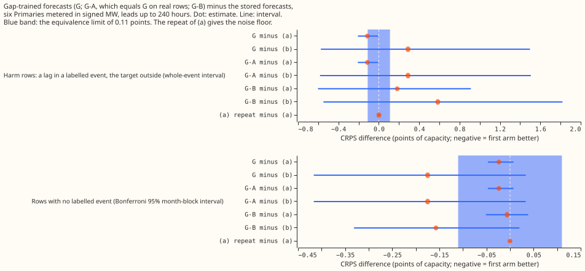
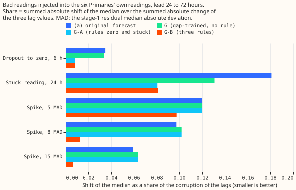
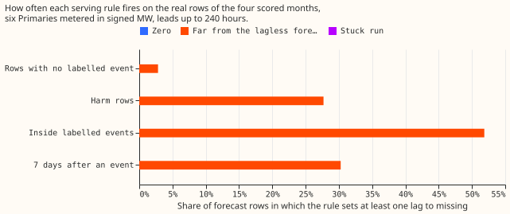
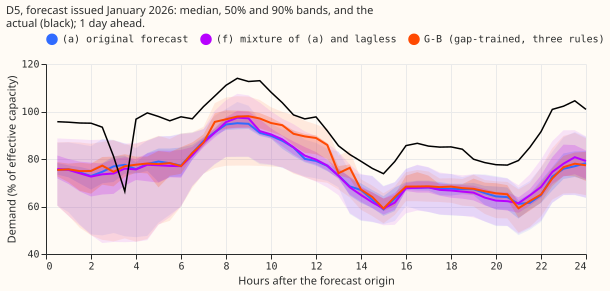
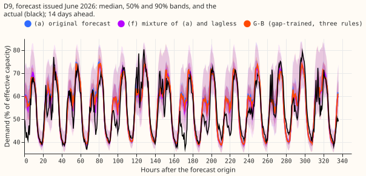
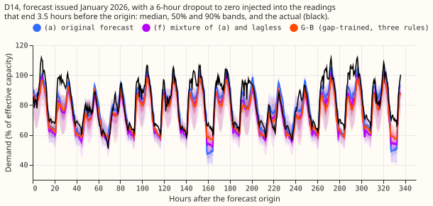
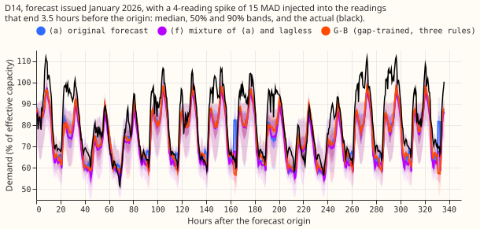
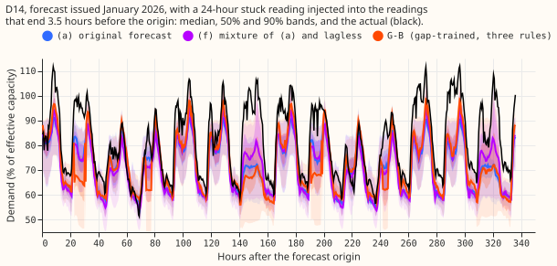
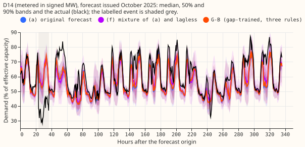

**Training the XGBoost demand forecast with 10% of its power lags randomly missing is free, and it
lets a serving rule shield the median forecast from a dropout and a stuck reading.** The rule for an
exactly-zero lag and the rule for a run of 12 identical readings never fire on the real rows of the
four scored months, so on real data arm G-A is identical to arm G. The rule for a lag more than 6
times the residual median absolute deviation (MAD) from the stage-1 median shields spikes of 8 times
the MAD or more, but it fires on 2.8% of rows with no labelled event and costs +0.0175 there.
The three rules together applied to a forecast trained without gaps are worse than no rule. NGED's
event labels are incomplete, so "rows with no labelled event" may hold unlogged events, and every
real-event slice undercounts. Every number is interim and unaudited, except that a separate agent
re-derived the headline scores (see Checks).

Figures 4 and 5 show a day-ahead and a fourteen-day forecast with no labelled event, figures 6 to 8
show the forecasts under an injected dropout, spike, and stuck reading, and figure 9 shows a
labelled event at D14 (D14 is an anonymised Primary label).

## Results

Scores are CRPS-like pinball loss in points of effective capacity. A contrast is the first arm minus
the second, so negative favours the first. Arms: (a) the original lags (experiment 402); (b) the
lagless forecast (experiment 392); (f) their fixed 50/50 mixture; G, the gap-trained forecast with no
rule; G-A, G with the rules for a zero and for a run of 12 identical readings; G-B, G with those two
rules and the distance rule; (a-rule), the booster of (a) with the two rules (identical to (a) on
real rows) and with all three rules; (a-rep), experiment 502's CUDA repeat of (a). The signed-MW
six are the 6 Primaries metered in signed megawatts (D5, D9, D10, D11, D14, D16). Months are the
resampling unit (4 scored months, 3 with labelled events). Every interval is a month-block interval
at the Bonferroni level of 99.58% for the 12 pre-registered contrasts, and all are in
`contrasts.csv`. Leads are 0 to 240 h unless stated.

- **Fits.** 24 boosters of G were fitted on the GPU (6 Primaries, 4 refits). A rule-applied forecast
  was written for each of G and (a).
- **Absolute scores, rows with no labelled event (326,964 half-hours).** (a) 3.0959, (a-rep) 3.0958,
  (b) 3.2471, (f) 3.0637, G 3.0722, G-A 3.0722, G-B 3.0898, (a-rule) with all three rules 3.1912.
  On harm rows (18,693 half-hours): (a) 4.047, (b) 3.645, (f) 3.630, G 3.934, G-B 4.229, (a-rule)
  with all three rules 5.774.
- **Noise floor.** (a-rep) minus (a) is -0.00016 [-0.0012, +0.0006] on rows with no labelled event.
  The repeat uses the same seed, so it bounds GPU nondeterminism only. The seed and the mask draw
  are not repeated.
- **Clean rows (rows with no labelled event).** G minus (a) is -0.024 [-0.047, +0.008]; G-B minus
  (a) is -0.006 [-0.051, +0.039]. Both intervals lie inside +-0.11, so P2 holds. G minus (b) is
  -0.175 [-0.417, +0.033] and G-B minus (b) is -0.157 [-0.331, +0.020]. At 12 to 36 h, G minus (a)
  is -0.014 [-0.048, +0.013], and G-B minus (a) is -0.013 [-0.040, +0.013]. G-B minus G is +0.0175
  across all leads.
- **Harm rows (a lag inside a labelled event, target outside it).** G minus (a) is -0.113 [-0.207,
  -0.007] over 18 events. G-B minus (a) is +0.182 [-0.602, +0.913]. Leaving out one Primary moves the
  G-B contrast from -0.165 to +0.405, and dropping the single largest event (D16, 4,130 of the
  18,693 rows) moves it from +0.182 to -0.158. The sign of that contrast is decided by one event, so
  it is descriptive only.
- **During and after events.** During a labelled event, G minus (a) is +0.049 [+0.047, +0.401] and
  G-B minus (a) is +1.097 [+0.065, +1.130], both worse than (a). For the 7 days after an event, G
  minus (a) is -0.162 [-0.200, -0.091] and G-B minus (a) is +0.200 [-0.623, +0.466].
- **Shift of the median under the corruption, lead 24 to 72 h, as a share of the corruption
  (figure 2).** A dropout to zero for 6 h: (a) 0.035, G 0.034, G-A 0.008, G-B 0.008, (a-rule)
  0.059. A stuck reading for 24 h: (a) 0.181, G 0.131, G-A 0.081, G-B 0.081, (a-rule) 0.353.
  A spike of 8 times the MAD: (a) 0.098, G 0.102, G-A 0.102, G-B 0.013. A spike of 15 times the MAD:
  (a) 0.059, G-B 0.006. A spike of 5 times the MAD: (a) 0.120, G-B 0.098. Over 0 to 240 h the
  dropout shares are 0.037 for G, 0.039 for (a), and 0.009 for G-A; the stuck shares are 0.328 for
  (a-rule). (a-rule) is better than (a) at D11 and D9 for a dropout and at D9 for a stuck reading.
- **Rule firing on the injections (G-B).** The distance rule newly fires in 99% of the cases with a
  spike of 8 times the MAD, 100% with 15 times, 24% with 5 times, and 13% with a stuck reading. The
  rule for a zero fires in 100% of the dropouts and the rule for a run in 100% of the stuck readings.
- **Genuine step of 5% of capacity (lead 24 to 72 h).** The share of the step that reaches the
  median is 0.09 to 0.44 depending on its length, the same for G, G-A, and G-B to within 0.01, and
  G-B's band width is within 0.7% of the band width without the step. The distance rule sets 0.4% to
  1.4% of the lag values to missing, so it is not a detector of load-shift events (P3 holds).
- **Rule firing on real rows.** The rule for a zero and the rule for a run fire on none of 518,076
  forecast keys. The distance rule sets at least one lag to missing on 2.8% of rows with no
  labelled event, 27.7% of harm rows, 51.9% of rows during an event, and 30.3% of the 7 days after.
  Of the rows with no labelled event, 12,042 have a lag inside an event and the distance rule fires
  on 36% of them. The remaining 314,922 rows have no event in the target or in any lag, and the rule
  fires on 1.6% of them (0.58% of lag values; the clean sweep rows give 0.46%). The false alarms sit
  at D5 (4.5%), D14 (3.0%), and D9 (2.0%), and are about 0% at D10, D11, and D16. Part of them may
  be unlabelled events. P1's false-alarm limit of 1% holds per lag value on the 314,922 rows and
  fails per row.
- **Cost where the distance rule fires.** CRPS on the 9,229 rows with no labelled event where the
  rule fires: (a) 5.834, G 5.716, G-B 6.338. G-B costs about +0.62 on those rows, which gives the
  +0.0175 on all rows.
- **Cold nights (zenith above 95 degrees, 2 m temperature at or below 3 degrees Celsius; 17,254
  half-hours).** CRPS: (a) 4.670, G 4.656, G-B 4.877, (b) 5.756, (f) 4.903. Coverage of q95 is 0.741
  for (a), 0.736 for G, and 0.732 for G-B (0.769, 0.763, and 0.761 at a widening of 1.15).
- **Tails.** On rows with no labelled event, coverage of q01, q05, q95, and q99 is 0.0033, 0.0357,
  0.900, and 0.978 for G, against 0.0033, 0.0355, 0.902, and 0.978 for (a). G-B has q95 coverage
  0.8996 and q99 0.9784. The pinball loss at q95 is 0.888 for G, 0.885 for G-B, and 0.895 for (a).
- **Avoidable curtailment cost (all rows, six Primaries, pounds, sum of 4 months).** At f = 0.9, (a)
  8.90e6, G 8.86e6, G-B 9.24e6, (b) 9.20e6, (f) 8.97e6. At f = 0.75, (a) 2.14e7, G 2.16e7, G-B 2.34e7,
  (b) 2.58e7, (f) 2.24e7. At f = 0.5, (a) 4.82e7, G 4.82e7, G-B 5.02e7, (b) 6.04e7, (f) 4.80e7. The
  cost is dominated by 2026-01. G minus (a) is lower in 2 of 4 months at f = 0.9 and f = 0.5, and
  in 1 of 4 at f = 0.75. The cost inside events and after them is undefined, because the cost
  function lacks a perfect-forecast arm on those slices.
- **Serving cost.** Gap training adds nothing at serving. The rules for a zero and for a run need only
  the last 7 days of readings. The distance rule needs the stage-1 median at each lag time (a
  stage-1 pass over the last 7 days per series) and the MAD of the stage-1 residual.
- **Predictions.** P1 is partly met. A dropout (0.008) and a stuck reading (0.081) fall under 0.10
  with G-A, and a spike of 8 times the MAD or more falls under 0.10 only with G-B (0.013 against 0.102
  for G-A). The false-alarm rate is 0.58% per lag value but 1.6% per row. P2 holds for G, G-A, and
  G-B. P3 holds: the distance rule sets 0.4% to 1.4% of the lags to missing under a 5% step. P4
  holds: no arm beats (f) on rows with no labelled event, as (f) scores 3.0637 against 3.0722
  for G.
- **Decision rule.** The smallest gain worth porting G-A is zero on the shifts at a clean-row loss
  inside +-0.11: G-A meets it, and it is free at serving. G-B must cut the shift by 0.05 beyond G-A
  and does so only for spikes of 8 times the MAD or more (0.09 beyond), at a loss of +0.0175 on rows
  with no labelled event. The stop conditions do not fire. The verdict is "more robust, not more
  accurate" for the rules, and "more accurate and robust" for gap training alone.
- **Checks.** A separate agent re-derived the scores of (a), G, G-A, and G-B from the stored
  forecasts (326,964 shared half-hours; a 3.0959, G 3.0722, G-B 3.0898) and confirmed the contrasts.
  It checked that the distance rule uses no reading younger than the origin minus 3.5 h, that the
  gap mask is applied only when training, and a hand-built dropout of 12 half-hours at D5 gave the
  same lags and flags as the module. The median minus the mean of the 11 quantiles is small and
  similar across arms at every Primary. The MAE of the median on rows with no labelled event is
  5.417 for (a), 5.385 for G, 5.426 for G-B, and 5.666 for (b) (points of capacity).

## Caveats

- **The harm-row contrast of the distance rule is one event.** The leave-one-Primary-out range is
  -0.165 to +0.405 and dropping event 55 at D16 flips the sign. No harm-row claim about G-B is made.
- **The noise floor is a same-seed repeat.** The seed and the gap-mask draw are not repeated, so the
  gain of G over (a) (-0.024) has no bound on seed variance. G beats (a) at each of the six
  Primaries (-0.004 to -0.036), which supports the sign.
- **G-A is not an independent arm.** It equals G bitwise on real rows because the rules for a zero
  and a run never fire there, so the 12 pre-registered contrasts are 8 distinct comparisons. The
  injections for a dropout and a stuck reading are exactly what those two rules match, so G-A's
  0.008 shows how G handles a missing lag, not how well the rules detect.
- **The distance rule only catches large departures.** At 6 times the MAD the threshold is 19% to
  33% of capacity depending on the Primary. A spike of 5 times the MAD is caught in 24% of cases.
- **The training masks differ from serving masks.** Training draws each lag of each row
  independently, while serving sets a lag missing for every lead of an origin at once. This was not
  tested.
- **Labels are incomplete.** Part of the 1.6% of false alarms may be unlabelled events.

## Not done

- No fit used a different seed or gap rate, and the 10% gap rate, the 6 times MAD distance, and the
  12-step run are single settings.
- G was fitted at the six Primaries only. The MVA-only eight were not run.
- BG2 and `manual_heuristic` were not reproduced on these rows.
- Real-event rows were not NRA-corrected, and avoidable curtailment inside and after events is
  undefined.

## Problems caused by the move

- The scripts need `PYTHONPATH` entries for the folders of experiments 377, 381, 383, and 390 as
  well as 87, 391, 392, 402, and 465, and the set was found by trial and error. The first
  scoring run failed with import errors until each folder was added.
