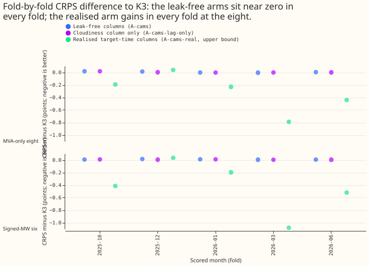
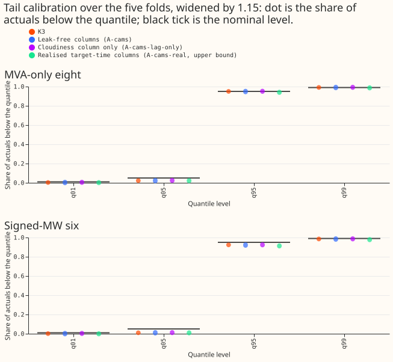
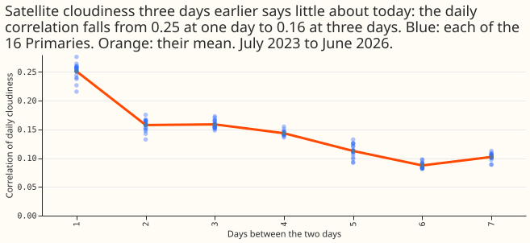
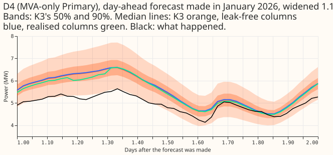
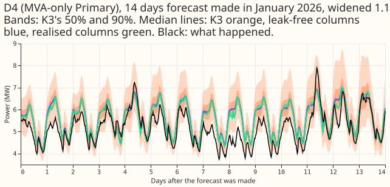
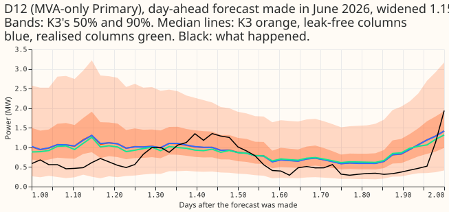
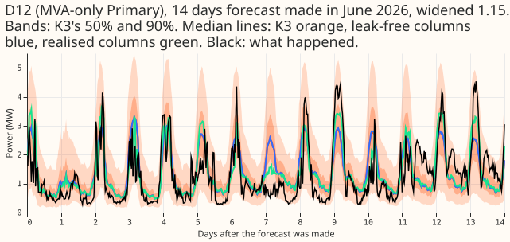

**Satellite sunshine measurements that a live service could have at forecast time did not help the
demand neural network. The same measurements read at the forecast's own half-hour would have helped
a lot.** We scored the forecast with the continuous ranked probability score (CRPS; lower is
better), in points (1 point is 1% of a substation's capacity). At the eight Primary substations
(the main distribution substations) whose meters report apparent power in megavolt-amperes (MVA)
rather than signed megawatts, the demand neural network of experiment 425 (arm A) scored 4.699. With
three columns built only from satellite data that exists at forecast time, it scored 4.705, a rise
of 0.1%. Columns that held the satellite irradiance measured afterwards for the half-hour being
forecast lowered the score by 0.318 points (6.8%). That gain measures how much error the ensemble
weather forecast of sunshine (many runs of ECMWF's weather model) causes. None of the feeds we
tested supplies it. The next place to look is a nowcast (a forecast of the next few hours made from
the latest observations) or a better sunshine forecast at short lead, because the realised arm
gained 0.134 points at day 1 and 0.407 at days 6 to 10.

**The question was whether a satellite record of recent days improves the demand neural network.**
We asked whether the neural network that forecasts demand at 16 Primary substations forecasts
better when it can see how sunny the last few days were, as measured by the Copernicus Atmosphere
Monitoring Service (CAMS) satellite retrieval. The network already reads the ensemble weather
forecast of sunshine. We built three inputs from CAMS days that were wholly over at least 36 hours
before the forecast (a delay we assumed, because the CAMS table has no availability stamp), added
them to experiment 425's stored network (its arm A), fine-tuned from the stored weights, and
compared the result with the stored network at five scored months. The idea comes from
[experiment 480](../00480-xgboost-cams-columns-at-mva-only-primaries-lab-conditions/result.md),
where two realised satellite columns lowered the error of an XGBoost model by 0.355 points at the
same eight Primaries. The score is CRPS in points of effective capacity (1 point is 1% of a
Primary's capacity). "The eight" are the eight Primaries that report only apparent power in
megavolt-amperes, and "the six" are the six that report signed megawatts.

| Arm | What it is |
|---|---|
| K3 | The stored arm A, quantile average of seeds 0 to 2 (no fit). |
| A-cams | K3's neural network plus the three columns built only from data available at forecast time (the "leak-free" columns), fine-tuned (three seeds, pooled the same way). |
| A-cams-lag-only | K3's neural network plus the cloudiness column only. |
| A-cams-real | K3's neural network plus the realised unit PV shape and clear-sky index of the target half-hour, as in experiment 480 (report only; a serving system cannot supply them). |

Verdict: not supported. The gate needed A-cams to lower CRPS at the eight by at least the minimum
detectable effect (0.077), and A-cams raised it by 0.006. The interval excludes a gain of 0.053
(15% of experiment 480's 0.355), so at this design the neural network gained no detectable
improvement from the older satellite sunshine we gave it.

## Figures

## Results

- **Design.** Five monthly folds (2025-10, 2025-12, 2026-01, 2026-03, 2026-06), seeds 0 to 2,
  experiment 470's intersection of rows (`experiment_470_intersection_v1`), widening 1.15, the D15
  and D18 start cut of 2025-03-01, flagged exact-zero half-hours dropped (1,179 scoring actuals,
  and 2,155 to 2,925 fine-tuning rows per fold), valid times from 2026-07-01 not scored. Monthly
  refits; each network starts from the stored pretrained arm A weights of the same month and seed,
  with zero weights for the new first-layer columns, then fine-tunes at a learning rate of 2e-4.
  Code: this folder, importing experiments 397, 425, 454, 470, and 494 (the scoring pattern).
  Fitted networks: the experiment's private `work/models/` folder, never in git.
- **Columns.** Origins are 09:00 UTC. For an origin on date D0 the cutoff is 21:00 UTC on D0-2, so
  the latest wholly available day is D0-3, which ends 57 hours before the origin. The three columns
  are: (a) the CAMS irradiance at the target half-hour's time of day on that day. (b) the mean of
  that irradiance over that day and the two before, and (c) the day's summed irradiance over its
  summed clear-sky irradiance. The [lag-features study](../../studies/forecasts/lag-features.md)
  found the previous whole day available at 09:00 UTC after February 2026, so a service could be one
  to two days fresher than this design.
- **Minimum detectable effect (three seeds, five folds).** 0.077 points at the eight and 0.124 at
  the six (experiment 428's definition, from the seed spread of the stored arm A). Bonferroni
  count 12 (3 arms x 2 groups x CRPS and q99 pinball loss); 100,000 origin-day block-bootstrap
  resamples.
- **CRPS, difference to K3 (points; Bonferroni interval).**

| Arm | Eight | Six (no labelled event) |
|---|---|---|
| A-cams | +0.006 [+0.001, +0.011] | +0.010 [+0.004, +0.017] |
| A-cams-lag-only | +0.004 [-0.000, +0.009] | +0.009 [+0.003, +0.015] |
| A-cams-real (report only) | -0.318 [-0.393, -0.246] | -0.467 [-0.577, -0.359] |

- **Absolute CRPS (points).** At the eight: K3 4.699, A-cams 4.705, A-cams-lag-only 4.703, and
  A-cams-real 4.381. At the six: K3 3.463, A-cams 3.474, A-cams-lag-only 3.472, and A-cams-real
  2.997.
- **Equivalence at the 0.02 limit.** The q99 pinball loss difference of A-cams is +0.001 at the
  eight (upper bound +0.002) and -0.000 at the six (upper +0.001), so A-cams is equivalent to K3 in
  the q99 tail at both groups. CRPS at the six is not tested for equivalence, because the minimum
  detectable effect there (0.124) exceeds 0.02.
- **Tails.** q99 coverage is 0.9908 (A-cams) against 0.9911 (K3) at the eight and 0.9845 against
  0.9847 at the six; q95 coverage 0.949 against 0.950 and 0.922 against 0.924. q99 pinball loss
  0.252 (A-cams) against 0.251 (K3) at the eight. A-cams-real has q99 pinball loss 0.238 at the
  eight.
- **Where the realised arm gains.** By lead at the eight: -0.134 at day 1, -0.256 at days 2 to 5,
  -0.407 at days 6 to 10. On sunny midday rows (clear-sky index at least 0.7, 10:00 to 15:00 UTC)
  -1.110 at the eight and -1.222 at the six. At D12 alone -0.635 (K3's CRPS there is 8.589), and at
  the eight without D12 -0.273. The realised arm gains nothing at D8 (+0.005) and in the 2025-12
  fold (+0.038 at the eight), and it loses on cold winter nights: +0.098 at the eight and +0.121 at
  the six.
- **Descriptive slices for A-cams (95% intervals, not corrected).** D12 alone +0.014 [+0.002,
  +0.027]; the eight without D12 +0.005 [+0.001, +0.009]; cold winter nights +0.008 at the eight
  [-0.005, +0.022] and +0.008 at the six [-0.005, +0.021]; the 12 to 36 hour band +0.004 at the
  eight [-0.000, +0.009] and +0.013 at the six [+0.006, +0.020]; sunny midday -0.004 at the eight
  [-0.013, +0.004] and -0.015 at the six [-0.029, -0.001]. Fold by fold at the eight A-cams ranges
  from -0.003 to +0.018.
- **Avoidable-curtailment cost at the six, difference to K3 (experiment 470's measure).** At f =
  0.9: A-cams +0.016 [-0.001, +0.048], A-cams-real +0.129 [-0.012, +0.353]. At f = 0.75: +0.082
  [+0.001, +0.206] and +0.809 [-0.035, +1.997]. At f = 0.5: +0.111 [-0.031, +0.327] and +0.091
  [-1.704, +2.410]. The realised columns therefore do not lower the curtailment cost at the six,
  although they lower CRPS. All the neural networks cost far less than `manual_heuristic` at f =
  0.75 and 0.5 (K3 -5.8 and -16.1).
- **D15 and D18 (report only).** CRPS 10.83 (K3), 10.86 (A-cams), 10.50 (A-cams-real).
- **Why the leak-free columns do not help (tested).** (1) The validation loss of the fine-tuned
  A-cams neural network is higher than the stored arm A's in 14 of 15 fits (mean +0.0008), so the
  fine-tune found no use for the columns. (2) The daily correlation of cloudiness between two days
  is 0.25 at one day, 0.16 at three days, and 0.10 at seven (figure 4), so a three-day-old value
  holds little information. (3) The same fine-tune does use the realised columns (validation loss
  0.24 to 0.29 against 0.33 to 0.39), so the recipe can use informative columns. (4) Setting the
  A-cams columns to their training mean at forecast time changes CRPS by -0.006 [-0.013, +0.000]
  at the eight, and moving the day one day earlier changes it by +0.000 [-0.006, +0.006].
  A null here may still mean that the columns were not learned in the fine-tune from zero weights;
  a retrained network was not tested.
- **Serving table.** A-cams needs a CAMS feed that arrives about a day late (not ingested today),
  one stored cloudiness value per Primary per day plus three half-hourly values per target, and
  leaves the number of neural networks per pass unchanged. The fallback when the feed is late (set
  the columns to their training mean and widen the bands) changes CRPS by -0.006 points [-0.013,
  +0.000] at the eight (no loss) in the prediction-only check. Because A-cams gains nothing, adding
  the feed is not worth it. A-cams-real cannot be served at any lead, because its columns describe
  the target half-hour itself.
- **Fit times.** 26 to 31 s for A-cams-lag-only and 29 to 60 s for A-cams-real per seed; 67 to 120 s
  for A-cams, which includes two extra prediction-only forecasts. 45 fine-tunes took about 1 hour of
  one GPU process.

## Checks

- **Median minus mean.** The stored forecasts hold 11 quantiles only. The mean of the quantiles
  minus the median per site differs by under 0.03 points between K3 and A-cams (D12 +2.94 for
  both), so the new columns do not shift the forecast.
- **Median error beside CRPS.** The mean absolute error of the median forecast moves with CRPS:
  K3 and A-cams agree to within 0.02 points at every Primary, and A-cams-real lowers it at 13 of 14
  Primaries (at D8 it rises by 0.08).
- **Triggers of the audit rules.** None fired. No control failed. The result contradicts the
  prediction (P1: a gain of 0.05 to 0.15), and the explanation tests above record why. The
  quantile-score and median-error contrasts agree. Leaving out D12 leaves the sign and verdict of
  the gate unchanged (+0.005 without D12). The nested arm A-cams-lag-only beats A-cams by 0.002,
  less than the half-width (0.005) of A-cams's interval. The realised arm's interval at the eight
  is 0.55 times as wide as experiment 480's.

## Caveats

- **Only a 36-hour-old feed was tested.** A fresher feed (the previous whole day) was not fitted.
  The correlation in figure 4 suggests a small gain at most (0.25 at one day).
- **Selection bias.** The five folds that choose the candidate also score it, and July 2026 stays
  unused.
- **Fine-tune only.** The new columns start at zero weight and the network was fine-tuned for about
  10 epochs, so the experiment cannot say whether a network trained with the columns from the start
  would use them.
- **The horizon is 1 to 10 days**, the range NGED care about. The realised columns are an upper
  bound, because a service never has them.

## What to try next

- **Nowcast.** Test a satellite or station nowcast of sunshine as an input at leads under 6 hours,
  where the ensemble's forecast is least accurate.
- **A fresher feed.** A feed with the previous whole day (available at 09:00 UTC) has not been
  tested; testing it would take one arm and 15 fits, about 0.2 GPU-hours.
- **Sunshine forecast error.** The realised arm's gain per lead band bounds what a better sunshine
  forecast could add (0.318 points, 6.8% of CRPS at the eight).
