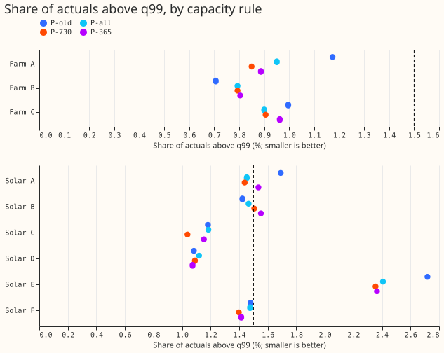
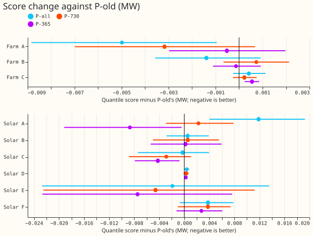
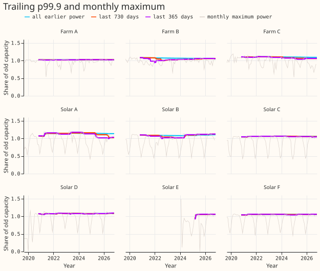
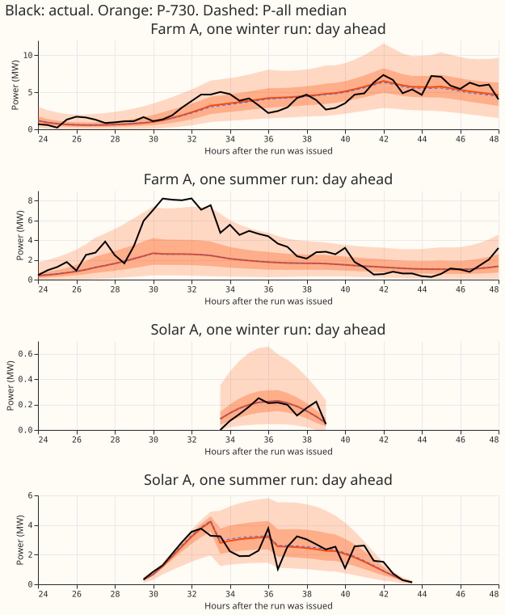
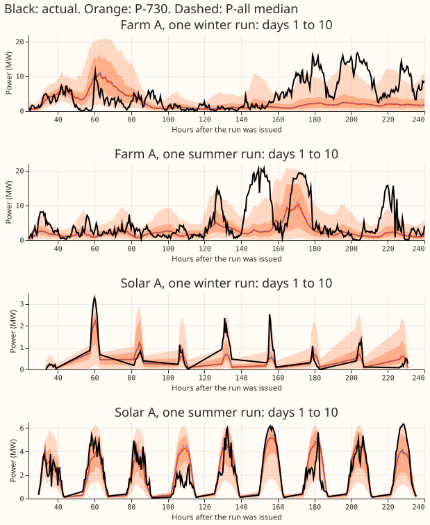

**Take-home: taking each series' capacity from only its last 730 days of power gets close to one
rule for wind and solar, but not close enough. Wind is unchanged, the pooled share of actuals above
the 99% quantile forecast is 0.85% for wind and 1.45% for solar, and Solar A's score loss falls from
2.3% to 0.4%. It still fails the pre-registered rule at Solar B (1.506% against a 1.5% limit) and
when Solar C or Solar D is dropped (1.537% and 1.517%). A 365-day window is worse.**

Capacity is the divisor that turns a series' power into a fraction between 0 and 1 for the neural
network. Experiment 461 set it to the 99.9th percentile of all earlier power, which suited the three
wind farms and not Solar A or Solar E. Here the 99.9th percentile is taken over only the last 730
days (P-730) or 365 days (P-365) before each fit's training ends, and the same wind network
(`member_plain`, 5 seeds) and solar network (`a2_member`, 3 seeds, 4 quarterly refits) are refitted.
P-all is experiment 461's all-earlier-power rule and P-old is the 99th percentile of the whole
record (experiments 429 and 430). Farm A to C are three metered wind farms and Solar A to F are six
metered solar farms.

**Terms.** *Table P*, *the limit* (at most 1.5% of actuals above the 99% quantile forecast), and
*pooled* are as in [experiment 461](../00461-wind-and-solar-retrain-with-p99-9-effective-capacity/result.md).
A window with under 8,000 valid half-hours (solar: daylight half-hours) falls back to P-all.

## Figures

## Results

- **C1, wind: no rolling arm differs from P-all beyond fit-to-fit spread.** Pooled score 1.1744 MW
  (P-all), 1.1757 (P-730), 1.1764 (P-365), 1.1765 (P-old). P-730 minus P-all is +0.0013 MW (95%
  interval +0.0003 to +0.0021; Bonferroni interval -0.0005 to +0.0024). Pooled share above q99:
  0.882% (P-all), 0.849% (P-730), 0.883% (P-365). The minimum detectable effect is 0.0034 MW, the
  mean gap between two P-old single-seed fits. Margins are 0.0209 MW (Farm A), 0.0090 MW (Farm B),
  and 0.0027 MW (Farm C), so Farm C's margin is under the minimum detectable effect and its verdict
  is inconclusive. The wind decision rests on the pooled score and the tail limit, and both pass.
- **C2, solar P-730 fails the rule narrowly.** Pooled score 0.6602 MW against 0.6627 (P-all) and
  0.6601 (P-old). Pooled share 1.449% (passes). Series above 1.5%: Solar B 1.506% and Solar E
  2.355%. Dropping one series leaves pooled shares of 1.451% (A), 1.437% (B), 1.537% (C), 1.517% (D),
  1.297% (E), 1.460% (F), so dropping C or D fails the pooled rule. No series worsens by more than
  the margin of 1% of the pooled old score (0.0066 MW; Solar F +0.0038 MW is the largest).
- **C3, solar P-365 fails more.** Pooled share 1.496%; Solar A 1.535%, Solar B 1.552%, Solar E
  2.365% are above 1.5%; dropping C, D, or F gives 1.569%, 1.576%, 1.513%. Solar D and Solar E fall
  back to P-all at every refit, so there they equal P-all. Solar A's score is 1.68% better than
  P-old (95% interval -0.0192 to -0.0004 MW), not significant at the Bonferroni level.
- **Solar A follows its capacity.** Score against P-old: +2.29% (P-all, ratio 1.14), +0.44% (P-730,
  ratio 1.105 and 1.039 at the last refit), -1.68% (P-365, ratio 1.017 and 1.002). P-730 minus P-all
  at Solar A is -0.0096 MW (-1.81%; Bonferroni interval -0.0177 to -0.0012). This fits the
  hypothesis that Solar A's high capacity under P-all is the cause. A level shift in Solar A's
  earlier output is a hypothesis: experiment 453 covers April to August only, and this page does not
  test it. The trailing p99.9 in figure 3 follows the monthly maximum only loosely.
- **Solar E is untestable.** Its history (21,852 to 31,278 half-hours) is under 730 days, so P-730
  equals P-all there, and P-365 falls back. Solar E stays at 2.35% to 2.37% above q99 in both arms,
  against 2.41% for P-all. The cause is not found: experiment 461's remark on its short history is
  a remark on noise, not an explanation.
- **Tails after table P, pooled (cover at nominal 1%, 5%, 95%, 99%).** Wind P-all, P-730, P-365: q01
  1.35%, 1.37%, 1.37%; q05 5.44%, 5.53%, 5.52%; q95 95.13%, 95.25%, 95.23%; q99 99.12%, 99.15%,
  99.12%; q99 pinball 0.0641 MW in all three. Solar: q01 3.29%, 3.28%, 3.29%; q05 6.69%, 6.68%,
  6.79%; q95 94.45%, 94.66%, 94.59%; q99 98.50%, 98.55%, 98.50%; q99 pinball 0.0248, 0.0247, 0.0244
  MW. Solar D's q01 coverage is 12.3% in every arm, so the capacity rule does not cause it.
- **Capacities** (new over old, P-730 and P-365 at the last refit): Farm A 1.027 and 1.027, B 1.041
  and 1.057, C 1.067 and 1.036; Solar A 1.039 and 1.002, B 1.121 and 1.125, C 1.053 and 1.040, D
  1.083 and 1.079 (fallback), E 1.057 and 1.057 (fallback), F 1.058 and 1.060. The window
  half-hours above each capacity number 30 to 36 for P-730 and 15 to 18 for P-365 (full table in the
  report).
- **Rows, seeds, cadence.** Rows are equal across arms: wind 54,899 half-hours, solar 345,510.
  Seeds: 5 wind, 3 solar. Solar refits are quarterly and wind is one fit, as in experiment 461;
  the contrast could depend on this. Bonferroni count: 44 intervals (two rolling arms, two
  references, 11 each), level 99.89%; leave-one-out intervals are extra and carry no Bonferroni
  correction. Production cost: one number per series per refit from power already stored.

## Caveats

- **The 1.5% limit is a point-estimate rule.** Solar B at 1.506% and Solar A at 1.535% are within
  noise of the limit, and no interval is computed for a share, so the verdict "fails" is the
  pre-registered rule applied literally.
- **Capacity is fixed per fit,** so the arms differ in the training-target scale and in the divisor.
- **Retraining schedule** is experiment 461's (wind one fit, solar quarterly), not weekly.
- **Scored range** stops at true day 10 (lead 240 hours); solar scoring is not restricted to
  12 to 36 hours.
- **The avoidable-curtailment cost does not apply to wind and solar farms.**

## Checks

- **Reviews.** One fresh Sonnet reviewed the plan and the code before the first fit (4 minor
  points, all accepted: the Bonferroni count for leave-one-out intervals, Solar E's P-730 window
  equalling P-all exactly, the missing report script, a clearer verdict block). A fresh Sonnet
  results review is recorded in the pull request.
- **Mean of the median forecast minus the actual, pooled after table P.** Wind -0.64 MW (P-old),
  -0.61 (P-all), -0.61 (P-730), -0.63 (P-365). Solar +0.089, +0.078, +0.089, +0.092 MW. Per series
  these move by under 0.05 MW except Solar A (+0.099 under P-all, +0.061 under P-730, +0.013 under
  P-365) and Solar B.
- **Triggers.** Trigger 4 fires in form: dropping Solar C or Solar D flips the pooled share rule
  under P-730. That leave-one-out condition is part of the pre-registered rule, so the flip is the
  reported result and the verdict was already "not supported". No ratio-1 gate was rerun, because
  only `capacity()` differs from experiment 461's fit loop, whose gate passed.

## Next steps

- Keep the all-history p99.9 for wind and the old capacity for Solar A and Solar E.
- If one rule is still wanted, judge the 1.5% limit by an interval on the share, and test a
  730-day window at Solar A and Solar E with a weekly refit.
