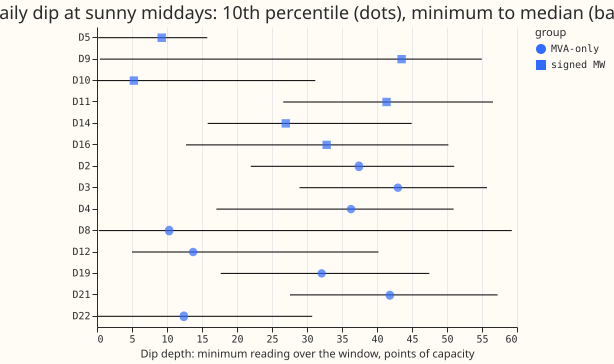
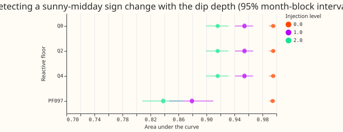
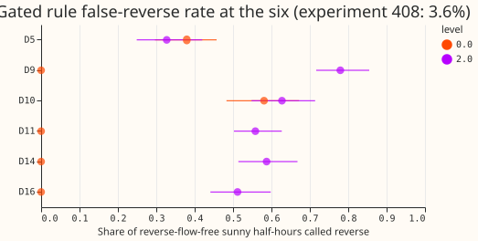

**Take-home.** A dip of the apparent power towards zero at sunny middays is a useful screen but not
a signed label. Eight primary substations (D2, D3, D4, D8, D12, D19, D21, D22) have meters that
report apparent power in MVA, which includes reactive power and is never negative, so NGED has no
signed history of real power (MW) there. We asked whether four kinds of evidence not used before
can say whether real power ever changes sign at those eight. We measured how low the meter reading
falls on sunny middays, and we calibrated that dip against the six primary substations that report
signed MW, after adding the recorded output of a real solar farm to their demand. We tried a rule
that compares expected solar output with expected demand, and we read the upstream meters and the
metered generator behind D8. When the reading carries no reactive power, the dip finds almost every
sign change. At power factor 0.97 (the realistic case, where reactive power is about a quarter of
the demand) the threshold that finds 89% of the added sign changes also flags 34% of days that have
none, in a test that leaves one primary substation out at a time.

Verdict: partly supported. No forecasting model was fitted, so there is no forecast score. The
Bonferroni count (the number of intervals reported) is 70. This page is interim. Counts are lower
bounds, because NGED's event labels are incomplete.

**Terms.** The *dip* is the lowest reading of the day between 10:00 and 15:00 UK time, on days with
a clear-sky index of 0.7 or more. The *reactive floor* is a reactive-power term added to the real
power to mimic an MVA meter. An *injection level* of 2.0 means the added solar farm is twice the
median sunny-midday reading. The *area under the curve* is the chance that a randomly chosen
sign-change day has a lower dip than a randomly chosen ordinary day (1.0 is perfect, 0.5 is chance).
*Gated* means the rule applies only when the sun is high enough.

## Figures

## Part 1: dip depth (one table of the eight)

- **Statistic.** For each UK day with at least 6 sunny half-hours (clear-sky index 0.7 or more, UK
  clock 10:00 to 15:00), the minimum reading. A crossing is a day on which the signed power is both
  below and above zero in the window. Cleaned power, July 2026 untouched, D15 and D18 cut before
  2025-03-01.
- **Calibration at the six (pooled, 5,155 to 5,392 days).** Injected solar farms are labelled Solar
  A
  to C and sized as in experiment 408 (level 1.0 and 2.0 times the median sunny-midday reading).
  Crossing counts at level 0 (real): 63 days: 58 at D10 and 5 at D5; at level 1.0, 1,300; at level
  2.0, 1,568.
- **Area under the curve (reactive floor 0, 2, and 4 points are identical because a constant floor
  does not change the ranking).** Level 0: 0.995 (0.990 to 0.999). Level 1.0: 0.954 (0.941 to
  0.967). Level 2.0: 0.916 (0.899 to 0.931). **Power factor 0.97:** level 0: 0.995 (0.990 to
  0.998); level 1.0: 0.879 (0.847 to 0.910); level 2.0: 0.838 (0.808 to 0.867). The difference
  between floor 0 and power factor 0.97 is 0.075 (0.055 to 0.096) at level 1.0 and 0.078 (0.061 to
  0.095) at level 2.0 (minimum detectable effect 0.029 and 0.024, 2.8 standard errors, shared
  month-block resamples).
- **Threshold, frozen on the six at level 2.0 before the eight were read.** Floor 0: 6.9 points of
  capacity, true-positive rate 0.87 and false-positive rate 0.20 leaving one Primary out. Power
  factor 0.97: 19.1 points, true-positive 0.89 and false-positive 0.34 leaving one Primary out.
- **Applied to the eight (raw MVA reading, floor-0 threshold 6.9 points).** Share of sunny days
  below
  the threshold: D8 6.7% (minimum reading 0.26 points), D22 1.2% (minimum 0.16), D12 1.2% (minimum
  5.0), D2, D3, D21 0%, D4 and D19 0%. For comparison, D5 (5 sign-change days at level 0) has 2.7%
  of days below
  it and D10 (real reverse flow) 11.8%. The power factor 0.97 threshold (19.1 points) flags 17.8% to
  23.9% of days at D8, D12, and D22 and 46.1% at D5, which has almost none, so it does not
  discriminate.
- **Pre-registered statements.** The area under the curve is at least 0.8 at floor 0: met (lower end
  0.899). The prediction that only D12 dips and D8 does not is not met: D8 and D22 dip, and D12 does
  not (experiment 370 found reverse flow at D12). NGED's own labels: D8 "Yes", D12 and D22 "Maybe",
  the other five "No"; the dip share agrees with the label at D8 and D22 and disagrees at D12.
  The prediction of 0.6 to 0.7 at power factor 0.97 was too low (0.84 to 0.88); the pre-registered
  rule
  (area under the curve below 0.7) does not bar a detection claim, but a delivered signed label may
  not claim to detect a crossing, because the false-positive rate is 34% leaving one Primary out;
  this is stricter than the pre-registered rule.

## Part 4: gated rule (circular, diagnostic only)

- **Rule.** Reverse flow if the unit PV shape is at least 0.3 and capacity times shape exceeds the
  night-time demand level of the same month and day type. Capacity: experiment 474's 2025 AC
  capacity (p10, p50, p90) in points of capacity. That table was fitted on the signed power of the
  Primary it labels and failed its placebo gate at every rung (95th-percentile placebo recovery 0.25
  to 0.51), so every Part 4 figure at the six is circular. Experiments 477 and 479 recover 0.62 to
  0.72 of a known capacity. At level 2.0 the injected farm's size is added to the capacity.
- **Result at the six (p50 capacity).** Pooled false-reverse rate on reverse-free sunny half-hours:
  18.6% at level 0 and 53.4% at level 2.0, against experiment 408's 3.6%; recall 98.1% and 99.1%.
  Per Primary (level 0) D5 37.9% and D10 58.1%. The rule calls reverse flow far too often because
  night-time demand is below daytime demand and no temperature adjustment was made.
- **Decision.** Not an improvement on experiment 408's rule: the line is closed as implemented.
  Comparison with experiment 412 was not made at D5 and D10, because the rule's false-reverse rate
  is already far above the 6.7% to 16.9% that experiment 412 reached.
- **The eight.** No stored capacity table covers them. At the six's capacities (29.6 to 55.0 points)
  the rule calls reverse flow on 56% to 75% of gated sunny half-hours at D12 and 0% to 61%
  elsewhere:
  D12 stands apart because its night-time demand level is 21 points against 39 to 60 elsewhere.

## Part 2: short check

- **Units and negatives (cleaned readings).** All four nodes report signed MW. Negative share: D1
  69.4%, D6 33.3%, D17 8.8%, D13 1.1%. D1 is mostly generation (69.4% negative) and D6 partly so
  (33.3%).
- **Children and metered share.** D1: 13 children in the hierarchy file, 8 in our series (4 of the
  eight: D2, D4, D19, D21); D13: 12 and 7 (the same four); D6: 17 and 12 (D3, D8, D12, D22); D17: 16
  and
  11 (the same four). Share metered 58% to 71%, so the unmetered remainder is too large for a
  closure to resolve a sign; experiment 152 found a D12 closure coefficient of 1.02, a variance cut
  of 0.7%, and an interval that includes zero.
- **Generator behind D8** (a metered gas engine; experiment 182). On 392 sunny-midday half-hours
  with
  generator data its output stays below D8's night-time demand level at every half-hour, so it gives
  no
  evidence of export (the generator's MW and D8's MVA are compared directly; units unchecked). The
  hierarchy files do not link
  generators to Primaries, so the other seven cannot be checked.

## Part 3: what a delivered label could claim

- **Wording.** "Inferred; reverse flow is possible at D8, D22, and D12 (NGED marks D8 'Yes' and D12
  and D22 'Maybe'); the signed forecast equals the apparent-power forecast elsewhere." At power
  factor 0.97, the realistic case, a dip is not a detection.
- **Evidence.** D8 and D22 dip to 0.26 and 0.16 points on at least one sunny day, mostly since 2024
  at D8;
  D12 does not in the 10:00 to 15:00 window (minimum 5.0 points), which the audit traced to the
  window rather than to an absence of crossings, and experiment 370's fit found reverse flow there.
  Nothing here is proof.
- **False-reverse.** Dip threshold at power factor 0.97: 34% leaving one Primary out. Experiment
  412:
  6.7% to 16.9%. Experiment 408: 3.6% at level 2.0. Gated rule here: 19% to 53%.
- **What an estimate adds at a Primary with no reverse flow.** The estimate adds nothing, and five
  of the eight never dip in the window.

## Checks

- Median forecast minus mean forecast per site and the error of the mean forecast: not applicable,
  no forecast was made.
- **Triggers fired.** The trigger "a result contradicts its own prediction" fired: the prediction
  that only D12 dips was contradicted. A fresh Sonnet audit re-derived the numbers from raw data
  (all matched, no code bug) and tested the explanations; its report is in the private
  `briefs/506_audit.md`.

## Audit findings (why D8 and D22 dip and D12 does not)

- **The fixed 10:00 to 15:00 window is the main reason D12 is missed (supported).** D12 exports
  strongly at midday: on clear May to July days its median midday apparent power is 81.6 points
  against 15.6 in dark hours, so the midday reading never nears zero (0% of days below 6.9
  points). The crossing, if there is one, happens in the shoulders: 7.2% of April to August days
  have a daily minimum below 6.9 points between 05:00 and 08:00 and 5.9% between 17:00 and 20:00.
  Over the whole day the share is 24% at D12, 19% at D8, 2.3% at D22, and 0% at D2 and D4. The
  window dip statistic therefore cannot confirm or deny reverse flow at a strongly exporting
  Primary, and the same blindness carries into the six-Primary calibration.
- **D12's 13 in-window dips are not solar (supported).** All fall from October to February at low
  sun and low demand.
- **D8 and D22 dips are not outages, flagged readings, or holiday effects (supported).** Dark-hour
  readings are normal (a dark-hour daily minimum below 6.9 points on 1.0% of D8 days and 0.0% of
  D22 days), the dips are short runs of 3 to 4 half-hours inside 08:00 to 17:00, and the dip rate
  rises with clear-sky index at D8 from 1.1% on cloudy days to 7.8% on clear days.
- **The D8 dips are recent (supported).** Share of sunny days below 6.9 points at D8: 0% in 2019 to
  2022, 0.7% in 2023, 3.9% in 2024, 23% in 2025, and 32% in 2026. At D22: 0% to 2022, then 0.7%,
  2.4%, 4.2%, and 2.5%. This fits new embedded generation or a changed load arrangement, and fits
  experiment 370's finding that D8's fit moved between its two cuts.
- **Untested.** Whether the D8 and D22 dips are solar output or load switched away in the daytime
  (D8's median midday power is 54 points against 55 at night), and whether a reactive floor of about
  5 points explains D12's shoulder minima.
- Deviations: the window and months use the UK clock, while experiment 412's use UTC; the power
  factor arm's demand proxy is the night-time level, which understates daytime demand; month blocks
  pool the six Primaries.

## Code review findings accepted as caveats (Parts 2 and 4)

- The unit of the capacity is unverified: 474's AC capacity in points is multiplied by a shape
  scaled
  by experiment 412's pooled 99th percentile, so every Part 4 call could be off by a constant
  factor.
- The gross demand is the night-time level over all years (the tested period included), not the
  plan's stored demand forecast adjusted for temperature; it is biased low, which explains the high
  false-reverse rate. The plan's margin was not applied.
- The capacity is the 2025 season-year row, fitted on the tested rows (circular), and at level 2.0
  the capacity adds the injected size (an oracle). Rows where the farm has a gap are dropped.
- Intervals are plain 95% month-block intervals; the Bonferroni count is stated but no interval is
  widened by it; undefined bootstrap draws
  were dropped silently. The false-reverse rate is on gated rows, a different population from
  experiment 408's 3.6%, so the comparison is indicative only.
- For the eight, the shares called are shares of half-hours, not false-reverse rates, and the
  demand level is built from MVA, which includes reactive power.
- The metered share counts only children with a series in our set, so it is a lower bound. The
  generator behind D8 was identified from experiment 182, not from the hierarchy files.

## Reuse and cost

CPU only, a few minutes per script. Scripts import experiment 87's `grid_times` and read experiment
412's stored CAMS arrays, experiment 39's farm frame, and experiment 474's table.
