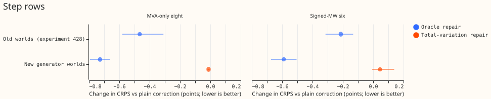
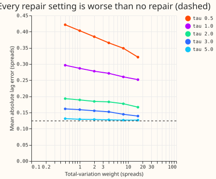

**This page is interim and unaudited: it reports a perfect repair of shifted lag readings (an
oracle) and one non-learned repair, and no learned encoder.** We asked whether the power readings
of the last 14 days need repairing, or whether down-weighting them (as experiments 402 to 482 did)
is enough. We injected shifts into the readings of 14 Primary substations: temporary load transfers
(family A), and genuine level changes that move the true power (family B). We retrained the lag
correction of experiment 472, a small neural network that adjusts the forecast using the last
three lag readings, and scored it with the lags repaired in three ways: not repaired ("plain"),
repaired by an oracle that knows the injected shift, and repaired by total-variation denoising of
the 14-day residual (the reading minus the forecast of a model that has no power input).

**The learned encoder (rung T1) was not run because the line is paused, not because a kill rule
fired.** The oracle improved the score, so the stop rule (a) did not fire. The non-learned repair
did not keep half of the oracle's gain, so rule (b), which would have promoted it in place of the
encoder, did not fire either. The next step would have been the noise curve and one encoder fit.

## Results

**Scores are CRPS in points of capacity (lower is better), on the four screen folds** (2026-06,
2026-01, 2025-10, 2026-03), three fit seeds each, on held-out injected worlds 200 to 202. "The
six" are the six Primaries that report signed MW, and "the eight" are the eight that report MVA
only. The minimum detectable effect (MDE) is experiment 454's formula: 2.8 times the mean standard
deviation of paired seed differences, over the square root of 4 folds. Intervals are the exact 95%
month-block resamples of the four fold means, a coarse resample. The weather is ERA5 reanalysis
and CAMS in both history and forecast, with one seed.

| Rows and worlds | Group | Oracle minus plain | Total-variation minus plain |
|---|---|---|---|
| Old worlds (experiment 428): harm and target rows with an injected shift | six | -0.214 (-0.314 to -0.132), MDE 0.014 | not run |
| Old worlds: same rows | eight | -0.466 (-0.581 to -0.309), MDE 0.223 | not run |
| New generator worlds: rows where a shift touches a lag | six | -0.589 (-0.674 to -0.505), MDE 0.089 | +0.045 (-0.006 to +0.139) |
| New generator worlds: same rows | eight | -0.727 (-0.793 to -0.661), MDE 0.088 | -0.012 (-0.018 to -0.005) |

- **Rule (a) did not fire: repairing the lags helps.** At the six, the old-world oracle gain was
  15.6 times the MDE, with an interval excluding zero. At the eight it was 2.1 times the MDE. The
  zero-lag control (experiment 472's correction with all lag inputs set to zero) was worse than
  plain by 0.49 (six) and 0.91 (eight) points on the old worlds, and by 2.43 and 2.65 on the new
  worlds, so the lag readings carry information.
- **The oracle gain sits on temporary shifts.** On new-world rows where a temporary (family A) shift
  touches a lag, the oracle gain was 1.25 (six) and 1.58 (eight) points. Where only a genuine
  (family B) shift touches a lag, it was 0.24 and 0.24. The oracle that removes a constant level
  per temporary shift (oracle-constant) gained 0.57 (six) and 0.68 (eight) over plain, close to the
  exact oracle, so most of the gain needs only the right level.
- **The oracle's gain depends on how it is applied.** Training on shifted lags and scoring on exact
  lags (oracle re-prediction) gained 0.18 (six) and 0.21 (eight) on the old worlds, against 0.21
  and 0.47 for the retrained oracle. The old-world gain at the eight roughly halves.
- **Prediction P1 (an oracle gain of at least 0.3 points) was met on the new worlds and at the
  eight on the old worlds,** and was missed at the six on the old worlds (0.21).
- **Total-variation repair did not keep half of the oracle gain, on the new generator worlds.** The
  paired difference between the repair's loss and the halfway point to the oracle was +0.34 (0.25
  to 0.45) at the six and +0.35 (0.31 to 0.39) at the eight; a negative value would have meant the
  repair keeps more than half. At the six the repair was worse than plain by 0.045 points. At the
  eight it kept 1.6% of the oracle gain (0.012 of 0.727). With 60% of the steps genuine, instead
  of the generator's 79%, the paired difference was +0.37 and +0.38, so the result did not change
  at that share. The repair was not run on the old worlds.
- **Rows with no shift touching a lag.** The repair's change in CRPS against plain was +0.028
  (-0.000 to +0.084) at the six and 0.000 at the eight, and in q99 pinball loss +0.011 (-0.000 to
  +0.031) at the six and +0.000 at the eight. The rule's bound applies to rows with no labelled
  event on the old worlds, which were not scored for this repair, so the bound was not tested. The
  oracle, retrained on exact lags, was 0.09 points worse than plain on these rows at the six
  (0.016 to 0.185) and 0.05 worse at the eight (0.03 to 0.09). We have not tested why.

## Tuning, and why the repair result is weak

**The tuning picked the weakest repair, so this test cannot show whether any non-learned repair
works.** On a separate tuning world (origins in 2024, no scored month), all 30 settings (6 weights
times 5 values of tau) gave a larger mean lag error than no repair (0.124 spreads, where a spread
is the Primary's residual standard deviation). The best setting, weight 16 and tau 5, the largest
of each, gave 0.127. The criterion averages over all tuning windows, most of which have no shift
touching a lag, and any repair adds noise to those windows. A setting tuned only on windows with
a temporary shift in force was not tried, because the plan fixed the criterion before any score
was read. The take-home message therefore does not claim that total-variation denoising cannot
tell a temporary shift from a genuine level change; this test never examined that.

## Outcome against the plan

| Item | Outcome |
|---|---|
| Rule (a): stop if the oracle does not beat plain by more than the MDE | Did not fire (old worlds, both groups) |
| Rule (b): promote total-variation repair if it keeps at least half the oracle gain | Did not fire (new worlds); not run on old worlds |
| Rule (c): stop the encoder if its errors fall where the noise curve keeps under half the gain | Not evaluated: no encoder, no noise curve |
| P1: oracle gain of at least 0.3 points | Partly met (above) |
| P2: total-variation repair keeps under half | Met on the new worlds; weak evidence (tuning) |
| P3: encoder errors fall in the useful part of the noise curve | Not tested |

## Limits

- **The lab setting flatters detection.** ERA5 knows the weather that happened, so the reading
  minus the forecast is smaller than at serving. A single-seed null is informative only when far
  from the MDE, and the six-Primary total-variation result (+0.045, MDE 0.089) is not far from it.
- **The NGED event labels are incomplete,** so counts of events are lower bounds.
- **Generator.** The generator makes 79% of the steps in force at the origin genuine, not the
  planned 60%. The 79% follows from the shares and durations chosen (derived 78%).
- **Code review.** A code review found 12 problems before any number was read. Seven were fixed:
  the oracle now uses the cleaned readings, events are a function of seed, Primary, and day, the
  size cap applies to the final step, circuit events draw a fraction of 0.3 to 1, the self-test
  tolerance is relative, an N0 slice no longer wraps, and the injection spread comes from the
  earliest table. Not fixed: the oracle and plain fit seeds are not paired by world, which makes
  the seed spread in the MDE approximate; the row count was not asserted against experiment 404's
  scoring rows. The review's other findings were fixed or do not change a number.
- **N0.** Of the 34 events with a measured deviation, the median coefficient of variation of the
  deviation is 0.44, and 29 have a correlation above 0.5 with the Primary's own daily demand, so a
  flat step describes most real events poorly. The generator draws shapes in the planned thirds
  regardless (tables in the private `work/n0/` folder).
