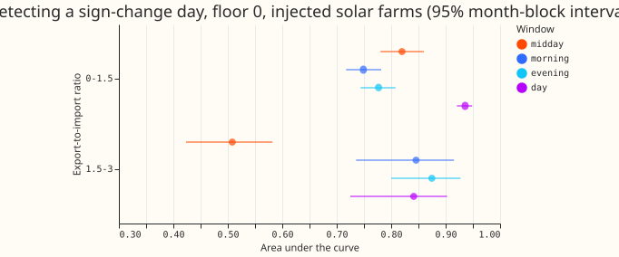
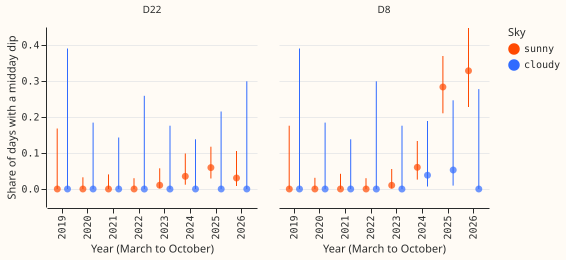
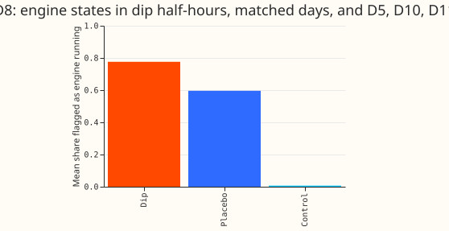
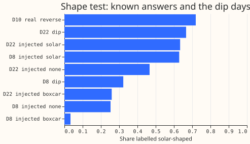

## Results

**Take-home.** A dip of the apparent power at the sun's edges is much better than a midday dip at
telling when a substation's power changes sign, but only up to export about three times the night
import, and D12 (about five times) lies beyond what we could calibrate. At D12 the shoulder dips
are as common on cloudy days and in the dark as on sunny days, so they show low demand and not
solar export. At D8, 55 of the 71 midday dip days have an engine running at most dip half-hours,
which is consistent with the gas engine, although the engine flag also tracks any low D8 reading
and so is weak evidence. The data cannot say which cause explains the other 16 D8 dip days or the 13
D22 dip days, and the sunny-versus-cloudy test does not support a solar cause at D22. Verdict:
`partly supported`. The audit is recorded below. Counts are lower bounds, because NGED's event labels
are incomplete.

**What we asked.** Experiment 506 looked for a dip of the apparent power (MVA, never negative) only
between 10:00 and 15:00. We asked two questions. First, does a dip at the edges of the sun's path
find the days when power changes sign better than a midday dip, once the export is several times
the night-time import, as at D12? Second, are the short midday dips at D8 and D22 solar export, a
load transfer, or the gas engine behind D8? We added recorded solar-farm output (Solar A to C) to
the six primary substations that report signed power, at 1, 2, 4, and 8 times their median sunny
midday reading, and measured how well each window's lowest reading finds the days on which the
signed power changes sign. No forecasting model was fitted.

**Terms.** D2 to D22 are NGED's primary substations (a Primary is a substation that steps 33 kV
down to 11 kV). The six are the Primaries that report signed real power in megawatts (MW). The
eight (D2, D3, D4, D8, D12, D19, D21, D22) report apparent power in megavolt-amperes (MVA), which
includes reactive power and is never negative. A reading is in points of the substation's capacity.
The export-to-import ratio is the midday reading divided by the night-time reading on clear days
from May to July. The area under the curve is the chance that a day on which the power changes
sign has a lower window minimum than a day on which it does not (1.0 is perfect, 0.5 is chance); a
window is usable when the area is at least 0.8 and its interval's lower end is above 0.6. Floor 0
and power factor 0.97 are two ways of making the six's readings look like apparent power. A
placebo is the same statistic on days or hours where no export is expected. NGED is National Grid
Electricity Distribution, and CAMS is the Copernicus Atmosphere Monitoring Service, the source of
the clear-sky index.

## Figures

*Figure 1: how well each window finds sign-change days, by export-to-import ratio.*

*Figure 2: share of days with a midday dip at D8 and D22, by year.*

*Figure 3: share of D8's dip half-hours flagged as engine running.*

*Figure 4: how often the shape test calls a drop solar-shaped, on known answers and on the dip days.*

## Part A: the shoulders

- **Windows.** Shoulders are the half-hours with the sun between 5.6 and 19.0 degrees above the
  horizon (where the clear-sky fleet shape is 0.05 to 0.3), rising for the morning and setting for
  the evening. April to September only. Day-worlds (a day counted once per injected level): 3,329
  (ratio below 1.5), 1,529 (1.5 to 3), 829 (3 to 6), and 429 (above 6). The farm shape was extended
  below 15 degrees of elevation on about 11% of half-hours.
- **Usable range.** Ratio below 1.5, floor 0: midday 0.82 (95% interval 0.78 to 0.86), morning 0.75
  (0.72 to 0.78), evening 0.78 (0.74 to 0.81), whole day 0.94 (0.92 to 0.95). Ratio 1.5 to 3: midday
  0.51 (0.42 to 0.58), morning 0.85 (0.74 to 0.91), evening 0.88 (0.80 to 0.93), whole day 0.84
  (0.73 to 0.90). At power factor 0.97 the 1.5 to 3 values are 0.52, 0.84, 0.87, and 0.84. The
  midday window stops being usable at a ratio of 1.5 to 3, earlier than the predicted 3 to 6.
- **Named contrasts, shoulder minus midday, ratio 1.5 to 3.** Floor 0: +0.33 (morning) and +0.37
  (evening); power factor 0.97: +0.32 and +0.36. All four are above zero at the 0.025/64 level
  (lower bounds +0.03 to +0.07; minimum detectable effect 0.16 to 0.18). In the ratio bin below 1.5
  the shoulders are worse than midday by 0.04 to 0.07 at floor 0 (0.01 to 0.04 at power factor
  0.97), not significant after correction.
- **Not estimable above ratio 3.** In the 3 to 6 and above 6 bins 99.4% and 97.4% of days cross
  zero (5 and 11 ordinary days), so no area under the curve can be computed. D12's ratio is 5.3
  (81.6 over 15.6 in experiment 506's May to July days; 5.27 here), so D12 lies where this
  calibration cannot say whether a shoulder window works.
- **D12 placebo (post hoc, thresholds of the 1.5 to 3 bin).** The morning threshold of 37 points is
  passed on 98.2% of sunny days and 93.7% of cloudy days, a sunny-to-cloudy ratio of 1.05 (1.01 to
  1.10). The evening threshold of 46 points is passed on 96.3% of sunny days and 98.9% of cloudy
  days (0.98; 0.95 to 1.01). The statistic is saturated, because the thresholds were set at lower
  export and nearly every D12 day is below them. The cloudy-day condition of the decision rule
  fails (lower bound 1.01, under 1.5), and so does the first condition (D12's bin is not
  calibrated). The dark-window condition is met: of the sunny days with no dark-window dip, 53%
  (15 days) show a morning shoulder dip and 58% (38 days) an evening one, against the 3% bar, so
  prediction A3's "fewer than 3%" arm is refuted. D12's shoulder dips are not shown to be export.
- **The other seven.** With thresholds of 40 to 53 points, the evening dip rate at D8 is about
  twice the cloudy rate (ratio 1.9, lower bound 1.2), as at D22 in the morning (1.5, lower bound
  1.2). D8's dips with no dark-window dip are 10% to 13% of such days, D22's 10% to 19%, and D2,
  D3, and D4 at most 2%. The thresholds sit far above zero, so these are low-reading days and not
  proven sign changes.
- **Bonferroni count.** 32 area intervals, 16 named contrasts, and 16 placebo ratios were planned:
  64. Of these, 16 areas and 8 contrasts were not estimable and D12 has no placebo ratio at its own
  bin. Decision rule intervals are plain 95% by design.

## Part B: D8 and D22 midday dips

- **Dip days reproduced.** 71 at D8, 13 at D22, and 13 at D12 (experiment 506). D8's share of
  sunny days with a dip is 0.7% in 2023, 3.9% in 2024, 23% in 2025, and 32% in 2026; D22's is 0.7%
  to 4.2%.
- **Engine running (D8).** In 55 of the 71 dip days (77%; Wilson interval 66% to 86%) more than half
  the dip half-hours are flagged as engine running. The mean flagged share is 0.78 in dip
  half-hours, 0.60 in the same half-hours on the 14 nearest non-dip days (difference 0.18, 95%
  interval 0.08 to 0.28), and 0.007 at D5, D10, and D11. The detector reads D8's own residual and is
  high on about 60% of D8's midday half-hours in 2025 and 2026 whatever the day, so the placebo
  share is high; an engine-running dip is neither solar nor a load transfer. The engine class cannot
  be assessed at D22.
- **Season and sky.** From March to October, D8 has 62 dips in 717 sunny days (the remaining dip
  days fall in other months) and 2 in 129 cloudy days (Mantel-Haenszel cloudy-to-sunny ratio 0.18,
  interval 0.04 to 0.57); D22 has 13 in 710 and 0 in 122 (0.29, 0.16 to 0.71). A solar cause
  predicts almost no cloudy dips, but the two intervals reach 0.57 and 0.71, from April to September
  D8's ratio is 0.44 (0.11 to 1.11), and the D22 figure rests on zero cloudy dips, so neither cause
  is excluded. Prediction B2 (an upper bound under 0.2) is not met at either Primary.
- **Shape test fails its known answer.** It labels 63% of injected solar-shaped drops and 85% of
  injected boxcars correctly (target 80% each; D22 alone labels 74% of boxcars), and 72% of D10's
  real reverse-flow days solar. The dip days are 32% (D8) and 67% (D22) solar-labelled. The shape
  test carries no weight.
- **Spark spread and neighbours.** Positive spark spread on 57% of dip days against 47% of other
  sunny days (difference +0.10, interval -0.03 to +0.22). The neighbours' readings over D8's dip
  half-hours move by -7.1 (D3), +22.6 (D12), and -14.3 (D22) points against placebo changes
  of -0.6, +2.4, and -0.2, and D22's dips by -6.2, -0.9, and +26.0 against placebo changes of +2.1,
  +6.1, and -10.1; with unmetered neighbours and opposite signs
  this is a low-power diagnostic and shows no clear recipient.
- **Growth and labels.** The dips began in 2023 at both Primaries. 71 of 71 D8 dip days and 12 of
  13 D22 dip days fall outside every labelled event that has times, but only 3 such events exist
  for D8 (the last ended on 2025-10-02, and 27 D8 dips fall in 2026) and 14 for D22, so the
  count of dips outside NGED's labelled events is a weak lower bound.
- **Cause classes.** D8: 55 engine running, 16 not separable. D22: 12 not separable (one dip day had
  no usable drop curve). The 55 are consistent with the engine; the rest could be solar or a load
  transfer.

## Part C: what the answers change

- **D12.** Experiment 370's reverse flow at D12 is not shown by the shoulder dip, which is as common
  on cloudy days and was not calibrated at D12's ratio. A probability of reverse flow at D12 should
  not use shoulder dips alone.
- **D8.** Label D8's dips as a probable engine regime, not "inferred, heavy reverse flow only". The
  16 days not flagged and the 13 D22 dips remain candidates for either a signed-power estimate or
  an unlabelled load shift, and are listed as unlabelled events in the training rows for the
  history-encoder line later. No count is promised to experiment 507.
- **Question for NGED.** What changed at D8 and D22 between 2023 and 2026: did the gas engine
  behind D8 start or change its running hours, were any connections added, or were loads
  transferred in the daytime at either Primary? Which of the dip days from 2023 to June 2026 does
  NGED's own log explain?

## Checks

- Median forecast minus mean forecast, and the error of the mean forecast: not applicable, no
  forecast was made.
- **Triggers fired.** Trigger 1 (a known-answer test failed: the shape test) and trigger 2 (results
  contradict predictions A1 and A2, with the explanation recorded above). A fresh Sonnet audit
  (`briefs/508_audit.md`) is recorded in the audit section.
- **Deviations.** Windows by sun elevation and April to September, not the clock; a daylight
  crossing label on all-sky days; ratio bins in place of injection levels; the D12 post hoc read;
  a different shape-test metric from the 506 audit; the plan review and code review changed the
  design, as the plan section records. Part B's cloudy half-hours need a clear-sky index of 0.1 to
  0.3. Two daylight-saving days a year are dropped from the day matrices.

## Audit

A fresh Sonnet auditor re-derived the three headlines with its own code (`briefs/508_audit.md`).
Triage:

- **Part A bin 1.5 to 3 survives.** Midday 0.509, morning 0.846, evening 0.875 against the stored
  0.508, 0.846, 0.875. Leaving out D10 and moving the shoulder band to 8 to 20 or 12 to 25 degrees
  leave the ordering unchanged. Accepted as a caveat: the pooled midday interval (0.42 to 0.58)
  does not separate it from 0.5 exactly.
- **Selection of days (accepted as a caveat).** Only about 22% of April to September days qualify,
  because the recorded farm output is missing in 20% to 63% of shoulder half-hours, so the sample
  leans toward days on which the farm was already producing at both shoulders. Requiring 2 shoulder
  half-hours instead of 3 gives 3.4 times as many days and the same ordering (midday 0.50, morning
  0.84, evening 0.83).
- **Farm extension (accepted as a caveat).** The extension creates no spurious crossings, but
  without it the evening area rises from 0.875 to 0.91, so shoulder areas are mildly sensitive to
  it.
- **Engine overlap (accepted; wording weakened).** The count of 55 reproduces and the index
  alignment is right, but the engine flag is also high on D8 days whose lowest reading is 7 to 25
  points (0.72 to 0.85), and the flag is fitted to D8's own series. The page therefore says
  "consistent with" and treats the engine as an unproven explanation.
- **Sky test (accepted; wording weakened).** D8's ratio of 0.18 holds from March to October
  (one-sided Fisher p = 0.0013) but is 0.44 (0.11 to 1.11) from April to September. D22's 0.29 rests
  on 0 cloudy dips in 122 days (Fisher p = 0.12), so the sky test does not support a solar cause
  at D22.
- **Crossing share above ratio 3 (corrected).** 99.4% in the 3 to 6 bin, 97.4% above 6 (98.7%
  combined); the page already gives the two figures.
- **Shape test (accepted).** The injected solar drop uses the recorded farm shape while the
  classifier fits the fleet shape, and the no-injection control is labelled solar 25% (D8) and 47%
  (D22) of the time. The page already gives the test no weight.

## Pre-registered plan

The first version of this plan took `u` over the clear-sky index as the clear-sky shape. A Sonnet
plan review (16 findings, `briefs/508_plan_review.md`) showed that `u` is computed from the actual
sky, so the plan below replaces that choice and the choices that depended on it.

- **Rows.** Cleaned power (`scan_power`, flagged exact-zero half-hours dropped), the experiment 399
  start cut (D15 and D18, neither in the six nor the eight), July 2026 untouched, the experiment 506
  data layer (folder `ml-experiments/00506-*`). Part A uses April to September only, so that the
  midday, shoulder, and whole-day windows describe the same days.
- **Sun position.** The shoulders are the half-hours in which the sun's elevation (pvlib, at the
  half-hour midpoint) lies between the two elevations at which the clear-sky fleet shape `u` of
  experiment 412 reaches 0.05 and 0.3 on rising-sun half-hours with a clear-sky index of 0.9 or more
  at D12. Morning is rising sun, evening is setting sun. The midday window is 10:00 to 15:00 UK
  time, and the fourth window is the whole day.
- **Qualifying days and one label.** A day qualifies when every window has enough finite
  half-hours (6 midday, 3 per shoulder, 40 whole-day), so every window's area under the curve uses
  the same days and any sky. The label is the same for all windows: the day's signed power is both
  below and above zero while the sun is above the horizon.
- **Injection.** signed = p - level x median|p| x farm shape, levels 1, 2, 4, and 8, farm rotation
  of experiment 408 (Solar A to C), the median taken over sunny middays as in experiment 506. The
  recorded farm shape is zero below 15 degrees of elevation, which is where the shoulders sit, so
  there the farm shape is the site's own `u` times the median ratio of the farm shape to `u` where
  `u` is 0.3 to 0.5. The share of half-hours extended this way is printed.
- **Ratio bins.** The export-to-import ratio is the median clear midday reading over the median
  dark-hour reading (sun more than 6 degrees below the horizon), May to July, from each arm's own
  reading in each injected world, never a fitted capacity. Worlds are pooled into the bins 0 to
  1.5, 1.5 to 3, 3 to 6, and above 6, per arm, and the area under the curve is computed per bin.
  D12's observed ratio (about 5.3) is read off the bin that contains it.
- **Arms, counts, and what counts as usable.** Two arms (floor 0 and power factor 0.97; floors 0, 2,
  and 4 give identical areas). Bonferroni families, counted at the end of the run: 32 area-under-
  the-curve intervals (4 bins x 4 windows x 2 arms), 16 named contrasts (each shoulder minus
  midday, per bin and arm, named in advance with no choice of the better shoulder), and 16 placebo
  ratios (8 Primaries x 2 shoulders), 64 in all, plus the Part B tests counted separately. The
  decision rule uses plain 95% intervals on purpose; the named contrasts are also shown at the
  0.025/64 level. A cell with fewer than 30 crossing or 30 ordinary days, or fewer than 10 month
  blocks holding both, is reported as not estimable. Every area carries its crossing and ordinary
  counts, the number of month blocks, and every contrast carries 2.8 standard errors as its minimum
  detectable effect. A window is usable at a ratio if its area is at least 0.8 with a lower end
  above 0.6 (as in experiment 506); the same criterion is used throughout.
- **Thresholds.** Youden-optimal per bin, window, and arm on the six, frozen to disk before the
  eight are read. Each of the eight uses the threshold of the bin that holds its own observed
  ratio; because thresholds for every bin are computed from the six alone, reading the eight's
  ratios only selects a row. For the eight, the power factor 0.97 arm is the matched one and floor
  0 a lower bound, because the meters report apparent power.
- **Placebos.** Sunny days (mean clear-sky index of the window 0.7 or more) against cloudy days
  (below 0.3) for each Primary and shoulder, with the ratio of the dip rates (0.5 added to each
  count) and a month-block interval, and the Primary's own dark-hour reading over a window of the
  same number of half-hours immediately on the dark side of the shoulder. Cloudy-day maintenance
  patterns are a confound that the placebo cannot remove, and the page says so.
- **Part B.** A dip day is a sunny day (clear-sky index 0.7 or more) whose 10:00 to 15:00 minimum
  reading is below 6.9 points of capacity (experiment 506). The run stops unless it finds 71 dip
  days at D8, 13 at D22, and 13 at D12. Cause classes are solar export, load transfer, and gas
  engine running. Engine running is scored against matched placebo days (the same half-hours on the
  14 nearest same-day-type non-dip days after 2023-08-15) with D5, D10, and D11 as controls, using
  experiment 196's engine states as stored by experiment 291, and cannot be assessed at D22. The
  shape test fits one amplitude to the drop (baseline of the 14 nearest non-dip days minus the
  reading), once with the fleet shape `u` and once with a boxcar over the half-peak run around the
  deepest half-hour; injected boxcar and solar-shaped drops of 40 to 50 points on D8 and D22 days
  before 2023 give the known answer, and the shape test enters the cause classes only if at least
  80% of each injected class is labelled correctly. The dip rate on cloudy against sunny middays of
  March to October is a Mantel-Haenszel risk ratio over year-month strata with a stratum bootstrap;
  with few cloudy dips it is reported as underpowered. Spark spread (experiment 186) compares dip
  days with other sunny days after 2023-08-15. The neighbour check reads the other Primaries under
  the same supply point and is a low-power diagnostic. The count of dip days outside every labelled
  event with times is a stand-alone result.
- **Prediction and rule changes.** Prediction A1 and the usable criterion now share one threshold
  (area 0.8, lower end above 0.6). The decision rule for D12 requires: a usable shoulder area in the
  bin that holds D12's ratio; a sunny-to-cloudy ratio of dip rates with a lower bound above 1.5
  (sensitivity at 1 and 2 reported); and, among sunny days with no dark-window reading below the
  frozen shoulder threshold, a shoulder dip share of at least 3% (sensitivity at 1% and 2%).
- **Deliverables.** Part C of the brief (what each answer changes, using "consistent with") and the
  exact question for NGED about what changed at D8 and D22 from 2023 to 2026, including the engine,
  new connections, and load transfers.
- **Reuse.** No predictions are reused or fitted. CPU only, 2 cores. Cadence: not applicable.
  Past-weather caveat: the clear-sky index comes from CAMS and describes the day observed, so the
  sunny and cloudy day labels are not available at forecast time. Advice followed: experiment 506
  says to treat the dip as a screen, not a signed label.

## Reuse and cost

CPU only; each script takes under a minute. Scripts import the experiment 506 data
layer (folder `ml-experiments/00506-*`) and experiment 87's `grid_times`. Stored tables are under
`data/ml-experiments/00508-*/work/`.
