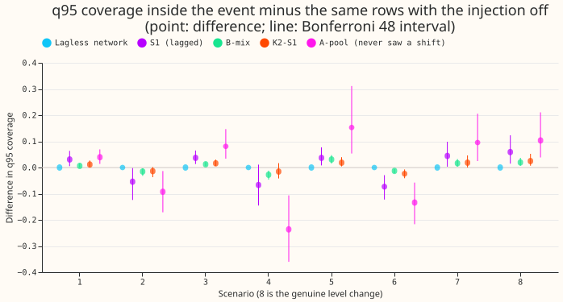
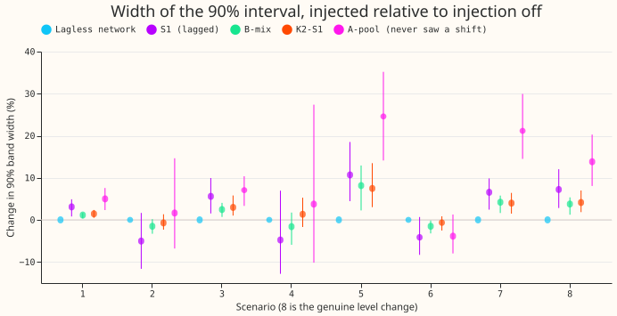
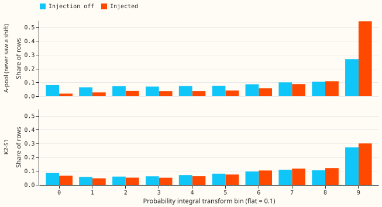
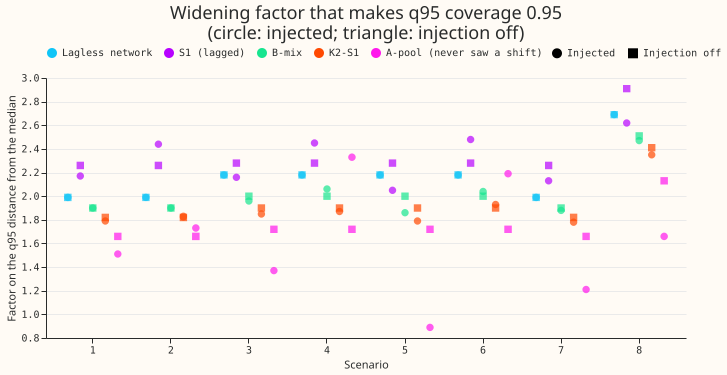
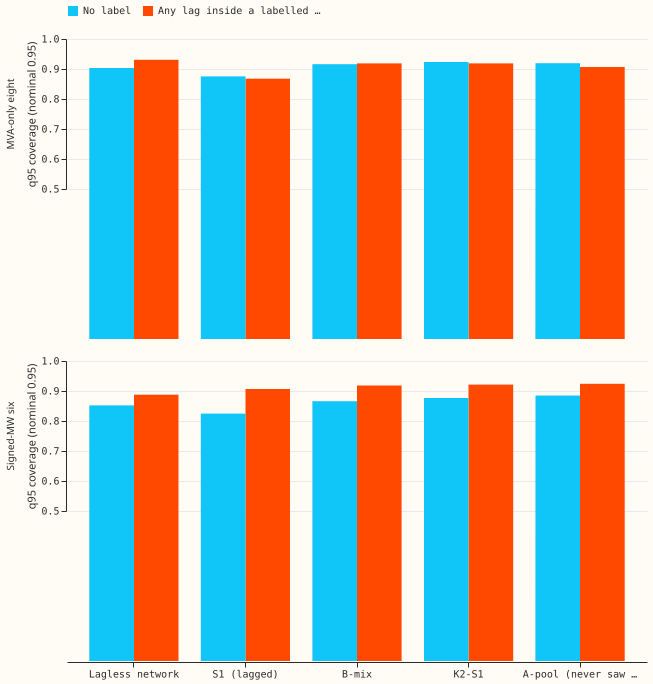

**When a load shift is added to one of the earlier power readings that a demand forecast uses, the
forecast that mixes lagged and lagless neural networks (K2-S1) keeps almost the same band and almost
the same coverage as on the same rows with no shift, so the shift does not make its band narrower
relative to the errors.** The pooled neural network that never saw an added shift (A-pool) is the
exception. At the three Primary substations we could check, every forecast under-covers its upper
tail with or without a shift, so the bands need widening everywhere, not only inside load-shift
events. The verdict is partly supported, because K2-S1's coverage in scenario 6, K2-S1's band width
in scenarios 5, 7, and 8, and A-pool's coverage in scenario 2 missed the pre-registered thresholds
(see Predictions).

**We asked whether the 90% band of a demand forecast is too narrow, too wide, or about right when one
of its three lags falls inside a load-shift event.** A lag is the power reading from an earlier time,
such as 24 hours before the forecast, that the neural network takes as an input. A load-shift event
is a period when NGED moves demand from one feeder to another, which steps the recorded power
without changing true demand. Experiment 482 added artificial shifts to the lags of stored
forecasts, and found that K2-S1's central 90% band covered 85% of actuals inside the event. That
85% could not be told apart from the networks' ordinary under-coverage, because experiment 482 did
not score the same rows with no shift. This experiment scores both forecasts on identical rows: the
forecast with shifted lags (stored by experiment 482) and the forecast with unshifted lags (stored by
experiments 454 and 470). It reports the difference.

**The comparison covers three Primary substations, D5, D12, and D14, in five test months.** Those 15
(month, Primary) pairs are the only ones for which experiment 482 stored forecasts row by row.
Experiment 482 shifted each of 16 Primaries in turn, and the other 13 keep summary tables only. D5
and D14 are among the six Primaries whose power is recorded in signed MW, and D12 is among the eight
recorded only in MVA (apparent power). Five forecasts are compared, as defined in experiment 482:

- **LL** is the lagless neural network, which reads no lag.
- **S1** is a neural network that reads lags and was trained on added shifts.
- **B-mix** is an equal mixture of a lagged and a lagless network.
- **K2-S1** is a mixture of two S1 and two lagless networks.
- **A-pool** is a pooled neural network trained on real lags only.

"q95 coverage" is the share of actual values at or below the forecast's 95th-percentile line, with a
nominal value of 0.95. The headline rows have the newest of the three lags inside the event
(experiment 482's `newest_in` class) and a lead of 24 to 240 hours. That is 6,495 rows in the 1-day
scenarios, 90,915 in the 14-day scenarios, and 19,485 in scenario 8. Widths are in points of
capacity, which are percentages of the Primary's effective capacity.

| Scenario | Shift | Duration | Neighbours compensated |
|---|---|---|---|
| 1 | +1x | 1 day | no |
| 2 | -3x | 1 day | no |
| 3 | +1x | 14 days | yes |
| 4 | -3x | 14 days | no |
| 5 | +3x | 14 days | yes |
| 6 | -1x | 14 days | no |
| 7 | +3x | 1 day | yes |
| 8 | +2x | 3 days | no, and the actual also moves (a genuine level change) |

A shift of 1x is one standard deviation of the Primary's 24-hour change in power. "Neighbours
compensated" means the same energy is taken off up to two neighbouring Primaries.

## Shifted lags against unshifted lags

- **K2-S1's q95 coverage moves by -0.024 to +0.025.** The differences are +0.011, -0.014, +0.016,
  -0.015, +0.018, -0.024, +0.019, and +0.025 in scenarios 1 to 8, with bootstrap standard
  deviations of 0.004 to 0.009. Its q95 coverage with shifted lags is 0.78 to 0.85, and 0.78 to 0.83
  with no shift. Intervals at the Bonferroni level for 48 contrasts (the interval widened so that
  48 comparisons together keep a 5% error rate) exclude zero in scenarios 1, 3, 5, 6, and 8.
- **K2-S1's 90% band changes by -0.7% to +7.5%.** The changes are +1.5%, -0.7%, +3.0%, +1.3%,
  +7.5%, -0.7%, +4.0%, and +4.1% in scenarios 1 to 8. The band is 30 points of capacity wide.
- **A-pool's q95 coverage falls by 0.09 in scenario 2, 0.24 in scenario 4, and 0.13 in scenario 6.**
  These are the negative shifts with no compensating neighbours. Standard deviations are 0.025,
  0.039, and 0.025. A-pool's q95 coverage rises by 0.04 to 0.15 in the other scenarios, because a
  positive shift lifts its median above the actual. Its q05 coverage in scenario 4 falls to 0.007
  from 0.042.
- **S1 loses 0.05 to 0.07 of q95 coverage in the three negative scenarios with no compensating
  neighbours, and B-mix loses 0.01 to 0.03.** The lagless network changes by exactly zero in all 8
  scenarios, which confirms that the code leaves an unshifted forecast untouched.
- **The same pattern holds at 12 to 36 hours ahead** (735 rows in the 1-day scenarios and 10,289 in
  the 14-day scenarios). K2-S1's q95 coverage changes by -0.031 to +0.033, and A-pool's by -0.304
  in scenario 4.
- **Tail calibration, scenario 4, `newest_in` rows, 24 to 240 hours ahead.** The table shows q05 and
  q95 coverage (nominal 0.05 and 0.95) with shifted and unshifted lags, and the pinball loss at q95
  (the quantile score at the 95th percentile, in points of capacity).

| Forecast | q05 shifted | q05 unshifted | q95 shifted | q95 unshifted | q95 pinball shifted | q95 pinball unshifted |
|---|---|---|---|---|---|---|
| LL | 0.061 | 0.061 | 0.771 | 0.771 | 1.789 | 1.789 |
| S1 | 0.042 | 0.062 | 0.693 | 0.759 | 2.231 | 1.790 |
| B-mix | 0.044 | 0.054 | 0.762 | 0.790 | 1.725 | 1.666 |
| K2-S1 | 0.038 | 0.049 | 0.786 | 0.802 | 1.601 | 1.594 |
| A-pool | 0.007 | 0.042 | 0.574 | 0.811 | 3.293 | 1.598 |

## Probability integral transform and widening factor

- **The probability integral transform of every forecast piles up in the top bin.** The transform
  places each actual within the forecast's distribution, and a flat histogram means calibrated. In
  scenario 4, 27% of actuals fall above the forecast's 90th percentile for K2-S1 and A-pool with no
  shift (nominal 10%). Shifted lags raise that share to 30% for K2-S1 and to 54% for A-pool.
- **The widening factor is the multiplier on each quantile's distance from the median that makes
  q95 coverage equal 0.95.** For K2-S1 it differs between shifted and unshifted lags by -0.03,
  +0.01, -0.05, -0.03, -0.11, +0.03, -0.04, and -0.06 in scenarios 1 to 8, so it is within 0.05 in 6
  of 8 scenarios. In the two exceptions (scenarios 5 and 8) the factor is lower with shifted lags,
  so the band was already wider.
- **B-mix is within 0.05 in 6 of 8 scenarios too, but not the same six.** Its differences are 0, 0,
  -0.04, +0.06, -0.14, +0.04, -0.02, and -0.04.
- **Most of the gap is general, not specific to events.** K2-S1's factor with no shift is 1.8 to 1.9
  in scenarios 1 to 7 and 2.4 in scenario 8, and the widening stored by experiment 454 is 1.15.
- **A-pool's factor falls to 0.89 in scenario 5 and rises to 2.33 in scenario 4.** Its band is too
  wide when a positive shift with compensated neighbours lifts its median, and too narrow when a
  negative shift pulls the median down.
- **The lower tail needs less widening.** K2-S1's q05 factor is 0.91 to 1.27 with shifted lags and
  1.00 to 1.27 with none.

## Real events (sensitivity)

- **This is not a paired result.** The page compares rows with any of the three lags inside a
  labelled event (58,638 rows at 12 of 30 (month, Primary) pairs in the signed-MW six, and 40,819
  rows at 12 of 40 pairs in the MVA-only eight) with rows that have no label, 24 to 240 hours ahead.
  The two kinds of rows come from different Primaries and months, so the contrast mixes the event
  with the Primary.
- **Against the NRA-corrected actual, K2-S1's q95 coverage is 0.92 on event rows and 0.88 on rows
  with no label** in the signed-MW six (difference +0.044, bootstrap standard deviation 0.040,
  minimum detectable effect 0.113). The NRA-corrected actual is the metered actual with the normal
  running arrangement restored (the correction of experiment 435). In the MVA-only eight the
  figures are 0.92 and 0.92 (difference -0.005, standard deviation 0.025).
- **Against the metered actual, the signed-MW six drop to 0.70** (difference -0.176, standard
  deviation 0.080). The metered power during the event is itself shifted, so the NRA-corrected
  actual is the headline.
- **K2-S1's band is 1.2 points narrower on event rows in the signed-MW six** (standard deviation
  1.5). In the MVA-only eight, event rows are 15 points wider than rows with no label for every
  forecast including the lagless network, so the difference comes from the Primary, not the event.
- **The labels are incomplete.** NGED says load-shift events may be missing from its logs, so rows
  with no label may hold events no label covers, and the real-event slices undercount.

## Other 13 Primaries (summary level, not the same rows)

- **The three stored Primaries are the worst covered.** K2-S1's q95 coverage with the stored raw
  quantiles on `newest_in` rows is 0.790 at the three stored Primaries and 0.902 at the other 13 in
  scenario 4, 0.828 and 0.929 in scenario 1, and 0.774 and 0.855 in scenario 8. With the 1.15
  widening, scenario 4 gives 0.836 and 0.933. The other 13 have no unshifted scores, so these
  figures do not form a pair.

## Predictions

- **P1 held in part.** K2-S1's q95 coverage changed by less than 0.02 in scenarios 1 to 5 and 7. In
  scenario 6 it fell by 0.024, which is below the 0.03 fall that would call the band too
  confident. The band was under 3% wider in scenarios 1 to 4 and 6 (scenario 3 is 2.98%), and 4.0%
  wider in scenario 7, which fails.
- **P2 held in two of three scenarios.** A-pool's q95 coverage fell by 0.24 and 0.13 in scenarios 4
  and 6, and by 0.09 in scenario 2, just short of the 0.10 line (interval -0.17 to -0.01).
- **P3 held in 6 of 8 scenarios for K2-S1** (tolerance 0.05). It failed in scenarios 5 and 8, by
  -0.11 and -0.06, where the factor was lower with shifted lags.
- **P4 held, but every other scenario also under-covers.** In scenario 8 every forecast's q95
  coverage is 0.76 to 0.87, below 0.95, so the prediction that the bands are too narrow could not
  fail, and scenario 8 is not worse than the others.
- **P5 held.** The width threshold failed in scenario 5 (+7.5%) and scenario 8 (+4.1%). The early
  check on the same rows had found +4.0% and +3.1% over all leads; this page uses 24 to 240 hours.

## Checks and caveats

- **A difference of 0.02 is 2 to 5 bootstrap standard deviations at 15 pairs.** The coverage
  minimum detectable effect (2.8 times the seed standard deviation of the pooled coverage) is
  0.011 at q95 for K2-S1 (0.008 to 0.012 at q05) and 0.022 to 0.028 at q95 for A-pool. The seed
  standard deviation comes from 3 seed cells (5 for A-pool), so it is noisy, and it measures seed
  variation, not the clustering of rows.
- **The Bonferroni count is 48 for the confirmatory contrasts** (3 forecasts, 8 scenarios, coverage
  and width). Every other contrast is descriptive.
- **Scenario 8 is a different contrast.** Both forecasts are scored against the shifted actual, so
  the contrast is between a forecast that saw the shifted lags and one that did not. In scenario 8
  the `before` and `after` classes mix shifted and unshifted targets.
- **The stored forecasts reproduce.** The unshifted forecasts of experiments 454 and 470 match
  experiment 482's no-shift rows to 2.4e-06 on `before` rows for every forecast. K2-S1's scenario 4
  `newest_in` q95 coverage over all lead hours (0.790) matches experiment 482's summary tables.
- **The absolute coverage figures come from three Primaries that under-cover more than the other
  13.** They are not representative of all 16. The 80-pair re-run was not done, because it needs a
  GPU stage that has not been timed and the result is not borderline.
- **No mean forecast is scored, so the median-minus-mean check does not apply.**
- **No audit trigger fired.** P1 and P2 each failed in part, and neither contradicts an earlier
  finding.
- **No new example forecast charts.** This page re-scores stored quantiles. Experiments 468 and 482
  hold six injected-scenario fan charts and four real-event charts for the same forecasts.
- **Not scored here:** the avoidable-curtailment cost, the price of widening on rows with no
  labelled event (experiments 446 and 483 hold it), and table P (experiment 435's recalibration) for
  LL, S1, and B-mix, because it exists only for K2-S1 and A-pool.

**What the next experiment should answer.** The three stored Primaries under-cover at q95 by 0.12 to
0.19 without any event. Whether the other 13 Primaries also need a factor above 1.15 on rows with no
event is a question for experiment 483's widening results, not for an event rule.
