**Refitting the lag-free demand network every day scored 0.065 points of CRPS better than refitting
it every week at the eight and 0.063 better at the six (lower is better; Bonferroni intervals
exclude zero), and refitting twice a week scored 0.036 and 0.041 better.** Interim and unaudited
until the reviews below have run. The daily refit leaves the network 0.091 points (eight) and 0.071
points (six) behind K2-S1, the network that reads lagged power, so it closes about 40% of the weekly
gap of 0.156 and 0.132. A 30-day or 60-day recency half-life did not beat the 90-day half-life, and
the mixed pretraining on ERA5, CAMS, and ENS rows scored worse than the ERA5 and CAMS pretraining of
experiment 510.

We asked whether refitting more often than weekly, or changing the recency weight, or pretraining on
ENS rows as well, closes more of the gap to K2-S1. All arms are lag-free, restart each fine-tune
from the fold's pretrained weights, average two seeds, and are scored on experiment 470's row set,
in points of effective capacity. "The eight" are the MVA-only Primaries and "the six" are the
signed-MW Primaries. Headline scores use rows with no labelled event. Each model scores only the
origins from its own cutoff to the next cutoff of the same cadence.

Verdict: partly supported. Prediction P1 held: L-1d beat L-3d, which beat L-Ww, and L-1d ended 0.07
to 0.09 behind K2-S1, inside the predicted 0.05 to 0.12 (the L-3d gain of 0.036 and 0.041 was
inside the predicted 0.03 to 0.08 at the six and just above it at the eight). P2 held: L-Ww-30 did
not beat L-Ww and its leak was larger. P3 failed: L-mix scored worse than L-Ww by 0.06 and 0.05,
which is outside the predicted "less than 0.05 better".

## Figures

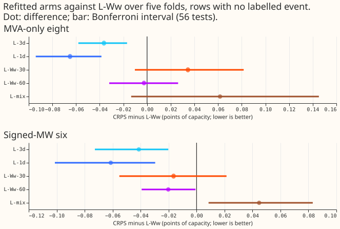

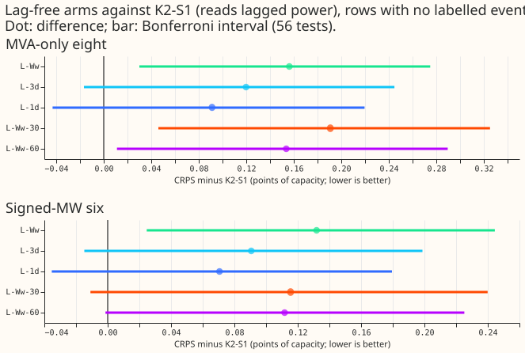

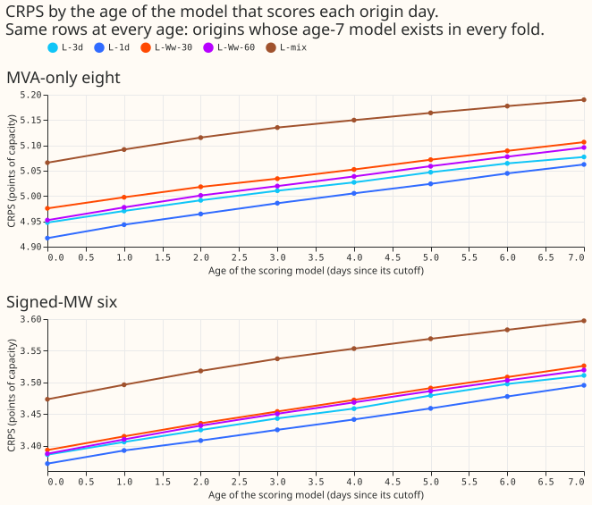

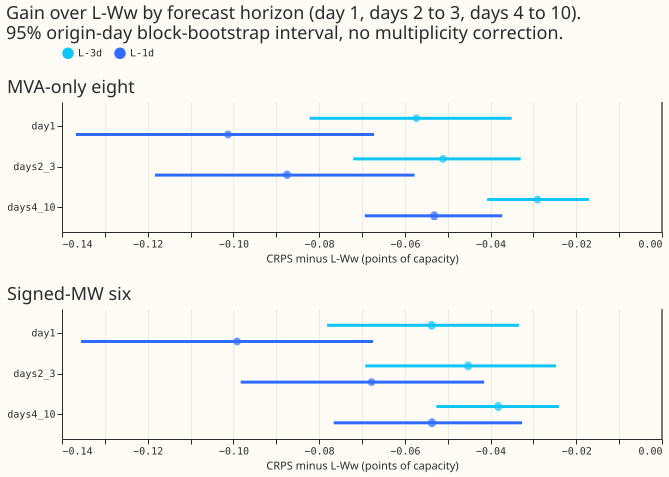

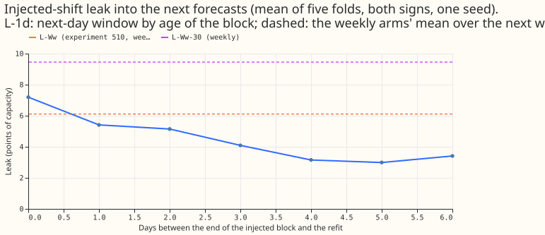

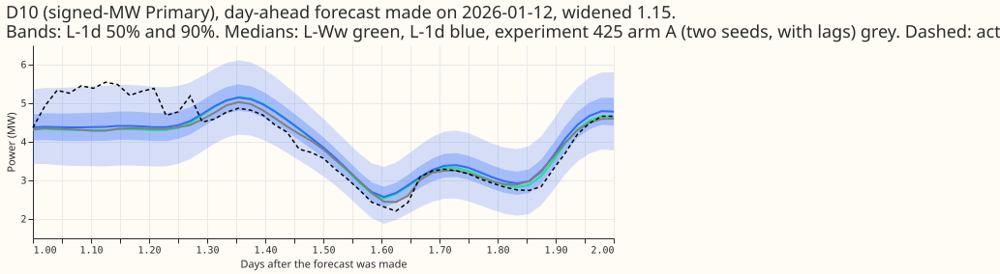

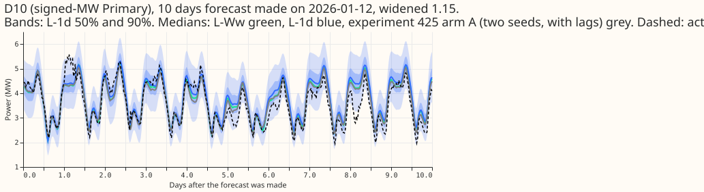

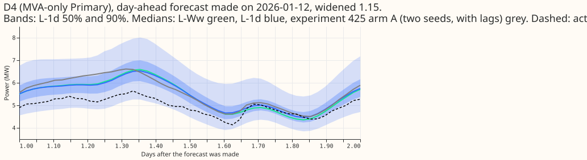

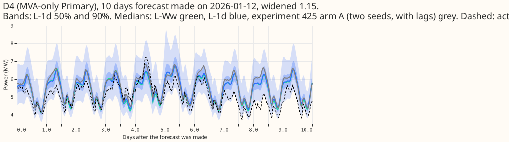

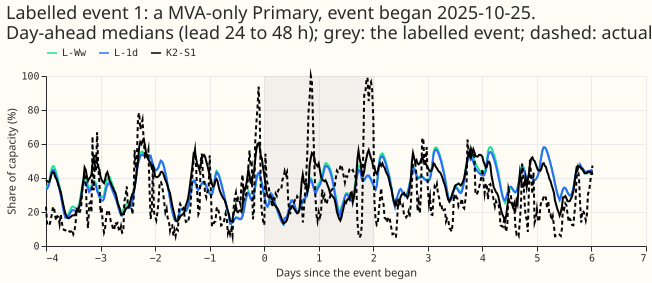

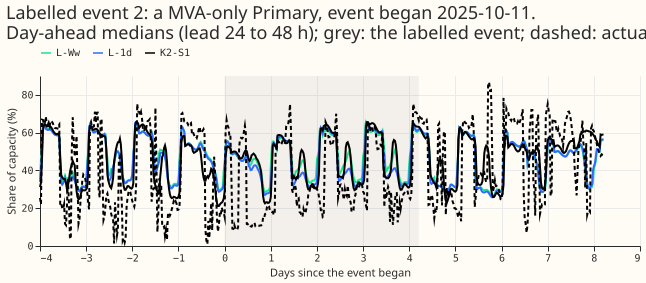

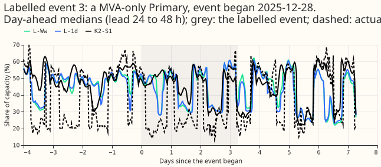

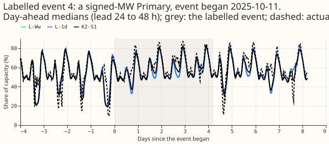

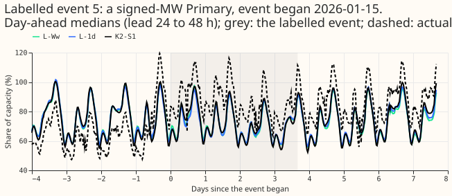

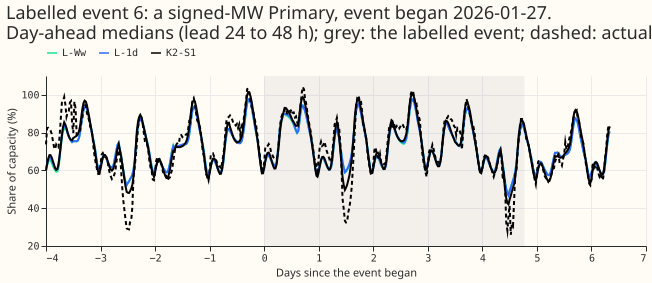

## Results

- **Absolute CRPS (eight / six), five folds, two seeds.** L-Ww 4.920 / 3.555; L-3d 4.883 / 3.513;
  L-1d 4.854 / 3.493; L-Ww-30 4.954 / 3.538; L-Ww-60 4.917 / 3.535; L-mix 4.981 / 3.599; K2-S1 4.763
  / 3.423; A-pool 4.682 / 3.457.
- **Paired contrasts against L-Ww (Bonferroni interval, 28 CRPS tests).** L-3d -0.036 [-0.058,
  -0.017] eight, -0.041 [-0.073, -0.020] six. L-1d -0.065 [-0.094, -0.039] eight, -0.063 [-0.101,
  -0.030] six. L-Ww-30 +0.035 [-0.010, +0.082] eight, -0.016 [-0.055, +0.021] six. L-Ww-60 -0.003
  [-0.032, +0.026] eight, -0.020 [-0.039, -0.001] six. L-mix +0.062 [-0.013, +0.145] eight, +0.045
  [+0.009, +0.083] six. L-1d minus L-3d -0.029 [-0.051, -0.009] eight, -0.020 [-0.043, -0.002] six.
  The minimum detectable effect with two seeds is 0.164 (eight) and 0.123 (six), experiment 510's
  values, so every gain here is below it: the intervals exclude zero because the contrasts are
  paired on the same rows, but a gain "of at least 0.05" is not established.
- **Gap to K2-S1 (unadjusted 95% block interval).** L-1d +0.091 [+0.017, +0.168] eight, +0.071
  [+0.007, +0.136] six; L-Ww +0.156 and +0.132. No arm is within noise of K2-S1.
- **Decision rule for the daily refit.** The point estimate and the Bonferroni interval pass at both
  groups. q99 pinball loss is 0.286 against 0.287 (eight) and 0.183 against 0.184 (six), inside
  +0.02. Cold winter nights: L-1d minus L-Ww -0.124 [-0.178, -0.069] eight, -0.060 [-0.106, -0.016]
  six, so no worse. The injected-shift leak is a reported trade-off (below). Twice weekly does not
  reach the -0.05 point estimate. L-Ww-30 and L-Ww-60 fail the rule, and L-mix is worse.
- **Horizon bands, L-1d minus L-Ww (eight / six).** Day 1 -0.101 / -0.099; days 2 to 3 -0.087 / (see
  slices.csv); days 4 to 10 -0.053 / -0.054; the 12 to 36 hour band -0.090 / -0.077. The gain is
  largest on the first day but reaches days 4 to 10, so the daily refit's new rows help beyond the
  short leads they reach directly.
- **Staleness curve (figure 2).** CRPS rises about 0.02 points per day of model age in every arm
  (L-1d at the eight: 4.917 at age 0 to 5.062 at age 7). The curve is on the origins whose age-7
  model exists in every fold, so its levels are higher than the headline. Experiment 510's L-M minus
  K2-S1 does not grow with the week of the month (0.46, 0.37, 0.41, 0.37, 0.16), so the curve alone
  does not isolate staleness from the weeks' differing weather.
- **Injected-shift leak (one seed, five folds, both signs; descriptive).** L-1d: 7.2 points of
  capacity on the day after the block, 5.4, 5.1, 4.1, 3.2, 3.0, and 3.4 on the following days.
  L-Ww-30: 9.5, against 6.1 for experiment 510's L-Ww (range across folds 3.4 to 14.5). The weekly
  L-Ww-30 leaks 3.4 points more than L-Ww, so a shorter half-life costs robustness. The daily
  refit's leak is larger the day after a bad block and fades within about 5 days.
- **Real events and holidays.** Christmas week 2025, L-1d minus L-Ww: -0.162 [-0.266, -0.066] eight,
  -0.144 [-0.249, -0.044] six (noise floor 0.26 and 0.27). Both are below the noise floor. 1 to 14
  January 2026: -0.069 eight, -0.104 six.
- **Tails.** q01 and q99 pinball loss and coverage are within 0.002 of L-Ww at both groups for L-1d
  and L-3d; see absolute.csv in the private data folder. Coverage of the 99% quantile is 0.995
  (eight) and 0.991 (six).
- **Avoidable-curtailment cost at the six, f = 0.9 / 0.75 / 0.5.** L-Ww 0.95 / 5.96 / 22.26; L-1d
  0.73 / 5.47 / 21.43; K2-S1 1.90 / 8.43 / 26.94; `manual_heuristic` 2.02 / 12.88 / 37.79. L-1d
  minus `manual_heuristic` is -1.28 [-3.54, -0.07], -7.41 [-15.51, -2.17], and -16.36 [-28.27,
  -8.12]. L-1d minus K2-S1 is -1.17 [-3.30, -0.02] at f = 0.9 and includes zero at the other two.
- **D15 and D18 (report only).** CRPS L-Ww 11.19, L-3d 11.00, L-1d 10.88, K2-S1 11.53.
- **Warm start (L-1d-warm, seed 0, report-only).** One epoch from the previous day's weights scored
  0.018 [-0.013, +0.050] (eight) and 0.032 [+0.008, +0.057] (six) worse than a daily restart on seed
  0, and +0.27 / +0.20 worse in Christmas week, so errors accumulate. Restart each day.
- **L-mix.** The source flag is a 38th input; arm A already has `lead` and `lead_sqrt` inputs and
  the ERA5 and CAMS pseudo-runs carry real leads, so no lead input was added. Pretraining took 31 to
  32 seconds per network. The mixed pretraining scored worse at both groups, so the daily repeat
  (L-mix-1d) was not run.
- **Not run.** L-1d-oldPT, because it is optional and experiment 494's PretrainOnce arm already
  tests stale pretraining.

## Checks

- **Median minus mean forecast.** Per group the absolute error of the median and of the mean
  forecast differ by at most 0.1, and median minus mean is -0.61 (eight) and -0.15 (six) for L-1d,
  the same as L-Ww (-0.61, -0.15). The mean-forecast error contrast L-1d minus L-Ww (6.380 against
  6.447 at the eight, 4.998 against 5.074 at the six) has the sign and size of the median contrast.
- **Leak check.** Printed before any fit: 0 rows past the valid-time or origin cut for every cutoff
  and half-life, and the scored windows tile each month and start at their own cutoff. The reused
  day-0 weights reproduce experiment 510's forecast exactly (maximum difference 0.0).
- **Reviews.** One fresh Sonnet code review before the first fit. Results, write-up, and prose
  reviews: pending when this was written; this page is interim until they have run.

## Caveats

- **Scale of the gain.** The daily refit's gain (about 1.3% of CRPS) is below the two-seed minimum
  detectable effect; the paired intervals are narrow because the rows are shared, but the gain could
  depend on the five folds. Seed 1 of L-1d is the replication: both seeds are pooled in the
  headline.
- **Folds.** Five test months of one year; only two of them are winter months.
- **Labelled events.** NGED's event labels are incomplete, so rows with no labelled event may hold
  events, and the event slices undercount.
- **Staleness.** The staleness curve is on a subset of origins and mixes the effect of age with the
  weather of the later weeks.
- **Stress run.** One seed and a fixed block; the leak differs 3-fold across folds, so the 1-point
  limit of the plan cannot be tested.

## What to try next

- Refit daily over a full winter before any release claim, because the weeks that favour a fresher
  model come from few folds.
- Test whether the daily gain survives when ENS rows arrive with the real publication delay in
  production.

## Plan (written before any fit)

## Question

Experiment 510 found that refitting the lag-free network weekly rather than monthly scored 0.17 to
0.19 points of CRPS better, and that the gain grew through the month (zero in week 1, about 0.35 by
week 4). That pattern is a staleness effect. We ask whether refitting twice a week or every day
closes more of the remaining gap to K2-S1, whether a 30-day or 60-day half-life does, and whether a
pretraining that sees ENS rows as well as ERA5 and CAMS rows helps the weekly fine-tune. A fourth
question, how stale the ERA5 and CAMS pretraining may be, is optional (L-1d-oldPT, below).

## Arms

All arms are lag-free (37 non-lag inputs, 3 mixture components, widened 1.15 at scoring), restart
every fine-tune from the fold's pretrained weights (seeds 0 and 1), and train on ENS rows with valid
time at most the cutoff minus 3.5 hours.

| Arm | Refit cadence | Half-life | Seeds | Note |
|---|---|---|---|---|
| L-3d | twice weekly: days 0 and 3 of each 7-day block, 00:00 UTC (45 cutoffs over 5 folds) | 90 days | 0, 1 | |
| L-1d | daily, 00:00 UTC (154 cutoffs) | 90 days | 0, 1 | seed 1 is run unconditionally and reported alone as the replication |
| L-Ww-30, L-Ww-60 | weekly (25 cutoffs) | 30, 60 days | 0, 1 | take the slot experiment 510 reserved for a 30/180-day sweep |
| L-mix | weekly | 90 days | 0, 1 | mixed ERA5, CAMS, and ENS pretraining (below) |
| L-1d-warm | daily | 90 days | 0 | gated and report-only (below) |
| L-1d-oldPT | daily | 90 days | 0 | optional: only if L-1d beats L-Ww; not in the fit count |
| References, not refitted | | | | L-M, L-W, L-Ww (experiment 510); K2-S1, A-pool (experiments 470, 454, 425) |

**Scoring window.** Every model scores only the forecast origins from its own cutoff to the next
cutoff of the same cadence (one day for daily, 3 or 4 days for twice weekly, one week for weekly,
the whole month for monthly L-M). The windows tile the month, so each origin has one scoring model.
The `leak` command prints the check, before any fit, that the windows tile each month and that no
scored origin lies before its own cutoff.

**Reuse.** A fit whose cutoff day (0, 7, 14, 21, or 28) coincides with one of experiment 510's
weekly L-Ww fits uses 510's saved weights, because the rows, the half-life, the seed, and the
pretrained weights are identical. The window forecast is produced afresh. That saves 50 of L-3d's 90
fits and 50 of L-1d's 308.

**L-mix.** Pretrain on ERA5 and CAMS rows (source flag 0) and the fold's ENS rows (flag 1, rows from
2024-04) together, with each batch half from each source (4,096 + 4,096), so the fewer ENS rows are
not swamped. Arm A already has a lead input: the `lead` and `lead_sqrt` columns, and the ERA5 and
CAMS pseudo-runs of experiment 418 carry real leads of 0.5 to 351 hours. So the plan adds only the
source-flag column (a 38th input) and keeps the existing lead inputs for both sources. Early
stopping uses the mean of the held-out negative log-likelihood of the two sources. The fine-tune
then uses ENS rows only (flag 1), weekly, with the 90-day half-life. The flag-1 pretraining rows
must satisfy the same cut as the fine-tune rows (valid time at most the pretraining cut minus 3.5
hours, origin at most the cut); the `pretrain-mix` command prints and asserts the check before
fitting. If L-mix passes its rule, it is repeated daily (L-mix-1d).

**L-1d-warm (defined before running).** Continue from the previous day's weights for one epoch (20%
of the training rows, as in experiment 510's harness) at the fine-tune learning rate, with a fresh
optimiser each day and no early stopping. The first cutoff of a fold starts from the pretrained
weights and is the full L-1d fine-tune; nothing chains across folds. Run it only if L-1d beats L-Ww
(seed 0, report-only).

**L-1d-oldPT.** Optional; run only if L-1d beats L-Ww. Experiment 494's PretrainOnce arm already
tests stale pretraining. If run, it ships the old fold's standardiser and per-Primary target
statistics with the old weights.

## Fit counts and cost

- **New fine-tunes:** L-3d 40, L-1d 258, L-Ww-30 and L-Ww-60 100, injected-shift stress 80, L-mix
  50: 528 fine-tunes, plus 10 mixed pretrainings.
- **Timed cost:** a daily fine-tune takes 2.5 to 3 seconds of training (the first one 7.8 seconds)
  and 0.15 seconds of row selection, because each month's rows are built once and held on the GPU.
  About 1 GPU-hour in all, with the staleness inference. One GPU process under 8 GB.
- **Gated, not counted:** L-1d-warm up to 154 fits and L-mix-1d 154 per seed.

## Scoring and contrasts

- **Staleness curve.** Score each origin with the model refit `k` days earlier (k = 0 to 7), for
  every arm. This is inference only, and works for daily refits. Beside it, report experiment 510's
  L-M minus K2-S1 by week of the month (0.46, 0.37, 0.41, 0.37, 0.16), which does not grow with the
  week, so staleness is not isolated, and 510's L-Ww minus L-W of +0.07 in weeks 1 and 2 at the
  eight. Say which horizon bands a daily refit can affect: the newest daily rows reach only short
  leads.
- **Contrasts (paired, same seeds and pretrained weights).** L-3d, L-1d, L-Ww-30, and L-Ww-60
  against L-Ww (4); L-1d against L-3d (1); each of the four against K2-S1 and A-pool (8); L-mix
  against L-Ww (1). That is 14 contrasts, at the eight and the six, so 28 CRPS tests (56 with q99
  pinball loss). Bonferroni count: 28 for CRPS. Absolute scores are reported beside every contrast.
- **Minimum detectable effect.** Experiment 510's two-seed values: 0.164 at the eight and 0.123 at
  the six (from its `mde_k2.csv`).
- **Rows.** Rows with no labelled event (NGED's event labels are incomplete), days 1 to 10, the 12
  to 36 hour band, and the horizon bands day 1, days 2 to 3, and days 4 to 10.
- **Injected-shift leak.** Experiment 510's stress run (a 7-day shift of 3 times the standard
  deviation of a Primary's 7-day mean target, both signs) for L-1d and L-Ww-30 only, one seed, five
  folds (about 80 fits). For L-Ww-30 the block ends at the day-14 cutoff as in 510. For L-1d the
  block is fixed (days 7 to 14 of the month) and the daily refits at days 14 to 20 are compared with
  their uninjected fits, so the leak is reported by the age of the block (0 to 6 days). Descriptive:
  510's L-Ww leak ranges from 3.4 to 14.5 points across folds, so the 1-point limit cannot be tested
  and is reported as a trade-off beside the score gain of every arm.
- **Other slices.** Rows inside labelled events against NRA-corrected actuals (sensitivity),
  Christmas week 22 to 31 December 2025 and 1 to 14 January 2026 per arm (noise floor 0.26 at the
  six and 0.27 at the eight for one Christmas), cold winter nights, q01, q05, q95, q99 coverage and
  pinball loss, the widening sweep 1.0 to 1.15, avoidable-curtailment cost at f = 0.9, 0.75, 0.5 at
  the signed-MW six. D15 and D18 are report-only.
- **Production cost per arm.** Fits per day, seconds per fit, stored ensemble rows, pretraining
  cadence, and networks per serving pass (1 for every arm).

## Pre-registered rules

- **More frequent refit worth porting:** contrast against L-Ww with a Bonferroni interval excluding
  zero and a point estimate of at most -0.05 at the six or the eight, q99 pinball loss within +0.02,
  cold winter nights no worse than +0.05. The leak is reported as a trade-off (its 1-point limit
  cannot be tested).
- **Shorter half-life worth porting:** the same terms, against L-Ww.
- **L-mix adopted:** L-mix minus L-Ww with an interval excluding zero and a point estimate of at
  most -0.05 at either group, and q99 pinball within +0.02.
- **Stale pretraining acceptable (if L-1d-oldPT is run):** not shown worse than L-1d by 0.03.
- **No arm within 0.1 of K2-S1:** say so and state the distance; the choice between a simpler first
  release and the 4-network lagged mixture is the maintainer's.

## Standing practices followed

Cleaned data and the D15 and D18 cut before 2025-03-01 (through experiment 428's rows); stored
references reused (L-M, L-W, L-Ww, K2-S1, A-pool, BG2, climatology, `manual_heuristic`) on the same
rows; seed 0 and 1 averaged by quantile as in 510; July 2026 unused; no XGBoost work; widening 1.15.
Schedule: the refit cadences are the experiment's subject. Titles say "load-shift", never
"switching".

## Implementation details (deleted when this ships)

Code in `ml-experiments/00511-.../`: `e00511_common.py` (cadences, the month's rows on the GPU),
`e00511_fit.py` (`leak`, `time`, `pretrain-mix`, `fit`, `assemble`, `stale`). Experiment 510's
harness is imported; its weekly offsets are hard-coded, so this folder adds cadence-aware cutoffs,
windows, and a `build_month` that extends rows to the last daily cutoff.
