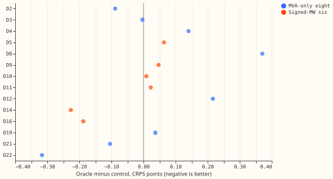
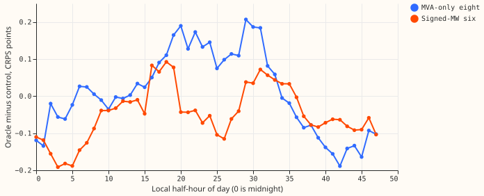

**We asked whether a demand neural network forecasts better if it is shown the electricity price of
the whole day during training, because batteries and gas engines behind a substation follow the
price.** We gave the network the exact price shape of each day, as 10 numbers such as the day's
cheapest and dearest half-hours and the evening-minus-overnight spread, at both training and
scoring. The oracle test is an upper bound, because no price exists when we forecast days 2 to 10.
The network did not forecast better by an amount we can resolve: its error changed by +0.037 points
of capacity at the eight Primaries that report only apparent power and by -0.048 at the six that
report signed megawatts (intervals include zero), where the minimum detectable effect is about 0.17
points. A shuffled day's shape and the shape of national demand minus wind did no better. All
numbers are interim and unaudited until the reviews are recorded in the pull request.

## Figures

## Results

- **Setup.** Five folds (2025-10, 2025-12, 2026-01, 2026-03, 2026-06), seeds 0, 1, and 2, rows of
  experiment 470 with no labelled event, widening 1.15. The scoring mask excludes the half-hours of
  price-missing days. None of the 1,145,256 half-hours of the five months' base rows (before the
  scorer's own filters) falls on one, so the mask removed no row.
- **Minimum detectable effect of a 3-seed mean (four arms pooled).** 0.176 at the eight and 0.168
  at the six.
- **CRPS contrasts (points; Bonferroni count 12; negative favours the first arm).**

| Contrast | Eight | Six |
|---|---|---|
| PO minus P0 (oracle) | +0.037 [-0.037, +0.118] | -0.048 [-0.100, +0.004] |
| PP minus P0 (placebo) | +0.057 [+0.017, +0.101] | +0.018 [-0.005, +0.040] |
| PN minus P0 (national) | +0.054 [-0.008, +0.118] | -0.003 [-0.060, +0.055] |
| PO minus PP | -0.020 [-0.068, +0.031] | -0.065 [-0.112, -0.017] |
| PO minus PN | -0.017 [-0.086, +0.048] | -0.045 [-0.098, +0.013] |

- **Absolute CRPS (points).** Eight: P0 5.150, PO 5.187, PP 5.207, PN 5.204. Six: P0 3.741, PO
  3.693, PP 3.758, PN 3.738.
- **Per fold (PO minus P0).** Eight: +0.001, +0.244, +0.015, +0.081, -0.201 (2025-10, 2025-12,
  2026-01, 2026-03, 2026-06). Six: +0.089, -0.191, -0.085, +0.103, -0.181. Five month blocks give
  near min-to-max intervals, and the signs are mixed.
- **Stop rule.** Neither group's point estimate reaches minus the minimum detectable effect, and
  the six's interval includes zero, so P-drop, P-aux, and P-teach did not run.
- **Known-asset Primaries (D2, D5, D8, D9, D11, D14) against the others, oracle minus control.**
  Eight: +0.059 against -0.003. Six: -0.027 against -0.089.
- **Horizon bands, oracle minus control.** Eight: +0.059 (day 1), +0.053 (days 2 to 3), -0.011
  (days 4 to 10). Six: +0.014, -0.020, -0.065.
- **Evening peak and overnight.** The six's overnight half-hours gain -0.134 against -0.025 for
  the rest, one slice of many and not corrected for the number of slices.
- **Predictions.** P1 held at the six (-0.048, inside 0.00 to 0.06) and did not hold at the
  eight, where the oracle was worse by an unresolved +0.037. P2 and P3 did not apply, because the
  oracle did not pass the stop rule. P4 is reported as a descriptive slice, uncorrected for the
  number of slices.
- **Christmas week 2025 and the report-only rows (descriptive; not gating).** In the 2025-12 fold's
  Christmas week the oracle scored -0.459 [-0.502, -0.414] at the eight and -0.417 [-0.491, -0.311]
  at the six against the control, while the placebo scored -0.182 and -0.039 and the national
  control +0.309 and -0.284. One Christmas week is a single event, and the 2025-12 fold's full-month
  eight score was +0.244 worse. The report-only rows (D15 and D18 included) scored +0.190
  [-0.336, +0.702] for the oracle, with +3.02 in the 2026-03 fold, so the interval is wide.
- **Interim timing run.** A single-fold, single-seed run (2025-10, seed 0, pinball loss) scored all
  three shape arms better than the control; five folds and three seeds did not reproduce that.

## Plan

**The plan below was written before any fit that produced a quoted number.** The plan covers Part 1
of the brief (the price shape) only; whether the 0/1 lockdown flag is still needed is a separate
experiment.

## Question

Batteries charge when the electricity price is low and discharge when it is high, and a gas engine
runs when the price is high. We know the price of the whole delivery day exactly when we train, and
we know none of it when we forecast days 2 to 10. We ask whether a lag-free demand neural network
that is shown the day's price shape during training forecasts better than one that is not. The first
test is an upper bound, the **oracle**, which sees the true shape at training and at scoring. It is
never deployable. If the oracle shows no gain that the placebo and national controls do not already
explain, no training-time-only variant can recover a gain, and the experiment stops there.

The idea comes from the maintainer. The lag-free network is that of experiments
[448](../00448-s1-network-assembly-ladder-with-pretraining-b-mix-and-seed-pool/result.md) and
[510](../00510-lagless-demand-network-weekly-finetune-and-recency-weights/result.md), pretrained on
ERA5 and CAMS rows and fine-tuned monthly on ensemble forecast rows. Among experiments 10, 15, 25,
437, 476, and 510, none tested a forward whole-day price shape for demand: experiment 25's shape
columns look back 24 hours only.

## Arms

All arms use experiment 510's `L-M` recipe (monthly refit, 182.6-day half-life weight, 3 mixture
components, hidden width 64, 2 layers, dropout 0.1) with the same rows, loop, folds, and seeds.
Every arm, the control included, is pretrained by this experiment's own script, so the arms differ
in their input columns and nothing else. The shape columns widen the input from 37 to 48, so the
pretrained weights of experiment 448 do not load, and no new column is zero-initialised.

| Arm | Extra input columns (11) | What it tests |
|---|---|---|
| P0 | none | The control. |
| PO | The 10 shape features and a missing flag, from the true Market Index price of the target half-hour's local day, at training and scoring. | Upper bound: does the true day shape help at all? |
| PP | The same columns of a seeded other day of the same calendar month, day type, and length (the shuffled-day placebo). | What a typical shape for that kind of day gives. |
| PN | The same 10 features of national demand minus national wind, of the target local day. | What realised national state gives: the realised price encodes realised national demand, wind, and weather error. |
| P-drop, P-aux, P-teach | Conditional on the stop rule; defined below. | Whether the oracle's gain survives with no price at serving time. |

**The oracle is an upper bound on the information in the realised national state, not a battery
result.** A passing oracle that PN matches means the realised national state helps, not that
batteries do.

## The 10 shape features

A **delivery day** is a local settlement day (Europe/London midnight to midnight, so it starts at
23:00 UTC in summer) and has 46, 48, or 50 half-hours. Every feature uses only the target day's own
values: there is no trailing, centred, or multi-day mean. Six features vary per half-hour and four
are constant within the day.

- **Per half-hour:** `rank` (position within the day, scaled 0 to 1), `minus_mean` (value minus the
  day's mean), `hours_from_min` (signed hours since the day's minimum, divided by 12),
  `hours_to_max` (signed hours until the day's maximum, divided by 12), `cheapest_4h` and
  `dearest_4h` (1 on the 8 lowest and the 8 highest half-hours of the day).
- **Per day:** `day_min`, `day_max`, `day_spread` (maximum minus minimum), and
  `evening_minus_overnight` (mean of the 16:00 to 19:00 local half-hours minus the mean of the 00:00
  to 05:00 local half-hours).
- **Dropped from the brief's list:** the slope-sign-change count (noise on half-hourly data) and the
  day's mean relative to a 7-day mean (it needs a multi-day mean).
- **Scaling:** the level features (`minus_mean`, `day_min`, `day_max`, `day_spread`,
  `evening_minus_overnight`) are z-scored with the mean and standard deviation of the non-missing
  half-hours before the fold's refit, so a test month never sets its own scale.

**Price source.** `market_index.parquet` is the Elexon Market Index (provider `APXMIDP`), not
verifiably the day-ahead price; N2EX day-ahead exists only from 2025-09. Rows are deduplicated on
`(time, dataProvider)`, and rows with zero volume count as missing.

**Missing-price days.** A day with any missing half-hour is a missing day: its ten shape columns are
0 and its missing flag is 1, in training and at scoring. The grid holds 2,527 local days; the
checks print how many are missing (101 for price, 50 for the national series). The scored rows
exclude the half-hours of missing days, for every arm, so the contrasts stay paired on one row
set; the number of excluded half-hours is reported.

**Shuffled-day placebo.** Each non-missing day takes the shape of another non-missing day with the
same calendar month (any year), the same day type (Monday to Friday, Saturday, Sunday), and the same
length in half-hours. Days of one group are shuffled once with a seeded generator (`seed = 513`) and
each takes the next day in that order, so a donor is never the day itself and is used once. The same
draw serves training and scoring. A group of one day, and every missing day, takes the missing flag.
The checks print the number of unmatched days (3, 2, 2, 2, and 1 in the five folds).

**National control.** The same 10 features of national demand outturn (`INDO`) minus `FUELHH` wind
generation, per half-hour, so they describe the day's residual demand shape.

## Folds, seeds, and cost

- **Folds and seeds.** The five folds of experiments 448, 449, and 510 (2025-10, 2025-12, 2026-01,
  2026-03, 2026-06), seeds 0, 1, and 2. July 2026 is unused.
- **Fit count.** Four arms, five folds, and three seeds give 60 pretrainings and 60 fine-tunings,
  above the brief's cap of 30 to 45 pretrainings, because the control is re-pretrained too. All
  three shape arms run before the stop rule is read, as the brief's core cap requires; running P0
  and PO first would halve the cost and give the same stop-rule verdict. The conditional
  arms add about 55 pretrainings and 55 fine-tunings (one at a time, if the stop rule passes).
- **Timed cost.** One fold, seed 0, all four arms: feeder 13 s (rows and shape tables), pretraining
  17 to 24 s per arm, fine-tune 3 to 6 s, so about 2 minutes per fold and seed and 0.4 GPU-hours for
  the 60 pretrainings and 60 fine-tunings. One GPU process under 8 GB, with `MemoryMax=8G` and
  `OMP_NUM_THREADS=1`.

## Scoring and contrasts

- **Rows and scorer.** Experiment 510's pipeline on experiment 470's row set
  (`experiment_470_intersection_v1`), rows with no labelled event, leads up to 10 days, forecast
  quantiles raw (no widening). "The eight" are the eight Primaries that report only apparent power
  (D15 and D18 report-only); "the six" are the six that report signed megawatts.
- **Contrasts (negative favours the first arm).** Gating, against P0: PO, PP, PN, and, if run,
  P-drop, P-aux, P-teach (6 contrasts at 2 groups, so 12 CRPS tests: Bonferroni count 12; the family
  of the whole price-and-lockdown brief is 18 with Part 2's 6). Descriptive, at the same interval
  width: PO minus PP and PO minus PN.
- **Minimum detectable effect.** From the seed spread of the four arms pooled (three seeds, five
  folds), printed by `e00513_score.py baseline` before any contrast. A seed spread cannot exist
  before any fit, so this replaces the brief's "before any fit". The minimum detectable effect is
  scaled to a 3-seed mean. Experiments 448 to
  510 report 0.057 to 0.164 points, so a pooled pass of 0.05 or less is unlikely to be resolved: the
  price terms are 3 to 5% of the error at the one Primary where they were measured.
- **Intervals.** Month-block bootstrap with five blocks gives near min-to-max intervals; the page
  says so and gives the sign per fold beside every interval.
- **Slices.** Per Primary and by half-hour of day, with the Primaries that have a known battery or
  gas engine (D2, D5, D8, D9, D11, D14) against the other Primaries; evening-peak and overnight
  half-hours against the rest; horizon bands day 1, days 2 to 3, and days 4 to 10 beside days 1 to
  10; the half-hours of missing price days are excluded and counted. A pooled gain at Primaries
  with no known asset is a
  leak check, not a finding. The chart of the oracle gain by Primary and by half-hour of day uses
  the OCF palette and no mark in the background colour.

## Pre-registered rules

- **Stop rule.** Continue to P-drop and P-aux only if, at either group, the Bonferroni interval of
  PO minus P0 excludes zero and its point estimate is at most minus the 3-seed minimum detectable
  effect. Otherwise stop and report.
- **Printed test count.** The scorer prints 10 counted tests (it counts the two descriptive
  contrasts); the Bonferroni family stays 12.
- **Missing flags.** PO and PP carry the missing flag on the 101 days without a price; PN carries
  it on the 50 days without a national series. The scoring mask uses the price-missing days only,
  for every arm.
- **Reading a passing oracle.** If PN or PP reproduces at least 0.75 of the oracle's gain at a
  group, call that gain a national-state or day-type effect. A battery reading needs the oracle to
  beat both, at the Primaries with a known asset.
- **P-drop (conditional).** The shape columns plus a missing flag as inputs. Training hides the
  shape (flag on, columns zero) on a random 50% to 100% of the days, the fraction drawn per batch.
  Scoring always sends the flag as missing, so the serving input is constant.
- **P-aux (conditional).** No price input. An extra 10-output head predicts the day's standardised
  shape features from the network's own inputs, with a loss weight tuned on folds 2025-10 and
  2026-01 only and scored on the other three folds, or a fixed grid of weights reported in full and
  counted in the Bonferroni family.
- **P-teach (demoted).** Runs only if the oracle passes and P-drop and P-aux both fail to recover
  its gain, and only after asking the manager, because it needs the Discuss session's approval. A
  teacher per fold and seed, equal hidden widths (64) for teacher and student.
- **Excluded (maintainer ruling).** No price and no predicted price shape at serving time.

## Standing practices followed

Cleaned data and the D15 and D18 start cut (through experiment 428's rows); rows with no labelled
event; July 2026 unused; no XGBoost work; metered generators are not shown (this experiment scores
substations); titles say "load-shift", never "switching"; every interim number is unaudited.
