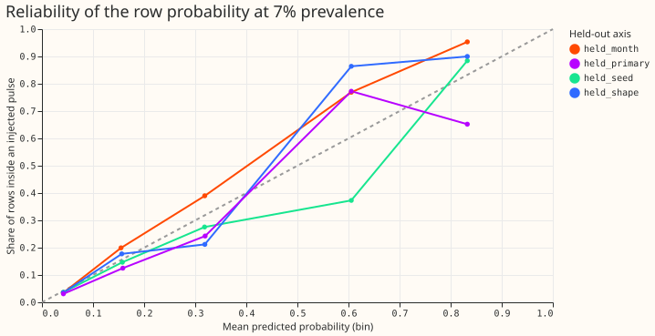
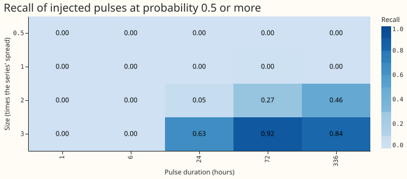
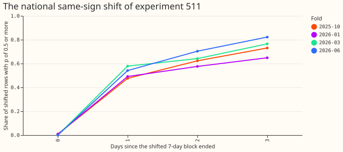
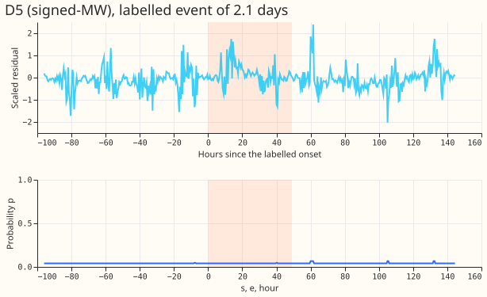
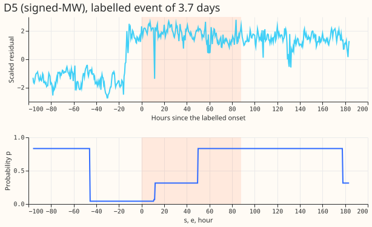
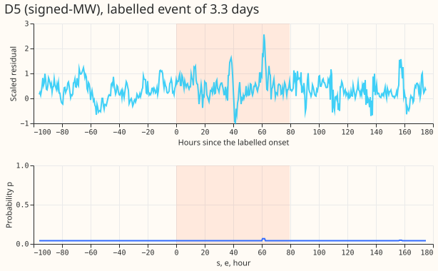
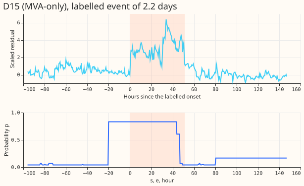
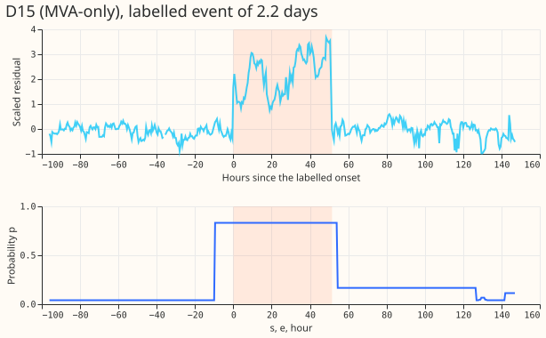
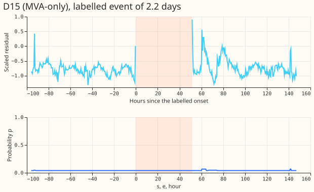

**A calibrated probability of "this half-hour is inside a load-shift event" can be built from four
signals, but it is weak: pulses as large as the series' own spread are found a quarter of the time,
and real rows keep nearly full weight.** The expected calibration error is 0.008 to 0.022 on the
four
held-out axes at 7% of rows inside a pulse, so a probability of 0.3 means about 30%. The recall of
injected pulses of at least 1 times the spread that last at least 6 hours is 0.27, against a
pre-registered 0.8. A Sonnet results review re-derived the headline numbers and agreed with all of
them.

We asked whether a small calibrated classifier, trained on injected pulses and hard negatives and
fed four signals (a step at each end, a return to the earlier level, edges at the same times in
other series, and the symmetry of the sizes), gives each Primary half-hour a probability of sitting
inside a load-shift event, using only data before a refit. The classifier is a depth-3 decision tree
chosen over a logistic regression on validation Brier score (0.0300 against 0.0314). It is
recalibrated per row and prior-shifted to 7% of rows inside a pulse. "The six" are the signed-MW
Primaries D5, D9, D10, D11, D14, and D16; "the eight" are the MVA-only Primaries D2, D3, D4, D8,
D12,
D19, D21, and D22; D15 and D18 are in neither group. The fifth fold of experiment 511 (2025-12) has
no
experiment 507 table and is dropped, so the tables cover 4 folds and 123 daily cutoffs, not 154.
Experiment 510's binary mask of labelled events cost CRPS (+0.079 at the eight, +0.032 at the six)
and could not speak on the leak, so a soft weight is untested; this page does not test it.

Verdict: partly supported. P1 held, P3 held, P4 held for g = 1 and narrowly failed for g = 2, P5
held, and P6 held (trivially, because p is low almost everywhere). P2 failed (recall 0.27 against
0.8)
and P7 failed. The pre-registered hand-off rule stops the tables here, because the recall is under
0.5
and the Brier skill is under 0.20 on two of four held-out axes at 7%; the manager decides.

## Figures

## Results

- **Checks run before any number.** The perturbation check replaced every residual at or after the
  cut with noise and rebuilt the whole chain: the largest difference in p was 0.0 at cutoff days 3,
  10, and 20 of 2026-01 (about 1.78 million rows checked each). A full recompute at the same cutoffs
  changed 863, 1,371, and 2,157 rows older than the 45-day recompute window (under 0.12% of rows).
- **Calibration (row level, 7% prevalence; bootstrap over Primary-months, 300 resamples).** Expected
  calibration error and Brier skill: held-out seeds 0.008 (0.003 to 0.017) and 0.198; months 0.013
  (0.005 to 0.022) and 0.240; shapes 0.014 (0.008 to 0.021) and 0.217; Primaries 0.022 (0.012 to
  0.034) and 0.162. Training worlds 0.012 and validation worlds 0.008 are fit statistics. At 2% (the
  intercept shifted by the change in log-odds) the errors are 0.003 to 0.009 and the skill 0.13,
  0.16,
  0.16, and 0.045 (the last with an interval from -0.05 to 0.11).
- **Recall at p of 0.5 or more, injected grid (2,880 pulses of at least 1 times the spread and 6
  hours).**
  0.27 (0.23 to 0.29); the six 0.22, the eight 0.34. By size: 0.5 times, 0.000; 1 times, 0.001; 2
  times,
  0.16 (0.11 to 0.20); 3 times, 0.48 (0.42 to 0.54). By duration: 1 hour and 6 hours, 0.000; 1 day,
  0.17;
  3 days, 0.30; 14 days, 0.33. Shape makes no difference (0.16, 0.16, and 0.16 for box, circuit, and
  own-shaped). 1,200 pulses per size and 960 per duration.
- **False flags.** On 164 Primary-years of worlds with no injection: 0.14 runs of p of 0.5 or more
  per
  Primary-year (0.08 to 0.20), 2.3 at p of 0.3 or more. The brief's limit of 2 per Primary-year is
  reached at p of 0.3, where recall is lower than the 0.27 above. Experiment 456's 1.74 false steps
  per Primary-year used a daily 7-day scan and does not transfer.
- **Genuine level changes.** Of rows from day 15 after an injected step with no return (196 worlds,
  held-out months), 0.0% reach p of 0.5.
- **Real rows with no labelled event (4 folds, daily cutoffs).** 0.4% to 0.7% of rows have p of 0.5
  or
  more. The mean weight (1 - p)^g is 0.94 for g = 1 and 0.89 to 0.90 for g = 2 (P4 asked for at
  least
  0.90: it held at g = 1 and fell short at g = 2 by 0.002 to 0.006). The Kish effective sample size
  is
  99% of the row count at both g, with recency weights 99% to 100% of the recency-only value. The
  weight is below 0.5 on 0.4% to 0.6% (g = 1) and 2.3% to 2.8% (g = 2) of rows. The floor p of an
  uncovered row (about 0.04 after the 7% prior shift) alone holds the mean weight below 0.96.
- **Labelled events (report only).** The area under the curve of mean p on the labelled events
  against
  matched rows with no labelled event is 0.67 (0.61 to 0.73) for fold 2026-06 (100 events, 500
  matched
  windows, 60 day blocks) and 0.65 (0.59 to 0.71) for fold 2026-03 (99 events); a lower bound.
  Mean p is 0.16 on events and 0.06 on matched windows.
- **D8 and D22 dips (report only).** p stays under 0.5 on all scored rows (10:00 to 15:00 only) of
  D8's 16 unexplained dip days
  (fold 2026-06) and of D22's dip days (9 fall in the window). The dip rows were set to missing in
  every training world, so this check cannot fail; training D8's 22 engine-explained dips
  before 2025-07 as hard negatives makes this expected for D8.
- **Experiment 511's national same-sign shift (extrapolation test; P7 predicted under 30%).** The
  share of shifted rows with p of 0.5 or more is 0.00 to 0.01 on the day the block ends and 0.48 to
  0.58, 0.58 to 0.70, and 0.65 to 0.82 on the following three days (4 folds). The shift is picked up
  only once the return is missing, as an unreturned step.
- **Mask table and thresholds.** Written at p of 0.5 or more, with tier, size, shape correlation,
  open
  flag, and the cutoff it is valid for; thresholds that flag 5% and 7% of unlabelled rows are 0.17
  and
  0.07 to 0.11. Flagging 1% or 2% is not possible (p has a tie plateau at 0.31). SHA-256 sums of the
  tables are in `work/sha256.txt`.

## Checks

- **Reviews.** Sonnet plan review (27 findings; accepted except one, the number of reviews); Sonnet
  code review 1 (12 findings, fixed before any number was read); Sonnet code review 2 (11 findings;
  9
  fixed or answered, and the worlds, classifier, and every table were rebuilt before the numbers
  above;
  not taken: the held-out Primaries still act as partners in every world, which the plan now says);
  results review (re-derived calibration, recall, false flags, weights, and the area under the curve
  with independent code; no disagreement beyond bootstrap noise; no leakage between train,
  validation, and held-out months).
- **Selection history.** A first fit ran before the second review. Its held-out numbers were seen
  (skill 0.14 to 0.18, recall 0.05). The second review's fixes (time-disjoint windows, detectable
  recipients, held-out dip days made missing in every world) changed the worlds, and the classifier
  was refit once with no feature or setting changed. No tuning followed any held-out number.
- **Triggers.** The classifier is a depth-3 tree, so no median-minus-mean forecast check applies; no
  forecast is scored.

## Caveats

- Only the held-out months set is time-disjoint from training; the held-out seeds, shapes, and
  Primaries share real background rows with training worlds. The minimum detectable effect belongs
  to the fine-tune experiment (no
  contrasts here, Bonferroni count 0).
- Calibration is against injected truth. Real residuals hold unlabelled events, so a high-score
  candidate that counts as a false flag may be a real load shift: candidates scoring 6 to 10 noise
  units were injected pulses only 24% of the time.
- NGED's labels are incomplete; the area under the curve is a lower bound and real-event slices
  undercount.
- The classifier runs at each refit and needs the lag-free residual series at that time; weights are
  training-time only.
- Held-out months are 2025-01 to 2025-06 only; July 2026 is unused.

## What to try next

- Raise recall at 2 false flags per Primary-year before using p as a weight: a return-to-level score
  that uses the shape of the step, or a partner signal restricted to neighbours, are the two signals
  not yet exploited.
- If the manager still wants the soft-weight fine-tune, run it with the injected-shift leak as the
  only gate; the real rows would change by about 6% in weight at g = 1.

## Plan (written before any run)

## Question

Experiment 510 masked the NGED-labelled load-shift events from the training rows of the lag-free
demand network and scored 0.079 points of CRPS worse at the eight MVA-only Primaries and 0.032
worse at the six signed-MW Primaries (dropping 6.0% to 7.6% of rows; Bonferroni intervals exclude
zero). Its leak of an injected shift was 6.18 points of capacity against 6.11 without the mask, but
that null holds by construction: the injected shift carries no label, so a label mask cannot touch
it. A binary mask therefore showed a cost for dropping rows and said nothing about the leak. A soft
weight might do better, because a false flag at weight 0.1 costs less than a dropped row. The soft
weight needs a probability that each half-hour sits inside a load-shift event. This experiment
builds
that probability from data before the refit, calibrates it on injected pulses, and freezes it. A
second experiment will then use the frozen tables as weights in a lag-free fine-tune.

## Data and residual series

- **Source.** Experiment 507's lagless mixture tables (`work/lagless_era5_mixture/month=2025-10,
  2026-01, 2026-03, 2026-06`, seed 0; each holds 16 Primaries from 2019-09 to the month's refit as
  `crossfit` rows, then 62 days of `further` rows). The residual of a Primary is the cleaned power
  over effective capacity (experiment 510's `clean_stack`, flagged exact-zero half-hours dropped,
  D15
  and D18 cut before 2025-03-01) minus `q50`. The scaled residual `z` divides by the Primary's
  median band half-width (`q95 - q05`) / 2 over its `crossfit` rows. The spread `s` of a Primary is
  1.4826 times the median absolute deviation of `z` over those rows. At the eight, the series is
  apparent power, so the sign of a shift cannot be recovered across zero (reported by group).
- **Folds and cutoffs.** The four folds are 2025-10, 2026-01, 2026-03, and 2026-06. The fifth fold
  of
  experiment 511 (2025-12) has no 507 table. This experiment drops it and says so. Rebuilding it
  costs 7 fits (GPU) and is left to the fine-tune experiment. The cutoffs are every day at 00:00 UTC
  of each fold month (123 cutoffs: 31 + 31 + 31 + 30); the 25 weekly cutoffs (days 1, 8, 15, 22, 29
  over 5 folds) are a subset, of which 20 exist.
- **Causality.** At the cutoff `c` the detector sees `z` only for half-hours at least 3.5 hours
  before
  `c` (experiment 510's cut). A script perturbs every `z` at or after the cutoff and checks that the
  stored p is unchanged, and prints the check before any other number. Every fold's scale statistics
  (spread, noise scales of the scan) come from the residual history before that fold's refit.
- **Built-in steps.** Each fold table has a junction between `crossfit` and `further` rows and five
  internal edges between the six cross-fit blocks (experiment 507's `leaks.csv` found 1 to 9
  Primaries with a junction jump above the usual q90). Each cross-fit block is centred on its own
  median (history only). The junction is detrended causally at each cutoff
  by matching the median of the first up to 7 observed days after it to the 7 days before, and when
  fewer than 2 days of `further` rows exist the rows after the junction are left out of the
  detector. The report counts the flags that touch a junction or edge (within 1 day).
- **Partner series.** The other 15 Primaries (scaled residuals) and the 4 bulk and grid supply
  points
  (the power minus its median over the same half-hour of the 4 earlier weeks, a causal profile
  difference, because no lagless forecast exists for them).

## The detector

- **Candidate pulses.** For each Primary and each duration `d` in {2, 4, 8, 16, 32, 64, 128, 256,
  512, 672} half-hours (1 hour to 14 days) and each start `a`, compare the mean `z` inside `[a,
  a+d)`
  with the mean in the flank before and the flank after (`f = clip(d, 12, 336)` half-hours each).
  Signal 1 (step) is the size of each edge, scaled by the robust noise of that statistic over the
  fold's history; a ramp of up to 4 half-hours is allowed because the edge is a difference of means.
  Signal 2 (return) is the closed-pulse score `min(|edge_in|, |edge_out|)` with the same sign at
  both edges, and the return ratio `|after - before| / min(|edge_in|, |edge_out|)`. Candidates above
  a low admission score are thinned by greedy suppression of overlapping spans.
- **Open pulses.** A pulse whose end is not yet observed at the cutoff (no flank after, or fewer
  than
  4 half-hours of it) is scored as an open step from its start to the cutoff, for starts within the
  last 672 half-hours. It enters the classifier with an `open` flag, so a step in the last 14 days
  is
  scored high by training, not by hand. A step with no return for 30 days or more has a closed score
  near zero and is reported as "unreturned". It is not masked.
- **Signal 3 (synchrony).** For each candidate, count the partner series with an edge of the
  opposite
  sign within 2 half-hours (1 hour) of its start, of its end, and of both, with the partner edge
  scaled by its own history. Count the same-sign edges too, because a same-sign edge in many series
  at one time is a weather or data artefact. A shifted-date placebo (partner series shifted by 7 to
  60 days) gives the chance rate of the counts.
- **Signal 4 (symmetry).** For a candidate with a synchronised partner, compare the size of the
  donor's change in MW with the sum of the partners' changes in MW (log of the ratio of magnitudes).
  Experiment 459 found a median leak share of 0.53 against a placebo of 0.54, so this is a low-power
  signal, reported against the placebo and never used alone.
- **Shape correlation.** For candidates of 24 half-hours or more, the correlation of the pulse's
  residual with the Primary's own median daily profile over the 28 days before. It is a feature and
  a column of the mask table.
- **Tiers.** Tier A: a candidate with a synchronised partner (both edges) and a symmetry ratio
  inside
  a stated tolerance. Tier B: a single-series pulse. Tier A symmetry is a diagnostic and does not
  gate tier A (the tolerance and the tier shares are reported, not tuned).
- **Classifier.** A logistic regression on the standardised feature set (log score, log duration,
  open flag, return ratio, edge asymmetry, amplitude, counts of opposite-sign and same-sign partner
  edges at start, end, and both, symmetry ratio and its flag, shape correlation) and a depth-3 tree
  on the same features. The choice between them is made on the validation worlds' Brier score. The
  chosen model is recalibrated with a one-variable Platt fit on those validation worlds. No neural
  network. The row probability is the largest candidate probability that covers the row (0 if no
  candidate does). A candidate is a positive if at least half of its rows lie inside an injected
  pulse.

## Series-level injector

Not experiment 507's window-level generator (its pull request has not cleared review). A world is a
60-day window of all 20 series built from real residual history, with a random cutoff inside the
window.

- **Pulses.** Sizes from 0.4 to 3.5 times the donor's spread (log-uniform), durations from 2 to 672
  half-hours (log-uniform), both signs, 1 to 4 per world, with a ramp of up to 4 half-hours at each
  edge. Shapes: constant-MW box, own-demand-shaped, and (held out from training) circuit-profile
  (a random daily profile with morning and evening bumps or an Economy 7 night step).
- **Mirrored pairs.** Half the pulses add the opposite change at 1 or 2 neighbours of the donor
  (from experiment 395's corrected neighbour table), scaled by the capacity ratio and by a leak
  share drawn from 0.3 to 1.2 (experiment 459 measured 0.53). The rest have no mirror (tier B).
- **Real events stay out.** Window starts avoid the labelled events (padded 2 days) of the donor and
  of the neighbours; labelled rows are never injected over and never used as training negatives.
- **Hard negatives.** (a) Genuine level changes: a step with no return, injected at a random time,
  size 0.4 to 3.5 times the spread; (b) D8's 55 engine-explained dip days from experiment 508 that
  fall before 2025-07 (real rows, label 0); (c) step-free surrogates: windows with no injection,
  from months before 2025-07. D22's 13 dip days and D8's 16 unexplained dip days are held out from
  every negative set and from training.
- **Training, validation, and held-out sets.** Residual history ending before 2025-07 for training.
  Training worlds: months 2021-01 to 2024-06, two shapes, seeds 0 to 1999. Validation worlds
  (classifier choice and the Platt fit): months 2024-07 to 2024-12, seeds 2000 to 2499. Held-out
  worlds for calibration, never used to fit or choose anything: (i) held-out shape
  (circuit-profile),
  (ii) held-out seeds (2500 to 2999), (iii) held-out months (2025-01 to 2025-06). Evaluation grids
  for recall use sizes 0.5, 1, 2, and 3 times the spread and durations 1 hour, 6 hours, 1 day, 3
  days,
  and 14 days. Training prevalence about 7% of rows inside a pulse (the labelled share with the
  pad); calibration is also reported at about 2%.
- **The national same-sign shift of experiment 511.** The fine-tune experiment applies it to all 16
  Primaries at once with one sign, so signals 3 and 4 are silent and the size lies outside the
  classifier's training range. This experiment evaluates p on that world and reads it as an
  extrapolation test (what share of the shifted rows receives p of at least 0.5).

## Outputs, frozen before any fine-tune score is read

- Per fold and cutoff, a float32 array of p over (Primary, target index) for the 730 days before the
  cutoff, keyed by (Primary, target_idx). Only the last 30 days before each cutoff are recomputed;
  older rows are taken from the previous cutoff's table, which saw at least 29 days after them. The
  first cutoff of a fold computes the whole history.
- The mask table (Primary, start, end, tier, size, shape correlation, open flag, and the cutoff it
  is
  valid for) at p of at least 0.5.
- The classifier, the feature scalers, the thresholds, and the freeze commit, written to the private
  folder; a file of SHA-256 sums of the p tables.

## Reports

- **Calibration.** Reliability curve, Brier score, and expected calibration error per row and per
  candidate, on training worlds (a fit statistic), validation worlds, and each held-out axis, at
  prevalences of about 7% and 2%.
- **Injected recall and false flags.** By size, duration, shape, and tier, with bootstrap intervals
  over Primary-months and the replicate counts as numbers. Genuine level changes called pulses.
- **Real rows.** Share of rows with p of at least 0.5 on rows with no labelled event, per
  Primary-year, by tier; the Kish effective sample size `(sum w)^2 / sum w^2` of `w = (1 - p)^g`
  (g = 1 and 2, floor 0.1) with and without p over experiment 511's training windows; the share of
  the unlabelled rows whose weight falls under 0.5.
- **Report only, after the freeze.** Area under the curve of p on the 184 labelled rows against
  matched rows with no labelled event (day-block bootstrap), and p on the 34 events with a measured
  deviation. NGED's labels are incomplete, so the matched rows hold unlabelled events and the area
  is a lower bound. D8 and D22 dip weights.
- **Group split.** At the eight the sign of a shift is not recoverable across zero; every figure is
  reported for the six and for the eight.

## Compute and cost

CPU only, at most 2 cores, one process per core, `OMP_NUM_THREADS=1`. The scan is vectorised by
cumulative sums. The whole run is expected to take about 1 to 3 hours; the first fold's time is
reported to the manager. Memory under 8 GB.

## Standing practices followed

Cleaned data and the D15 and D18 cut before 2025-03-01; no model fitted other than the
logistic regression and the tree; July 2026 unused; titles say "load-shift", never "switching";
NGED's labels are called incomplete ("rows with no labelled event"); no generator time series is
shown. The earlier results the plan follows: experiments 510 (a label mask costs CRPS and cannot
speak on an unlabelled leak) and 511 (the baseline cadence, daily, and its leak by block age), and
the earlier detector results of experiments 217, 302, 295, 332, and 392. Serving dependency: the
weights are training-time only and the classifier runs at each refit, not at serving, but
production would still need the lag-free residual series available at each refit.

## Implementation details (deleted when this ships)

Code in `ml-experiments/00514-load-shift-probability-detector-and-calibration/`: `e00514_data.py`
(residual and partner series, junction detrending, labels), `e00514_detect.py` (scan, candidates,
features), `e00514_inject.py` (series-level injector), `e00514_train.py` (worlds, classifier,
calibration), `e00514_tables.py` (the p tables, the causality check, real-row reports),
`e00514_report.py` (figures, numbers).

## Amendments after the plan review (Sonnet, 27 findings; accepted unless noted)

- **Causality.** All detrending, scale statistics, and noise scales use only half-hours at least
  3.5 hours before the cutoff. The perturbation check recomputes the whole chain (detrend,
  candidates,
  cached rows) with every later `z` replaced and compares p, for the cached rows too. Cached rows
  are
  valid because the previous cutoff computed them with strictly less data. The recompute window is
  45 days (a 14-day pulse, a 14-day flank, and margin), and a measured check reports how many p
  values older than the window would change with a full recompute.
- **Scale statistics.** For injected worlds the spread and noise scales come from the world's own
  history before its cutoff. Months 2025-10 to 2026-06 are only scored, never trained or validated
  on.
  Months 2025-01 to 2025-06 are used only as the held-out-month axis.
- **Held-out axes.** Four axes: held-out shape (circuit-profile), held-out seeds (a weak axis, said
  so), held-out months, and held-out Primaries (Primary indices 3, 8, and 13, excluded from every
  training and validation world). The resampling unit is the Primary-month on each axis.
- **World mixture.** Of the training worlds, 45% hold only pulses, 25% add a genuine level change,
  10% are windows around D8 engine dips before 2025-07, and 20% hold no injection. Prevalence near
  7% comes from the pulse count; the 2% reading subsamples pulses, and the intercept is shifted by
  the
  log-odds change in prevalence (a prior-shift correction, not a separate Platt fit); P1 uses both
  readings.
- **Labels and matching.** An injected pulse matches its highest-overlap candidate; other candidates
  overlapping it by under half their rows are negatives, and greedy suppression (a candidate that
  overlaps an already-kept one by more than half is dropped) prevents duplicates. An open genuine
  level change is labelled 0 in training, an open injected pulse 1, so the prior for an open step is
  the share of each in the mixture (reported).
- **Numbers fixed from the training worlds before any held-out number is read.** Admission score 2.5
  noise units; flank clip 12 to 336 half-hours; symmetry tolerance a donor-to-partner magnitude
  ratio
  between 1/2.5 and 2.5; partner edge thresholds 3 and 5 noise units. Pulses per grid cell of the
  recall tables: at least 100 (sizes 4 x durations 5 x shapes 3 x signs 2, sixteen Primaries).
- **Group of eight.** Signal 3 uses the sign of the apparent-power change as recorded; the feature
  set also carries sign-free counts, and every figure is reported for the six signed-MW Primaries
  and
  the eight MVA-only Primaries separately.
- **Fold consequence.** The fine-tune experiment either rebuilds the 2025-12 table (7 GPU fits) or
  runs four folds (123 daily cutoffs, not 154).
- **Mask tables.** Written at p of at least 0.5 and at the thresholds giving 1%, 2%, 5%, and 7% of
  rows flagged. No contrasts are run here; the minimum detectable effect belongs to the fine-tune
  experiment. Interim numbers are labelled interim and unaudited.
- **D8 and D22 dips.** The dip days after 2025-07 are not in any training set by date; those before
  2025-07 are held out explicitly (D22's 13 and D8's 16 unexplained), and the report says how many
  of
  each fall on each side.
- **Reports to the manager** at plan PR open (done), code review done, results, and merge, with the
  timed first fold.
- **Not taken.** Reducing the number of reviews (finding 26): the plan keeps them.
- **Code review (Sonnet, 12 findings).** Fixed before any number was read: dip worlds now evaluate
  D8
  (Primary index 4) and respect each set's months; held-out dip days are excluded from every world;
  worlds containing a labelled event (padded) in the donor, a recipient, or the extra series are
  rejected; recipients without data are skipped; D15 and D18 are never partners (in training and in
  the tables alike); "own" pulses use a profile one week older than the feature's shape profile;
  fold statistics use rows below the refit minus the 3.5-hour cut; recall-grid pulses always have an
  observed after-flank; the held-out-Primary axis scores donors only; uncovered rows are marked -1,
  not 0; the mask table uses the calibrated probability and carries tier, size, shape correlation,
  open flag, and cutoff; the training and validation reports are labelled fit statistics and P3 is
  read on held-out months only. Counts: D22 has 12 dip days with a date in the stored table (the
  plan
  said 13), and 22 of D8's 55 explained dip days fall before 2025-07.
