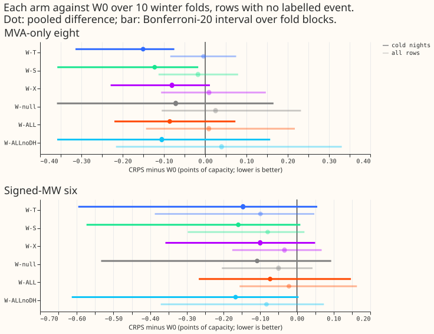
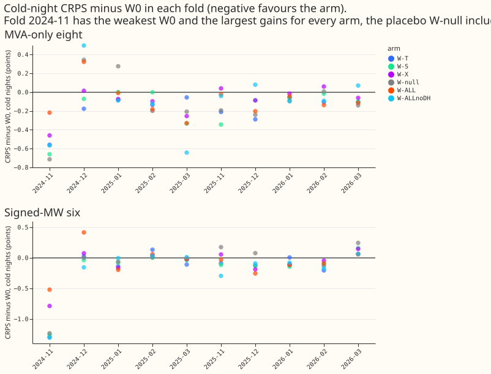
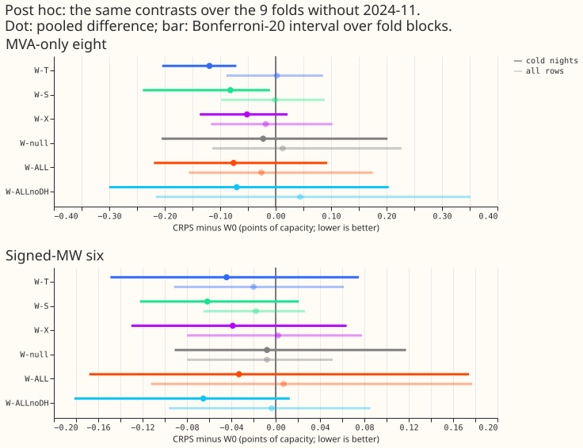

**Take-home: trailing temperature windows may help the lag-free demand network a little on cold
nights at the eight MVA-only Primaries, but this experiment cannot tell the real windows from a
shuffled-day placebo, so the verdict is "not resolved".**

- **Arms.** W0 is the base lag-free neural network with 37 input columns. W-T adds trailing
  temperature means over 6, 24, and 72 hours. W-S adds trailing shortwave-radiation means. W-X adds
  the product of the 24-hour temperature (minus 15.5 °C) and the 24-hour shortwave. W-ALL combines
  all of these with W-DH (heating and cooling degree-hours), and "W-ALL minus W-DH" drops W-DH.
  **W-null is the placebo:** it gives every row the windows of a randomly drawn other day of the same
  month and day type. W-seam builds W-T differently before the forecast origin. W-CNN is a later
  pull request with learned windows.
- **Seed spread alone limits what this experiment can detect.** The minimum detectable effect (the
  smallest difference in the continuous ranked probability score, CRPS, that seed spread alone would
  resolve) is 0.34 points of effective capacity on all rows and 0.48 on cold nights for one fold
  with 3 seeds. Pooled over 10 folds the seed-only figure is about 0.11 and 0.15, and fold-to-fold
  variation widens the intervals further. W0 scores 5.40 (all rows) and 4.67 (cold nights) at the
  eight MVA-only Primaries, and 4.16 and 3.44 at the six signed-MW Primaries (those whose metered
  power carries a sign). A lower score is better.
- **At the eight MVA-only Primaries, only W-T and W-S beat W0 on cold nights, and the placebo gains
  almost as much.** Cold nights are half-hours below 5 °C between 18:00 and 08:00 local time. The
  contrast is arm minus W0 (negative favours the arm), with a Bonferroni interval corrected for 20
  comparisons, and the count is of negative folds out of 10:
    - W-T: -0.150 [-0.314, -0.075], 10 of 10. W-S: -0.122 [-0.358, -0.017], 9 of 10.
    - W-X -0.081, W-ALL -0.086, and W-ALL minus W-DH -0.105 include zero.
    - W-null: -0.071. W-T minus W-null is -0.079 [-0.290, +0.089], so the real windows do not
      resolve from the placebo.
- **At the six signed-MW Primaries, no window resolves on cold nights.** W-T is -0.147
  [-0.596, +0.055], W-S -0.160 [-0.574, +0.009], W-ALL minus W-DH -0.167 [-0.614, +0.004], and
  W-null -0.108.
- **On all rows nothing resolves.** W-T is -0.004 at the eight and -0.099 at the six.
- **One fold, 2024-11, supplies part of every gain, because W0 scores badly there.** Every arm,
  the placebo included, gains 0.46 to 1.29 points in that fold
  ([Figure 2](figure_2_per_fold.svg)). A **post hoc** check, chosen after seeing the per-fold
  table, leaves 2024-11 out ([Figure 3](figure_3_leave_out_2024_11.svg)). At the eight, W-T then
  keeps about 80% of its gain: -0.119 [-0.205, -0.071] in 9 of 9 folds, while W-null falls to
  -0.023. At the six, W-T falls to -0.044 and W-S to -0.062 [-0.122, +0.021].
- **In the tails the placebo gains as much as W-T.** On cold nights at the eight, W-T lowers q95
  pinball loss by 0.043 and q99 by 0.023, and the placebo lowers them by 0.038 and 0.024. The share
  of observations below the q95 and q99 forecasts (coverage) was not saved in the report, so it is
  not quoted.
- **Combining windows did not help.** W-ALL (-0.086) did no better than W-T alone (-0.150), which
  suggests that each extra column adds noise as well as signal.

## Predictions

- **P1 (W-T, cold nights, eight: gain of at least 0.05):** passes on the point estimate (gain
  0.150), but not against the placebo.
- **P2 (W-S, six: gain on cold sunny days exceeds gain on cold overcast days by at least 0.05):**
  passes on the point estimate (cold-sunny contrast -0.065, cold-overcast contrast +0.178), with both
  intervals spanning zero.
- **P3 (W-X: negative on sunny slices, within +0.02 on all rows):** winter folds contain no
  warm-sunny or warm-overcast rows, so P3 cannot be tested. The cold-sunny clause is unresolved.
- **P4 (W-null inside plus or minus the minimum detectable effect):** passes only because the test
  cannot fail. The cold-night minimum detectable effect (0.48) is far wider than the placebo gain
  (-0.071).
- **P5 (W-seam within plus or minus 0.02 of W-T, all rows):** fails, at +0.025 (eight) and +0.023
  (six). The cold-night values (+0.019, +0.016) are inside.
- **Stop rule:** W-T and W-S met the condition for continuing at the eight, so W-ALL and W-ALL minus
  W-DH ran. Neither W-ALL nor W-ALL minus W-DH beat W-T.

## Checks and caveats

- **Three audit triggers fired:** the placebo gained, W-ALL did worse than its nested arm W-T, and
  the minimum detectable effect was wider than the plan expected. The median-minus-mean forecast
  check and the mean-forecast error beside each quantile-score contrast were not run.
- **The placebo takes 88 to 100% of W-T's tail gains,** and W-T minus W-null is negative in only 5
  of 10 folds at the eight.
- **W0 for 2025-12, 2026-01, and 2026-03 is reused from experiment 513's `P0`.** W0 is fitted here
  for the other 7 folds.
- **Warm slices are empty,** so no claim covers warm days.
- **Example probabilistic forecast graphs were not drawn** in this experiment.
- **A 6-hour window holds only two distinct ensemble samples on day 1 and one beyond day 6.**
- **Event labels are incomplete,** so clean rows may hold unlabelled events and counts are lower
  bounds.

## What to try next

- Repeat W-T against W-null with more seeds, and with a stronger W0 in 2024-11, before building the
  convolutional-network version of the windows (W-CNN) on W-T.
- The temperature windows would be a candidate for the six signed-MW Primaries only after a run that
  resolves the placebo.

## Plan (written before any fit that produced a quoted number)

### Question

The lag-free demand network (37 input columns plus an 8-wide embedding of the Primary) sees the
weather only at the valid time. We ask whether it forecasts better when it also sees the weather of
the previous hours. The maintainer's argument is that every earlier neural test of trailing,
forward, or daily-mean weather fed the network three origin lags of power, so those nulls may not
transfer. Among the merged result pages searched for the brief, the only lag-free test of trailing
temperature is experiment 6 (XGBoost, with a 0.1-point floor), and none tested a trailing shortwave
window or a temperature-by-shortwave product in a lag-free neural network.

This pull request holds the **core arms** (W-T, W-S, W-X, W-null, and the seam control W-seam).
The learned-window arms (W-CNN) are a separate later pull request. W-ALL, and W-DH as a drop-one
inside W-ALL, run here only if the stop rule passes.

### Arms

Every arm adds columns to the 37 and is re-pretrained from scratch with them, using one loop for
all arms (experiment 513's `P0` loop). The pretrained weights of experiment 448 do not load, and no
new column is zero-initialised.

| Arm | Added columns | What it tests |
|---|---|---|
| W0 | none | The control (experiment 513's `P0`, reused for three folds). |
| W-T | Means of temperature over the 6, 24, and 72 hours ending at the valid time (3 columns). | Thermal lag. |
| W-S | Means of shortwave over the 6 and 24 hours ending at the valid time, and over the 24 hours ending 24 hours before the valid time (3 columns). | Stored solar gain. |
| W-X | One column: (24-hour mean temperature minus 15.5 °C) times the 24-hour mean shortwave. | Cold-sunny and warm-sunny against cold-dull and warm-overcast. |
| W-null | The 9 columns of W-ALL (W-T, W-S, W-X, and the two degree-hour columns) taken from a shuffled other day. | A gain from nine extra columns alone. |
| W-seam | W-T built with persistence fill before the forecast origin instead of the previous run's ensemble mean. | Whether the seam, not the physics, drives W-T. |
| W-ALL, W-ALL minus W-DH | Conditional on the stop rule. W-DH is heating degree-hours below 15.5 °C and cooling degree-hours above 20 °C accumulated over 24 hours (2 columns). | Whether the arms add up, and whether W-DH is needed. |

The valid-time product of temperature and shortwave is dropped: the network can learn it from two
existing columns.

### How a window is built

- **One rule at every lead (maintainer, 2026-11-02).** Every window is built on the half-hourly
  weather series that the stored ensemble summaries already are, with no lead-dependent definitions.
  The ensemble mean is a linear interpolation of 3-hourly steps to 144 hours and of 6-hourly steps
  from 144 to 360 hours, so a 6-hour window holds only two distinct samples on day 1 and one beyond
  day 6. The write-up says so beside every result.
- **Ensemble rows (fine-tuning and scoring).** A row belongs to a run with origin `O` (09:00 UTC).
  For half-hours after `O` the series is that run's ensemble mean. For half-hours at or before `O`
  it is the "analysis proxy" of experiment 437: the first day of the freshest earlier run that
  covers that half-hour (leads of about 9.5 to 33.5 hours). No later run is used. The proxy is
  available at serving, because every earlier run was published by `O`. The 72-hour window reaches
  back three days, so it uses up to three earlier runs. The module is copied from experiment 437's
  `e00437_features.py` with the new columns added, and its check, which rebuilds sampled runs with
  every later run deleted and requires the same result, is re-run on the new columns, because the
  original covers only the 22 columns of experiment 437.
- **Training rows (pretraining on ERA5 and CAMS).** ERA5 temperature is the `:00` rows of the
  half-hourly `era5_features.parquet` (the `:30` rows are interpolation and contain the next hour),
  and shortwave is the hourly CAMS file with its hour-end stamps. Both are subsampled to the
  ensemble's step grid, at 3-hourly UTC stamps for half-hours up to 144 hours after the run's 00 UTC
  start and at 6-hourly stamps after that, and then linearly interpolated to half-hours. A
  pretraining row's pseudo-run is experiment 418's: its origin is 09:00 UTC and its start is 9 hours
  earlier, and that start decides where the step grid changes. Before the first fit, the code check
  compares the stored ensemble shortwave step with the CAMS hour-end value; if the ensemble step is
  a mean over the preceding step, CAMS is averaged over the preceding 3 or 6 hours before
  interpolation. The pretraining windows are therefore as smooth as the serving windows, and the
  grid change follows the lead of the window's half-hour, not the lead of the valid time.
- **Missing earlier runs.** A window silently shortens when an earlier run is missing. Each row
  carries a degradation count, `diag_missed_runs`: the number of the three days before the origin
  whose run is absent. It is a scoring diagnostic, never a network input. The scorer reports the
  share of rows with a non-zero count by horizon band. Windows at the start of the ensemble history
  (April 2024) are truncated to what exists and flagged.
- **Calibration of the ensemble level.** The 2 K level offsets between the ensemble mean and ERA5
  are not corrected in the core arms. Arms that pass the stop rule get the noise arm of the brief
  (below).
- **Scoring uses ensemble windows built exactly as at serving**, never ERA5 windows. A gain that
  exists with ERA5 windows but not with ensemble windows does not count.
- **Standardisation.** Each new column is standardised with the mean and standard deviation of the
  fold's ensemble fine-tuning rows that are not held out for early stopping, in the pretraining,
  fine-tuning, and scoring stages alike, so a test month never sets its own scale. W-null takes the
  donor's raw values and applies the same scale as W-ALL, so it has the real columns' distribution.
  The ERA5 windows are smoother and offset from the ensemble windows by up to 2 K; this offset is
  the mismatch that the conditional noise arm addresses.

### Placebo and seam control

- **W-null.** For each local valid day (Europe/London midnight to midnight), a seeded draw (`seed =
  515`) picks another valid day of the same calendar month, the same day type (Monday to Friday,
  Saturday, Sunday), and the same length in half-hours (46, 48, or 50, so a clock-change day matches
  only another clock-change day), at least 3 days away so that persistent weather cannot make the
  donor informative, without replacement, and from the same side of the fold's refit (training rows
  take donors that start before the refit, scored rows take donors from days after the refit (the
  later side), within the ensemble period). The row takes the nine window columns of the donor day
  at the same half-hour of day and the same lead: its origin and valid time both move by the
  whole-day shift between the two days, so an ensemble row takes the donor shift's run, and an ERA5
  row builds the columns at the shifted origin and valid time. If the donor's run is missing the row
  takes the next donor in the seeded order. The number of rows with no donor is printed, and those
  rows take the column means. The same draw serves training and scoring.
- **W-seam.** Persistence fill holds the run's first value (the value at its first half-hour after
  `O`) for every half-hour at or before `O`. W-seam shares W-T's pretrained weights, because ERA5
  windows have no seam, so it adds 30 fine-tunes and no pretrains. P5 uses a contrast of the two
  builds' 3-seed mean quantiles on common rows, with per-seed contrasts alongside, because the 0.02
  limit sits below the minimum detectable effect.

### Folds, seeds, and the minimum detectable effect

- **Folds.** Ten winter months (the "10 winter folds"): 2024-11, 2024-12, 2025-01, 2025-02, 2025-03,
  2025-11, 2025-12, 2026-01, 2026-02, and 2026-03. Ensemble summaries exist for every daily run from
  2024-04-01 to 2026-06-30. The five early months have 7 to 11 months of ensemble fine-tuning, no
  `L0PT` pretrained weights, and no D15 or D18 (their cut is 2025-03-01; report-only). 2025-11 and
  2026-02 need new pretrains. Experiment 437 scored 2025-10, 2025-12, 2026-01, and 2026-03, and
  experiment 442 added 2025-11 and 2026-02, so four of the ten months were read before this
  question; the five early months and the exact weather windows are new. Seeds 0, 1, and 2. July
  2026 is unused. Christmas week is inside 2024-12 and 2025-12.
- **Control reuse.** Experiment 513's `P0` weights and forecasts give W0 for 2025-12, 2026-01, and
  2026-03, because `P0` is the same network, loop, rows, and seeds. W0 is fitted here for the other
  seven folds.
- **Minimum detectable effect.** Stated first, from the seed spread of the base and the null arm
  over the ten folds, before any contrast is read (`e00515_score.py baseline`). References from
  earlier experiments: 0.13 at the eight and 0.10 at the six on all rows, and 0.034 at the eight and
  0.085 at the six on cold nights in 2026-01 alone (a lower bound), all at 3 seeds. The limits of
  0.05 and 0.03 are at or below the minimum detectable effect on all rows, so a pass at those limits
  reads "not shown worse", and only the pooled ten-month cold-night slice can resolve them.
- **Intervals.** Month-block bootstrap over ten folds, with the fold count printed beside every
  interval and the sign per fold beside it. Few blocks give near min-to-max intervals.

### Scoring

- **Rows and groups.** Rows with no labelled event, leads up to 240 hours, cleaned data, the D15
  and D18 start cut, and the eight MVA-only Primaries and six signed-MW Primaries as the gating
  groups. D15 and D18 are report-only. Experiment 470's row set covers only five months, so this
  experiment builds its own, `experiment_515_winter_v1`: every forecast row of the ten months whose
  actual is cleaned power with no labelled event, that every scored arm holds. The row counts per
  fold and group are printed.
- **Widening.** Forecast quantiles are scored raw and widened by 1.15, as experiment 510 does. The
  widening is a fixed table for every arm.
- **Slices (pre-registered).** All rows; cold nights (temperature below 5 °C, 18:00 to 08:00); cold
  sunny, cold overcast, warm sunny, and warm overcast days, with experiment 441's definitions
  extended to warm days (a local day's mean temperature of at least 15.5 °C); slice membership comes
  from the stored ensemble mean at the valid time, which no arm edits, never from an arm's own
  columns; Christmas week; horizon bands day 1, days 2 to 3, and days 4 to 10. Tail results are q95
  and q99 pinball loss and coverage on cold nights beside CRPS (experiment 441 found signed-six
  cold-night coverage of 76% and 83%).
- **Bonferroni count.** The primary family is **20** tests: 5 hand-built arms (W-T, W-S, W-X, W-ALL,
  W-ALL minus W-DH) times 2 groups times 2 slices (all rows, cold nights). The core arms contribute
  12 of them (3 arms times 2 groups times 2 slices); intervals use 20 throughout so arms that run
  later do not change an interval. The **reported family** is **84** tests: 7 arms times 2 groups
  times 4 slices (all rows, cold nights, cold sunny, cold overcast) is 56 CRPS tests, plus 28 q95
  and q99 cold-night tests. Both numbers are printed by the scorer.
- **Quoted earlier effects.** Experiment 437's -0.022 at the eight is all rows. The -0.099 is
  experiment 441's cold-night figure (inconclusive, 2 of 3 folds). Experiment 442 gave -0.014 at the
  eight and -0.086 at the six (D16 drives it).

### Pre-registered rules

- **Stop rule.** Continue to W-ALL and W-ALL minus W-DH if a Bonferroni interval of a core arm
  against W0 excludes zero at either group and its point estimate is at least 0.03 points better.
  Otherwise stop and report "not resolved". W-CNN does not wait for this rule.
- **Noise arm (conditional).** Only for an arm that passes. The noise has one level per window
  column and lead band: the root mean square of (ensemble window minus ERA5 window) over the
  training window before the refit, temporally coherent (independent noise averages out in a 24-hour
  mean). The level offset between ensemble and ERA5 is one offset per column and lead band, fitted
  on data before the refit and never on the scored month.
- **What counts.** A gain counts through CRPS at both groups and through the cold-night tail
  slices, not through a feature's importance. A simple hand-built window that passes is preferred
  to W-CNN for the first release.

### Folds, fit count, and cost

- **Fit count.** Pretrainings: 4 core arms (W-T, W-S, W-X, W-null) times 10 folds times 3 seeds is
  120, plus W0 on 7 folds times 3 seeds is 21, so **141 pretrainings**. Fine-tunes: the same 141,
  plus 30 for W-seam, so **171 fine-tunes**. W-ALL and W-ALL minus W-DH, if they run, add 60
  pretrainings and 60 fine-tunes. The noise arm adds pretrains only for passing arms.
- **Cost.** To be timed on the first arm and reported to the manager before the remaining fits. The
  estimate from experiment 513's logs (pretrain 18 to 24 s, fine-tune 3 to 6 s, rows 13 s per fold)
  is 0.9 to 1.4 GPU-hours for the core fits, plus building the window columns (not yet timed). One
  GPU process under 8 GB, with `MemoryMax=8G` and `OMP_NUM_THREADS=1`; launches are staggered
  against the other workers' GPU jobs.

### Departures from the brief

- The brief's five anchor folds of experiment 513's `P0` reduce to 3 here (2025-12, 2026-01,
  2026-03), because 2025-10 and 2026-06 are not winter months. W0 is fitted for the other 7 folds.
- Experiment 513's `P0` comes from its branch `price-shape-privileged-input`, whose commit is
  recorded in the pull request before the reuse. Fits start after experiments 511 and 513 Part 1 are
  scored, which has happened.
- W-DH has no prediction of its own, because it runs only as a drop-one inside W-ALL.
- The cost estimate is lower than the brief's 1.2 to 2.6 GPU-hours because it uses experiment 513's
  measured pretrain time (18 to 24 s) at 141 pretrainings; the brief assumed longer fits.
- The minimum detectable effect comes from seed spread; the fold-to-fold term enters through the
  month-block bootstrap, and the page states both.
- The month-block bootstrap resamples the 10 folds with each fold's 3-seed mean (seed-paired), at
  the Bonferroni level 0.05 / (2 x 20) per tail. With 10 blocks the interval approaches min-to-max.
- Charts show per-fold gains, cold-night and sunny slices, in the OCF palette with no mark in the
  background colour; metered generators are not scored (substations only).
- The reported family of 84 tests counts 7 arms: W-T, W-S, W-X, W-ALL, W-ALL minus W-DH, and the
  two W-CNN variants of the later pull request. The scorer prints 84; this pull request runs at most
  5 of those arms. P4 and P5 are descriptive tests outside both families.

### Standing practices followed

Cleaned data and the D15 and D18 start cut; rows with no labelled event; July 2026 unused; no
XGBoost work; metered generators are not shown (substations only); titles say "load-shift", never
"switching"; the Plan, a fresh Sonnet code review before the first fit that produces quoted numbers,
and Sonnet reviews of the results and the write-up follow the `ml-experiment` skill.
