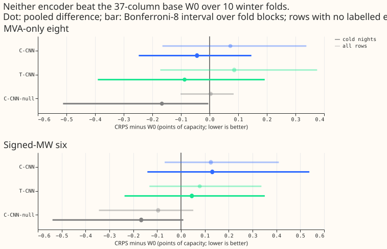
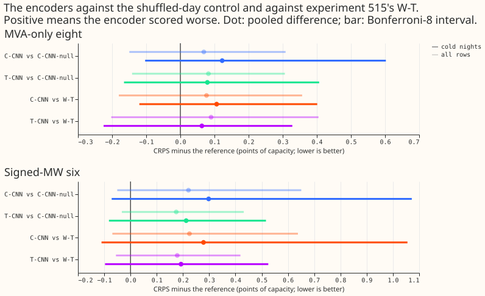
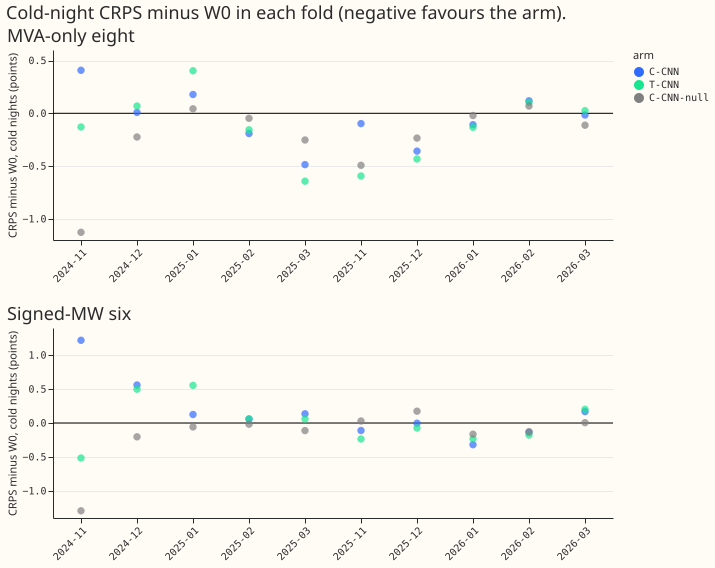

**Take-home: a learned 24-hour weather window did not help the lag-free demand network, and the
hand-built trailing windows of experiment 515 remain the only window input with any sign of a gain
(on cold nights at the eight MVA-only Primaries, itself unresolved against a shuffled-day
placebo).** Both encoders scored worse than the 37-column base on all rows. The encoder that read
real windows scored numerically worse than the same encoder reading shuffled-day windows, but the
interval includes zero. The next step is to stop spending fits on learned windows and to resolve
experiment 515's placebo question first.

We asked whether a one-dimensional convolutional encoder over the seven ensemble-mean weather
variables (shortwave, longwave, temperature, dew point, surface pressure, precipitation, and 10 m
wind speed) at 48 half-hourly positions improves the lag-free demand network. The folds, seeds,
rows, slices, bootstrap, and base forecasts are experiment 515's. Contrasts are arm minus W0 in
points of CRPS (negative favours the arm), with a Bonferroni-8 interval over fold blocks (10
blocks). "The eight" are the eight Primaries that report only apparent power (MVA); "the six" are
the six that report signed megawatts. W0 is experiment 515's 37-column base, and W-T, W-S, and W-X
are experiment 515's hand-built trailing temperature, shortwave, and temperature-by-shortwave
windows.

## Results

- **Arms.** C-CNN reads the window centred on the valid time (12 h before to 11.5 h after). T-CNN
  reads the 24 h ending at the valid time. C-CNN-null is C-CNN reading the window of a shuffled
  other day (experiment 515's placebo rule). Each encoder is two strided convolutions (16 and 32
  channels, kernel 5), flattened into an 8-number vector that joins the 37 columns. Every arm is
  pretrained afresh on ERA5 and CAMS rows and fine-tuned on ensemble rows, with 3 seeds on 10 winter
  folds (90 pretrains, 90 fine-tunes).
- **Scoring windows are built as at serving.** Windows read the half-hourly series, which is a
  linear interpolation of the ensemble's 3-hourly steps to 144 h and 6-hourly steps after, so
  nothing is finer than 3 h on day 1 and nothing finer than 6 h beyond day 6. ERA5 windows used in
  pretraining are subsampled to the same step grid and then interpolated.
- **Minimum detectable effect from seed spread alone, 3-seed mean:** 0.26 (eight) and 0.34 (six)
  on all rows and 0.37 and 0.49 on cold nights for one fold. Pooled over the 10 folds the
  seed-only figures are 0.08 and 0.11 on all rows and 0.12 and 0.15 on cold nights. The
  fold-block intervals are about 0.5 points wide, which is the larger limit: this experiment cannot
  resolve a gain of 0.03 to 0.10.
- **All rows.** C-CNN: +0.072 [-0.165, +0.338] at the eight (3 of 10 folds negative) and +0.125
  [-0.068, +0.410] at the six (4 of 10). T-CNN: +0.086 [-0.172, +0.376] (6 of 10) and +0.079
  [-0.132, +0.337] (5 of 10).
- **Cold nights.** C-CNN: -0.044 [-0.248, +0.146] at the eight (6 of 10) and +0.131 [-0.141, +0.538]
  at the six (4 of 10). T-CNN: -0.087 [-0.391, +0.193] and +0.046 [-0.237, +0.351].
- **Cold sunny days at the six are worse with the centred encoder.** C-CNN is +0.430 [+0.025,
  +1.066] (3 of 10 folds negative) and T-CNN +0.250 [+0.091, +0.557] (1 of 10). These intervals are
  at the Bonferroni-8 level and exclude zero, but the slice is exploratory, not in the 8 primary
  tests, and not corrected for the full reported family.
- **Against experiment 515's hand-built windows, the encoders are no better.** C-CNN minus W-T is
  +0.077 [-0.180, +0.357] at the eight and +0.225 [-0.069, +0.638] at the six on all rows. T-CNN
  minus W-T is +0.090 and +0.178. The 0.03 margin for "learned beats hand-built" is not met.
- **The shuffled-day control scored numerically better than the real windows, unresolved.**
  C-CNN-null minus W0 is +0.004 [-0.102, +0.084] at the eight and -0.096 [-0.344, +0.052] at the six
  on all rows, and -0.167 [-0.512, -0.004] and -0.167 [-0.539, +0.010] on cold nights. C-CNN minus
  C-CNN-null is +0.069 [-0.149, +0.308] and +0.221 [-0.050, +0.651] on all rows. A control that
  reads no information about the day scored 0.17 points better than the base on cold nights, with an
  interval that excludes zero at the eight. That shows the control's own variation is large; the
  cause (seed spread, or the extra inputs changing the pretrained weights) is not identified.
- **Tails.** On cold nights, C-CNN changes q95 pinball loss by -0.018 (eight) and +0.059 (six), and
  q99 by -0.012 and +0.045; coverage moves by at most 0.008, all intervals include zero. T-CNN
  changes q95 by -0.037 and -0.034.
- **Horizon bands.** No band resolves: at days 4 to 10, C-CNN is +0.060 (eight) and +0.128 (six).
- **Absolute CRPS (points of capacity), all rows and cold nights.** W0: 5.40 and 4.67 at the eight,
  4.16 and 3.44 at the six. C-CNN: 5.47 and 4.63, 4.29 and 3.57. T-CNN: 5.49 and 4.58, 4.24 and
  3.49.

## Predictions

- **P1 (C-CNN vs W0, -0.08 to +0.02 at both groups on all rows):** fails at the six (+0.125); at
  the eight (+0.072) the loss is above +0.02 too, so P1 fails at both groups.
- **P2 (C-CNN beats T-CNN by under 0.03):** C-CNN minus T-CNN is -0.014 at the eight and +0.046 at
  the six, so P2 holds there. At the six the gap has the opposite sign (C-CNN worse), which P2 did
  not anticipate, so P2 is not supported at the six.
- **P3 (best CNN beats best hand-built arm by under 0.03):** passes, because the CNN arms are worse.
- **P4 (C-CNN-null within the minimum detectable effect of the base):** passes on all rows and cold
  nights, against the one-fold figure (0.26 to 0.49), as in experiment 515, but only because that
  figure is wide. Against the pooled figure (0.12 and 0.15 on cold nights) the control's -0.167
  would fail P4.

## Checks and caveats

- **Weather inputs come from runs issued at or before the origin.** `e00516_leak_check.py` rebuilt
  144,000 window positions (3,000 test rows of 2025-12 x 48 positions) from the stored summaries.
  Every position after the origin came from the row's own run and every position at or before it
  from an earlier run's first day; the largest source-run origin minus row origin was 0 half-hours,
  and values agreed to 1.1e-5 (float32). Example row: Primary index 4, origin grid index 109746,
  valid grid index 109977.
- **Windows with a missing source are filled with the training mean (0 after standardising).** The
  check zero-filled any position whose source row was absent and asserted that fill; it does not
  print how many positions that was. Placebo rows with no donor day keep their own window: 10,752
  to 19,068 rows per fold across pretraining, fine-tuning, and test tables.
- **ERA5 windows differ from ensemble windows.** On fine-tuning rows, ERA5 minus ensemble windows
  differ by 0.35 (temperature) to 0.81 (precipitation) standardised standard deviations. The
  encoder is pretrained on ERA5 windows and scored on ensemble windows, which may explain why real
  windows score worse than shuffled ones; this is unproven.
- **Not done:** the noise arm (experiment 515's coherent ensemble-minus-ERA5 noise) because no
  variant passed the stop rule.
- **Event labels are incomplete,** so "rows with no labelled event" may hold unlabelled events.
- **Review:** one fresh Sonnet review of the whole diff ran after the fits, not before them. It
  found no leak and no mismatched number; its findings on interpretation and wording are applied. It
  also found a window position past the run's 360 h horizon that would have read a later run's
  history; no row reaches it (the longest lead is 240 h), and the gather now returns no value there.
  The leak check was re-run after the change. The fit script had no review before the first fit.
- **Cost.** Per fold: feeder 16 to 22 s; pretrain 14 to 40 s, median 26 s (about the same as a
  37-column pretrain, not the 3 to 5 times assumed); fine-tune 2 to 14 s, median 6 s; peak 6.1 GB of
  RAM. The log holds 89 of the 90 pretrains and fine-tunes, because the timing run came first.

## What to try next

- **Resolve experiment 515's placebo question before any learned window.** A shuffled-day control
  beat the real windows here and gained at the eight in experiment 515, so a control with the
  same columns is the first thing a window experiment has to beat.
- **Pretrain on ensemble-like windows,** by adding the coherent noise of experiment 515 to the ERA5
  windows, only if a hand-built window passes first.
