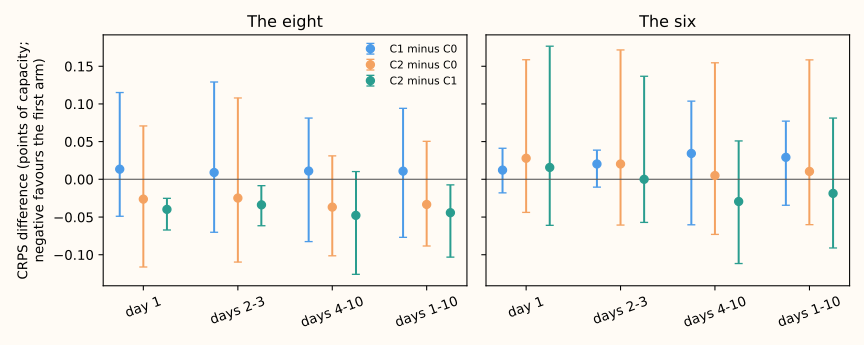

## Take-home message

**Removing the flag but keeping the lockdown rows is slightly worse; dropping the lockdown rows
makes the network no worse than with the flag, and better at the eight.** The flag is 0 in every
fine-tune and scored row, so it acts only through pretraining. Replacing it with dropping the
2020-03-23 to 2021-07-19 rows from pretraining (arm C2) scored 5.117 at the eight and 3.751 at the
six, against 5.150 and 3.741 with the flag (C0). Every difference is below the minimum detectable
effect (0.125 at the eight, 0.133 at the six, 3-seed means), so read the intervals below as
suggestive. This narrows the search to C2 as a simpler recipe for later lag-free experiments; it does
not show that the lockdown rows hurt in absolute terms.

## Figure

Pooled difference per horizon band and group; bars span the lowest to the highest of the five
per-fold differences, so they are ranges, not confidence intervals. Negative favours the first arm.

## Results

- **Counted contrasts** (CRPS over days 1 to 10, difference with Bonferroni-18 interval, folds
  negative of 5):
    - C1 minus C0: eight +0.011 (-0.020 to +0.042, 2 of 5), six +0.029 (+0.007 to +0.052, 2 of 5).
    - C2 minus C0: eight -0.033 (-0.060 to -0.007, 3 of 5), six +0.010 (-0.017 to +0.038, 3 of 5).
    - C2 minus C1: eight -0.044 (-0.069 to -0.021, 5 of 5), six -0.019 (-0.049 to +0.009, 3 of 5).
- **Pre-registered rules.** "Flag not shown to be needed" fails: the six's upper bound for C1 minus C0
  is 0.052, above the 0.05 margin. "Flag needed" passes at the six only (lower bound +0.007, a
  fifth of the minimum detectable effect). "Lockdown rows hurt" passes at the eight (upper bound -0.021). C2
  is not shown worse than C0 at either group (upper bounds -0.007 and +0.038, both below 0.05).
  Prediction P1 failed at the six; P2 held.
- **Absolute scores** (eight / six): C0 5.150 / 3.741, C1 5.161 / 3.770, C2 5.117 / 3.751.
- **Horizon bands** (C2 minus C1, eight): day 1 -0.040, days 2 to 3 -0.034, days 4 to 10 -0.048;
  (C1 minus C0, six): +0.012, +0.020, +0.034. No band reverses the sign of its group.
- **Tails** (q99 pinball loss, eight / six): C0 0.280 / 0.186, C1 0.286 / 0.192, C2 0.292 / 0.189.
  Coverage of the q99 is 0.9915, 0.9900, and 0.9898 at the eight, and the q01 coverage is 0.0032,
  0.0024, and 0.0032. C2's q99 loss is higher than C0's at the eight, so the CRPS gain does not come
  from the upper tail.

## Caveats

- **The minimum detectable effect is larger than every difference.** It comes from the seed spread
  (0.078 and 0.083 points per seed; 3 seeds, 5 folds), while the intervals come from a month-block
  bootstrap of 5 blocks, which is narrow. The two disagree about how sure to be; trust the larger.
- **Christmas week and the report-only Primaries.** The Christmas-week slices (fold 2025-12 only)
  disagree in sign between the eight and the six, so no reading is drawn. D15 and D18 (report-only)
  scored 0.24 to 0.72 points worse for C1 and C2 than for C0; their history is short, so the 2020 rows
  may matter there. This was not pre-registered as a contrast.
- **Load-shift events.** Rows with no labelled event are scored; NGED says some events are unlabelled,
  so these rows may hold events that no label covers.
- **Not run.** The two example probabilistic forecast graphs and the load-shift event plots are not
  in this page: the arms differ only in pretraining, and the scored rows are the same. Say if the
  manager wants them added.
- **Schedule.** Monthly refit; the contrast could differ under weekly refits.
- **Interim.** The fits and numbers have had one code review; the results review and write-up review
  are recorded in the PR body.

## What to try next

- Use C2 (no flag, lockdown rows dropped) as the lag-free pretraining recipe in later experiments, and
  confirm on weekly refits before a release claim.
- Test the report-only Primaries separately if D15 and D18 matter: their short history may need the
  2020 rows.

## Plan

**The plan was written before any score was read.** One fold and one seed (2025-10, seed 0) were
timed first; their forecasts are kept as part of the final fits and were not scored until the code
review had run. The plan covers Part 2 of the brief (the lockdown flag); the whole-day price shape is
[experiment 513](../00513-lagless-demand-network-whole-day-price-shape-at-training-time/result.md).

## Question

The lag-free demand network takes a 0/1 input that is 1 from 2020-03-23 to 2021-07-19. The network is
pretrained on ERA5 and CAMS rows from 2019-09, which include that period, and fine-tuned on ensemble
forecast rows from 2024-04, which do not. The flag is 0 in every scored month. Is the column still
needed, and do the lockdown rows hurt a network that cannot see the flag?

## Arms

All arms use experiment 510's `L-M` recipe (monthly refit, 182.6-day weight, 3 mixture components,
hidden width 64, 2 layers, dropout 0.1), pretrained here by experiment 513's loop. They differ only
in the flag column and the pretraining rows.

| Arm | Flag column | Pretraining rows | Network inputs |
|---|---|---|---|
| C0 | kept | all | 37 non-lag columns |
| C1 | removed | all | 36 |
| C2 | removed | the flagged rows (2020-03-23 to 2021-07-19) dropped, from training and early stopping | 36 |

**C2 is a pretraining-only change.** The fine-tune rows hold no flagged row, and the scripts assert
this for every fold. **C1 changes the fine-tune too**, because the network has one input fewer, so
the pretrained weights of experiment 448 do not load and every arm, C0 included, is pretrained here.
In the first fold 1,395,832 of 7,005,809 pretraining rows are flagged (19.9%).

## Folds, seeds, and cost

- **Folds and seeds.** The five folds of experiments 448, 449, and 510 (2025-10, 2025-12, 2026-01,
  2026-03, 2026-06), seeds 0, 1, and 2. July 2026 is unused.
- **Fit count.** 3 arms x 5 folds x 3 seeds: 45 pretrainings and 45 fine-tunings.
- **Timed cost.** Fold 2025-10, seed 0: feeder 13 s per fold; pretraining 20 s (C0), 16 s (C1), and
  18 s (C2); fine-tuning 7 s, 4 s, and 5 s. About 0.3 GPU-hours for everything (13 s x 5 + 45 x
  (18 + 5.3) s = about 19 minutes). One GPU process under 8 GB, with `MemoryMax=8G` and
  `OMP_NUM_THREADS=1`.

## Scoring and contrasts

- **Rows and scorer.** Experiment 510's pipeline on experiment 470's row set, rows with no labelled
  event, leads up to 10 days, raw quantiles (no widening). "The eight" are the eight Primaries that
  report only apparent power (D15 and D18 report-only); "the six" are the six that report signed
  megawatts.
- **Contrasts (negative favours the first arm).** C1 minus C0, C2 minus C0, C2 minus C1, at CRPS
  over days 1 to 10, at the eight and the six: 6 tests. The Bonferroni count is the family of the
  whole price-and-lockdown brief, 18.
- **Slices.** Horizon bands day 1, days 2 to 3, and days 4 to 10 beside days 1 to 10, and Christmas
  week (22 to 28 December, fold 2025-12).
- **Minimum detectable effect.** From the seed spread of the three arms pooled (three seeds, five
  folds), scaled to a 3-seed mean, printed by `e00517_score.py baseline` before any contrast.
  Earlier experiments report 0.057 to 0.164 points for single-seed or two-seed comparisons.
- **Intervals.** Month-block bootstrap with five blocks gives near min-to-max intervals; the page says
  so and gives the sign per fold beside every interval.

## Pre-registered rules

- **Not shown to be needed.** At both groups the upper Bonferroni bound of C1 minus C0 is below the
  non-inferiority margin of 0.05 points. "Within the minimum detectable effect" is not used: below
  the minimum detectable effect, no difference can be proved.
- **Needed.** The lower Bonferroni bound of C1 minus C0 is above zero at a group.
- **Lockdown rows hurt.** The upper Bonferroni bound of C2 minus C1 is below zero at a group.
- **Otherwise** the experiment cannot tell, and says so.

## Standing practices followed

Cleaned data and the D15 and D18 start cut (through experiment 428's rows); rows with no labelled
event; July 2026 unused; no XGBoost work; titles say "load-shift", never "switching"; every interim
number is unaudited.

## Implementation details (deleted when this ships)

Code in `ml-experiments/00517-.../`: `e00517_fit.py` (pretrain, fine-tune, forecast) and
`e00517_score.py` (experiment 510's scorer pointed here), and `e00517_slices.py` (horizon bands and
the figure). Run with `PYTHONPATH` set to the
`ml-experiments/*` folders and `DATA_PATH_INTERNAL=/home/jack/dev/nged-substation-forecast/data`.
