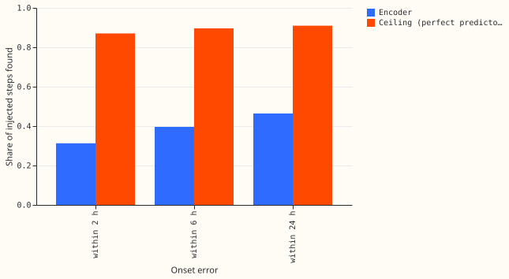

**This page is interim and unaudited, and its result is a weak null.** A small neural network (the
history encoder, 86,747 parameters) was trained once, for 69 seconds, on injected shifts in 14 days
of power readings at the fold 2026-01 Primaries. The encoder did not pass the pre-registered
proxy for the plan's kill rule (c). The fit used one seed and a noisy validation block of 401 windows, so the
result does not rule out a learned repair.

## Method

- **Question.** Experiment 507 showed that a perfect repair of the three lag readings improves the
  lag correction. This experiment asks whether a small neural network can learn to find and size
  injected shifts in the 672 half-hours (14 days) of readings, and how long one fit takes.
- **Data.** Experiment 507's generator, with temporary shifts (family A), genuine level changes
  (family B), and hard negatives drawn three times as often (family D). One window is a Primary
  and a day. The two input channels are the surprise (reading minus the ERA5 and CAMS lagless
  median, over the Primary's residual spread) and the median standardised within the window. Windows
  touching a labelled event are dropped. Test windows have origins in January 2026; training windows
  end 68 days before the refit, the validation block (30 days) sits before a 24-day embargo.
- **Encoder.** A dilated convolution stem, 168 two-hour tokens, two transformer layers with a
  learned relative-position bias, and heads for the step probability, the step size, and whether
  the step in force at the newest reading is genuine. The losses were a positive-unlabelled step
  loss with a size loss (weight 0.5), a genuine-head cross-entropy (0.2), and a total-variation
  penalty (1e-3). Adam at 2e-3, batches of 128, a fresh generator world each epoch.
- **Checks.** The four checks P1 to P4 and their thresholds were written into the plan before the
  fit. A candidate step is a half-hour where the mean estimated step over the next 4 half-hours
  differs from the mean over the previous 4 by at least 0.5 spreads.

## Results

**Terms.** A spread is a Primary's residual standard deviation (the reading minus the lagless
median, which is the forecast of a network that sees no power input). A candidate step is defined
in the Method. The ceiling is the score of a predictor that outputs the injected step. A temporary
shift (family A) ends; a genuine change (family B) persists. The signed-MW six are the Primaries
that report signed megawatts and the MVA-only eight report apparent power only.

**Scores are on the 372 test windows (origins in January 2026) in injected worlds 200 to 202.**
Intervals resample whole Primaries (13 in the test month). "Ceiling" is the same score for a
perfect predictor that outputs the injected step, read through the same candidate rule.

| Check | Threshold (fixed before the fit) | Result | Outcome |
|---|---|---|---|
| P1: best epoch of the validation step loss (`L_u`, the pre-registered measure) | 8 or later | 14 (`L_u` 0.244) | Passed on that measure only: the loss moved between 0.24 and 0.57 from epoch to epoch, and the plain cross-entropy beside it was lowest at epoch 4 |
| P2: error at the three lags on rows a step touches | under half of the unrepaired error | 0.446 against 0.988 spreads (45%) | Passed |
| P2: error added on rows no step touches | under 0.1 of the mean injected step | 0.144 | Failed (no interval computed) |
| P3: steps found within 6 hours | at least 70% of the ceiling (0.896) | 0.396 (0.365 to 0.434), 44% of the ceiling | Failed |
| P4: planted-step precision at a 2% rate | at least 0.3 | 0.165 (0.07 at the six, 0.40 at the eight) | Failed on the pooled value (no interval computed; the groups straddle the threshold, so the pooled failure is not firm) |

- **The encoder found a third of the steps within 2 hours.** The shares found within 2, 6, and 24
  hours were 0.313, 0.396, and 0.464, against ceilings of 0.870, 0.896, and 0.910. The ceiling is
  below 1 because a step under 0.5 spreads is never a candidate. At the signed-MW six the share
  within 2 hours was 0.297 (4 Primaries), and at the MVA-only eight 0.326 (7 Primaries).
- **Size was roughly right when a step was found.** The median relative size error among found
  steps was 0.25, and 50% were within 25%.
- **The false-flag rate depends on which median is used.** On test windows with no injection it was
  0.032 (0.003 to 0.085). On the validation block's real windows it was 0.297. A possible
  cause (not tested) is that 78% of test half-hours take their median from the table's post-refit
  module, while training and validation use cross-fitted medians, so the test surprise is quieter.
- **Raising the candidate threshold trades recall for precision.** At 1.5 spreads the planted-step
  precision was 0.334, but only 7% of steps were found within 2 hours. The thresholds of 0.5, 0.75,
  1.0, and 1.5 spreads gave precisions of 0.165, 0.188, 0.246, and 0.334. P4 was fixed at 0.5.
- **The genuine-change head was weak.** Its area under the ROC curve was 0.64 on 373 labelled
  window-world pairs (windows with a step in force at the newest reading, pooled over the three
  worlds). The generator makes 75% of steps in force at the newest reading genuine.
- **Cost.** One fit took 69 seconds (22 epochs of 16,384 windows, about 3 seconds each), against a
  cap of 2 hours.

## Outcome against the plan

| Item | Outcome |
|---|---|
| Kill rule (c), clause 2: validation step loss stops falling before epoch 10 | Not fired (best epoch 14), but the curve is noisy |
| Kill rule (c), clause 1, read through the proxy P2 to P4 | The proxy failed (P2 on the clean-row guard, P3, P4) |
| Consequence in the plan | The neural encoder stops unless the neural Discuss session overrules |

## Limits

- **A weak null.** One seed, a 69-second fit, and a validation block of 401 windows (the step loss
  swung by more than a factor of two between epochs) cannot separate "the encoder cannot learn this"
  from "this fit was too small". The thresholds were fixed before the fit.
- **The total-variation test of experiment 507 is also weak.** Its tuning hit the edge of the grid
  (weight 16 and tau 5, the weakest repair), so this experiment cannot say how a learned encoder
  compares with a well-tuned non-learned repair.
- **The noise curve was not run,** by the maintainer's standing instruction, so the first clause of
  rule (c) is read only through the proxy.
- **The lab setting flatters detection,** and the test month holds 4 Primaries at the six (D5 and
  D16 are excluded by labelled events) and 7 at the eight.
- **NGED's event labels are incomplete,** so the real windows used for the false-flag rate hold
  events that no label covers.
- **Training prevalence.** 19% of the valid training half-hours are positives, against at most a
  few per cent in real data, so the step probability is calibrated to a busier world than the real
  one.

## What the next experiment should answer

Whether a longer fit with several seeds, a larger validation block, a lower learning rate, and a
flag threshold chosen on validation reaches the thresholds. The neural Discuss session decides
whether that fit is worth its cost.
