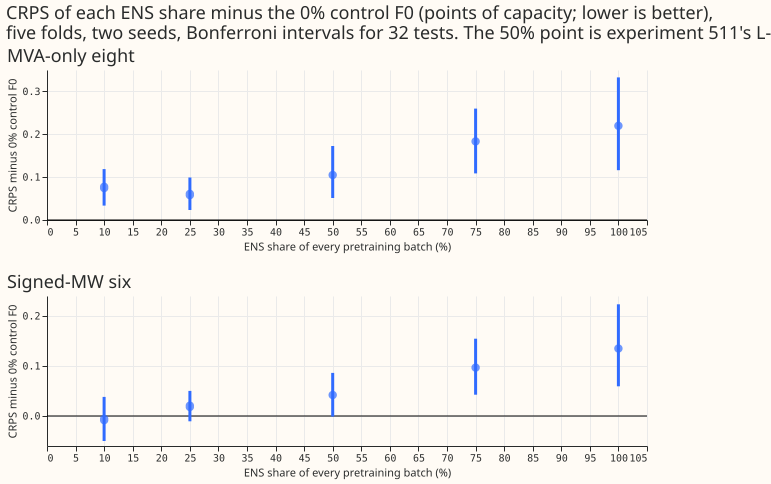
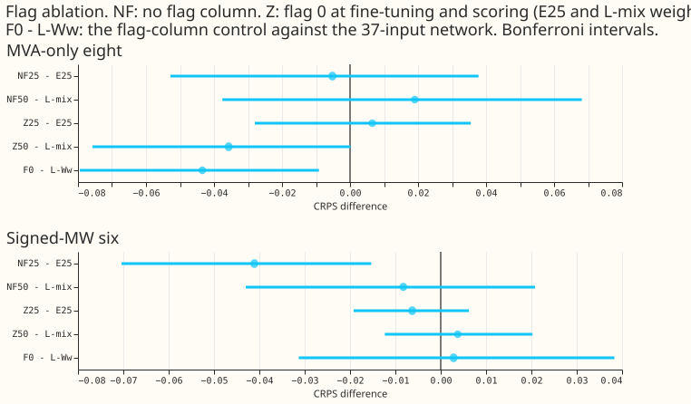
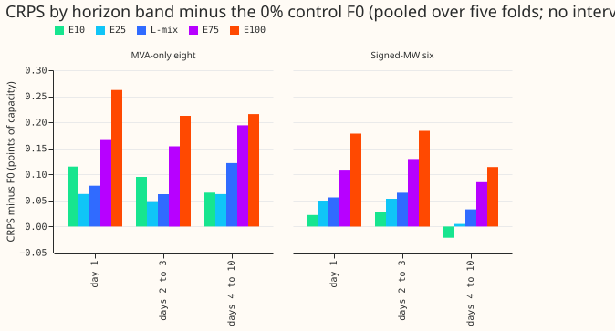
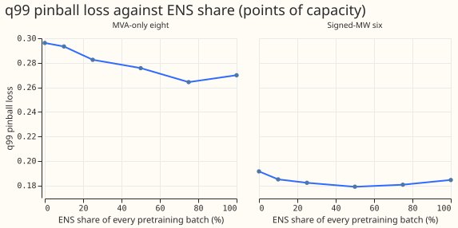
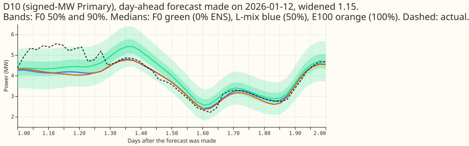
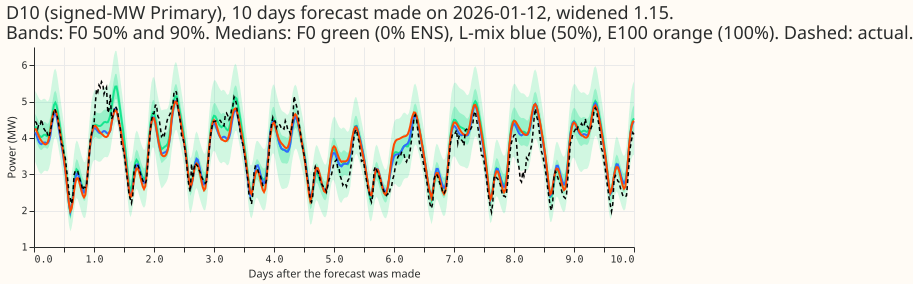
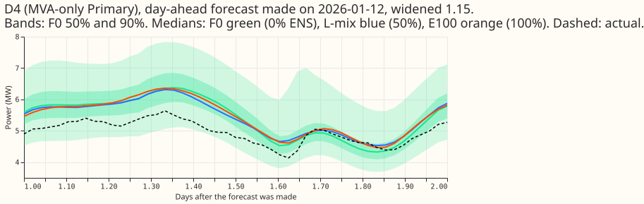
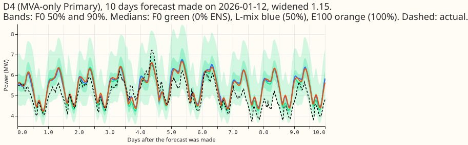

**Putting ENS rows into the pretraining batches of the lag-free demand neural network made its mean
forecast worse at the eight MVA-only Primaries, and the loss grew steeply from a 50% share upwards.**
Against the 0% control F0, CRPS rose by 0.076 points at a 10% share, 0.059 at 25%, 0.105 at 50%
(experiment 511's L-mix), 0.183 at 75%, and 0.220 for ENS only (lower is better; the Bonferroni
intervals for 32 tests exclude zero for all five). At the six signed-MW Primaries only 75% (+0.097)
and ENS only (+0.135) have intervals that exclude zero. The ENS rows lowered the q99 pinball loss
(75%: -0.032 at the eight), so the share trades a worse mean score for a better top tail. Removing
the flag, or fine-tuning and scoring at flag 0, moved the CRPS by at most 0.041 points, so the flag
does not explain experiment 511's deficit; it does explain part of the q99 gain.

Verdict: not supported. The pre-registered rule needed a share that beats the control, and none did;
the prediction that 10% and 25% are non-inferior (upper bound below +0.03) also failed at the eight.
The numbers were re-derived from the score tables by a fresh reviewer (see "Checks").

## Figures

## Results

- **Setup.** Weekly refits, 90-day half-life, restart from the month's pretrained weights, five
  folds (2025-10, 2025-12, 2026-01, 2026-03, 2026-06), seeds 0 and 1, scored on experiment 470's
  rows ("rows with no labelled event" at the six), in points of effective capacity. The 50% arm is
  experiment 511's L-mix; its fits were reused. Weekly refits, so the contrasts are for the weekly
  cadence only. Scoring actuals dropped for a flagged exact zero: 1,179 half-hours across the five
  folds and all groups.
- **Absolute CRPS (eight / six).** L-Ww 4.920 / 3.555; F0 (0%) 4.876 / 3.558; E10 4.952 / 3.551; E25
  4.936 / 3.577; L-mix (50%) 4.981 / 3.599; E75 5.060 / 3.654; E100 5.096 / 3.693; K2-S1 4.763 /
  3.423; A-pool 4.682 / 3.457. F0 is within the 0.164 (eight) and 0.123 (six) two-seed minimum
  detectable effect of L-Ww at both groups.
- **Contrasts against F0 (Bonferroni interval, 32 CRPS tests; negative is better).** Eight: E10
  +0.076 [+0.034, +0.119]; E25 +0.059 [+0.023, +0.099]; L-mix +0.105 [+0.052, +0.173]; E75 +0.183
  [+0.109, +0.260]; E100 +0.220 [+0.116, +0.333]. Six: E10 -0.007 [-0.050, +0.038]; E25 +0.019
  [-0.011, +0.050]; L-mix +0.042 [-0.001, +0.086]; E75 +0.097 [+0.043, +0.155]; E100 +0.135 [+0.059,
  +0.223]. The sign by fold is positive in 3 to 4 of 5 folds for each share at the eight; the
  2026-06 fold favours 25% to ENS only (-0.03 to -0.09), and 2026-01 favours 10% and 25%.
- **Shape.** E75 minus E25: +0.124 [+0.076, +0.174] (eight), +0.077 [+0.029, +0.126] (six); E100
  minus E25: +0.160 and +0.116; E25 minus E10: -0.017 and +0.027 (both include zero). The curve is
  flat from 0% to 25% within 0.06 and rises steeply beyond 50%.
- **Experiment 511's contrast recomputed.** L-mix minus L-Ww +0.062 [-0.012, +0.148] (eight) and
  +0.045 [+0.008, +0.083] (six), against +0.062 [-0.015, +0.148] and +0.045 [+0.009, +0.081] in
  experiment 511 (which used 56 tests). F0 minus L-Ww is -0.043 [-0.079, -0.009] at the eight and
  +0.003 [-0.031, +0.038] at the six. The eight-group difference is below the 0.164 two-seed
  detectable effect, and F0 has a different input width and draws 8,192 ERA5 and CAMS rows per step,
  so the difference is not evidence that the flag column helps. The 2026-06 fold alone contributes
  -0.151 of it.
- **Flag ablation (fixed at 25% and 50%).** No flag column: NF25 minus E25 -0.005 [-0.053, +0.038]
  (eight) and -0.041 [-0.070, -0.015] (six); NF50 minus L-mix +0.019 [-0.038, +0.068] and -0.008
  [-0.043, +0.021]. Flag 0 at fine-tuning and scoring: Z25 minus E25 +0.007 [-0.028, +0.036] and
  -0.006 [-0.019, +0.006]; Z50 minus L-mix -0.036 [-0.076, +0.000] and +0.004 [-0.012, +0.020].
  F0z (F0's weights fine-tuned and scored at flag 0, report only) scored 4.875 / 3.556 against F0's
  4.876 / 3.558, so the untrained flag input in F0 did no harm.
- **Horizon bands (CRPS minus F0, eight / six, pooled over five folds, no interval).** Day 1: E10
  +0.115 / +0.022; E25 +0.062 / +0.050; L-mix +0.078 / +0.056; E75 +0.168 / +0.109; E100 +0.262 /
  +0.178. Days 2 to 3: E25 +0.048 / +0.053; L-mix +0.062 / +0.065; E75 +0.154 / +0.130; E100 +0.212
  / +0.184. Days 4 to 10: E25 +0.062 / +0.005; L-mix +0.122 / +0.033; E75 +0.194 / +0.085; E100
  +0.216 / +0.114. The ENS-only deficit is largest at day 1 at the eight and at days 2 to 3 at the
  six. E10 and E25 are level with F0 at days 4 to 10 at the six (-0.022 and +0.005), and E10 at days
  2 to 3 is +0.095 (eight) and +0.027 (six).
- **Tails.** q99 pinball loss minus F0 (Bonferroni interval, eight / six): E10 -0.003 [-0.007,
  +0.002] / -0.006 [-0.012, -0.002]; E25 -0.014 / -0.009; L-mix -0.021 / -0.013; E75 -0.032 /
  -0.011; E100 -0.026 [-0.035, -0.016] / -0.007 [-0.016, +0.002]. F0 minus L-Ww is +0.009 / +0.008.
  Removing the flag raises q99 pinball loss: NF25 minus E25 +0.012 [+0.007, +0.016] and NF50 minus
  L-mix +0.012 at the eight, and flag 0 at fine-tuning does the same (Z25 minus E25 +0.011, Z50
  minus L-mix +0.012), so the q99 gain depends on the flag. Against L-Ww the q99 gain of E25 is
  inside zero (-0.005 [-0.010, +0.001] eight, -0.002 [-0.006, +0.002] six). q99 coverage at the
  eight: F0 0.9936, E25 0.9937, L-mix 0.9937, E75 0.9913, E100 0.9887 (nominal 0.99), so ENS-only
  pretraining under-covers slightly. q01, q05, and q95 are in `absolute.csv` of the private data
  folder and were not analysed.
- **Two-stage control TS (own family, 4 CRPS tests, 8 with q99).** TS scored 4.923 / 3.559. TS minus
  L-Ww +0.004 [-0.002, +0.010] / +0.005 [-0.001, +0.010]; TS minus F0 +0.047 [+0.017, +0.078] /
  +0.002 [-0.028, +0.030]. One epoch of ENS-only training at 0.1 times the rate lowered the held-out
  ENS loss in every fold (for example 0.5904 to 0.5179 in 2025-10) but left the forecast
  unchanged from L-Ww. TS is within 0.013 of the best mixed share (E25 at the eight, E10 at the
  six).
- **Fit counts and cost.** 70 pretrains (12 to 49 s each), 10 stage-2 epochs, 550 fine-tunes (2 to 5
  s each), about 1.1 hours of wall time on one GPU process; peak host memory 5.3 GB and GPU memory
  2.1 GB at the timed fold. The 60-epoch cap bound only for E25 in the timed fold.
- **Serving cost.** A production pretraining with ENS rows would store about 4.2 to 5.0 million ENS
  rows and keep a pool of 7.4 to 7.9 million ERA5 and CAMS rows per fold, about 12 million rows of
  37 float32 inputs (about 1.8 GB). F0 needs only the ERA5 and CAMS pool.

## Pre-registered predictions

- **P1 (no share beats the 0% control by 0.03 or more): held.** No share improved on F0 at the
  eight; at the six the best was E10 at -0.007.
- **P2 (10% and 25% non-inferior to 0%; 75% and ENS only worse than 25%): half failed.** The upper
  Bonferroni bounds of E10 and E25 exceed +0.03 at both groups, so non-inferiority is not shown, and
  at the eight the lower bounds are above zero. 75% and ENS only were worse than 25% (+0.124 and
  +0.160 at the eight).
- **P3 (removing the flag changes the score by less than 0.03): held in 6 of 8 cells on point
  estimates.** NF25 at the six (-0.041, interval [-0.070, -0.015], no flag better) and Z50 at the
  eight (-0.036, interval [-0.076, +0.000]) are outside it. Several "held" cells have intervals that
  reach past 0.03 (NF25 at the eight, [-0.053, +0.038]), so the point estimates support the
  prediction less strongly than the count suggests.
- **P4 (two-stage control no better than the best mixed share): not tested.** TS was within 0.013
  of the best mixed share at both groups (TS beat E25 by 0.013 at the eight, E10 beat TS by 0.008 at
  the six). No TS-versus-mixed contrast was computed; TS minus L-Ww and TS minus F0 form their own
  family.
- **P1's parenthetical** ("every difference is inside the minimum detectable effect") failed at the
  eight for E75 (+0.183) and E100 (+0.220), which exceed 0.164. P1 itself held. P1 to P4 are the
  front-matter prediction, and the plan section below lists the arms and rules, not the predictions.
- **Minimum detectable effect.** 0.164 (eight) and 0.123 (six), experiment 511's two-seed values,
  not refitted; the paired intervals are narrower because the rows are shared.

## Checks

- **Leak check.** `pretrain` asserts that no ENS or ERA5 and CAMS row lies past the refit cutoff
  minus 3.5 hours and that no origin lies past the cutoff, for every fold; it printed 0 for all five
  folds. Weekly fine-tunes use experiment 511's row selection and windows.
- **Reviews.** One fresh Sonnet review of the plan and code ran before the first fit. It found: the
  claim that F0 differs from L-mix only in ENS rows was not strictly true (F0 draws 8,192 ERA5 and
  CAMS rows per step); the flag column of F0 is untrained at pretraining; the hypothesis could not
  separate the share from the double use of rows; the contrast list was not enumerated. All four
  were accepted and the plan was edited; F0z was added for the second. One fresh Sonnet review of
  the results and the write-up re-derived the numbers and found them correct, and found: the P3 count
  was 6 of 8 (not 7); P4 was untested; the flag carries part of the q99 gain; the take-home overstated
  a monotone trend; one claim of "best" held at the eight only; and several bare "network" and
  pronoun uses. All were accepted and edited.
- **Not run.** The median-minus-mean check and the other audit triggers of the `ml-experiment` skill
  were not run, and no second write-up review ran.

## Caveats

- **Weekly cadence only.** The contrasts may differ at a daily refit, which experiment 511 found
  better.
- **Fewer ERA5 and CAMS rows.** Every arm takes the same number of steps per epoch, so a larger ENS
  share also means fewer ERA5 and CAMS rows seen per epoch; the sweep varies both together.
- **Overlap of rows.** Every ENS pretraining row also lies in the 730-day fine-tune window, so the
  sweep cannot separate the share from the double use of those rows.
- **Seed noise.** Two seeds and five folds; the seed standard deviation is 0.083 (eight) and 0.063
  (six), larger than most contrasts here, so small differences (under 0.06) are not established.
- **Rows with no labelled event.** NGED's event labels are incomplete, so these rows may hold
  events.
- **Not done in this experiment.** Cold winter nights, Christmas week, the injected-shift leak, the
  ENS date range (recent 90 and 180 days only), and the daily refit repeat belong to the diagnostics
  experiment that follows.

## What to try next

- Repeat the diagnostics (ENS date range, cold nights, leak) on F0 and E25 only, since larger
  shares are clearly worse.
- Test a tail-focused variant: 25% to 75% ENS rows scored on q99 pinball loss and the avoidable
  curtailment cost, since ENS rows lowered the q99 loss.

## Plan (written before any fit)

### Question

Experiment 511's L-mix pretrained the lag-free neural network on ERA5, CAMS, and ENS rows together and
scored worse than L-Ww, which pretrains on ERA5 and CAMS rows only: +0.062 [-0.015, +0.148] at the
eight (not significant) and +0.045 [+0.009, +0.081] at the six, in points of CRPS. We ask what ENS
share in the pretraining batches is best, and whether the deficit comes from the share, the source
flag, or the double use of rows.

### What experiment 511 built (Step 0)

- **Share.** Each pretraining batch held 4,096 ERA5-or-CAMS rows and 4,096 ENS rows, drawn
  uniformly: 50% ENS by batch share, but about 36 to 40% by row count (4.2 to 5.0 million ENS rows
  against 7.5 to 7.9 million ERA5-and-CAMS rows per fold). There were no row weights in pretraining.
- **Overlap.** Every pretraining ENS row also lies in the 730-day fine-tune window, so L-mix saw
  those rows twice. This is a design choice, not a test leak: `pretrain_mix` asserts that no ENS or
  ERA5/CAMS row lies past the cutoff minus 3.5 h or has an origin past the cutoff.
- **Flag and spread.** The source flag is a 38th input: 0 for ERA5-and-CAMS rows, 1 for ENS rows,
  and 1 at fine-tuning and scoring. ERA5 and CAMS rows carry the fold's median standardised ENS
  spread by lead band, as in experiment 418.
- **ENS history.** 18, 20, 21, 23, and 26 months before the five fold cutoffs (the 730-day window
  caps it at 24).

### Arms (all weekly cadence, 90-day half-life, restart from the month's pretrained weights)

Shares are shares of each 8,192-row pretraining batch. Every arm takes the same number of steps per
epoch (20% of the ERA5-and-CAMS training rows at 4,096 rows per step) with the same batch size, so the
number of ERA5-and-CAMS rows drawn per epoch falls as the ENS share rises. Contrasts are written
"arm minus control", so a negative difference is a gain.

- **F0, the 0% control.** The 38-input network, the flag column fixed at 0 in every pretraining row
  (all rows are ERA5 and CAMS), flag 1 at fine-tuning and scoring, as in L-mix. F0 differs from
  L-mix in having no ENS rows in pretraining (and so drawing 8,192 ERA5-and-CAMS rows per step), and
  it keeps the seed pairing. Caveat: the flag column is 0 in every F0 pretraining row, so its first-
  layer weights stay at their random start and the switch to flag 1 at fine-tuning adds an untrained
  input. F0z (report-only, outside the counted family) fine-tunes and scores the same weights at
  flag 0. L-Ww (37 inputs) anchors the cadence only.
- **E10, E25, E75, E100.** Same, with 10%, 25%, 75%, and 100% of every batch drawn from the ENS
  rows.
- **E50 is L-mix.** Experiment 511's 2 seeds x 5 folds of fits are reused.
- **Early stopping at any share** uses the held-out NLL averaged with the batch shares as weights,
  so 50% reproduces L-mix's mean of the two sources, and E100 uses the ENS term alone.
- **Flag ablation, fixed in advance at 25% and 50%.** NF25 and NF50: no flag column (37 inputs),
  same pretraining mix. Z25 and Z50: the pretrained weights of E25 and L-mix, with the flag set to
  0 (not 1) at fine-tuning and scoring. "Flag 1 at fine-tuning" is what L-mix did.
- **TS, the two-stage control.** Experiment 510's ERA5-and-CAMS pretrained weights (37 inputs),
  then one epoch (20% of the ENS training rows) on ENS rows only at 0.1 times the pretraining
  learning rate, keeping the stage-2 weights only if the held-out ENS NLL fell; then the usual
  fine-tune with no flag.

### Pre-registered rules

- **Tests.** 16 contrasts x 2 groups = 32 CRPS tests (64 with q99). Against F0: E10, E25, L-mix (the
  50% share), E75, E100. Against L-Ww: F0, E25, L-mix (repeats experiment 511's contrast). Flag
  ablation: NF25 against E25, NF50 against L-mix, Z25 against E25, Z50 against L-mix. Shape: E25
  against E10, E75 against E25, E100 against E25, L-mix against E25. The optional two-stage control
  TS is its own family (TS against L-Ww and against F0: 4 CRPS tests, 8 with q99) and is reported
  separately. Minimum detectable effect: 0.164 (eight) and 0.123 (six), experiment 511's `mde.csv`
  from two seeds, not refitted.
- **Seeds.** Seeds 0 and 1 for every arm. No outcome-selected third seed.
- **Scored set.** Experiment 470's rows, five folds, "rows with no labelled event"; D15 and D18
  report only; horizon bands day 1, days 2 to 3, days 4 to 10.
- **Month-block bootstrap** with the fold count stated beside every interval, and per-fold signs.
- **Diagnostics left to the next experiment.** The ENS date range, the cold-night and Christmas
  slices, and the injected-shift leak.

### What the plan costs

- 7 new pretraining variants (F0, E10, E25, E75, E100, NF25, NF50) x 5 folds x 2 seeds = 70
  pretrains (about 32 s each) + 10 stage-2 epochs, and 11 new arms (F0, F0z, E10, E25, E75, E100,
  NF25, NF50, Z25, Z50, TS) x 25 weekly fine-tunes x 2 seeds = 550 fine-tunes (about 3.8 s each).
  About 1.2 GPU-hours in all.
