> **Correction (2026-11-04).** The gap to K2-S1 above 24 h of lead on this page is voided. K2-S1
> mixes in experiment 404's lag-free head, which took its weather from the freshest run at each
> target's valid time (leads of 9 to 33 h at every horizon), a look-ahead that a forecast made at
> the origin does not have. The gap at 0 to 24 h is unchanged, and comparisons that do not involve
> K2-S1 are unaffected. The rebuilt K2-S1 will restate the gaps. Evidence: experiments 531 and 532.

**K2-S1's advantage over the daily-refit lag-free neural network L-1d is largest at 120 to 240 h,
and the point estimates favour L-1d below 48 h, so the advantage is not a lag advantage.** K2-S1
reads lagged power; L-1d does not. The gap is 0.174 points of CRPS (continuous ranked probability
score, lower is better) at the eight MVA-only (megavolt-ampere-metered) Primaries and 0.196 at the
six signed-MW (megawatt-metered) Primaries. A short-horizon correction on a lag-free anchor is
therefore not what the gap calls for. At the eight, a monthly five-head lag-free ensemble (LL-ens5)
is 0.017 behind K2-S1 at 120 to 240 h, which is consistent with head count driving the gap. At the
six, LL-ens5 matches L-1d and is 0.20 behind K2-S1, so K2-S1's lagged heads may contribute there.
Every number on this page is interim and unaudited until a human has read it.

Experiment 511 left L-1d 0.091 (eight) and 0.071 (six) points behind K2-S1. We re-cut experiment
511's stored per-row scores by lead time, and fitted no neural network. "Gap" means L-1d minus K2-S1
CRPS in points of capacity, so a positive gap means K2-S1 is better. The gap mixes three
differences: lagged against lag-free heads, daily against monthly refit, and four heads against two.

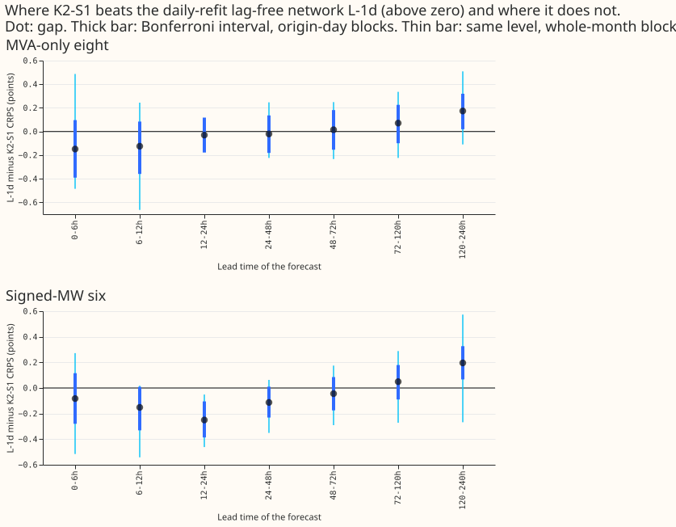

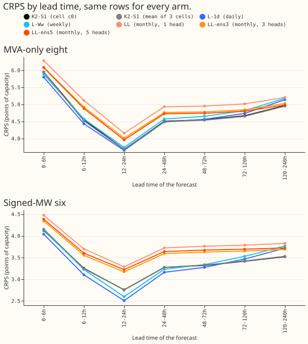

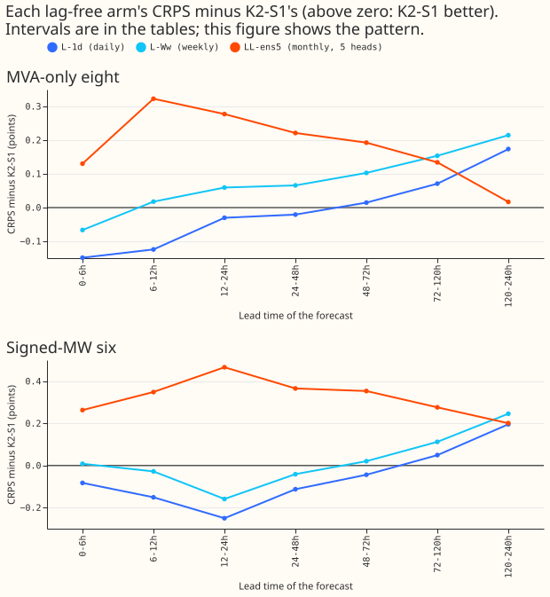

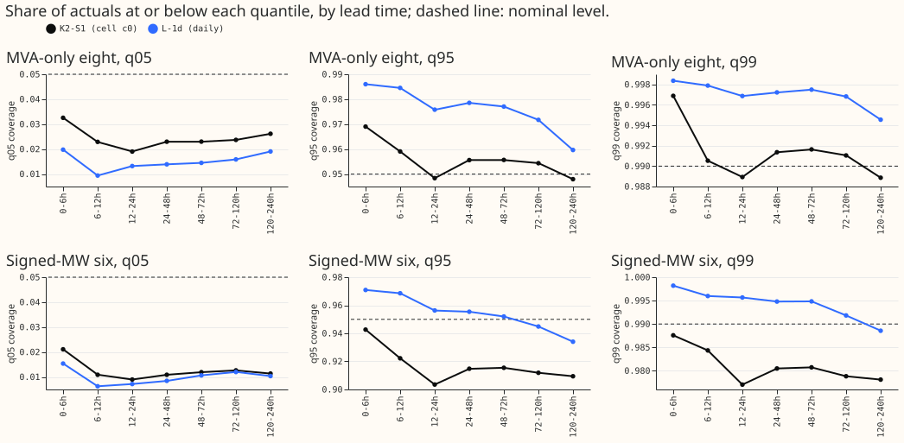

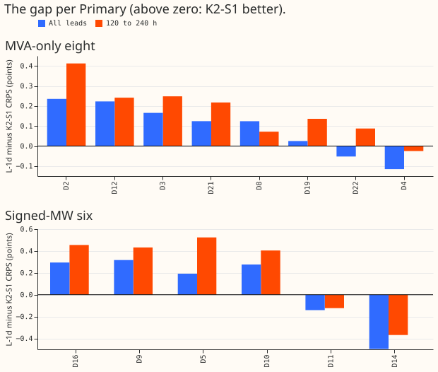

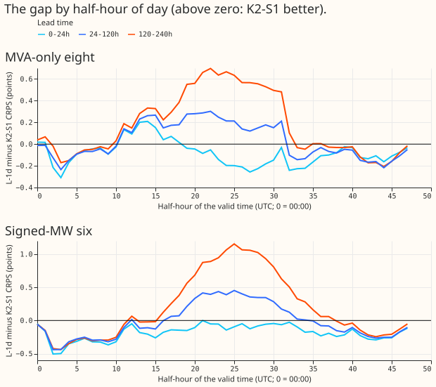

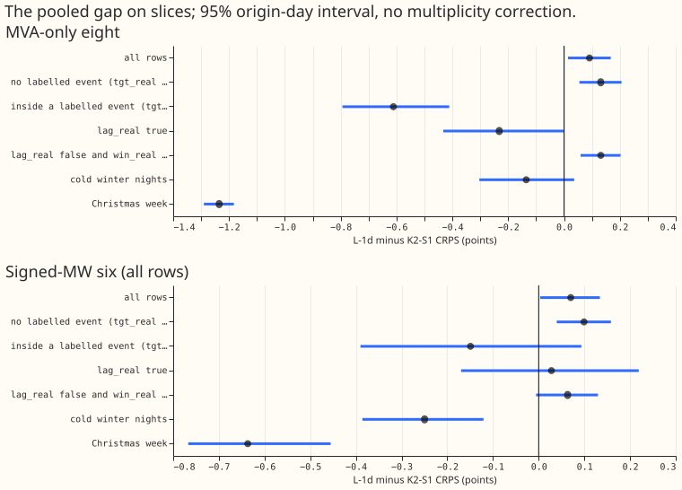

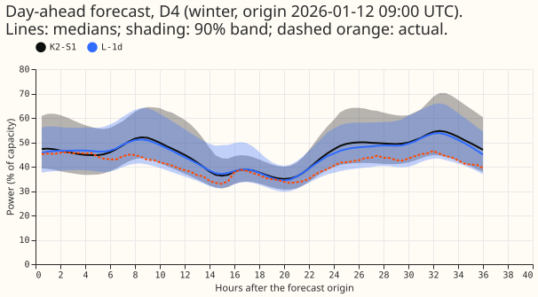

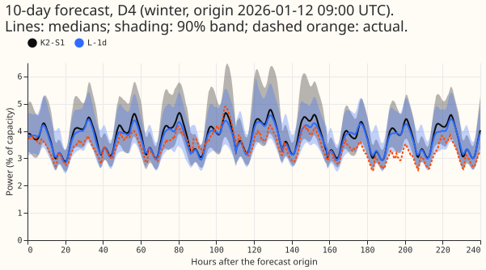

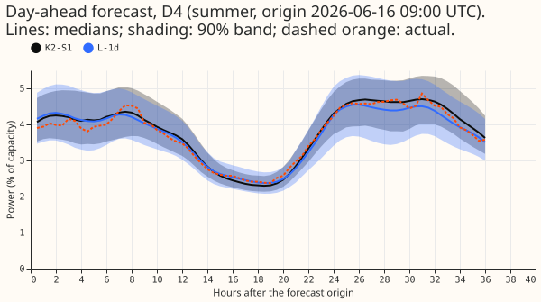

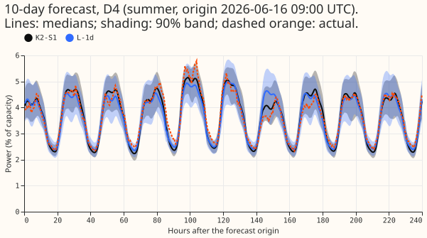

## Predictions

- **P1 held for the sign pattern and the share.** The gap is negative below 48 h at both groups
  except the eight's 48 to 72 h band (+0.01), and positive from 72 h at both groups. The 120 to 240
  h band holds 94% of the eight's summed gap (more than the predicted 70%).
- **P2 fits neither branch cleanly.** At 120 to 240 h at the eight, LL (monthly, one head) is 0.066
  worse than L-1d and L-Ww (weekly) 0.042 worse, as refit age would predict. But LL-ens3 and LL-ens5
  are better than L-1d, as head count would predict. The Bonferroni interval of L-1d minus LL-ens5
  includes zero.
- **P3 held at the eight and failed at the six.** At 120 to 240 h at the eight, K2-S1's q95 coverage
  is closer to nominal than L-1d's (0.948 against 0.960), and so is q99 (0.989 against 0.995). At
  the six, L-1d is closer (q95 0.934 against 0.909).
- **P4 failed.** No Primary carries more than 40% of the eight's gap (largest: D2, 32%; D4 is -16%).

## Results

- **L-1d is better below 48 h in point estimate only, and K2-S1 is better at 120 to 240 h.** At the
  eight, the gap is -0.15 [-0.39, +0.10] at 0 to 6 h, -0.12 at 6 to 12 h, -0.03, -0.02, +0.01,
  +0.07, and +0.17 [+0.02, +0.32] at 120 to 240 h (Bonferroni intervals over origin-day blocks, 28
  tests). Only the 120 to 240 h interval excludes zero.
- **At the six, two bands exclude zero.** The gap is -0.08, -0.15, -0.25 [-0.39, -0.10] at 12 to 24
  h, -0.11, -0.04, +0.05, and +0.20 [+0.07, +0.33] at 120 to 240 h.
- **The whole-month block check is much wider.** With 5 blocks, the interval is near the
  minimum-to-maximum range of the five folds. At the eight every band includes zero (120 to 240 h:
  [-0.11, +0.51]), and at the six only 12 to 24 h excludes zero. This check cannot support a claim.
- **The minimum detectable effect is as large as most gaps.** From L-1d's two seeds it is 0.10 to
  0.27 per band at the eight and 0.11 to 0.17 at the six. The 120 to 240 h gap (0.17 and 0.20) is at
  or just above it, and every gap below 72 h at the eight is smaller.
- **The sign of the 120 to 240 h gap is positive in 4 of 5 folds at both groups.** Below 48 h the
  number of positive folds ranges from 0 to 3 of 5.
- **The pooled gaps reproduce experiment 511.** They are 0.091 at the eight and 0.071 at the six. On
  rows with no labelled event the eight's gap is 0.131.
- **Reference arms at 120 to 240 h (CRPS, eight / six).** K2-S1 4.967 / 3.523; L-1d 5.140 / 3.719;
  L-Ww 5.182 / 3.769; LL 5.206 / 3.829; LL-ens3 5.029 / 3.690; LL-ens5 4.984 / 3.724. K2-S1 minus
  LL-ens5 is -0.017 [-0.056, +0.023, uncorrected] at the eight and -0.201 at the six. L-1d minus
  LL-ens5 is +0.157 [+0.059, +0.253, uncorrected; Bonferroni -0.001, +0.310] at the eight and -0.005
  at the six.
- **Below 72 h the monthly ensembles score worse than L-1d.** LL-ens5 is 0.18 to 0.45 worse at the
  eight and 0.35 to 0.72 worse at the six. In this comparison the daily refit matters most at short
  lead, but it is confounded with ensemble size.
- **Tail calibration over all leads.** q95 coverage (nominal 0.95) is 0.952 for K2-S1 and 0.968 for
  L-1d at the eight, and 0.912 and 0.943 at the six. q99 coverage (nominal 0.99) is 0.990 and 0.996
  at the eight, and 0.979 and 0.991 at the six. K2-S1 is closer to nominal at the eight, and L-1d is
  closer at the six, where K2-S1's bands are too narrow. The q99 pinball loss gap (L-1d minus K2-S1)
  is +0.010 [-0.002, +0.021] at the eight and -0.019 [-0.031, -0.007] at the six (56 tests).
- **L-1d's bands are wider than K2-S1's in every band.** The mean q05 to q95 width (points of
  capacity, L-1d against K2-S1 cell c0) at the eight is 41.1 against 38.9 at 0 to 6 h, 32.5 against
  30.1 at 24 to 48 h, and 34.0 against 31.6 at 120 to 240 h. At the six it is 30.2 against 27.6,
  22.8 against 20.9, and 24.0 against 22.5. Both widen by about the same from 12 to 24 h to 120 to
  240 h (7.3 points for L-1d and 6.9 for K2-S1 at the eight). The wider mixture of K2-S1's four
  heads therefore does not give it the wider bands, and the narrower bands come with the lower CRPS.
  The tables are `scores/widths.csv`, `scores/absolute.csv` (coverage and pinball loss by band), and
  `scores/contrasts.csv`, in this experiment's private data folder.
- **No Primary dominates the eight, and the six is a sum of offsetting terms.** At the eight the
  pooled gap is D2 +0.235 (32%), D12 +0.223 (31%), D3 +0.166 (23%), D8 +0.124 (17%), D21 +0.124
  (17%), D19 +0.025, D22 -0.052, and D4 -0.115 (-16%). At the six, D14 is -0.496 against D9 +0.317,
  D16 +0.295, D10 +0.276, D5 +0.193, and D11 -0.141.
- **L-1d is far better inside labelled events and in Christmas week.** At the eight the gap
  (uncorrected 95% interval) is +0.131 [+0.055, +0.206] on rows with no labelled event, -0.611
  [-0.794, -0.412] inside a labelled event, -1.235 [-1.290, -1.183] in Christmas week, and -0.135
  [-0.303, +0.036] on cold winter nights. K2-S1 is worse there, which is the opposite of what a lag
  advantage would produce, because K2-S1's lagged heads follow the shifted readings. The six's
  slices use all 429,176 of its rows (pooled gap 0.070): cold winter nights -0.250 and Christmas
  week -0.637. D15 and D18 have a pooled gap of -0.651.
- **The gap by half-hour of day (figure 6) is noisy** and shows no single ramp or peak that carries
  it.

## Checks

- **Experiment 511's K2-S1 score is cell c0 alone.** The stored column reproduces exactly from cell
  c0 (maximum difference 0.0). The all-lead CRPS of the three cells at the eight is 4.763 (c0),
  4.741 (c1), and 4.742 (c2). The mean of the three cells gives a pooled gap of 0.106 at the eight
  and 0.064 at the six, and 0.190 and 0.187 at 120 to 240 h. The headline uses c0 so that it
  reproduces experiment 511.
- **L-1d recomputed from its two stored seeds** (quantile average, 1.15 widening) reproduces
  experiment 511's column to 0.0.
- **The audit triggers of the `ml-experiment` skill do not apply.** No forecast was made and no
  score changed; stored scores were re-cut. The median-minus-mean check was therefore not run.
- **Row counts per band match** the earlier first look (eight 13,456 / 14,678 / 29,365 / 58,578 /
  58,194 / 115,237 / 282,533).
- **2,736 rows of fold 2026-06 have NaN coverage and pinball columns** in experiment 511's table.
  All 2,736 are outside `main16`, so none enters any table here.
- **Reviews.** A Sonnet code review before the first number was used (one finding, the choice of
  cell c0 against the 3-cell mean, accepted; band shares and q99 contrasts added), a Sonnet results
  review that re-derived the headline numbers (all matched; it found a unit error in the example
  figures and the band widths, both fixed), and a Sonnet write-up review (accepted in full).

## Caveats

- **The gap mixes refit age, ensemble size, and averaging method.** K2-S1 is refitted monthly with
  four heads per cell mixed as distributions; L-1d is refitted daily with two seeds averaged by
  quantile. No daily four-head lag-free ensemble was built, because none can be built from stored
  seeds.
- **Experiment 454 does not say that K2-S1's gain is mostly ensembling.** It says that mixing a
  lagged and a lag-free forecast beats averaging lagged networks, and it has no result by lead.
- **There are only 153 origins (one a day) in 5 folds.** Rows are strongly correlated within a day,
  and most bands cannot be told apart from zero.
- **Unlogged events.** NGED's logs may miss load-shift events, so rows with no labelled event can
  hold unlogged events, and the labelled-event slices undercount.
- **The profile does not say whether a better use of lags exists.** It shows only that K2-S1's
  current use of lags does not lower CRPS below 48 h compared with the daily lag-free network.
- **No load-shift event time series were drawn.** This experiment re-cuts stored scores and asks no
  question about how forecasts respond inside an event.

## What to try next

- **Test the head-count reading at the eight directly.** Refit the daily lag-free network with five
  heads and compare it with K2-S1 at 120 to 240 h. This needs fits, so it needs the manager
  session's approval.
- **Find what makes K2-S1 better at the six at long lead.** LL-ens5 does not match it there, so the
  S1 heads or the mixture are the candidates.
