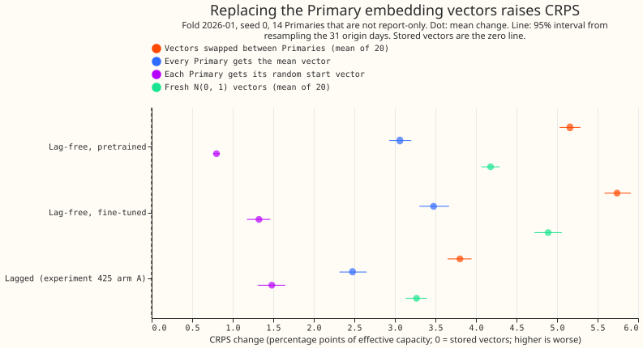
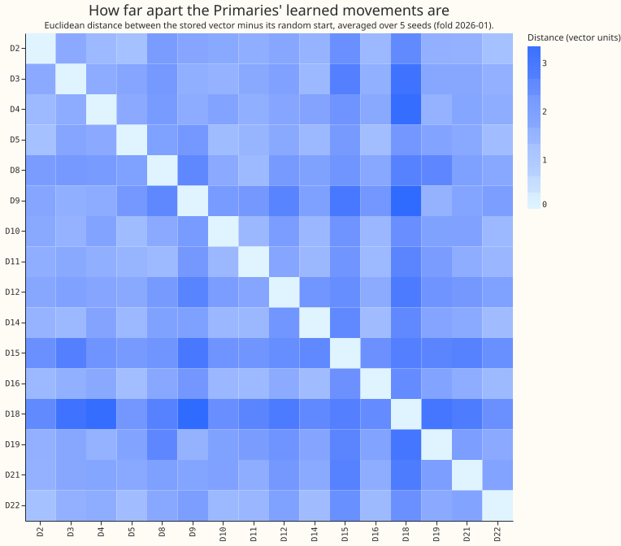
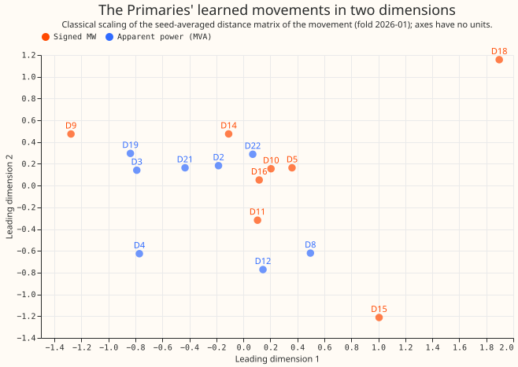
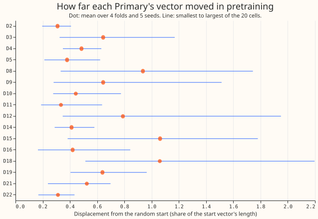

**The lag-free demand network's Primary embedding is not just a random label, but it is also not a
map of physical behaviour.** The embedding is the table of 8 numbers that tells the network which
primary substation (Primary) a row belongs to. Each vector starts as a random draw. Pretraining moves
each vector about half its own length, and the network needs that movement: scoring a Primary with
its own random start vector, instead of its trained vector, raised the continuous ranked probability
score (CRPS, lower is better) by 0.80 percentage points of effective capacity (a percentage of the
Primary's capacity) for the pretrained network and by 1.32 for the fine-tuned network. What the
movement encodes is only weakly physical.

We asked whether the embedding carries more than a random identity tag. We read the stored weights of
experiments 448 (the lag-free network, 4 folds x 5 seeds), 425 (the lagged network, arm A), and 511
without fitting anything. We regenerated each random start, measured how far the vectors moved,
tested the movement against 10 per-Primary descriptors of demand shape and weather response and
against the metering type, and replaced the vectors in the network and rescored the 2026-01 test
month. Verdict: partly supported. "The six" are the 6 Primaries that report signed megawatts and "the
eight" are the 8 that report apparent power (MVA) only; D15 and D18 (the two short-history Primaries)
are left out of every mean.

## Figures

## Results

- **Part 1, displacement.** The regenerated start correlates 0.85 to 0.93 with the stored vectors of
  the same seed (20 files). The stored vectors sit 0.52 of the start's norm from the start (95%
  bootstrap interval 0.50 to 0.54 over 20 fold-and-seed cells; arm A 0.68). Daily fine-tuning moves
  them a further 3.6% (3.0% to 4.2%); the one fine-tuned L-1d network of experiment 511 moved 1.8%.
  The per-dimension standard deviation is 0.56 to 1.51, and 6 or 7 of 8 dimensions carry 90% of the
  variance (5 or 6 for the random start alone).
- **Part 1, alignment.** Same-seed stored vectors agree across folds (Spearman 0.92 mean over 30
  matrix pairs of 120 distances), as the shared start makes certain. After the start is removed,
  same-seed movements still agree (0.88 over 30 pairs). Different seeds agree on the movement
  (0.38 mean, 0.09 to 0.59, 40 pairs) far more than on the stored vectors (0.16, -0.06 to 0.34),
  against a permutation null with standard deviation 0.14: part of the movement is the same
  whichever start it begins from. Arm A and the lag-free network agree 0.73 on the movement (20
  pairs).
- **Part 2, Mantel tests.** Eleven counted tests (10 descriptors and the metering type) plus the
  probe, level 0.05 / 12 = 0.0042, on fold 2026-01 with the 5-seed average distance matrix. One test
  passes: winter weekday profile shape (Spearman 0.51, p 0.0014, 14 Primaries, since D15 and D18 have
  no winter data in that window). It also has p 0.002 at fold 2025-10 and 0.0096 at 2026-03 and
  0.012 at 2026-06. With cosine distance, which ignores how far a vector moved, the same test gives
  0.09 (p 0.28). The movement's length correlates 0.67 with the winter profile's deviation from the
  mean, so the pass reflects the size of the movement and not its direction. Temperature slope in
  winter (0.33, p 0.026), load factor (0.36, p 0.047), and midday shortwave slope (0.36, p 0.045) do
  not pass the count. The 120 pairs come from 16 Primaries, so they overstate the independent
  evidence.
- **Part 2, metering type.** The Mantel correlation is -0.00 to 0.03 at every fold (p 0.50 to 0.97).
  The leave-one-Primary-out probe classifies 31% to 38% of the 16 Primaries correctly from the
  movement and 50% to 69% from the stored vectors, against 50% for chance (exact binomial interval at
  the Bonferroni level, 0.06 to 0.74 for the movement; the lower bound never exceeds 0.5). D15 and D18
  sit in the group of their own metering unit, so there are two groups of 8. The metering type is not
  separated.
- **Part 2, power of the test.** A planted-signal control (a movement built from one descriptor at
  25% or 50% of its variance, 100 draws) detects the weekend ratios, the temperature slopes, and
  (at 50%) the profiles at rates of 0.54 to 1.00 and 0.65, but demand level and load factor only at
  0.06 to 0.43. A null result for demand level is therefore weak evidence.
- **Part 3.** One fold (2026-01), one seed (0), 14 scored Primaries, each Primary's day equally
  weighted. The identity arm reproduces experiment 448's stored quantiles to 2.2e-5 of capacity at
  every level. The table gives the CRPS change in percentage points at the six and at the eight,
  with the 95% interval from resampling the 31 origin days. The minimum detectable effect is
  0.246 (six) and 0.328 (eight).

| Network | Arm | Six | Eight |
|---|---|---|---|
| Lag-free, pretrained | vectors swapped (mean of 20) | 3.63 (3.52 to 3.73) | 6.31 (6.06 to 6.55) |
| Lag-free, pretrained | mean vector | 0.80 (0.73 to 0.86) | 4.76 (4.50 to 5.02) |
| Lag-free, pretrained | own random start | 0.44 (0.32 to 0.56) | 1.07 (0.94 to 1.20) |
| Lag-free, pretrained | fresh N(0, 1) (mean of 20) | 2.59 (2.54 to 2.65) | 5.37 (5.15 to 5.59) |
| Lag-free, fine-tuned | vectors swapped | 4.30 (4.17 to 4.43) | 6.82 (6.50 to 7.16) |
| Lag-free, fine-tuned | own random start | 0.86 (0.74 to 0.98) | 1.67 (1.34 to 1.98) |
| Lagged (arm A) | vectors swapped | 2.64 (2.51 to 2.78) | 4.67 (4.45 to 4.91) |
| Lagged (arm A) | own random start | 0.81 (0.75 to 0.88) | 1.98 (1.70 to 2.27) |

The identity scores are 5.55 (six) and 5.67 (eight) for the pretrained network, 5.53 and 4.74 for the
fine-tuned network, and 4.91 and 4.54 for arm A. Swapping vectors raises CRPS by 5.16 points on
average for the pretrained network, 5.74 for the fine-tuned network, and 3.80 for arm A. Arm A loses
34% less than the fine-tuned lag-free network and 26% less than the pretrained one. The swap shows
that the vectors are used, not that they are informative.

## Predictions

- P1 (displacement 0.40 to 0.60, fine-tune movement under 0.05): met.
- P2 (no Mantel test passes): not met. One of 11 passes, and the cosine distance and the movement-size
  correlation explain it.
- P3 (swap raises CRPS by more than 0.5): met at every network.
- P4 (own start costs under the minimum detectable effect): not met. It raised CRPS by 0.44 to 1.98,
  above 0.246 (six) and 0.328 (eight) in every row of the table.
- P5 (arm A loses at least a third less): met against the fine-tuned network (34%), not against the
  pretrained network (26%).
- Decision rule: one Mantel test passes and the own-start arm is worse by more than the minimum
  detectable effect, so the rule returns "healthy". We read this as "used, only weakly arranged",
  because the one passing test depends on movement size.

## Part 4: options for telling the network which Primary it is

None was run. "Window" says whether the option uses only the training window, so it adds no live-data
dependency at serving. The evidence cited is experiment 406 (removing the embedding raises CRPS by
0.79 and 0.81 points at the six and the eight), 421 (raw last-7-days power identifies the Primary 90%
of the time, yet a learned label beats it by 0.28 to 0.33), 425, and 448.

- **Initialise the embedding from descriptors** (for example a PCA of each Primary's training-history
  profile). Prediction that could fail: the cross-seed agreement of the movement rises from 0.38 to
  above 0.7, and CRPS falls by more than the minimum detectable effect. Cost: low, one code change
  and a pretrain. Window: yes.
- **A higher learning rate, or no weight decay, on the embedding.** Prediction: the displacement from
  the start rises above 0.8 and CRPS falls. Cost: low. Window: yes.
- **Static descriptor inputs recomputed at each refit.** Prediction: the network matches the
  embedding's CRPS without a learned label, and the fresh-vector arm of this experiment stops being
  worse than the descriptors. Cost: medium (a descriptor table per fold and the feature columns).
  Window: yes.
- **A wider embedding (16 or 32).** Prediction: no CRPS gain, because 6 of 8 dimensions already
  carry the variance of the start. Cost: low. Window: yes.
- **A per-Primary output scale and bias head.** Prediction: a gain at the eight, where the
  start-vector arm cost the most. Cost: low. Window: yes.
- **Feature-wise modulation of the hidden layers from the embedding.** Prediction: a gain only if
  Primaries differ in weather response, which the temperature-slope Mantel tests did not show.
  Cost: medium. Window: yes.

## Consistency with experiment 511

Experiment 511 found the daily-refit lag-free network ahead of K2-S1 below about 2 days and behind at
days 5 to 10. A weak embedding would hurt at every lead, so the result is not evidence that the
embedding is thin. The weather columns come from each Primary's own H3 cell, which carries
per-Primary information besides the embedding.

## Checks

- Median minus mean forecast per site, tail calibration, curtailment cost, and load-shift plots do
  not apply: no forecast was fitted and the page scores only swapped weights.
- Triggers: trigger 2 fired for P4 (the movement is used) and for P2. The cosine and movement-size
  tests and the fresh-vector arm are the tested explanations. No audit ran, because of quota, and the
  PR says so.
- Row set: the 2026-01 test rows with a cleaned actual, which is not experiment 454's row set; the
  raw quantiles are not widened.
- Skipped: the reverse-flow share and the midday-dip share (experiments 506 and 508) were not
  computed, and the 2025-12 weights of experiment 510 are not used.

## Caveats

- Part 3 is one fold and one seed, and the minimum detectable effect is an assumption carried over
  from experiment 511's two-seed, five-fold value.
- Part 1 and 2 intervals come from 20 cells and 5 seeds.
- Rows with no labelled event are not separated: NGED's logs may miss load-shift events, so these
  numbers include unlogged events.

## What to try next

- Test per-Primary descriptors as static inputs, against the embedding at the same seeds, with the
  metering type as a direct input.
