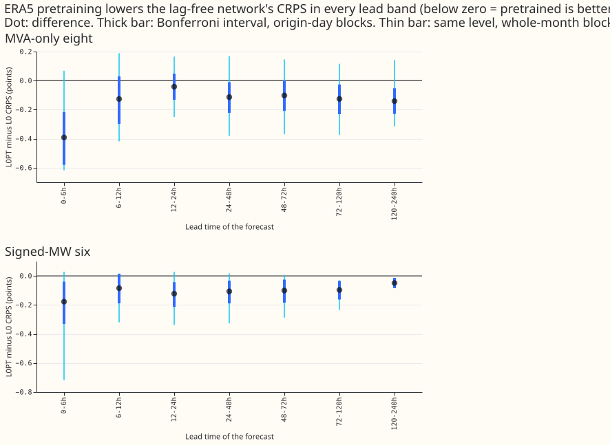
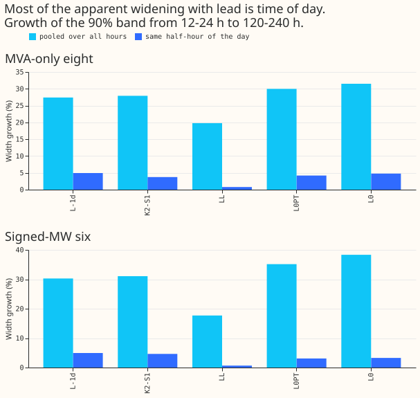
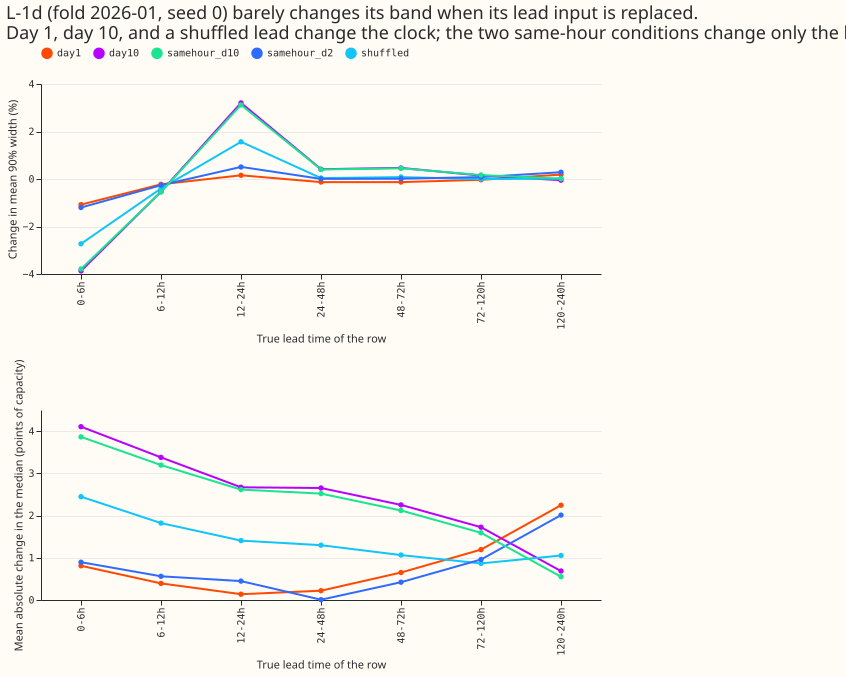
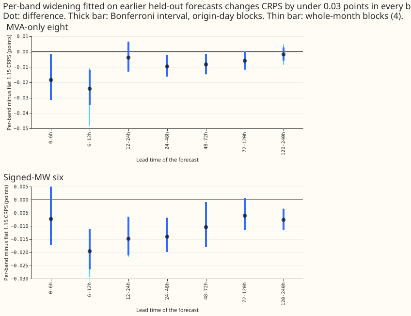
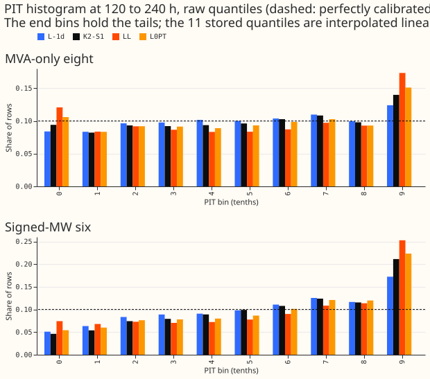
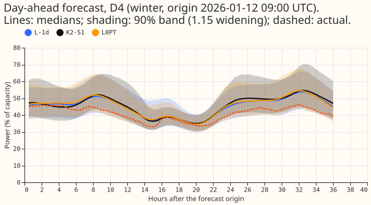
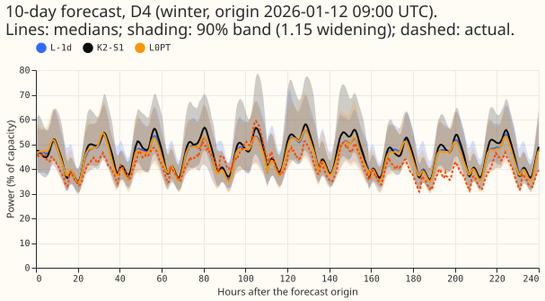
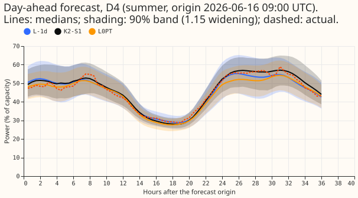
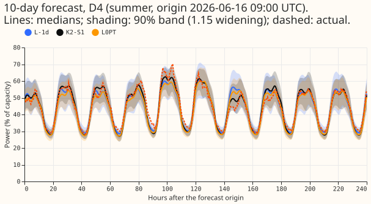

**The lag-free neural network does not widen its prediction bands with lead, but neither does K2-S1,
and widening the bands separately for each lead recovers almost none of K2-S1's advantage at days 5
to 10.** Lead is how far ahead the forecast looks. The lag-free neural network L-1d reads no recent
power readings and is refitted every day. It starts from weights pretrained on ERA5 weather, in
which the forecast is the truth at every lead. We asked whether L-1d has learned that a longer lead
means a larger weather error. K2-S1 is the neural network that also reads lagged power. We re-read
the forecasts that experiments 511, 454, and 448 had stored, scored them by lead band (a range of
leads, such as 120 to 240 h), and fed experiment 511's stored L-1d weights altered lead inputs.
Replacing the lead input changed the mean width of the 90% prediction band by at most 4%. The band
grows only 5% from 12-24 h to 120-240 h once the half-hour of the day is held fixed (every forecast
origin is at 09:00 UTC, so lead fixes the half-hour), against 27% in the pooled figures. K2-S1's
band grows by 4%. Widening the bands separately for each lead, with factors fitted on earlier
held-out forecasts, changes the continuous ranked probability score (CRPS, lower is better) by at
most 0.024 points of effective capacity. ERA5 pretraining lowers CRPS in every lead band as a point
estimate. Its Bonferroni interval over origin-day blocks excludes zero in 5 of 7 bands at the eight
and 6 of 7 at the six, but the whole-month Bonferroni interval only in 0 of 7 and 2 of 7. Every
number on this page is interim and unaudited until a human has read it.

Here "the eight" are the 8 MVA-only (megavolt-ampere-metered) Primary substations and "the six" are
the 6 signed-MW (megawatt-metered) Primary substations, as in experiment 521. CRPS (the
continuous ranked probability score, lower is better) is in points of effective capacity. This
experiment fitted no neural network and used no GPU. A Bonferroni interval widens each interval so
that the stated number of tests share one 5% error rate. A PIT (probability integral transform)
histogram shows where actuals fall within the forecast distribution. Origin-day blocks resample
whole forecast days.

## Predictions

- **P1 held for the width and failed for the median.** Setting every row to day 10 changes L-1d's
  mean 90% width by -4% to +3% across lead bands (under the predicted 10%). It moves the median by a
  mean absolute 0.7 to 4.1 points of capacity (day 10), against the predicted 1% of capacity or
  less.
  The network ignores lead for the band and uses it for the centre of the forecast.
- **P2 held.** Within one half-hour of the day the 90% width grows by 4.9% (L-1d) and 3.7%
  (K2-S1) at the eight and by 5.0% and 4.6% at the six, differences of 0.012 and 0.003 as ratios.
- **P3 half held.** Per-band widening lowers CRPS at 120-240 h by 0.008 points at the six
  (Bonferroni interval -0.012 to -0.003, excludes zero) and by 0.002 at the eight (includes
  zero). The eight part held (under 0.03). The predicted 0.03 at the six was not reached. Against
  the gaps of 0.196 (six) and 0.174 (eight) from experiment 521's rows, per-band widening closes 4%
  and 1%. Those gaps use different rows from the folds 2025-12 onward in the contrast, so the
  percentages are approximate. On the contrast's own rows the gaps are not stored.
- **P4 mixed, and confounded by recipe.** L0PT minus LL is negative in 2 of the 4 bands below
  48 h as predicted (0-6 h: -0.043 eight, -0.022 six; 12-24 h: -0.100, -0.146), positive in the
  other 2 (6-12 h and 24-48 h), and positive at 120-240 h by 0.37 (eight) and 0.53 (six) as
  predicted. LL differs from L0PT in training recipe, so this contrast does not isolate
  pretraining. Against L0, the same network without pretraining, the pretrained L0PT has the lower
  CRPS in every band as a point estimate (see Results).

## Results

- **Pretraining helps at every lead as a point estimate (like-for-like).** L0PT minus L0, in points
  of CRPS (negative
  means pretraining is better; Bonferroni intervals over origin-day blocks, 28 counted tests).
  At the eight, L0PT minus L0 is -0.39 [-0.58, -0.22] at 0-6 h, -0.14 [-0.23, -0.05] at 120-240 h,
  -0.13 [-0.21, -0.06] pooled (the pooled rows are not among the 28 counted tests). At the six it is
  -0.18 [-0.33, -0.04] at 0-6 h, -0.05 [-0.09, -0.01] at 120-240 h, -0.08
  [-0.11, -0.05] pooled. Origin-day intervals exclude zero in 5 of 7 bands at the eight and 6 of 7
  at the six. The Bonferroni whole-month intervals (4 blocks, near the range of the folds) exclude
  zero in 0 of 7 bands at the eight and 2 of 7 at the six (72-120 h and 120-240 h; at 120-240 h the
  six's is -0.083 to -0.021). The unadjusted whole-month intervals exclude zero in 1 and 6.
- **The contrast with LL is confounded.** L0PT minus LL is +0.37 [+0.22, +0.53] at 120-240 h at
  the eight and +0.53 [+0.34, +0.73] at the six, but LL is a cell of experiment 454's lag-free
  heads, which come from experiment 404's cross-fitted lag-free table and another training recipe.
  LL scores 5.084 and L0 5.596 at the eight, so the
  difference lies in the recipe and not in pretraining.
- **Per-band widening gains under 0.03 everywhere.** Per-band minus flat 1.15, CRPS: -0.002
  (eight) and -0.008 (six) at 120-240 h; -0.018 and -0.007 at 0-6 h; -0.005 and -0.009 pooled
  (folds 2025-12 onward). The flat 1.15 was chosen on the scored rows, so it is not held-out. The
  per-band factors, fitted on earlier forecasts, leave q95 coverage at 0.920 (eight) and 0.938 (six)
  pooled, below the 0.95 target, because the earlier folds were better covered than the later
  ones.
- **Hour of day and lead are tied together.** Every origin is at 09:00 UTC, so lead fixes the
  half-hour of the target. The pooled 90% width grows 27% (eight) and 30% (six) from 12-24 h to
  120-240 h, and 5% once the half-hour is held fixed.
- **The Part 3 gate does not hold.** L-1d minus K2-S1 q95 coverage at 120-240 h is 0.015 (eight)
  and 0.027 (six) lower than at 12-24 h, short of the 0.03 gate, and L-1d covers more than K2-S1
  in both bands. Part 3 is not run.
- **PIT histograms.** At 120-240 h the top PIT bin holds 0.124 (eight) and 0.172 (six) of L-1d's
  rows against 0.1 if calibrated, and the bottom bin holds 0.084 and 0.051. The actuals fall above
  the bands more often than below.

## Tail calibration at 120-240 h (L0PT, L0 )

| Arm | Group | q95 coverage | q99 coverage | q99 pinball |
|---|---|---|---|---|
| L0PT | eight | 0.938 | 0.987 | 0.302 |
| L0 | eight | 0.934 | 0.984 | 0.306 |
| K2-S1 | eight | 0.952 | 0.989 | 0.287 |
| L0PT | six | 0.899 | 0.975 | 0.215 |
| L0 | six | 0.896 | 0.972 | 0.225 |
| K2-S1 | six | 0.911 | 0.979 | 0.196 |

## Checks

- **Median minus mean forecast.** The widening in this experiment changes only the distance of each
  quantile from the median, so the median is unchanged. The median minus the atom-weighted mean of
  the 11 stored quantiles
  is -0.6 (L0PT) and -0.5 (L0) points at the eight, and -0.2 (L0PT) and -0.3 (L0) at the six, pooled
  over bands.
- **Error of the median beside the CRPS contrast.** The mean absolute error of the median,
  L0PT minus L0, is -0.22 at the eight and -0.08 at the six at 120-240 h, the same sign as the CRPS
  contrast.
- **Leave one Primary out.** The L0PT minus L0 CRPS at 120-240 h is between -0.17 and -0.10 at the
  eight and between -0.06 and -0.03 at the six, whichever Primary is left out.
- **Triggers.** The protocol's second audit trigger (a result contradicts its prediction) fired for
  P1's median part, P3, and P4; the
  explanation is the 09:00 UTC origin (P1), non-stationary coverage (P3), and the recipe
  difference between L0PT and LL (P4), tested by adding L0. The other triggers except the seventh
  did not fire. The seventh (a later design depends on an unreplicated result) may fire: the
  manager's next lead experiments could depend on the pretraining
  sign, which rests on one pair of experiments (448's L0 and L0PT, 3 seeds, 4 folds); no audit has
  run.
- **Reviews.** A Sonnet plan review, a Sonnet code review (no blocking findings; the hour
  stratification, the width comparison rows, the Bonferroni tail resamples, and unused code were
  fixed), and a Sonnet results review that re-derived the L0PT minus LL contrast, the width ratios,
  one widening factor, and the L-1d reproduction without a mismatch. The L0 contrast has had the
  same code review as the other contrasts. The results review did not cover it.
- **Reproduction.** The panel reproduces experiment 511's stored L-1d CRPS to 5e-7 in every month.
  The lead-swap "true" condition reproduces experiment 511's stored seed-0 quantiles to 5.4e-5 of
  capacity. Experiment 511's 2,736 rows of 2026-06 with NaN `cov_*` and `pin_*` are in no row set
  and are excluded.

## Method and data

- **Arms and rows.** Rows are experiment 511's scored rows (row set
  `experiment_470_intersection_v1`;
  folds 2025-10, 2025-12, 2026-01, 2026-03, 2026-06; D15 and D18 cut at 2025-03-01; cleaned data).
  L-1d is the quantile average of experiment 511's two seeds. K2-S1 and LL are experiment 454's
  three cells each. L0PT and L0 are experiment 448's seeds 0 to 2 (world 0; no 2025-12 fold, so
  four folds). All scores use the 1.15 widening, and the cells are scored one by one and averaged.
- **Cadence.** Monthly for experiments 448 and 454, daily for L-1d. No refit here.
- **Part 2 factors.** Estimated per daily cutoff from the unwidened L-1d quantiles whose target is
  at
  least 3.5 h before the cutoff; floor 0.5, cap 3, fallback 1.15 when a band holds under 2,000
  rows (100 of 6,832 day, set, band, and tail cells; `part2_fallbacks.csv`).
- **Past-weather caveat.** No weather enters this experiment; it re-reads stored forecasts, whose
  inputs are the stored ensemble mean and spread.
- **Minimum detectable effect.** From the seed spread, for L0PT and L0 at 120-240 h: 0.13 and 0.20
  (eight), 0.21 and 0.09 (six). At 120-240 h the L0PT minus L0 contrast of -0.14 (eight) sits
  below the L0 arm's own 0.20, so it is a point estimate with 3 of 4 folds negative at the eight (4
  of 4 at the six), and its Bonferroni interval excludes zero over origin-day blocks only at the
  eight; at the six the whole-month interval also excludes zero.
- **Lead swap.** L-1d, fold 2026-01, seed 0, 31 daily lag-free neural networks, CPU. K2-S1's
  lag-free heads cannot be
  swapped: experiment 454 stored their forecasts, not their weights.
- **No load-shift event plots.** This experiment scores no event slice.
- **Not done.** Part 3 (L-Pshare waits for experiment 519; L-lead-head is not supported by the lead
  swap and Part 2). Comparison with experiment 435's table P factors, which were fitted on other
  arms.

## What the next experiment should answer

**The long-lead gap may lie in the centre of the forecast rather than the band width.** The lead
swap moves L-1d's median by up to 4 points of capacity while its band stays put, and a per-band
width correction recovers under 5% of the gap. The next experiment can test whether the advantage of
K2-S1 and of experiment 454's five-head lag-free ensemble at days 5 to 10 comes from averaging
several heads, by scoring the mean absolute error of each arm's median by lead.
