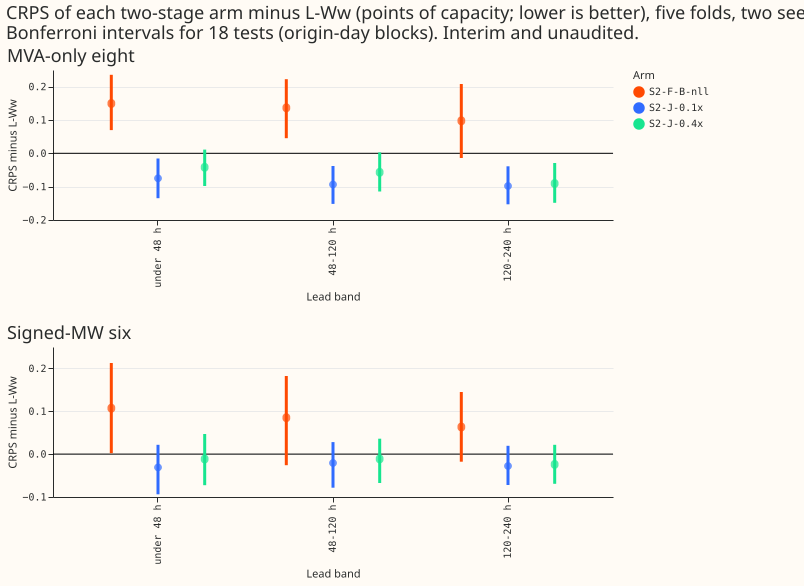
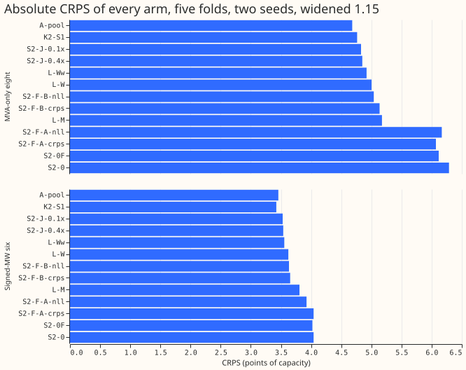
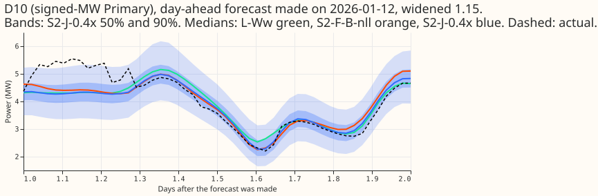
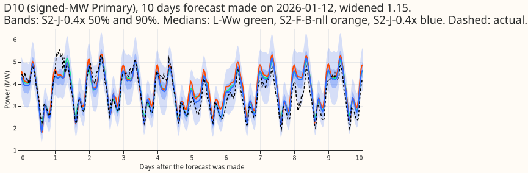
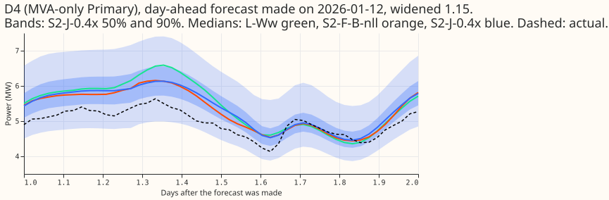
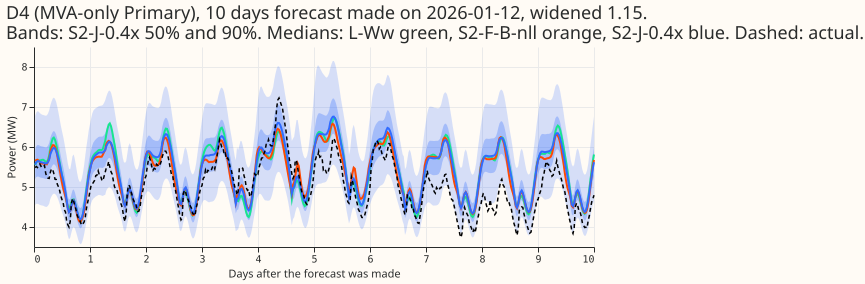

> **Correction (2026-11-04).** The gap to K2-S1 above 24 h of lead on this page is voided. K2-S1
> mixes in experiment 404's lag-free head, which took its weather from the freshest run at each
> target's valid time (leads of 9 to 33 h at every horizon), a look-ahead that a forecast made at
> the origin does not have. The gap at 0 to 24 h is unchanged, and comparisons that do not involve
> K2-S1 are unaffected. The rebuilt K2-S1 will restate the gaps. Evidence: experiments 531 and 532.

**A weather-to-power network that never sees lead time or ensemble spread, fine-tuned together with
a small calibrator, forecasts as well as the current single-stage lag-free network L-Ww; the same
two parts with the first network frozen forecast worse.** We split the lag-free demand network in
two. The first network maps ERA5 and CAMS weather, the calendar, and the Primary substation to a
probability distribution of power. It was trained on past-weather rows only and has no lead-time or
spread input. A small second network takes that distribution plus the lead, the ensemble spread,
the hour, and the metering group, and returns a corrected distribution. We scored five test months
(2025-10, 2025-12, 2026-01, 2026-03, 2026-06) with weekly refits, two seeds, and CRPS in points of
capacity (lower is better). The method builds on the lag-free network of experiments
[448](../00448-s1-network-assembly-ladder-with-pretraining-b-mix-and-seed-pool/result.md) and
[510](../00510-lagless-demand-network-weekly-finetune-and-recency-weights/result.md), and on
experiment 449's cross-fit for the second network's training rows. Interim, unaudited numbers.

Verdict: partly supported. S2-J, with the first network fine-tuned together with the calibrator, is
inside the minimum detectable effect (MDE) of L-Ww in all six group-and-band cells (equivalence
holds). The pre-registered gain for the frozen arm S2-F (P1) did not appear: S2-F is worse than
L-Ww. Several arms in the plan did not run (below).

## Figures

## Results

- **Arms.** S2-0: the stored L0PT network with no fine-tune (the CPU gate; keeps lead and spread).
  S2-0F: the new lead-free, spread-free first network alone. S2-F: S2-0F plus a second network
  trained on cross-fitted outputs, form A (a shift of the means and log standard deviations per
  group and 30-hour lead bin) or form B (2 x 32 multilayer perceptron), with the negative
  log-likelihood (nll) or the closed-form CRPS as loss. S2-J-0.4x and S2-J-0.1x: first network and
  form-B head fine-tuned together at 0.4x or 0.1x of the 5e-4 pretraining rate (0.4x is experiment
  511's L-1d rate).
- **Absolute CRPS (eight / six), all lead bands.** K2-S1 4.763 / 3.423; S2-J-0.1x 4.828 / 3.529;
  S2-J-0.4x 4.849 / 3.537; L-Ww 4.920 / 3.555; S2-F-B-nll 5.040 / 3.634; S2-F-B-crps 5.137 / 3.653;
  S2-0F 6.118 / 4.022; S2-0 6.287 / 4.041; S2-F-A-nll 6.168 / 3.924; S2-F-A-crps 6.071 / 4.041.
  The MDE of a two-seed pool is 0.164 (eight) and 0.123 (six).
- **Counted contrasts against L-Ww (18 tests; first minus second; negative is better).** S2-J-0.1x:
  eight -0.075, -0.094, -0.098 and six -0.031, -0.021, -0.028 in the bands under 48 h, 48 to 120 h,
  and 120 to 240 h. S2-J-0.4x: eight -0.042, -0.057, -0.091 and six -0.011, -0.011, -0.024.
  S2-F-B-nll: eight +0.149, +0.137, +0.098 and six +0.107, +0.085, +0.063. The Bonferroni intervals
  exclude zero for S2-J-0.1x at the eight in all three bands (upper bounds -0.015, -0.038, -0.039)
  and for S2-J-0.4x at the eight only at 120 to 240 h (-0.029). No S2-J gain reaches the MDE, so
  none counts as a gain; the equivalence is the finding. S2-J-0.1x is better than L-Ww in 4 or 5 of 5
  folds at the eight and 3 or 4 of 5 at the six.
- **Predictions.** P1 (S2-F beats L-Ww at 120 to 240 h by 0.087 / 0.098): not supported, S2-F-B-nll is
  +0.098 / +0.063 worse. P2 (S2-J within the MDE): holds in every band. S2-J-0.4x closes 42% of the
  eight's 120 to 240 h gap to K2-S1 (0.091 of 0.215) and 10% of the six's; S2-J-0.1x closes 46% and
  11%. P4 (form A recovers 70% of form B's gain over S2-0F): not supported; form A is +0.03 to +0.08
  worse than S2-0F at the eight and recovers 8% to 32% of form B's gain at the six. P3, P5, P6, P7:
  not run (below).
- **What the calibrator adds.** Form B minus S2-0F: -1.21, -1.09, -1.02 (eight) and -0.46, -0.39,
  -0.36 (six), in all 5 folds. S2-J-0.4x minus S2-F-B-nll: -0.19, -0.19, -0.19 (eight) and -0.12,
  -0.10, -0.09 (six). The nll loss beats the CRPS loss for form B by 0.05 to 0.13 at the eight
  (descriptive).
- **Tails (all leads; 95th and 99th percentile pinball loss / coverage, eight).** L-Ww 1.015 /
  0.964 and 0.287 / 0.995; S2-J-0.1x 1.014 / 0.958 and 0.285 / 0.993; S2-J-0.4x 1.027 / 0.959 and
  0.293 / 0.993; S2-F-B-nll 1.092 / 0.954 and 0.309 / 0.991. Six: L-Ww 0.699 / 0.935 and 0.184 /
  0.989; S2-J-0.1x 0.694 / 0.933 and 0.184 / 0.989. The two-stage tails match L-Ww's. The 1st and 5th
  percentiles, the tails by lead band, and the avoidable-curtailment cost were not computed.
- **Gate (S2-0).** The stored L0PT weights with no fine-tune score +1.37 (eight) and +0.49 (six)
  CRPS above L-Ww, so fine-tuning on ensemble rows carries most of the skill.

## Checks and caveats

- **Setup.** Weekly refits, 90-day half-life, rows by experiment 510's rule (valid time at most 3.5 h
  before the cutoff, within 730 days), widening 1.15 applied by the scorer to every arm, cleaned data
  (1,179 scoring half-hours dropped as flagged exact zeros across the folds), the D15 and D18 cut
  from the rows of experiment 454. The contrasts are for weekly refits only. L-Ww, L-W, L-M, K2-S1
  are stored predictions from experiments 510 and 454. Stage 1 and the cross-fit networks are saved
  under `work/stage1` and `work/stage1_crossfit` (60 + 10 files) in the private data folder; the
  stage-2 and S2-J weights were not saved.
- **Cross-fit.** Each second-network training row uses a first network that left out a 3-day-padded
  block of the history around its valid time (6 blocks per fold and seed). That network is slightly
  staler than the full one used at test, which may over-widen S2-F. The CRPS loss is in units of
  each Primary's standard deviation, so it weights low-variance Primaries more than nll does.
- **Not run (quota pause until Wednesday 2026-11-04 01:00 UTC).** The stage-0 arms, S2-M, S2-R, the
  daily harness, the injected-shift leak, the eleven-quantile control, the 1st and 5th percentile
  tails, tails by lead, widths and the probability integral transform by lead, the avoidable
  curtailment cost, and the load-shift plots. They remain proposals.
- **Audit triggers.** Trigger 2 fired for P1; the page tests an explanation (S2-J minus S2-F above:
  the frozen first network cannot track recent demand). Trigger 3 was not checked: the mean-forecast
  error and the median-minus-mean forecast per site were not computed. The results review, the
  prose review, and the audit were skipped for quota, and every number is interim and unaudited. The
  author checked the quoted numbers once against the stored score tables. Trigger 7
  applies to any later design that builds on S2-J's equivalence.
- **Seeds and statistics.** Two seeds, five folds; the intervals resample 153 origin days, with the
  five whole-month blocks as a check (per-fold signs above). The Bonferroni count is 18.
- **Unlogged events.** NGED's logs may miss load-shift events, so clean rows may hold events no label
  covers; this page scores no event slice.
- **What to try next.** Run S2-M (51 members through the first network), the stage-0 weather adaptor,
  and the injected-shift leak once the quota returns. Test whether the S2-J head still helps
  against a lead-free network without a head, to see whether the head adds anything.
