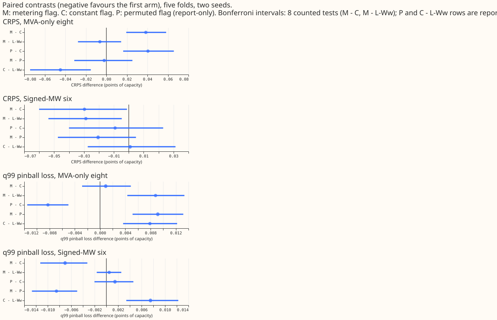
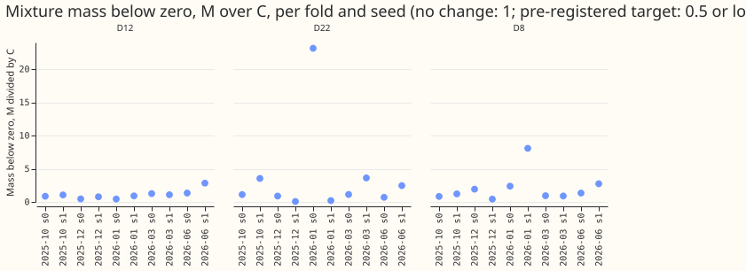
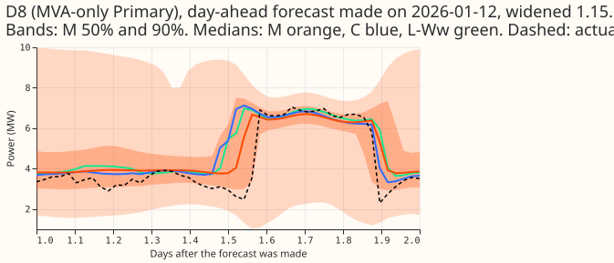
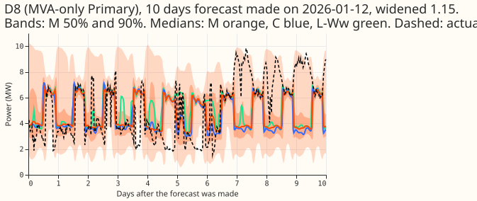
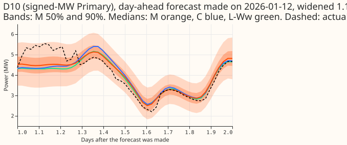
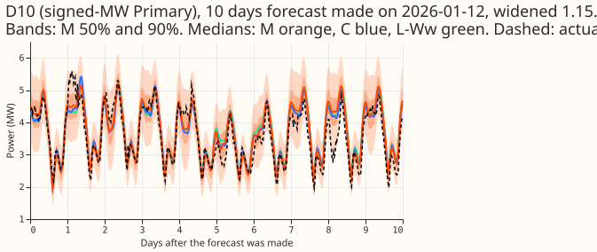

> **Correction (2026-11-04).** The gap to K2-S1 above 24 h of lead on this page is voided. K2-S1
> mixes in experiment 404's lag-free head, which took its weather from the freshest run at each
> target's valid time (leads of 9 to 33 h at every horizon), a look-ahead that a forecast made at
> the origin does not have. The gap at 0 to 24 h is unchanged, and comparisons that do not involve
> K2-S1 are unaffected. The rebuilt K2-S1 will restate the gaps. Evidence: experiments 531 and 532.
**Telling the lag-free demand network whether a Primary reports signed MW or apparent power in MVA
did not improve its forecast.** M is the network with one 0/1 metering column (1 for MVA), C the
same network with that column fixed at 0, P a copy with the column assigned to a random 8 of the 16
Primaries, and L-Ww the 37-input network. At the eight MVA-only Primaries, M scored worse than C by
0.038 points of CRPS (Bonferroni interval +0.019 to +0.058; lower is better), and P scored worse by
0.041, so the loss comes from adding a per-Primary column of that shape, not from metering type. At
the six signed-MW Primaries M scored better than C by 0.030 (-0.060 to -0.001), and P did not (-0.009,
-0.040 to +0.023). The flag did not cut the mixture's probability mass below zero at the eight.
Every number on this page is interim and unaudited until a human has read it.

Verdict: not supported. P1 (no CRPS move at either group) and P2 (mass below zero halved) failed, and
the falsifier P5 (M worse than C, with an interval excluding zero) held at the eight. The embedding
is therefore not shown to be too thin.

## Figures

## Results

- **Absolute scores (CRPS, points of capacity; eight / six).** L-Ww 4.920 / 3.555; C 4.875 / 3.556;
  M 4.913 / 3.526; P 4.915 / 3.547; K2-S1 4.763 / 3.423 for scale. Five folds (2025-10, 2025-12,
  2026-01, 2026-03, 2026-06), seeds 0 and 1, weekly refits, experiment 470's intersection rows. C is
  experiment 519's stored F0z, reused unrefitted (a forced-zero check reproduced its forecast to 6e-6
  on 53,760 rows). July 2026 unused. Scoring actuals dropped for a flagged exact zero: 1,179
  half-hours across the five folds, as in experiment 519.
- **Counted family (Bonferroni, 8 tests), difference and interval.** M - C CRPS: eight +0.038
  (+0.019 to +0.058), six -0.030 (-0.060 to -0.001). M - C q99 pinball loss: eight +0.001 (-0.003 to
  +0.005), six -0.007 (-0.011 to -0.003). M - L-Ww CRPS: eight -0.006 (-0.028 to +0.014), six -0.029
  (-0.054 to -0.005). M - L-Ww q99: eight +0.009 (+0.004 to +0.013), six +0.000 (-0.002 to +0.003).
- **Report-only family (Bonferroni, 12 tests).** P - C CRPS: eight +0.041 (+0.016 to +0.066), six
  -0.009 (-0.040 to +0.023). M - P CRPS: eight -0.002 (-0.031 to +0.025), six -0.021 (-0.047 to
  +0.005). P - C q99: eight -0.008 (-0.012 to -0.005). C - L-Ww CRPS: eight -0.045, six +0.001 (this
  repeats experiment 519's F0 against L-Ww; M - L-Ww is confounded with that width and batch
  difference).
- **Minimum detectable effect.** Experiment 511's two-seed values (0.164 at the eight, 0.123 at the
  six) are shown for scale only. The paired intervals above are tighter than those values, so an
  effect smaller than about 0.02 to 0.03 points could not have been detected.
- **Tail table (coverage at q01 / q05 / q95 / q99; eight, then six).** C 0.002 / 0.017 / 0.961 / 0.994
  and 0.001 / 0.011 / 0.935 / 0.988. M 0.002 / 0.018 / 0.961 / 0.994 and 0.001 / 0.011 / 0.941 / 0.991.
  q95 pinball loss rose at the eight (M - C +0.023, +0.012 to +0.035) and fell at the six (-0.020).
- **Mass below zero (mean of the mixture's mass below 0 MW over the scored half-hours; M / C / L-Ww).**
  D8 0.0065 / 0.0046 / 0.0033; D12 0.0025 / 0.0026 / 0.0023; D22 0.00054 / 0.00031 / 0.00040. The
  M over C ratio was at most 0.5 in 1 of 10 fold-and-seed cells at D8, 2 of 10 at D12 (both seed 0),
  and 2 of 10 at D22, so P2 fails. D22's baseline mass is below 0.1%, so a halving is untestable
  there. At D8 the share of half-hours with q05 below zero rose from 0.2% (C) and 0.02% (L-Ww)
  to 2.1% (M).
- **D10 reverse-flow case study (single Primary).** Only 3 of the 15 days since 2025-10 with a negative
  reading at D10 fall in the scored months (2,420 half-hours). The share of those half-hours whose q05
  is below zero is 18.1% for M, 17.9% for C, 14.2% for L-Ww, and 15.9% for P; no median is below
  zero in any arm. D10's flag is 0 in both M and C, so the M - C difference is interference.
- **Choices.** The flag is the 38th input (experiment 519 keeps the 37-input recipe). The group
  comes from the `units` column of the Primary table (D15 and D18 are MW and report-only). P is one
  random draw of the 8/6 split.

## Checks

- The plan review and one code review ran (Sonnet) and were triaged on the pull request; the
  code review found no blocking defect. A results review that re-derives the headline numbers, the
  audit triggers, and the write-up reviews were **not run**, on the manager's instruction to spend at
  most one review because the quota is tight. The median-minus-mean forecast check was not run.
- No lookahead: the flag is a fixed fact about each Primary, and the pretraining and refit row
  assertions of the copied harness (rows past the cut equal 0) ran.

## Caveats

- Two seeds and five folds leave seed-to-seed noise of 0.06 to 0.08 points (experiment 519), larger
  than the six's gain, so the six's -0.030 is a point estimate near the 0.03 margin set in the plan.
- At the six, M and C have identical inputs (flag 0 in both), so the six's contrast measures
  interference through shared weights and noise, not information.
- The mass is measured on every scored half-hour of the test rows, not only experiment 470's row set.
- NGED load-shift events may be missing from its logs, so rows with no labelled event may hold
  unlabelled events.

## What to try next

- Truncate or clip the mixture at 0 MW at the eight if forecasts must be non-negative.
- Leave the Part 4 embedding options in their current order.

## Plan (written before any fit)

- **The metering flag is the 38th input, not the 39th.** Experiment 519 (merged) keeps the 37-input
  L-Ww recipe as the base: its best arm F0 carried a source flag only as a constant column (0 in every
  ERA5-and-CAMS pretraining row, so its first-layer weights never trained), and its advice is to
  pretrain on ERA5 and CAMS rows alone. The recipe therefore has no source flag, and the metering
  flag is the only added column.
- **Arms.** M: 38 inputs, the 37 lag-free columns plus a metering column read from the Primary index
  (1 for apparent power in MVA, 0 for signed MW), pretrained with it, fine-tuned weekly from those
  weights. M is pretrained with experiment 519's `train_share` at share 0 (8,192 ERA5 and CAMS rows
  per step), with the column derived from the Primary index, so M and C share the recipe, the width,
  and (with the same `torch.manual_seed`) the initial weights. C: experiment 519's stored F0
  pretrains and F0z fits, reused unrefitted; its column is a source flag held at 0, which is a constant
  column here. A sanity check runs M's code path with the lookup forced to 0 and must reproduce F0z to
  float tolerance, and the row counts must match 519's. L-Ww: experiment 510's stored forecasts. The
  M minus L-Ww contrast is confounded with the width and batch difference that 519 documented (F0
  minus L-Ww is -0.043 at the eight). P (report-only): the same network with a fixed random
  8/6 assignment of the 16 Primaries to the flag, one draw, to separate "metering type" from "any
  extra per-Primary column". At the six, M and C have identical inputs (flag 0 in both), so the
  six's contrast tests interference and noise, not information.
- **Recipe.** The L-Ww harness: ERA5-and-CAMS pretraining (experiment 448's rows and loop), weekly
  refit, 90-day half-life, restart from the month's pretrained weights, five folds (2025-10,
  2025-12, 2026-01, 2026-03, 2026-06), seeds 0 and 1, weekly cadence because L-Ww is the weekly
  anchor. July 2026 stays unused. Cleaned data throughout, with the flagged exact-zero half-hours
  dropped (the count is printed per fold), and the D15 and D18 rows before 2025-03-01 cut.
- **Group of each Primary.** The flag takes the metering unit of each of the 16 Primaries. The eight
  are D2, D3, D4, D8, D12, D19, D21, and D22; the six are D5, D9, D10, D11, D14, and D16; D15 and
  D18 take the flag of their own metering unit (checked against the metering table before any fit)
  and are report-only. The code review checks the Primary-index-to-label mapping against `sites()`
  before any per-Primary number is quoted, because the earlier proxy inferred it.
- **Mass below zero.** For each row, the sum over the three components of the softmax weight times
  the normal CDF of (z0 - mean_k) / std_k, with z0 = -target_mean / target_std of the Primary; no
  outlier component. It is not zero for a correct network, because demand sits near zero at the eight.
- **Inference-only baseline first (CPU, no GPU go needed).** Load experiment 510's stored L-Ww
  fine-tuned state dicts (`models/hl90`), run them on the scored rows, and compute for each Primary
  the mixture's probability mass below zero (the mixture CDF at 0 MW after undoing the Primary's
  target standardiser), before any clipping. Report it per Primary at D8, D12, and D22. A Primary
  whose baseline mass is below 0.1% of rows cannot show a halving.
- **Reverse-flow case study at D10.** Take the stored reverse-flow days of experiment 506
  (`part1_days_six`, level 0: 15 of 117 days since 2025-10 at D10; D5 has 5 days in all, not enough)
  and report, for M, C, and L-Ww, the share of those days' half-hours whose forecast median or q05 is
  below zero beside the share of half-hours whose actual is below zero. It is a single-Primary case
  study.
- **Statistics.** Paired contrasts over origin-day blocks as in experiment 519's scorer, Bonferroni
  family of 8 (above), the two-seed minimum detectable effect printed beside every contrast, per-fold
  signs reported, intervals worded as "not shown to move CRPS (interval a to b)". The Part 2 probe
  of experiment 522 (the leave-one-Primary-out linear probe of metering type from the embedding) is
  reported beside the result, not as a gate, once experiment 522 merges. Tail table: coverage and
  pinball loss at 0.01, 0.05, 0.95, and 0.99. The load-shift reporting rule is not triggered,
  because no labelled event is scored.
- **Figures.** CRPS and q99 contrast of M minus C and M minus L-Ww with intervals (headline), the
  per-Primary mass below zero at D8, D12, and D22 for L-Ww, C, and M, the D10 reverse-flow days with
  the three forecasts, two example forecasts (day-ahead and 14-day, one Primary), and the per-fold
  signs.
- **Compute.** About 0.4 GPU-hours: 20 pretrains (arms M and P x 5 folds x 2 seeds, 31 to 46 s
  each) and 100 weekly fine-tunes (2 arms x 5 folds x 2 seeds x 5 weeks, about 5 s each) plus the
  month builds; C costs nothing because 519 stored it. One GPU process under 8 GB (`MemoryMax=8G`, `OMP_NUM_THREADS=1`).
  No fit starts before
  the manager's "GPU go". Experiment 510's L-Ww forecasts and weights and 519's F0 and F0z are reused,
  which saves 10 pretrains and 50 fine-tunes. Code changes: a 16-long flag lookup in `sites()` order
  (asserted), a `with_flag` variant that appends `lookup[p]` in pretraining, validation, `GpuMonth`,
  and the test rows, and a mixture-mass function.
- **Reviews.** One Sonnet plan review, one Sonnet code review before the first fit, a results review
  that re-derives the headline numbers, and two write-up reviews.
