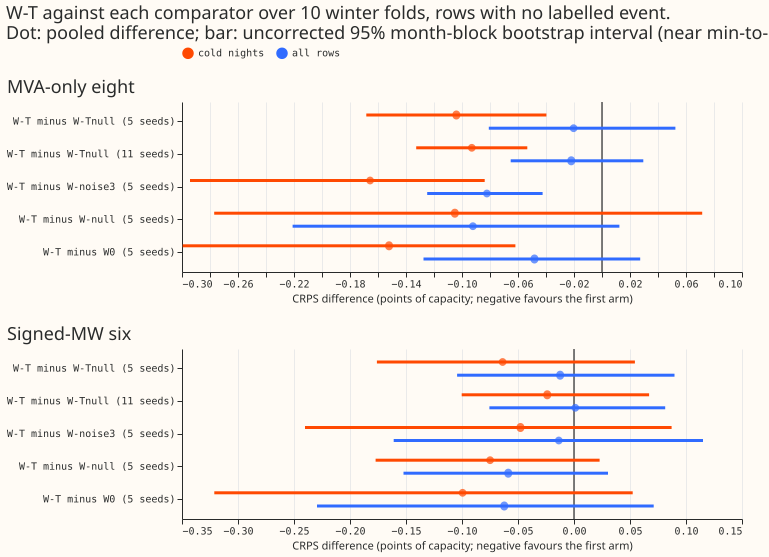
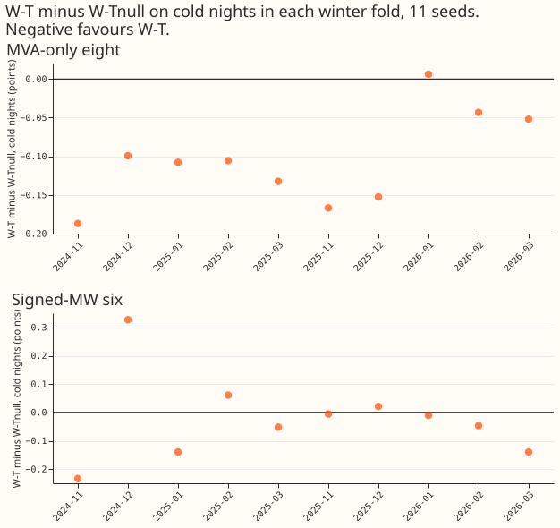
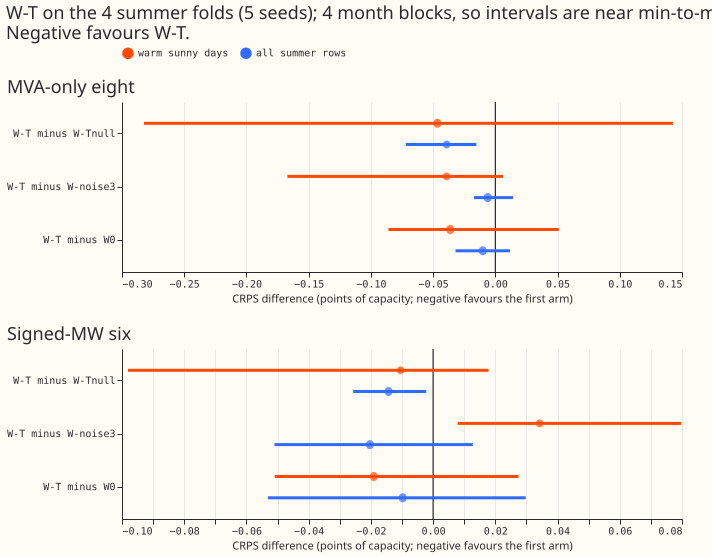
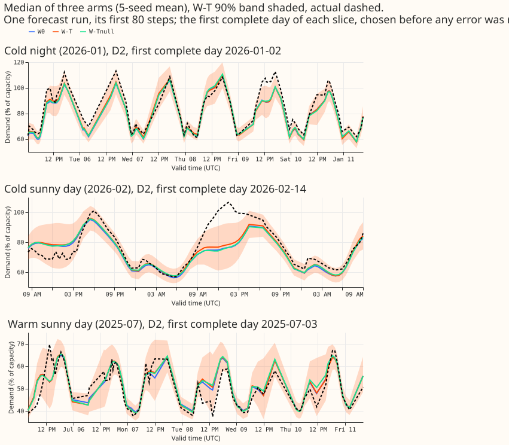

**Take-home: on cold winter nights at the eight MVA-only Primaries, trailing temperature windows
lowered the error of the lag-free demand neural network by a small amount more than a shuffled-day
placebo of the same three columns did, but the margin is only just above what the seeds can resolve,
so the next step is a check on more winters at the eight.**

A Primary is a primary substation of NGED's electricity distribution network. The eight MVA-only
Primaries report power in MVA with no sign, and the six signed-MW Primaries report power in MW with
a sign. We asked whether the cold-night gain of experiment 515's trailing temperature windows came
from the
windows' content or merely from giving the neural network three extra columns. "W-T" gives the
lag-free demand neural network (one that reads no recent power) the means of temperature over the
previous 6, 24, and 72 hours. "W-Tnull" gives it the same three columns filled with the temperatures
of a randomly drawn other day. "W-noise3" gives it three columns of random numbers, and "W0" is the
plain network. We compared the four on the 10 winter test months of experiment 515, with 5 seeds and
then 11 seeds, and on 4 summer months. Cold nights are half-hours below 5 °C between 18:00 and 08:00
local time. CRPS is the continuous ranked probability score in points of effective capacity, and a
negative difference favours the first arm. The "seam check" compares W-T with a build that fills the
hours before the forecast origin with the run's first value ("W-seam").

**Maintainer decision.** The pre-registered adoption rule was not met, because the seam check
failed narrowly (below). The maintainer's decision, relayed by the manager, is to adopt W-T for the
first-release recipe despite that failure. This experiment changed no recipe, serving code, or
dependency pin and records results only, so `adopted_in` stays `none` until a model release is cut.

- **Primary (registered): W-T minus W-Tnull, cold nights, eight.** 5 seeds: -0.104, bootstrap 95%
  interval [-0.168, -0.040], 8 of 10 folds negative. 11 seeds: -0.093 [-0.133, -0.053], 9 of 10
  negative. Without 2024-11: -0.086 [-0.123, -0.045]. The 5-seed point estimate is above the
  registered -0.12 line, so the 5-seed result reads as a tighter interval and not as a verdict. The
  intervals are month-block bootstraps over 10 folds, so they are near min-to-max.
- **Minimum detectable effect (seed spread only), eight, cold nights, pooled over 10 folds:** 0.140
  at 5 seeds and 0.083 at 11 seeds (all rows: 0.104 and 0.062).
- **Predictions.** P1 (point estimate -0.05 or lower): passes. P2 (W-noise3 minus W0 inside plus or
  minus 0.118): passes, +0.014 [-0.075, +0.105]. P3 (seam, all rows, within plus or minus 0.02):
  fails, W-seam minus W-T is +0.030 [+0.002, +0.071] at the eight and +0.026 [-0.002, +0.060] at the
  six (experiment 515 also failed it at 3 seeds).
- **Against the other comparators (eight, cold nights, 5 seeds).** W-T minus W0 -0.152 [-0.300,
  -0.062] (experiment 515 found -0.150). W-Tnull minus W0 -0.048 [-0.189, +0.047], so about a third
  of
  the gain over W0 also appears with shuffled days at 5 seeds, and almost all of that comes from
  fold
  2024-11 (W-Tnull minus W0 -0.683 there). W-T minus W-noise3 -0.166 [-0.384, -0.055]
  (Bonferroni-21), 10 of 10 negative. W-null minus W0 -0.047; W-T minus W-null -0.105 [-0.358,
  +0.176].
- **Absolute CRPS (11 seeds, cold nights / all rows).** Eight: W0 4.557 / 5.351, W-T 4.441 / 5.290,
  W-Tnull 4.534 / 5.312. Six: W0 3.373 / 4.108, W-T 3.305 / 4.062, W-Tnull 3.329 / 4.060.
- **The placebo contrast resolves nowhere else (5 seeds unless stated).** All rows at the eight: W-T
  minus W-Tnull -0.020 [-0.106, +0.095]. All rows at the eight, W-T minus W0 does resolve: -0.062
  [-0.092, -0.027] at 11 seeds, so W-T is no worse than +0.03 (adoption condition ii, also met at
  the six: -0.047 [-0.169, +0.060] at 11 seeds). Six cold nights: W-T minus W-Tnull -0.064
  [-0.243, +0.127]. Summer (4 folds): warm sunny W-T minus W-Tnull -0.047 at the eight and -0.010 at
  the six, intervals spanning zero. W-S and W-X minus W0 on cold nights at the eight (-0.079,
  -0.055)
  do not resolve.
- **Tails (eight, cold nights, W-T minus W0).** q95 pinball loss -0.030 [-0.039, -0.015], q99
  -0.010 [-0.017, -0.001]; the share of actuals below the q95 forecast rises by 0.008 [0.001, 0.016]
  and below the q99 forecast by 0.001 [-0.0001, 0.002]. Horizon bands (all rows, eight): days 4 to
  10 -0.060 [-0.155, +0.016], earlier bands about
  -0.02.
- **Fold 2024-11** gives W-T minus W0 -0.83, but W-T minus W-Tnull is -0.147 there and -0.101
  without
  it, so the placebo contrast does not depend on that fold. Folds 2025-11 and 2026-01 favour
  W-Tnull.
- **Weather inputs and timing.** Every window column comes from the run issued at or before the
  forecast origin, as in experiment 515's causality check (later runs removed, same result). This
  experiment did not repeat that check row by row.

## Checks

- **Median minus mean forecast (eight, cold nights, points of capacity):** W0 +0.139, W-T +0.093,
  W-Tnull +0.102, W-null +0.108, W-noise3 +0.142; all rows +0.21 to +0.29. The mixture mean sits
  slightly above the median for every arm, so the spread does not shift the forecast by more than
  0.3
  points.
- **Error of the mean forecast beside CRPS:** W-T minus W0 mean error -0.238 [-0.454, -0.095] and
  median
  error -0.203 [-0.457, -0.058], the same sign as the CRPS contrast. W-Tnull minus W0 mean error
  -0.072
  includes zero. The refit that supplies the mean for seeds 0 to 2 reproduced experiment 515's
  quantiles to within 0.00003. The mean is not available for W-S, W-X, and W-seam.
- **Audit triggers.** Trigger 1 fired: the placebo W-Tnull gained 0.048 on cold nights, mostly in
  fold
  2024-11. No audit was run, to save quota. The result is worded as a small gain only just above the
  minimum detectable effect, and a reader should weigh the missing audit.
- **Bonferroni.** 1 primary test at 0.05; a secondary family of 21 tests (the W-T minus W-null,
  W-noise3, and W-Tnull contrasts at the registered slices). Everything else is descriptive and
  uncorrected.
- **Caveats.** W-noise3 columns are frozen across seeds, so its intervals are narrower than a
  re-drawn noise arm's. Event labels are incomplete, so clean rows may hold unlabelled events. Warm
  sunny rests on 4 summer month blocks. W0 for 2025-12, 2026-01, and 2026-03 seeds 0 to 2 comes from
  experiment 513's `P0`. No example forecast shows a metered generator. W-noise9 was not run.

## What to try next

- Check W-T at the eight on a longer history (more winters) before relying on a 0.09-point gain.
- Repeat with a nine-column noise arm only if the W-null contrast needs a column-count control.
- The six signed-MW Primaries need a different test: no window arm resolved there at 11 seeds.

## Plan (written before any fit that produced a quoted number)

### Question

Experiment 515 ([result
page](../00515-lagless-demand-network-trailing-weather-window-features/result.md))
gave a lag-free neural network the trailing means of temperature over 6, 24, and 72 hours (W-T) and
found a cold-night CRPS gain of 0.150 points at the eight MVA-only Primaries. A placebo that gave
every row the nine window columns of a randomly drawn other day (W-null) gained 0.071, so the
real windows did not resolve from the placebo. That comparison confounded the content of the
columns with their number (three real columns against nine shuffled ones), used three seeds, and had
no summer fold. It also did not run the median-minus-mean forecast check, the mean-forecast error
beside each contrast, or the example forecast graphs.

This experiment repeats the comparison with a placebo matched to W-T's three columns, five seeds, a
column-count control, four summer folds, and the missing checks. It adds files only: no
`e00515_*` file is edited, and every output goes to this experiment's own folder, because the 515
scorer lists arms by scanning its own `work/seed_preds/*`.

### Design notes

- The primary comparator is **W-Tnull**: the shuffled-day version of exactly W-T's three columns,
  drawn with the same donor days as W-null. W-null (nine columns) is a secondary comparator.
- **W-noise3** is three frozen independent standard-normal columns, the same for every training
  seed.
It controls the number of columns, not their content, so the W-T minus W-noise3 leg of the adoption
  rule is easier to pass than the W-Tnull leg. Noise columns are appended unscaled, because they
already have mean 0 and standard deviation 1. A nine-column noise arm is the follow-up if the W-null
  contrast needs a column-count control.
- The seam check of the adoption rule needs W-seam at 5 seeds, so W-seam seeds 3 and 4 run on the 10
  winter folds. They start from W-T's pretrained weights and need no pretraining.
- The mean-forecast refit needs only fine-tunes, because experiment 515 stored the pretrained
  weights
of W0, W-T, and W-null for seeds 0 to 2 (and experiment 513 stored `P0`'s for the three reused
  folds).
- The new scorer `e00526_score.py` replaces 515's hard-coded 20 tests with 1 primary and 21
  secondary
  tests and reads 515's forecast files by path, without scanning 515's folders. The new fit script
  subclasses 515's `Fold`, because W-Tnull needs the temperature columns of the placebo array and
  W-noise3 needs unscaled columns.

### Arms

Every arm starts from the 37 non-lag columns and is pretrained from scratch with its added columns,
in experiment 513's `P0` loop, as in 515.

| Arm | Added columns | Role |
|---|---|---|
| W0 | none | Control |
| W-T | 3 trailing temperature means (6, 24, 72 hours) | The candidate |
| W-Tnull | The same 3 columns, taken from a shuffled other day (515's donor rules) | Primary comparator |
| W-null | 515's 9 shuffled columns | Secondary comparator |
| W-noise3 | 3 frozen independent N(0,1) columns | Column-count control |
| W-S, W-X | 515's trailing shortwave means; the temperature-by-shortwave product | Carried over from 515 |
| W-seam | W-T with persistence fill before the origin | Seam check |

W-noise3 columns are drawn once per fold and stage from a fixed seed, so they carry no information
about demand.

### Folds and seeds

- **Winter folds (10):** 2024-11, 2024-12, 2025-01, 2025-02, 2025-03, 2025-11, 2025-12, 2026-01,
  2026-02, 2026-03, as in 515. Each reports with and without 2024-11.
- **Summer folds (4):** 2025-05, 2025-07, 2025-09, 2026-04. The refit cutoff is the start of the
  test month. Every fold scores only valid times before 2026-07-01, and July 2026 is unused.
  Summer folds add no cold nights, so they serve the warm-sunny slice only.
- **Seeds:** 5 (0 to 4) for W0, W-T, W-Tnull, W-null, and W-noise3 on the winter folds, then 11 (0
  to 10)
  for W0, W-T, and W-Tnull (approved extension).
Seeds 0 to 2 of W0, W-T, W-null, W-S, W-X, and W-seam are read from 515 (W0 for 2025-12, 2026-01,
  and
2026-03 from experiment 513's `P0`) and are not refitted. Summer folds fit every arm at all 5 seeds.
  The harness skips any forecast that exists, so more seeds can be added later without refitting.

### Statistics (pre-registered)

- **Primary:** 1 test, W-T minus W-Tnull, cold nights, the eight, level 0.05. The month-block
  bootstrap resamples the 10 winter folds, each carrying its 5-seed mean.
- **Secondary family: 21 tests**, Bonferroni-corrected. W-T minus W-null at five slice-and-group
  pairs: eight and six on all rows, eight and six on cold nights, and six on cold-sunny. W-T minus
W-noise3 and W-T minus W-Tnull at eight and six on all rows, cold nights, cold sunny, and warm sunny
  (8 + 8 tests). The primary cell appears in both the primary and the family, which is conservative.
  Fold sets: all rows, cold nights, and cold sunny use the 10 winter folds; warm sunny uses the 4
  summer folds, so those 8 tests rest on 4 month blocks and read as weak. W-S, W-X, W-null minus
  W-Tnull, and W-noise3 minus W0 are descriptive. D15 and D18 are report-only.
- **Minimum detectable effect at 5 seeds**, from the single-seed spread of 515 (0.215 all rows,
  0.300
  cold nights per fold): one fold 0.267 and 0.371; pooled over 10 folds 0.084 and 0.118. The scorer
  recomputes them from the five seeds and prints them beside every contrast.
- **State plainly:** the primary is not resolvable at 5 seeds. Its standard error is about 0.06, so
the 95% half-width is about 0.12 and the 80%-power minimum detectable effect about 0.17, against an
  observed 515 contrast of -0.079. The 11-seed extension for W0, W-T, and W-Tnull costs about
  1.7 to 1.9 GPU-hours and is part of this plan.
- **Lead bands:** day 1, days 2 to 3, days 4 to 10, as 515 scored.
- **Rows:** `experiment_526_v1` repeats 515's row rules (cleaned data, the D15 and D18 start cut,
  leads up to 240 hours, no labelled event) and keeps the rows every core arm holds.
- **Widening:** 1.15 about the median for CRPS, as in 515.

### Checks that 515 did not run

- **Median minus mean forecast, per arm.** The mixture mean is `sum(exp(log_w) x mean)` as in
`e00510_common.py`, converted to a fraction of capacity. Every new fit saves the mean column beside
  the quantiles, and the seeds 0 to 2 forecasts of W0, W-T, and W-null are refitted from the stored
pretrained weights (90 fine-tunes). The refit's quantiles are compared with 515's stored quantiles,
  so the check also reports whether the fine-tune reproduces.
- **Mean-forecast error beside each CRPS contrast** (absolute error of the mean, in points), through
  the same interval code.
- **Example forecast graphs**: a cold night, a cold sunny day, and a warm sunny day at a Primary
  (substations only; no metered generator).
- **Peak resident memory** of the first fold, measured with `/usr/bin/time -v`.

### Run order and cost

The GPU runs in stages, each started only on the manager's "GPU go". One GPU process under 8 GB
(`MemoryMax=8G`, `OMP_NUM_THREADS=1`). A fit pair (pretrain plus fine-tune) takes about 22 seconds,
plus
13 to 35 seconds of row building per fold and stage. This experiment runs before experiment 516's
GPU
fits.

| Stage | Contents | Pairs | Estimate (GPU-hours) |
|---|---|---|---|
| 1 | Winter seeds 3 and 4 of W0, W-T, W-null | 60 | 0.4 |
| 2 | Winter W-Tnull and W-noise3 at 5 seeds | 100 | 0.7 |
| 3 | 11-seed extension: seeds 5 to 10 of W0, W-T, W-Tnull, winter | 180 | 1.3 |
| 4 | W-S and W-X, winter seeds 3 and 4 | 40 | 0.3 |
| 5 | Four summer folds, 7 arms at 5 seeds | 140 | 1.0 |
| 6 | W-seam seeds 3 and 4, winter | 20 fine-tunes | 0.05 |
| 7 | Mean refit of seeds 0 to 2 of W0, W-T, W-null, winter | 90 fine-tunes | 0.15 |

The total is about 3.9 GPU-hours, of which the core 5-seed comparison (stages 1 and 2) is 1.1.

### Reuse and standing practices

Stored forecasts reused: 515's seeds 0 to 2 of W0, W-T, W-null, W-S, W-X, and W-seam, and 513's
`P0`.
Cleaned data and the D15 and D18 start cut apply. Refits are monthly. Fitted networks are saved in
the experiment's private data folder. July 2026 is unused. Generators are not scored.
The reviews follow the `ml-experiment` skill: a Sonnet plan review, a Sonnet code review before the
first fit, a Sonnet results review, an audit if a trigger fires, and two Sonnet write-up reviews.
