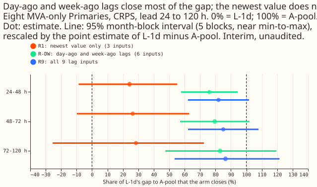
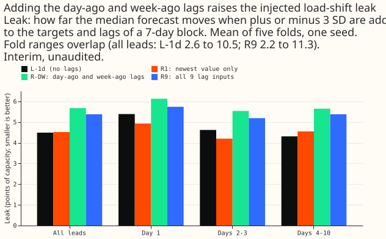

**The lag-free neural network L-1d scores 0.2 to 0.3 points of capacity worse (CRPS, the continuous ranked probability score) than the lag-enabled network A-pool at 24 to 120 h lead for the eight Primary substations metered in MVA only, and adding the day-ago and week-ago lags closes 76% to 83% of that gap (point estimates).** Experiments 527 to 539 tested whether head count, recency, restart, refit cadence, network family, or the weather's age explain the gap. The next step is to decide whether the lags are worth a larger injected load-shift leak (5.68 against 4.49 points of capacity for the day-ago and week-ago lags, in one seed). Verdict: supported. Every number on this page is interim and unaudited: no
experiment in the series has had a code or write-up review.

Names used below. **L-1d** is the daily-refit lag-free neural network of experiment 511. **A-pool**
is the same family of network with 9 lag inputs (the newest value, the same half-hour a day ago, and
the same half-hour and weekday a week ago, each with a missing flag and an age), refitted monthly, of
experiment 425 arm A. **K2-S1** is the mixture of lagged and lag-free heads of experiment 521.
**The eight** are the MVA-only Primaries and **the six** the signed-MW Primaries. **R1**, **R-DW**, and **R9** are L-1d with the newest-value lag, the day-ago and week-ago lags, and all 9 lag inputs added at fine-tuning. **A-nolag** is A-pool with its 9 lag inputs removed. A lead is the time between the forecast origin and the target. CRPS is in points
of capacity, and a positive "arm minus reference" means the arm is worse.

## Figures

## Findings

- **(a) K2-S1's edge at 120 to 240 h was a look-ahead (experiments 531 and 532).** Experiment 404's
  lag-free heads, which K2-S1 contains, took the weather for a target's valid time from the freshest
  run, so a target 5 to 10 days ahead got weather issued about a day before the target, which is 4 to 9 days after the forecast origin. Scoring L-1d with that
  weather lowered its 120 to 240 h CRPS at the eight from 5.140 to 4.940 (-0.201, interval -0.369 to
  -0.059) and, in the point estimate, removed its whole gap to K2-S1 (0.174 to -0.027; the Bonferroni-widened interval of the CRPS change, -0.452 to +0.008, includes zero). At the six it closed 58% of the gap
  (0.196 to 0.081; the CRPS change, -0.114, has an interval that includes zero). Scoring the 404 head
  with the weather of the run available at the origin raised its 120 to 240 h CRPS by 1.124 (interval
  1.027 to 1.210) at the eight. Five such heads averaged are 1.0 worse than K2-S1 at the eight and
  1.1 at the six. Every gap to K2-S1 above 24 h of lead is therefore not a valid forecast comparison.
  K2-S1 with an origin-time lag-free half was not scored.
- **(b) Head count, recency, restart, cadence, and a richer stage 2 do not explain the gap (experiments
  527 to 530, 534, 536).** Experiments 527 to 530 measured their factors against K2-S1, so finding
  (a) means they speak to K2-S1's look-ahead and not to A-pool. Within that frame, four daily seeds
  closed 11% (eight) and 21% (six) of the 120 to 240 h gap to K2-S1 (527). Recency half-lives of 365
  days or none, a from-scratch restart, and weekly or monthly refits all widened the gap, and daily
  beat weekly beat monthly (529). A stage 2 that sees every stage-1 input sat 0.576 above K2-S1 at the
  eight (528). The network ladder pointed to the weather's age, which 531 confirmed (530). Against
  A-pool directly, a shorter half-life raised the eight's 120 to 240 h CRPS monotonically (90 days
  5.140, 30 days 5.169, 14 days 5.228, 7 days 5.277, 3 days 5.386; A-pool 5.058), and 180 days was no
  better than 90 (534 for 3 to 90 days, 536 for 180 days).
- **(c) A-pool beats L-1d by 0.2 to 0.3 points at 24 to 120 h at the eight, and the lags carry it
  (experiments 533 and 537).** L-1d minus A-pool is +0.288 (interval +0.189 to +0.374), +0.254
  (+0.171 to +0.332), and +0.200 (+0.102 to +0.300) at 24 to 48 h, 48 to 72 h, and 72 to 120 h, with
  5 of 5 folds positive in each band. At 120 to 240 h the gap is +0.082 (-0.034 to +0.213), which is
  not shown. At the six L-1d is not shown to differ from A-pool, except at 12 to 24 h (+0.196). On cold nights at the eight the point estimate is larger, +0.535 at 24 to 48 h. Only three folds have cold nights, and the interval overlaps the all-rows interval.
  Removing A-pool's 9 lags raises its CRPS by +0.567, +0.512, and +0.454 points in the same three bands (every
  interval excludes zero, 5 of 5 folds). That network, A-nolag, is then worse than L-1d by 0.255 to
  0.279. A-nolag differs from L-1d in cadence and half-life as well as in lags, and experiment 537
  does not split those factors.
- **(d) The day-ago and week-ago lags close most of the gap, and the newest value does not
  (experiments 538 and 539).** At the eight, with lags added at fine-tuning only, the share of the
  gap closed at 24 to 48 h, 48 to 72 h, and 72 to 120 h is 24%, 26%, and 28% for the newest value, its
  flag, and its age (R1); 76%, 79%, and 83% for the day-ago and week-ago lags with their flags and
  ages (R-DW); and 82%, 85%, and 87% for all 9 lag inputs (R9). R1 minus A-pool excludes zero in all
  three bands (5 of 5 folds). R-DW minus A-pool excludes zero only at 24 to 48 h (+0.069, interval
  +0.016 to +0.122). R9 minus A-pool includes zero in all three bands. At the six, R1 and R9 are level with A-pool at 24 to 240 h. Outside that range, R9 is better at 6 to 12 h (-0.179) and R1 is worse at 12 to 24 h (+0.113).
- **(e) The lags raise the injected load-shift leak (experiments 538 and 539).** In the stress world
  a shift of plus or minus 3 standard deviations of the Primary's 7-day mean is added to the targets and to every lag whose observation time
  falls in a 7-day block. Averaged over all leads, the median forecast moves by 4.49 points of
  capacity for L-1d, 4.52 for R1, 5.38 for R9, and 5.68 for R-DW. At block age 0 the figures are 7.20
  (L-1d), 10.7 (R9), and 11.5 (R-DW). The day-ago and week-ago lags are the route, because R1 adds none measurable. These figures are descriptive. They come from one seed and five folds, and the fold ranges overlap (all leads: L-1d 2.6 to 10.5, R1 2.3 to 10.3, R9 2.2 to 11.3; no range was stored for R-DW).

## What was tried

The Bonferroni count is the number of counted contrasts in the experiment's own correction.

| Experiment | Question | Finding | Bonferroni count |
|---|---|---|---|
| 527 | Do more daily lag-free heads close K2-S1's 120 to 240 h edge? | 11% (eight) and 21% (six) of the gap closed | 56 |
| 528 | Does a stage 2 that sees every stage-1 input close it? | No: 0.576 above K2-S1 at the eight | 126 |
| 529 | Do recency, restart, or cadence close it? | No: every change widened the gap | 168 |
| 530 | Does the network family or the weather's age explain the edge? | Weather age: the ladder's first step raises CRPS by 0.88 at 120 to 240 h at the eight | 30 |
| 531 | Is the edge a look-ahead? | Yes in the point estimates: all of the eight's gap, 58% of the six's | 28 |
| 532 | Does an origin-time lag-free network match K2-S1? | No: 1.0 (eight) and 1.1 (six) worse at 120 to 240 h | 280 |
| 533 | How big is L-1d's gap to A-pool on the same rows? | +0.200 to +0.288 at 24 to 120 h at the eight | 28 |
| 534 | Does heavier recency weighting close the gap to A-pool? | No at the eight; not shown at the six, apart from 12 to 24 h | 70 |
| 535 | What differs between A-pool and L-1d? | Code reading only: lags are the largest difference | none |
| 536 | Does a 180-day half-life help? | No: no better than 90 days | 14 |
| 537 | What does A-pool lose without its lags? | +0.454 to +0.567 at 24 to 120 h | 28 |
| 538 | Do the newest value, or all 9 lags, close the gap when added to L-1d? | 24% to 28% and 82% to 87% | 56 |
| 539 | Do the day-ago and week-ago lags alone close it? | 76% to 83% | 28 |

## Checks

- **Weather from the run issued at or before the origin, row by row.** This page fits nothing and
  scores nothing. Experiments 538 and 539 passed it row by row on every test and training row. Experiment 537 passed it on the scored rows only. Experiments 532, 534, and 536 passed it on a 48,000-row sample of the shared feature source. Experiment 539, for example, asserted it on all 153 test origins and 25.0 million training rows. Example row from experiment 539: target 2025-10-03 07:00 UTC, origin 2025-10-01 09:00
  UTC, weather run 2025-10-01 00:00 UTC. The 404 head's freshest-run weather is the violation found, and
  finding (a) is about it.
- **Lags observed at or before the origin minus 3.5 h.** Experiments 538 and 539 passed this row by
  row. Example from 539: origin 2025-10-01 09:00 UTC, target 2025-10-01 12:30 UTC, day lag observed
  2025-09-30 12:30 UTC.
- **Figures.** Figure 1 rescales the stored arm-minus-A-pool intervals by the stored point estimate of
  L-1d minus A-pool (0.288, 0.254, 0.200), so its intervals ignore the uncertainty in that
  denominator. Figure 2 plots the stored means. `e00540_figures.py` holds every plotted number with the
  experiment it came from.

## Caveats

- Every experiment in the series is interim and unaudited. Intervals are 95% month-block bootstraps
  with 5 blocks, which is near the minimum to the maximum of the five folds.
- Experiments 538 and 539 add the lags at fine-tuning only, from zero first-layer weights. Pretraining
  with the lags was not tried. They use two seeds, and they do not replicate A-pool's row cuts (about
  2,900 of 4.9 million rows in 2026-01 and the D15 and D18 weekly-lag start cut). The remaining
  0.03 to 0.05 points between R9 and A-pool are not attributed.
- NGED's event labels are incomplete, so rows with no labelled event may hold unlabelled events. The
  minimum detectable effect from L-1d's two-seed spread (0.10 to 0.27) is a proxy for each arm's own.
- D15 and D18 are report-only, and the standing numbers for them are in each experiment's tables.
- The look-ahead finding rests on experiment 531's refit of the 404 head, which reproduced the stored
  table to 5.2e-06.

## What to try next

The injected-shift leak is the drawback of the lags. One open question is whether a lag network that gives less weight to lags inside a shifted block keeps the 76% to 83% gain at a lower leak.
The maintainer decides whether to run it.
