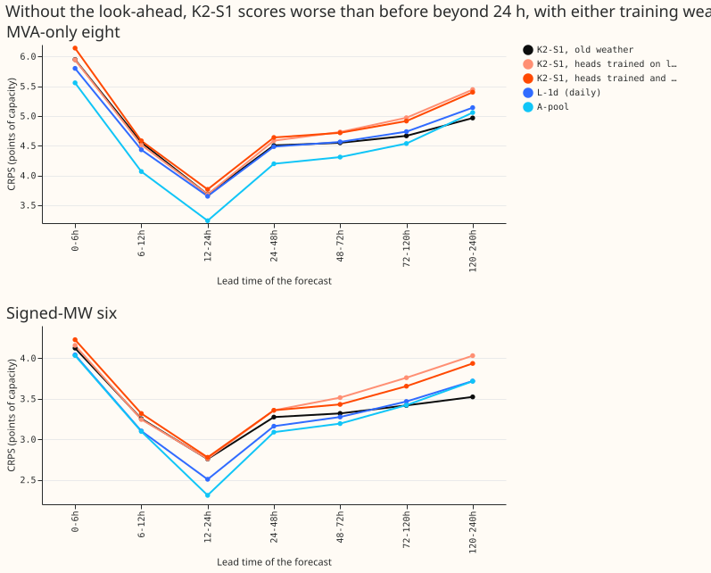
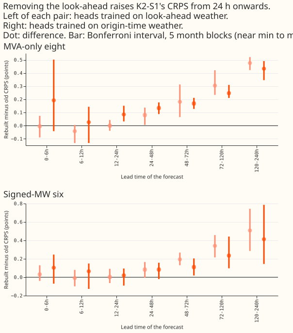

# K2-S1 rebuilt on origin-time weather

**Take-home message: K2-S1's lead over the daily lag-free network L-1d at 5 to 10 days was a
look-ahead, and with the look-ahead removed K2-S1 scores worse than L-1d from 24 hours ahead.** The
next step is to retrain the lag-free heads on origin-time weather, because the rebuilt K2-S1 here
still uses heads trained on the look-ahead weather and is probably too pessimistic. Verdict: partly
supported. P1 (same score below 24 h) held. P2 (a fall of about 0.17 and 0.20 points at 120 to 240
h) had the right direction and a size three times too small.

## What was rebuilt

- The S1 heads of experiment 454 already read weather from the run issued at the forecast origin,
  and their lag inputs sit at or before the origin. They are unchanged.
- The lag-free heads (experiment 404's "further" module, seeds 0 to 2) are refitted with experiment
  531's code, which reproduced 404's stored table to 5e-6, and fed the weather of experiment 397's
  rows. The cells are experiment 454's three seed pairs, each an equal-weight mixture of two S1
  heads and two lag-free heads. Code reused from experiments 404, 454, 521, and 531 (the last copied
  into this folder).
- Weather check: every one of the 1,142,520 scored rows was matched to the summary of the run
  initialised at origin minus 9 h, with all 14 weather columns equal. Example: Primary D2, origin
  2026-06-01 09:00 UTC, target 2026-06-07 15:30 UTC, run initialised 2026-06-01 00:00 UTC and
  published 09:00 UTC, lead 150.5 h, mean shortwave radiation 444.776 in both the table and the run.
  The check ties each row to its summary row, whose stored origin is the run time plus 9 h.
- Rows: rows with no labelled event, experiment 511's row set, five folds of 511; July 2026 unused.
  Eight = MVA-only Primaries, six = signed-MW Primaries.

## Scores

Rebuilt minus old K2-S1, CRPS in points of capacity. The MDE is `1.96 sqrt(2) sd / sqrt(3)` over the
three cells. Bonferroni count: 28 (2 counted contrasts, 7 bands, 2 row sets). Intervals: month-block
bootstrap with 5 blocks (near the minimum to maximum), Bonferroni-widened.

| Band | Eight: difference (interval, folds positive, MDE) | Six: difference (interval, folds positive, MDE) |
|---|---|---|
| 0-6h | -0.004 (-0.089 to +0.075, 2/5, 0.14) | +0.033 (-0.036 to +0.130, 2/5, 0.16) |
| 6-12h | -0.042 (-0.132 to +0.005, 1/5, 0.12) | -0.009 (-0.098 to +0.080, 2/5, 0.15) |
| 12-24h | -0.000 (-0.039 to +0.043, 2/5, 0.05) | +0.003 (-0.061 to +0.091, 2/5, 0.12) |
| 24-48h | +0.081 (+0.006 to +0.137, 4/5, 0.07) | +0.083 (-0.004 to +0.165, 4/5, 0.13) |
| 48-72h | +0.182 (+0.066 to +0.300, 5/5, 0.11) | +0.194 (+0.130 to +0.268, 5/5, 0.14) |
| 72-120h | +0.305 (+0.234 to +0.420, 5/5, 0.14) | +0.342 (+0.216 to +0.457, 5/5, 0.14) |
| 120-240h | +0.477 (+0.423 to +0.521, 5/5, 0.20) | +0.508 (+0.286 to +0.743, 5/5, 0.18) |

- Below 24 h every difference is inside its MDE (P1 holds).
- Rebuilt K2-S1 minus L-1d at 120 to 240 h: +0.303 at the eight and +0.312 at the six; the
  Bonferroni month-block interval includes zero at the eight (-0.032 to +0.587, 4/5 folds positive)
  and excludes it at the six (+0.075 to +0.690, 5/5 folds positive). The old K2-S1 was 0.174 and
  0.196 better than L-1d there.
- Absolute CRPS: eight 120-240h rebuilt 5.443, old 4.967, L-1d 5.140, A-pool 5.058, A-pool minus
  lags 5.430, R-DW 5.064; six rebuilt 4.031, old 3.523, L-1d 3.719, A-pool 3.717, A-pool minus lags
  3.995, R-DW 3.719. Full tables: `scores/absolute.csv` and `scores/contrasts.csv` in the private
  data folder.

## Caveats

- **The lag-free heads were trained on look-ahead weather.** The refit is experiment 404's training
  (freshest-run weather, run age 9.5 to 33 hours) and is then fed origin-time weather at leads up to
  240 h. The rebuilt K2-S1 is therefore a pessimistic bound. Retraining the lag-free heads on
  origin-time rows would give the fair figure; that is the next step, and is not done.
- Cells share seeds, so the MDE is optimistic. Row loss: none of the scored rows lacked a matching
  S1 head.
- NGED's event labels are incomplete, so clean rows may hold unlabelled events.

## Correction table: gaps to K2-S1 that change

Gap = reference CRPS minus K2-S1 CRPS in points of capacity (positive: K2-S1 better). Old = stored
K2-S1 (cell c0); new = rebuilt on origin-time weather (mean of 3 cells). Point estimates only;
intervals for the L-1d gap are in the page.

### Eight (MVA-only)

| Band | L-1d: old → new | L-Ww: old → new | A-pool: old → new | A-pool minus lags: old → new | R-DW: old → new |
|---|---|---|---|---|---|
| 0-6h | -0.15 → -0.14 | -0.07 → -0.06 | -0.39 → -0.39 | +0.11 → +0.11 | -0.37 → -0.36 |
| 6-12h | -0.12 → -0.08 | +0.02 → +0.06 | -0.49 → -0.45 | +0.36 → +0.40 | -0.48 → -0.43 |
| 12-24h | -0.03 → -0.03 | +0.06 → +0.06 | -0.44 → -0.44 | +0.24 → +0.24 | -0.29 → -0.29 |
| 24-48h | -0.02 → -0.10 | +0.07 → -0.01 | -0.31 → -0.39 | +0.26 → +0.18 | -0.24 → -0.32 |
| 48-72h | +0.01 → -0.17 | +0.10 → -0.08 | -0.24 → -0.42 | +0.27 → +0.09 | -0.19 → -0.37 |
| 72-120h | +0.07 → -0.23 | +0.15 → -0.15 | -0.13 → -0.43 | +0.33 → +0.02 | -0.09 → -0.40 |
| 120-240h | +0.17 → -0.30 | +0.21 → -0.26 | +0.09 → -0.39 | +0.46 → -0.01 | +0.10 → -0.38 |

### Six (signed-MW)

| Band | L-1d: old → new | L-Ww: old → new | A-pool: old → new | A-pool minus lags: old → new | R-DW: old → new |
|---|---|---|---|---|---|
| 0-6h | -0.08 → -0.12 | +0.01 → -0.02 | -0.09 → -0.12 | +0.14 → +0.11 | -0.12 → -0.15 |
| 6-12h | -0.15 → -0.14 | -0.03 → -0.02 | -0.16 → -0.15 | +0.20 → +0.21 | -0.33 → -0.32 |
| 12-24h | -0.25 → -0.25 | -0.16 → -0.16 | -0.45 → -0.45 | +0.14 → +0.13 | -0.43 → -0.43 |
| 24-48h | -0.11 → -0.20 | -0.04 → -0.12 | -0.19 → -0.27 | +0.19 → +0.10 | -0.21 → -0.29 |
| 48-72h | -0.04 → -0.24 | +0.02 → -0.17 | -0.13 → -0.32 | +0.23 → +0.03 | -0.13 → -0.32 |
| 72-120h | +0.05 → -0.29 | +0.11 → -0.23 | +0.00 → -0.34 | +0.34 → +0.00 | -0.01 → -0.35 |
| 120-240h | +0.20 → -0.31 | +0.25 → -0.26 | +0.19 → -0.31 | +0.47 → -0.04 | +0.20 → -0.31 |

## Experiments whose gap to K2-S1 used the old weather

Classified from each page's headline only; item A writes the correction notes on the pages.

- **Gap to K2-S1 reverses beyond 24 h (the conclusion "X stays behind K2-S1" does not survive):**
  510 (L-Ww behind K2-S1), 511 (daily L-1d behind K2-S1), 521 (K2-S1 advantage at 120-240 h). Their
  lag-free-versus-lag-free contrasts (cadence, half-life) stand, because both arms use the same
  weather.
- **Conclusion rests on short leads or on contrasts not involving K2-S1's long-lead score, so it
  probably stands:** 468 (events), 519, 523, 524, 525.
- **Not classified (headline not read or not about K2-S1's long-lead score):** 470, 527, 529, 530.
