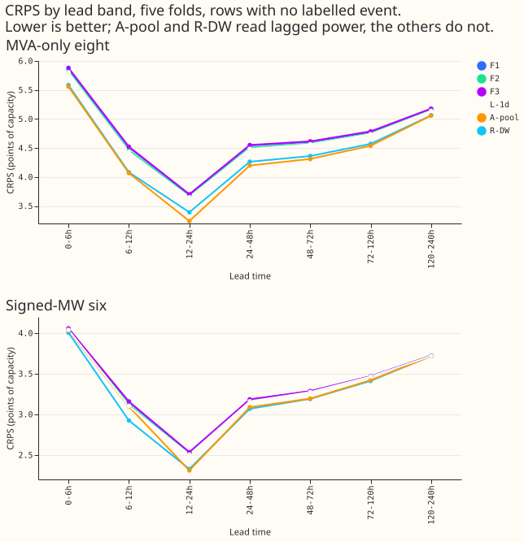
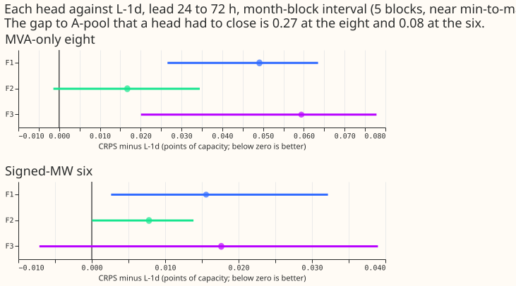
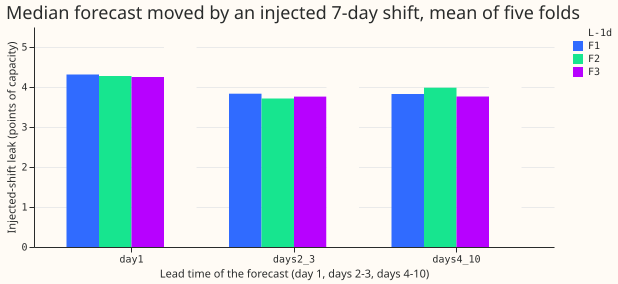

**Training a demand neural network without lagged-power inputs to predict the recent power level as
a side task did not help it forecast.**  Its continuous ranked probability score (CRPS, the quality
measure of a probabilistic forecast, here in percentage points of substation capacity; lower is
better) was 0.049 points worse than the same network without the side task, averaged over the eight
substations whose power is metered only as apparent power (MVA) and over forecasts 24 to 72 hours
ahead. None of the 0.271-point gap to the neural network that reads lagged power closed. The
reverse-flow side task scored 0.017 worse and the two side tasks together 0.059 worse.
The next step is to give the network the day-ago and week-ago lags as inputs, as experiment 539
did, because the recent level was not learnable as a side task in this test.

We asked whether a lag-free demand network can recover what lag inputs tell a lagged network
without receiving them at forecast time. We added extra outputs to the last layer of experiment
511's best lag-free network (L-1d) and trained them on power values from before each row's forecast
origin, which the network never sees as inputs. F1 predicts the newest observed power at the origin,
the day-ago power, and the week-ago power (three standardised values; this follows
[Caruana (1997)](https://doi.org/10.1023/A:1007379606734) in sharing hidden layers between a main
and a side task). F2 predicts whether power at the target time is below -0.005 of capacity (a
reverse flow), where the sign is metered. F3 has both heads. Each side loss has weight 0.5. Scores are
on experiment 511's five folds of one month each, 2 seeds, rows with no labelled event.

Verdict: refuted. The pre-registered prediction was that F1 would close at least half of the gap
between L-1d and A-pool (the lagged network of experiment 425) at lead 24 to 72 h at the eight,
meaning F1 minus A-pool of at most +0.144 and +0.127. F1 minus A-pool was +0.345 and +0.295. F2 was
predicted to change the eight by less than the minimum detectable effect (0.135), and it did (+0.017).
F3 was predicted to be no better than F1 and F3 was 0.010 worse.

## Results

| Lead 24 to 72 h, CRPS (points of capacity) | Eight | Six |
|---|---|---|
| F1 (recent-level head) | 4.574 | 3.234 |
| F2 (reverse-flow head) | 4.541 | 3.226 |
| F3 (both heads) | 4.584 | 3.236 |
| F1-w01 (post hoc: F1 with weight 0.1) | 4.530 | 3.220 |
| L-1d (no head; experiment 511) | 4.525 | 3.219 |
| R-DW (day-ago and week-ago lags as inputs; experiment 539) | 4.314 | 3.129 |
| A-pool (lagged network; experiment 425) | 4.254 | 3.142 |

- **F1 minus L-1d** is +0.049 at the eight (month-block interval +0.035 to +0.061, 5 of 5 folds worse,
  minimum detectable effect 0.135) and +0.016 at the six (+0.008 to +0.024, 5 of 5 folds).
- **F3 minus L-1d** is +0.059 at the eight (+0.040 to +0.074, 5 of 5 folds) and +0.018 at the six
  (+0.002 to +0.033, 4 of 5 folds). **F2 minus L-1d** is +0.017 at the eight (+0.004 to +0.028, 4 of 5 folds).
- **The gap that had to close** is L-1d minus A-pool: +0.271 at the eight (+0.182 to +0.352, 5 of 5
  folds) and +0.077 at the six (-0.015 to +0.160, 3 of 5 folds).
- **Interval method.** The intervals are 95% month-block bootstraps with 5 blocks, which is close to
  the range from the best fold to the worst fold. The Bonferroni count is 56 (4 counted contrasts, F1 minus
  A-pool, F1 minus L-1d, F2 minus L-1d, and F3 minus L-1d, times 7 bands times 2 sets). The minimum
  detectable effect (0.135 at the eight) is two to three times every contrast above, so one
  contrast alone could not detect a gain or loss of that size; the fold signs (5 of 5 worse for F1
  and F3 at the eight) are the stronger evidence. At lead 24 to 120 h, F1 minus L-1d is positive
  in every band at the eight.
- **Injected-shift leak** (511's stress world, 7-day block of 3 times the weekly-mean standard
  deviation, seed 0, mean of five folds): F1 3.88, F2 3.96, F3 3.81, L-1d 4.49 points of capacity.
  The pre-registered limit was 4.99. The point estimates are lower for every head (the fold ranges overlap L-1d's, so a reduction is not shown), on day 1 (4.3 against 5.4)
  and on days 2 to 3 (3.7 to 3.8 against 4.6) alike. We did not test why.
- **D15 and D18** (report-only) scored 10.42 for F1, 10.28 for F2, and 10.36 for F3 at lead 24 to 72
  h, against 10.37 for L-1d. F2 is 0.09 better there, where reverse flow is common; this was not
  tested.
  July 2026 was not scored and not tuned on.

## Checks

- **Weather inputs.** Every row's weather comes from the run issued at or before the forecast
  origin, asserted for all 153 test origins. Example: target 2026-06-07 15:30 UTC, origin
  2026-06-01 09:00 UTC, weather run 2026-06-01 00:00 UTC. The 9 lag columns are removed from the
  network inputs before training and scoring; they remain only as training targets, each observed at
  least 3.5 hours before its origin (asserted row by row).
- **Targets match the cleaned power.** After rounding the lag time to the half-hour grid, 100% of
  kept side targets equal the cleaned power at that time; targets whose cleaned power is missing
  were dropped (about 0.1% of rows), and so were values clipped at 5 standard deviations.
- **Reverse-flow labels.** The label exists at the six and at D15 and D18 and is masked at the
  eight. Reverse flow is rare at the six (at most 0.26% of half-hours at any one Primary, from a one-off look
  at the cleaned power that is not stored), so most positive labels come
  from D15, which is report-only. F2 therefore had little to learn from, which is a reason its effect
  is small, not a finding about reverse flow.
- **Explanation tested (trigger 2).** F1 with weight 0.1 (post hoc, not in the plan, not counted in
  the Bonferroni count) scored +0.005 against L-1d at the eight (+0.002 to +0.008) and +0.001 at the
  six. The harm is smaller at the lower weight but does not vanish (the interval still excludes zero),
  and neither weight tested gives a gain. The weight
  0.5 was fixed before any score; no other weight was run. The gradient clipping includes the side
  gradients, a small difference from L-1d besides the extra outputs, which the design cannot avoid.
- **Error of the mean or median.** Not computed: no contrast here points in a direction that a
  quantile-score disagreement could reverse, because every arm shares the same mixture output.
- **Triggers.** Trigger 2 fired (the result contradicts the prediction) and the weight test above is
  the explanation; the other triggers did not. No audit was run, because the explanation was tested
  and no later experiment's design depends on this result's sign.
- **Not done.** The rebuilt K2-S1 (experiment 541) was not stored when this ran, so it is not a
  comparator. The research default's absolute scores against BG2 and `manual_heuristic` are in
  experiments 511 and 539. Lead range: 6 to 240 h; the headline concerns 24 to 72 h.

## What the next experiment should answer

Which of the day-ago and week-ago lag inputs, in what reduced form, keeps most of experiment 539's
76% to 80% gap closure while leaking an injected load shift least.
