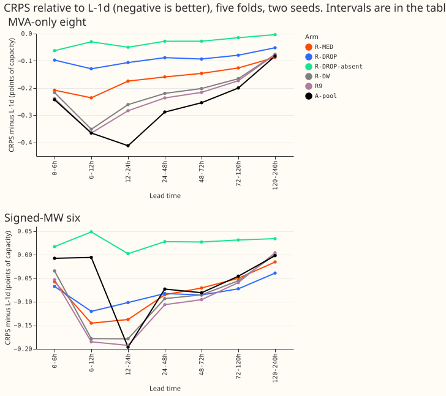
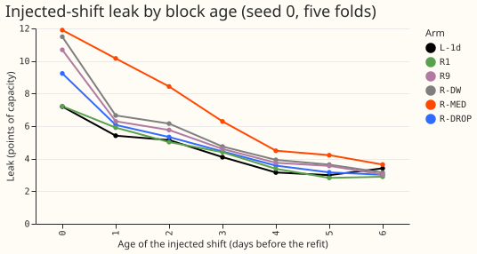
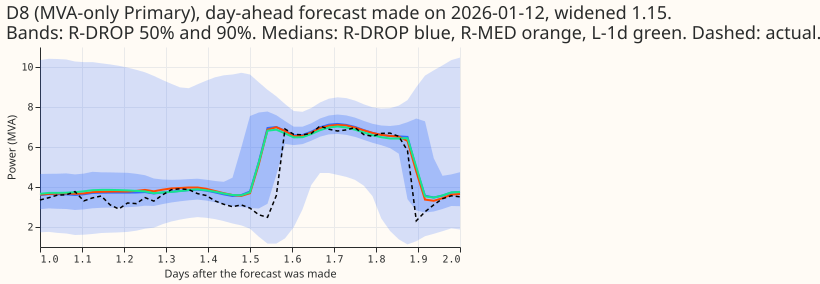
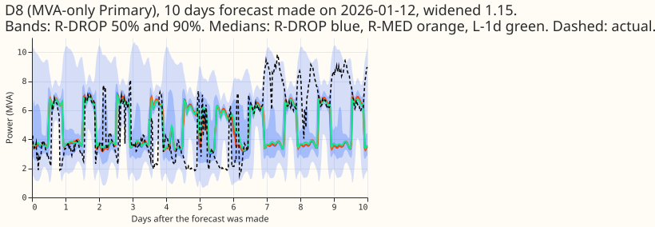

**Averaging the same half-hour over several past days did not make the lag-light demand network
safer, and randomly removing the readings in training cost most of its gain.** The question was
whether two changes to experiment 539's network (the lag-free network plus the day-ago and week-ago
power readings) keep its gain and cut its sensitivity to load-shift events. R-MED replaces the two
readings by medians of the same half-hour over the last 7 and 28 days. R-DROP removes all six reading
inputs in 30% of rows during training. All numbers are interim and unaudited, in points of
capacity; lower CRPS is better.

Verdict: not supported. P1 failed on both parts, P2 failed, and P3 held.

## Figures

## Results

- **Pre-registered predictions.** Judged in the 24-48 h, 48-72 h, and 72-120 h bands at the eight.
  P1 (R-MED within 0.03 of R-DW, leak at most 5.2): failed. R-MED minus R-DW is +0.060, +0.056, and
  +0.040, and the leak is 7.02. P2 (R-DROP with readings present keeps 90% of R-DW's closed gap):
  failed. R-DROP closes 31%, 37%, and 40% of L-1d's gap to A-pool, which is 40%, 47%, and 48% of
  R-DW's closed gap. P3 (R-DROP with readings absent costs at most 0.15 more than L-1d): held. It is
  0.028, 0.028, and 0.015 below L-1d.
- **Absolute CRPS at the eight, 24-48 h / 48-72 h / 72-120 h.** A-pool 4.197 / 4.311 / 4.538; R9 4.249
  / 4.349 / 4.565; R-DW 4.266 / 4.363 / 4.572; R-MED 4.326 / 4.419 / 4.612; R-DROP 4.397 / 4.471 /
  4.659; R-DROP absent 4.457 / 4.537 / 4.723; L-1d 4.485 / 4.565 / 4.738; `manual_heuristic` 5.543 /
  5.406 / 5.568. The full table, every band, and the six are in the stored `scores/absolute.csv`.
- **Counted contrasts at the eight (95% month-block bootstrap, 5 blocks, near min-to-max;
  Bonferroni count 42 = 3 contrasts x 7 bands x 2 sets; minimum detectable effect 0.13, 0.14, 0.10).**
  R-MED minus R-DW: +0.060 (+0.041 to +0.093; 5 of 5 folds worse), +0.056 (+0.016 to +0.104), +0.040
  (+0.009 to +0.074). R-DROP minus R-DW: +0.131 (+0.046 to +0.277; 5 of 5 folds worse), +0.109
  (+0.043 to +0.240), +0.086 (+0.024 to +0.244). R-DROP absent minus L-1d: -0.028 (-0.087 to +0.024),
  -0.028 (-0.079 to +0.031), -0.015 (-0.066 to +0.019). The R-MED contrasts are smaller than the
  minimum detectable effect, so their sign is consistent across folds but their size is not firmly
  established.
- **At the six** the contrasts are inside the minimum detectable effect: R-MED minus R-DW +0.008,
  +0.015, +0.005; R-DROP minus R-DW +0.011, 0.000, -0.017 (all intervals include zero). R-DROP
  absent minus L-1d is +0.028 (+0.006 to +0.054), +0.027, +0.031 (+0.004 to +0.061).
- **Injected-shift leak (experiment 511's stress world, seed 0, five folds, all leads).** L-1d 4.49,
  R1 4.52, R-DROP 4.97, R9 5.38, R-DW 5.68, R-MED 7.02. At block age 0 the leak is 7.20 (L-1d), 9.23
  (R-DROP), 11.49 (R-DW), and 11.90 (R-MED). The leak of R-MED is above R-DW's at every block
  age from 0 to 6.
  A likely reason, not tested here, is that the 7-day median has most of its members inside the
  7-day shifted block, so the whole shift enters the input for several days.
- **Checks.** Every power value and every median member is at least 3.5 h older than the origin,
  asserted for all rows (24,979,347 training rows and 1,142,520 test rows); 2,000 random rows per
  month recomputed with an explicit loop matched the medians. Every weather input comes from the run
  issued at or before the origin (`nwp_init_time <= power_fcst_init_time` asserted for all 153 test
  origins and every training origin). Example test row: origin 2026-01-01 09:00 UTC, target
  2026-01-01 15:00 UTC, weather run 2026-01-01 00:00 UTC, day-ago reading observed 2025-12-31
  15:00 UTC. Cost under 1 GPU-h, one process under 8 GB.
- **Reviews.** One Sonnet code review before the first fit found a crash in the checks writer, a
  cache key that could be reused across months, and a missing empty-window marker for the absent
  scoring; all three were fixed. No results review and no write-up review were run, because the quota
  is tight, so the numbers are unaudited.

## Caveats

- Two seeds and five folds; the leak is one seed. R-DROP and R-MED differ from R-DW only in the
  six inputs, so the fit-to-fit noise of 539 applies.
- R-DROP's dropout is drawn once per refit, not once per epoch, and covers the early-stopping rows.
  "Flag 0" in the brief was read as "present flag 0", which is the missing flag set to 1.
- The 4-week median is the 28 most recent days at the same half-hour, and the 7-day median the 7
  most recent, with at least 10 and 3 members observed; other choices were not tried.
- Experiments 538 and 539 are unmerged, so R-DW and R9 numbers come from their private tables.
- NGED load-shift events may be missing from its logs, so rows with no labelled event may hold
  unlabelled events, and the leak is measured on injected shifts only.

## What to try next

- Guard the day-ago and week-ago readings with a shift detector's probability (nullify the lag when
  the probability is high), then measure the leak and CRPS together.
- Accept experiment 539's leak of 5.68 if it stays under the 6-point limit, since neither variant
  improved both numbers.
